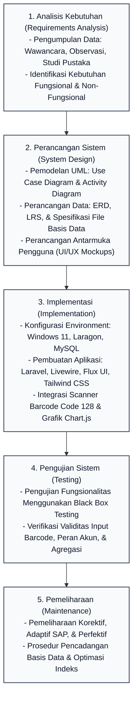
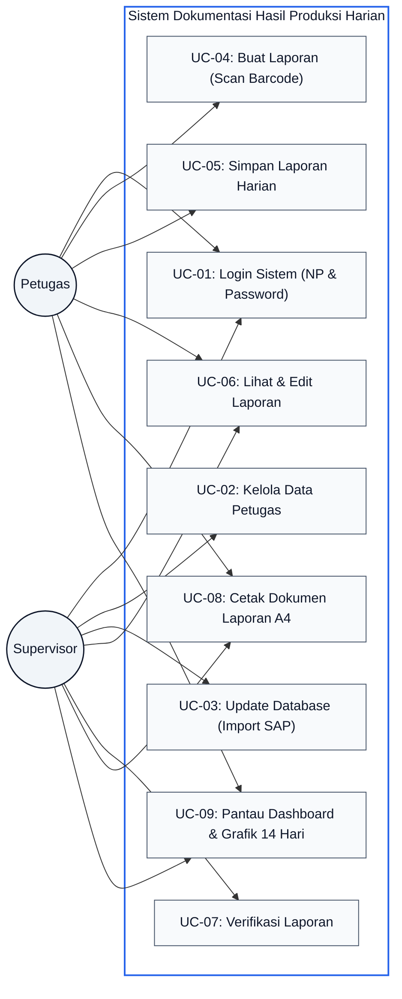
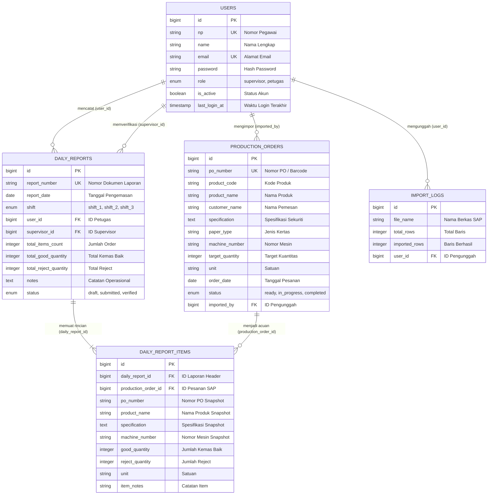

# BAB III
# PENGEMBANGAN PERANGKAT LUNAK

Bab ini menguraikan secara komprehensif metodologi, alur kerja, serta tahapan rekayasa perangkat lunak yang diterapkan dalam membangun Sistem Dokumentasi Hasil Produksi Harian Berbasis Web dengan Scan Barcode dan Grafik Performa 14 Hari Kerja. Objek penelitian ini berpusat pada Unit Pengemasan di PT Percetakan Dokumen Sekuriti, Karawang, yang bertanggung jawab atas proses akhir verifikasi kuantitas, pengemasan dokumen berpengaman tinggi, dan pelaporan hasil kerja harian kepada Kepala Unit / Supervisor. Seluruh tahapan pengembangan disusun secara terstruktur untuk menjawab permasalahan inefisiensi pencatatan manual, mengurangi potensi kesalahan manusia (*human error*), serta menghadirkan sistem pemantauan produktivitas harian yang transparan dan terukur.

---

## 3.1. Metode Pengembangan Perangkat Lunak

### 3.1.1 Nama dan Konsep Dasar Metode Pengembangan
Model pengembangan perangkat lunak yang diterapkan dalam penelitian ini adalah **Metode Waterfall** (*Classic Life Cycle*). Metode Waterfall merupakan pendekatan rekayasa perangkat lunak yang bersifat sekuensial dan sistematis, di mana kemajuan proses pengembangan diposisikan mengalir secara linier ke arah bawah melalui tahapan-tahapan yang terdefinisi secara baku. Dalam model ini, suatu fase pengembangan harus diselesaikan secara tuntas dan menghasilkan dokumen spesifikasi serta hasil kerja yang valid sebelum fase berikutnya dapat dimulai.

Prinsip dasar metode Waterfall menekankan pentingnya investigasi kebutuhan yang mendalam dan perancangan arsitektur yang matang sebelum tahap pembuatan aplikasi (coding) dilaksanakan. Pendekatan ini membantu menjaga kualitas aplikasi, memperjelas batasan ruang lingkup pekerjaan, serta memudahkan pemantauan kemajuan pengembangan sistem.

### 3.1.2 Alasan Pemilihan Metode Waterfall
Pemilihan metode Waterfall dalam pengembangan sistem dokumentasi hasil produksi harian ini didasarkan pada karakteristik operasional pabrik dan spesifikasi teknis sistem yang dikembangkan. Beberapa pertimbangan mendasar yang melandasi pemilihan metode ini antara lain:

Pertama, karakteristik kebutuhan fungsional sistem telah teridentifikasi secara jelas dan terperinci sejak tahap awal observasi lapangan di Unit Pengemasan PT Percetakan Dokumen Sekuriti. Format data pesanan dari sistem SAP, struktur Nomor PO yang tertuang dalam bentuk barcode tipe Code 128 pada Kartu Mesin Produksi, serta kebutuhan formulir pelaporan hasil kemas memiliki format dan aturan bisnis yang sudah baku. Kondisi kebutuhan yang pasti ini sangat selaras dengan sifat metode Waterfall yang tidak membutuhkan perubahan arsitektur secara berulang-ulang di tengah proses konstruksi.

Kedua, prosedur operasional standar (SOP) di area kerja pengemasan memiliki alur kerja yang stabil dan terikat pada hierarki pertanggungjawaban produksi. Hubungan kerja antara Petugas Pengemasan sebagai pelaksana pencatatan dan Kepala Unit / Supervisor sebagai pemeriksa dan penanggung jawab laporan harian menuntut kejelasan peran serta keabsahan data yang valid dan akurat. Dengan metode Waterfall, pembagian hak akses pengguna dan alur verifikasi laporan dapat dirancang dengan jelas sejak awal.

Ketiga, keterbatasan waktu pengerjaan dan sumber daya penelitian memerlukan manajemen proyek yang teratur dengan batas pencapaian (*milestones*) yang terukur. Dengan membagi pengembangan ke dalam tahapan sekuensial yang berurutan, evaluasi terhadap keberhasilan setiap fase, mulai dari analisis alur data, pemodelan basis data, hingga pengujian scanner, dapat dilakukan secara terstruktur tanpa menimbulkan tumpang tindih aktivitas.

Keempat, skala sistem yang terfokus pada digitalisasi pencatatan dokumen kemas dan pemantauan analitik 14 hari kerja memungkinkan seluruh spesifikasi dirancang secara komprehensif di awal. Pendekatan terstruktur ini meminimalkan risiko terjadinya pembengkakan ruang lingkup (*scope creep*) dan memastikan konsentrasi rekayasa tertuju pada stabilitas pembacaan scanner dan keakuratan kalkulasi data grafik.

### 3.1.3 Deskripsi Singkat Tahapan Metode Waterfall
Secara umum, metode Waterfall yang diterapkan dalam penelitian ini terdiri atas lima tahapan utama yang dilaksanakan secara berurutan:

1. **Analisis Kebutuhan (*Requirement Analysis*)**
   <br>
   Tahap pengumpulan data komprehensif melalui wawancara, observasi langsung di area kerja pengemasan, serta studi pustaka. Tahap ini menghasilkan dokumen spesifikasi kebutuhan sistem pengguna yang mencakup kebutuhan fungsional dan non-fungsional sebagai acuan utama perancangan.

2. **Perancangan Sistem (*System Design*)**
   <br>
   Tahap perancangan arsitektur perangkat lunak yang menerjemahkan kebutuhan sistem ke dalam representasi logis dan fisik. Aktivitas ini mencakup pemodelan use case diagram beserta skenario lengkapnya, activity diagram, perancangan Entity Relationship Diagram (ERD), transformasi Logical Record Structure (LRS), spesifikasi tabel basis data, dan perancangan antarmuka pengguna.

3. **Implementasi (*Implementation*)**
   <br>
   Tahap penerjemahan seluruh dokumen perancangan ke dalam pembuatan aplikasi fungsional. Pada tahap ini, basis data dikonfigurasikan, logika backend dibangun menggunakan Laravel dengan arsitektur MVC, antarmuka reaktif diwujudkan melalui Livewire dan Flux UI, integrasi pembacaan barcode Code 128 dikonfigurasikan, dan modul kalkulasi analitik grafik 14 hari kerja diaktifkan.

4. **Pengujian Sistem (*Testing*)**
   <br>
   Tahap verifikasi dan validasi aplikasi untuk memastikan setiap fungsi bekerja sesuai dengan rancangan spesifikasi kebutuhan. Pengujian dilakukan menggunakan metode *Black Box Testing* yang menguji keakuratan masukan dan keluaran sistem pada skenario operasional nyata.

5. **Pemeliharaan (*Maintenance*)**
   <br>
   Tahap pemeliharaan sistem setelah aplikasi diterapkan di lingkungan kerja. Kegiatan ini mencakup pencadangan basis data berkala, penanganan kendala teknis yang timbul, pembaruan keamanan, serta penyesuaian logika sistem terhadap perubahan format data ekspor SAP.

### 3.1.4 Kesesuaian Metode dengan Penelitian
Penerapan metode Waterfall memberikan kepastian alur kerja yang mendukung tujuan penelitian. Dengan menetapkan analisis dan desain arsitektur secara matang sebelum pembuatan aplikasi dimulai, pengembang dapat mengantisipasi kendala integrasi antara data hasil scanner dan basis data master SAP. Setiap fungsi yang dikembangkan, mulai dari pembacaan barcode cepat hingga penyajian grafik performa 14 hari kerja, memiliki acuan pengujian yang jelas, sehingga aplikasi yang dihasilkan dapat berfungsi dengan stabil, akurat, dan mudah digunakan oleh petugas di Unit Pengemasan.

### 3.1.5 Ilustrasi Alur Metode Waterfall
Alur tahapan pengembangan perangkat lunak menggunakan model Waterfall diilustrasikan secara runtut pada Gambar 3.1 berikut:


*Gambar 3.1: Alur Tahapan Metode Waterfall pada Pengembangan Sistem Dokumentasi Produksi Harian*

---

## 3.2 Tahap Pengembangan Perangkat Lunak

### A. Tahapan Perencanaan Kebutuhan

Tahap perencanaan kebutuhan merupakan langkah fondasional dalam siklus rekayasa perangkat lunak. Pada tahap ini, pengembang melakukan investigasi menyeluruh mengenai mekanisme operasional yang sedang berjalan pada Unit Pengemasan PT Percetakan Dokumen Sekuriti untuk mengidentifikasi akar permasalahan, memetakan kendala operasional, dan merumuskan batasan solusi teknologi yang tepat sasaran.

#### 1. Tahap Pengumpulan Data
Untuk memperoleh data yang akurat, komprehensif, dan relevan dengan kebutuhan sistem, proses pengumpulan data dilakukan melalui tiga tahapan utama:

##### a. Wawancara
Wawancara mendalam (*in-depth interview*) dilakukan secara langsung dengan para pemangku kepentingan (*stakeholders*) di lingkungan Unit Pengemasan PT Percetakan Dokumen Sekuriti, antara lain:
1. **Kepala Unit / Supervisor Pengemasan (Bpk. Agus Soelistyo)**
   <br>
   Wawancara difokuskan pada prosedur operasional standar (SOP) pemeriksaan hasil produksi, mekanisme verifikasi laporan harian, kendala lambatnya penerimaan rekapitulasi kerja dari giliran kerja (*shift*) sebelumnya, serta kebutuhan terhadap instrumen pemantauan visual berupa grafik performa 14 hari kerja terakhir untuk mengevaluasi stabilitas produktivitas dan fluktuasi angka *reject*.
2. **Petugas Operator Pengemasan (Bpk. Umar Ibnu Zainal M. dan Operator Shift)**
   <br>
   Wawancara difokuskan pada alur teknis pencatatan fisik yang selama ini dilakukan di meja kerja pengemasan, kendala penyalinan manual dari Kartu Mesin Produksi ke lembar kertas folio, durasi waktu yang dihabiskan untuk mencatat data satu kartu mesin (mencapai 2 hingga 3 menit per pesanan), serta kesulitan dalam menelusuri riwayat pesanan yang terselip.

Dari hasil wawancara, disimpulkan bahwa pengguna sangat membutuhkan sistem berbasis web yang dapat mengisi data spesifikasi pesanan secara otomatis hanya dengan memindai barcode Nomor PO, sehingga petugas dapat berfokus pada aktivitas fisik pengemasan tanpa terbebani administrasi tulis tangan.

##### b. Observasi
Observasi lapangan dilakukan dengan mengamati secara langsung alur kerja fisik di ruang Unit Pengemasan PT Percetakan Dokumen Sekuriti di Karawang selama jam kerja aktif (meliputi Shift 1 Pagi, Shift 2 Siang, dan Shift 3 Malam).

Fokus pengamatan meliputi:
1. **Pemeriksaan Fisik Kartu Mesin Produksi:** Mengamati struktur atribut data yang tertera pada lembaran kartu mesin, termasuk keberadaan kode barcode linier tipe **Code 128** yang merepresentasikan Nomor PO (*Production Order*), nomor mesin cetak asal, jenis bahan kertas berpengaman, dan target kuantitas.
2. **Peralatan Kerja Tersedia:** Memeriksa ketersediaan fasilitas komputer PC dan perangkat *barcode scanner* genggam berbasis USB yang berada di meja kontrol pengemasan, yang selama ini belum terintegrasi ke dalam sistem pencatatan terpusat.
3. **Penanganan Dokumen Fisik:** Mengamati bagaimana lembaran formulir laporan harian ditumpuk, disalin ulang pada akhir shift, ditandatangani secara manual, dan disimpan dalam ordner arsip fisik yang rentan mengalami kerusakan fisik atau kehilangan data historis.

##### c. Studi Pustaka
Studi pustaka dilakukan dengan mengkaji berbagai referensi ilmiah, jurnal rekayasa perangkat lunak, buku teks, dan dokumentasi teknis yang relevan dengan topik penelitian.

Kajian pustaka mencakup:
1. Teori rekayasa perangkat lunak model Waterfall dan pemodelan visual menggunakan Unified Modeling Language (UML) dari literatur standar akademik.
2. Prinsip kerja simbologi barcode linier **Code 128** serta teknik penangkapan data masukan scanner melalui antarmuka *Human Interface Device* (HID) pada aplikasi web.
3. Arsitektur pengembangan web modern menggunakan kerangka kerja Laravel, Livewire untuk reaktivitas antarmuka, dan integrasi pustaka Chart.js untuk perenderan grafik analitik deret waktu (*time-series*).
4. Dokumentasi teknis mengenai standar keamanan dokumen sekuriti dan regulasi pengelolaan produksi dokumen sekuriti negara.

---

#### 2. Analisa Kebutuhan Sistem Pengguna
Berdasarkan hasil pengumpulan data, dilakukan analisis kebutuhan sistem pengguna yang dikelompokkan ke dalam kebutuhan fungsional dan kebutuhan non-fungsional:

##### a. Kebutuhan Fungsional (*Functional Requirements*)
Kebutuhan fungsional mendefinisikan kapabilitas dan layanan operasional yang wajib disediakan oleh sistem aplikasi:

1. **Modul Autentikasi Pengguna (Login Sistem)**
   <br>
   Sistem menyediakan form login yang memvalidasi identitas pengguna menggunakan Nomor Pegawai (NP) dan password terenkripsi. Sistem membedakan hak akses secara ketat berdasarkan dua peran pengguna, yaitu **Petugas** (operator pengemasan yang berwenang melakukan scan barcode, mencatat hasil kemas, dan mencetak laporan) serta **Supervisor** (Kepala Unit yang memiliki wewenang tambahan mengelola master akun petugas, mengimpor master data SAP, memverifikasi laporan, dan menganalisis grafik performa). Sistem juga menyediakan fungsi *logout* yang aman.

2. **Modul Manajemen Data Petugas**
   <br>
   Sistem menyediakan antarmuka bagi Supervisor untuk mengelola data akun operator pengemasan, meliputi penambahan data petugas baru, peninjauan daftar petugas, pembaruan data akun, pengubahan status aktif/nonaktif, dan pengaturan ulang (*reset*) kata sandi akun berdasarkan Nomor Pegawai (NP).

3. **Modul Update Database (Master Data SAP)**
   <br>
   Sistem menyediakan fasilitas pengunggahan berkas master pesanan produksi dari sistem ERP SAP dalam format spreadsheet (`.xlsx` atau `.csv`). Sistem mengekstrak kolom Nomor PO, Kode Produk, Nama Barang, Spesifikasi Sekuriti, Nomor Mesin Asal, dan Target Kuantitas Siap Kemas, kemudian menyimpannya ke dalam tabel master sistem secara massal (*bulk upsert*).

4. **Modul Buat Laporan (Scan Barcode & Entri Kemas)**
   <br>
   Sistem menyediakan halaman kerja utama bagi Petugas yang mengarahkan fokus kursor secara otomatis ke kolom pembacaan barcode. Saat petugas memindai kode barcode Code 128 pada Kartu Mesin Produksi, sistem secara instan mencari rekaman Nomor PO pada basis data master dan menampilkan spesifikasi produk secara otomatis. Petugas selanjutnya memasukkan jumlah hasil kemas baik dan kuantitas reject, lalu menambahkan data ke tabel penampungan sementara (*staging table*) sebelum difinalisasi menjadi dokumen laporan dengan Nomor Laporan unik otomatis (`LAP-YYYYMMDD-XXXX`).

5. **Modul Manajemen dan Cetak Laporan (Lihat Laporan)**
   <br>
   Sistem menyediakan tabel riwayat laporan hasil produksi harian yang dilengkapi fitur pencarian, penyaringan tanggal/status, peninjauan rincian item kemas, pengeditan korektif oleh Petugas (selama status draf), verifikasi persetujuan oleh Supervisor, serta pencetakan dokumen fisik rapi standar ukuran kertas A4 lengkap dengan kolom pengesahan tanda tangan.

6. **Modul Dashboard dan Grafik Performa 14 Hari Kerja**
   <br>
   Sistem menyajikan halaman beranda terpadu yang menampilkan kartu ringkasan metrik kinerja operasional harian (Total Kemas Baik, Total Reject, Total PO Terscan, dan Status Laporan), serta merender visualisasi **Grafik Analitik Hasil Produksi 14 Hari Kerja Terakhir** yang membandingkan volume kemas baik terhadap kuantitas reject secara interaktif.

##### b. Kebutuhan Non-Fungsional (*Non-Functional Requirements*)
Kebutuhan non-fungsional menetapkan batasan kualitas teknis dan performa sistem:

1. **Performa dan Kecepatan Respon**
   <br>
   Sistem dirancang untuk memberikan respon pencarian data produk pada saat barcode Nomor PO dipindai dalam waktu kurang dari 1 detik. Proses kalkulasi data dan penampilan grafik analitik 14 hari kerja pada dashboard diselesaikan dalam waktu di bawah 2 detik pada jaringan lokal.

2. **Keandalan dan Integritas Transaksi Data**
   <br>
   Sistem menerapkan validasi pencegahan duplikasi entri barcode Nomor PO dalam satu sesi laporan harian. Seluruh proses penyimpanan transaksi laporan multi-item dibungkus dalam mekanisme transaksi basis data (*database transaction*) untuk menjamin konsistensi data.

3. **Kompatibilitas Perangkat Keras dan Perangkat Lunak**
   <br>
   Sistem kompatibel secara langsung (*Plug-and-Play*) dengan perangkat *barcode scanner* USB yang membaca format Code 128, dapat diakses melalui peramban web modern (*Google Chrome, Mozilla Firefox, Microsoft Edge*), dan format cetak disesuaikan untuk kertas standar A4.

4. **Kemudahan Penggunaan (*Usability*)**
   <br>
   Tata letak antarmuka dirancang bersih, intuitif, dan kontras tinggi, mempermudah pengoperasian di meja kerja pengemasan, serta dilengkapi notifikasi umpan balik atas setiap aksi pengguna.

5. **Keamanan Sistem dan Data**
   <br>
   Seluruh kata sandi pengguna dienkripsi dengan algoritma *Bcrypt*. Sistem dilengkapi proteksi terhadap serangan web umum (CSRF, SQL Injection, XSS) serta otorisasi berbasis peran pengguna (*role-based access control*).

---

### B. Tahap Analisis Pemodelan

Tahap analisis pemodelan bertujuan untuk memvisualisasikan struktur fungsional, aliran aktivitas proses, skema basis data terelasi, representasi record logis, serta spesifikasi detail berkas tabel data sebelum pembuatan aplikasi dilaksanakan.

#### 1. Use Case Diagram
Use Case Diagram mendeskripsikan interaksi fungsional antara aktor (pengguna sistem) dengan kapabilitas yang disediakan oleh sistem. Sistem ini melibatkan dua aktor utama, yaitu **Petugas (Operator Pengemasan)** dan **Supervisor (Kepala Unit / Admin)**.

Hubungan fungsional antara kedua aktor dengan modul-modul sistem dimodelkan pada Gambar 3.2:


*Gambar 3.2: Use Case Diagram Sistem Dokumentasi Hasil Produksi Harian*

Rincian peran aktor didefinisikan pada Tabel 3.1:

*Tabel 3.1: Definisi Peran Aktor Sistem*
| No | Aktor | Deskripsi Peran dan Hak Akses |
|---|---|---|
| 1 | **Petugas** | Operator pada Unit Pengemasan yang bertugas login ke sistem menggunakan Nomor Pegawai (NP), memindai barcode Nomor PO pada Kartu Mesin Produksi, menginputkan kuantitas hasil kemas harian, menyimpan draf dan finalisasi laporan, mencetak lembar laporan fisik, serta memantau ringkasan performa pada dashboard. |
| 2 | **Supervisor** | Kepala Unit yang bertugas mengelola akun pengguna petugas, mengunggah data master pesanan produksi dari berkas ekspor SAP, meninjau dan memverifikasi laporan produksi harian, mencetak laporan terverifikasi, serta menganalisis visualisasi tren performa pada grafik 14 hari kerja. |

Ringkasan fungsional dari sembilan *use case* yang teridentifikasi disajikan pada Tabel 3.2:

*Tabel 3.2: Definisi Fungsional Use Case Sistem*
| No | Kode Use Case | Nama Use Case | Aktor Terlibat | Deskripsi Fungsional |
|---|---|---|---|---|
| 1 | UC-01 | Login Sistem | Petugas, Supervisor | Memvalidasi identitas pengguna melalui pencocokan Nomor Pegawai (NP) dan password terenkripsi sebelum memberikan akses ke halaman utama. |
| 2 | UC-02 | Kelola Data Petugas | Supervisor | Mengelola data akun pengguna sistem, mencakup penambahan akun baru, penonaktifan akun, pembaruan data, dan reset password berdasarkan Nomor Pegawai (NP). |
| 3 | UC-03 | Update Database (Import SAP) | Supervisor | Mengunggah dan memvalidasi berkas master data pesanan produksi dari SAP ke dalam tabel master sistem. |
| 4 | UC-04 | Buat Laporan (Scan Barcode) | Petugas | Menerima data hasil scanner barcode Code 128 dan mengambil spesifikasi produk secara otomatis dari basis data. |
| 5 | UC-05 | Simpan Laporan Harian | Petugas | Membentuk Nomor Laporan unik otomatis (`LAP-YYYYMMDD-XXXX`) dan menyimpan seluruh rincian transaksi hasil kemas ke basis data. |
| 6 | UC-06 | Lihat & Edit Laporan | Petugas, Supervisor | Menampilkan daftar riwayat laporan harian, menampilkan detail item barang, dan mengakomodasi koreksi data sebelum verifikasi. |
| 7 | UC-07 | Verifikasi Laporan | Supervisor | Memberikan status persetujuan resmi (*verified*) terhadap laporan produksi harian yang telah ditinjau keabsahannya. |
| 8 | UC-08 | Cetak Dokumen Laporan | Petugas, Supervisor | Menerbitkan keluaran cetak lembaran laporan fisik standar ukuran kertas A4 lengkap dengan kolom pengesahan tanda tangan. |
| 9 | UC-09 | Pantau Dashboard & Grafik 14 Hari | Petugas, Supervisor | Menyajikan kartu metrik ringkasan harian dan visualisasi grafik batang/garis performa produksi selama 14 hari kerja terakhir. |

Guna memperjelas mekanisme operasional setiap *use case*, berikut disajikan tabel spesifikasi skenario detail untuk seluruh *use case* sistem (Tabel 3.3 s.d. Tabel 3.11):

*Tabel 3.3: Skenario Use Case 1 - Login Sistem (UC-01)*
| Komponen Skenario | Deskripsi |
|---|---|
| **Nomor Use Case** | UC-01 |
| **Nama Use Case** | Login Sistem |
| **Aktor** | Petugas, Supervisor |
| **Deskripsi** | Proses autentikasi pengguna ke dalam sistem menggunakan kombinasi Nomor Pegawai (NP) dan password. |
| **Kondisi Awal (*Pre-condition*)** | Pengguna berada pada halaman form login dan belum terautentikasi. |
| **Kondisi Akhir (*Post-condition*)** | Pengguna berhasil masuk ke sistem dan diarahkan ke halaman Dashboard sesuai perannya. |
| **Alur Utama (*Normal Flow*)** | 1. Pengguna membuka peramban web dan mengakses alamat sistem.<br>2. Sistem menampilkan antarmuka form login.<br>3. Pengguna menginputkan Nomor Pegawai (NP) dan kata sandi.<br>4. Pengguna menekan tombol "Masuk Sistem".<br>5. Sistem memvalidasi kredensial ke tabel `users`.<br>6. Kredensial valid, sistem menginisialisasi sesi dan mengarahkan ke Dashboard. |
| **Alur Alternatif (*Alternative Flow*)** | 5a. Jika NP atau password salah, sistem menampilkan notifikasi kesalahan dan tetap pada halaman login.<br>5b. Jika akun berstatus nonaktif, sistem menampilkan pesan bahwa akun tidak diizinkan masuk. |

*Tabel 3.4: Skenario Use Case 2 - Kelola Data Petugas (UC-02)*
| Komponen Skenario | Deskripsi |
|---|---|
| **Nomor Use Case** | UC-02 |
| **Nama Use Case** | Kelola Data Petugas |
| **Aktor** | Supervisor |
| **Deskripsi** | Menambah, melihat, mengubah data profil, status aktif/nonaktif, dan mereset password akun petugas. |
| **Kondisi Awal (*Pre-condition*)** | Supervisor telah login dan mengakses menu Data Petugas. |
| **Kondisi Akhir (*Post-condition*)** | Data akun petugas berhasil tersimpan, terbarui, atau dinonaktifkan pada basis data. |
| **Alur Utama (*Normal Flow*)** | 1. Supervisor memilih menu "Data Petugas".<br>2. Sistem menampilkan daftar tabel akun petugas.<br>3. Supervisor menekan tombol "Tambah Petugas" atau "Edit".<br>4. Sistem menampilkan modal dialog form isian petugas.<br>5. Supervisor menginputkan NP, Nama, Email, Peran, dan Password.<br>6. Supervisor menekan tombol "Simpan Data".<br>7. Sistem memvalidasi data dan menyimpan perubahan ke tabel `users`.<br>8. Sistem memperbarui daftar tabel petugas dan menampilkan notifikasi sukses. |
| **Alur Alternatif (*Alternative Flow*)** | 7a. Jika Nomor Pegawai (NP) atau email sudah terdaftar sebelumnya, sistem menampilkan pesan kesalahan duplikasi data dan meminta input ulang. |

*Tabel 3.5: Skenario Use Case 3 - Update Database / Import Master SAP (UC-03)*
| Komponen Skenario | Deskripsi |
|---|---|
| **Nomor Use Case** | UC-03 |
| **Nama Use Case** | Update Database (Import SAP) |
| **Aktor** | Supervisor |
| **Deskripsi** | Mengunggah dan mengekstrak berkas spreadsheet master pesanan produksi dari sistem SAP ke basis data aplikasi. |
| **Kondisi Awal (*Pre-condition*)** | Supervisor telah login dan memiliki berkas ekspor SAP (`.xlsx`/`.csv`). |
| **Kondisi Akhir (*Post-condition*)** | Data pesanan produksi tersimpan pada tabel `production_orders` dan riwayat tercatat di `import_logs`. |
| **Alur Utama (*Normal Flow*)** | 1. Supervisor memilih menu "Update Database".<br>2. Sistem menampilkan halaman unggah berkas dan riwayat impor.<br>3. Supervisor memilih berkas ekspor SAP dari komputer lokal.<br>4. Supervisor menekan tombol "Proses & Impor ke Master Data".<br>5. Sistem memvalidasi format berkas dan memetakan struktur kolom.<br>6. Sistem melakukan *bulk upsert* data pesanan ke tabel `production_orders`.<br>7. Sistem mencatat log impor ke tabel `import_logs` dan menampilkan jumlah baris data yang berhasil diproses. |
| **Alur Alternatif (*Alternative Flow*)** | 5a. Jika format berkas tidak sesuai atau kolom wajib tidak ditemukan, sistem membatalkan proses dan menampilkan pesan galat validasi struktur berkas. |

*Tabel 3.6: Skenario Use Case 4 - Buat Laporan / Scan Barcode (UC-04)*
| Komponen Skenario | Deskripsi |
|---|---|
| **Nomor Use Case** | UC-04 |
| **Nama Use Case** | Buat Laporan (Scan Barcode & Entri Kemas) |
| **Aktor** | Petugas |
| **Deskripsi** | Memindai barcode Nomor PO pada Kartu Mesin Produksi, memuat spesifikasi produk, dan menginputkan hasil kemas. |
| **Kondisi Awal (*Pre-condition*)** | Petugas telah login dan berada pada halaman Buat Laporan. |
| **Kondisi Akhir (*Post-condition*)** | Rincian data kemas tertampung pada tabel penampungan sementara (*staging table*). |
| **Alur Utama (*Normal Flow*)** | 1. Petugas memilih shift kerja operasional.<br>2. Petugas mengarahkan scanner ke barcode Code 128 pada Kartu Mesin Produksi.<br>3. Scanner membaca data Nomor PO dan mengirimkannya ke sistem.<br>4. Sistem mencari rekaman Nomor PO pada tabel `production_orders`.<br>5. Sistem menampilkan Nama Produk, Spesifikasi Bahan, Nomor Mesin, dan Target Kuantitas.<br>6. Petugas menginputkan kuantitas kemas baik dan kuantitas reject.<br>7. Petugas menekan tombol "Tambah ke Daftar Laporan".<br>8. Sistem memvalidasi input dan memasukkan item ke daftar draf laporan sementara. |
| **Alur Alternatif (*Alternative Flow*)** | 4a. Jika Nomor PO tidak ditemukan di master SAP, sistem membunyikan peringatan dan memunculkan notifikasi bahwa Nomor PO belum diimpor. |

*Tabel 3.7: Skenario Use Case 5 - Simpan Laporan Harian (UC-05)*
| Komponen Skenario | Deskripsi |
|---|---|
| **Nomor Use Case** | UC-05 |
| **Nama Use Case** | Simpan Laporan Harian |
| **Aktor** | Petugas |
| **Deskripsi** | Memfinalisasi seluruh item hasil kemas yang tertampung pada draf laporan menjadi satu rekaman dokumen resmi. |
| **Kondisi Awal (*Pre-condition*)** | Terdapat minimal satu item kemas pada tabel penampungan sementara. |
| **Kondisi Akhir (*Post-condition*)** | Laporan tersimpan permanen di tabel `daily_reports` dan `daily_report_items`. |
| **Alur Utama (*Normal Flow*)** | 1. Petugas memeriksa rekapitulasi total item, total baik, dan total reject.<br>2. Petugas menekan tombol "Finalisasi & Simpan Laporan".<br>3. Sistem membangkitkan Nomor Laporan unik otomatis format `LAP-YYYYMMDD-XXXX`.<br>4. Sistem menjalankan transaksi basis data untuk menyimpan data header dan relasi rincian item.<br>5. Sistem mengosongkan tabel sementara dan menampilkan notifikasi sukses disertai opsi cetak. |
| **Alur Alternatif (*Alternative Flow*)** | 4a. Jika terjadi kegagalan jaringan atau basis data, sistem melakukan *rollback* transaksi dan menampilkan pesan kegagalan penyimpanan. |

*Tabel 3.8: Skenario Use Case 6 - Lihat dan Edit Laporan (UC-06)*
| Komponen Skenario | Deskripsi |
|---|---|
| **Nomor Use Case** | UC-06 |
| **Nama Use Case** | Lihat dan Edit Laporan |
| **Aktor** | Petugas, Supervisor |
| **Deskripsi** | Menampilkan daftar riwayat laporan harian, meninjau rincian item, dan melakukan koreksi data (khusus status draf). |
| **Kondisi Awal (*Pre-condition*)** | Pengguna mengakses menu Lihat Laporan. |
| **Kondisi Akhir (*Post-condition*)** | Pengguna melihat daftar laporan atau perubahan kuantitas berhasil diperbarui di basis data. |
| **Alur Utama (*Normal Flow*)** | 1. Pengguna membuka menu "Lihat Laporan".<br>2. Sistem menampilkan tabel daftar laporan lengkap dengan filter tanggal dan status.<br>3. Pengguna menekan tombol "Lihat" pada salah satu nomor laporan.<br>4. Sistem menampilkan rincian detail seluruh item pesanan.<br>5. (Opsi Petugas) Petugas mengoreksi angka kemas pada laporan berstatus draf dan menekan "Update Data".<br>6. Sistem memperbarui rekaman data dan memuat ulang rincian laporan. |
| **Alur Alternatif (*Alternative Flow*)** | 5a. Jika laporan telah berstatus *verified*, sistem mengunci formulir sehingga perubahan data tidak dapat dilakukan. |

*Tabel 3.9: Skenario Use Case 7 - Verifikasi Laporan (UC-07)*
| Komponen Skenario | Deskripsi |
|---|---|
| **Nomor Use Case** | UC-07 |
| **Nama Use Case** | Verifikasi Laporan |
| **Aktor** | Supervisor |
| **Deskripsi** | Memvalidasi kebenaran fisik data hasil kemas dan memberikan status pengesahan resmi (*verified*). |
| **Kondisi Awal (*Pre-condition*)** | Supervisor membuka rincian laporan harian yang berstatus draf/submitted. |
| **Kondisi Akhir (*Post-condition*)** | Status laporan berubah menjadi *verified* dan identitas supervisor tercatat sebagai pemeriksa. |
| **Alur Utama (*Normal Flow*)** | 1. Supervisor meninjau rincian item kemas pada dokumen laporan terpilih.<br>2. Supervisor memastikan kesesuaian angka kemas baik dan reject dengan kondisi lapangan.<br>3. Supervisor menekan tombol "Verifikasi & Setujui Laporan".<br>4. Sistem memperbarui kolom `status` menjadi `verified` dan mencatat `supervisor_id`.<br>5. Sistem menampilkan notifikasi bahwa laporan telah resmi disahkan. |
| **Alur Alternatif (*Alternative Flow*)** | 3a. Jika terdapat ketidaksesuaian data, Supervisor menambahkan catatan koreksi pada kolom `notes` dan meminta petugas melakukan perbaikan. |

*Tabel 3.10: Skenario Use Case 8 - Cetak Dokumen Laporan (UC-08)*
| Komponen Skenario | Deskripsi |
|---|---|
| **Nomor Use Case** | UC-08 |
| **Nama Use Case** | Cetak Dokumen Laporan |
| **Aktor** | Petugas, Supervisor |
| **Deskripsi** | Menerbitkan dokumen fisik laporan produksi harian berformat standar ukuran kertas A4 untuk pengesahan tanda tangan. |
| **Kondisi Awal (*Pre-condition*)** | Pengguna membuka rincian laporan yang ingin dicetak. |
| **Kondisi Akhir (*Post-condition*)** | Dokumen tercetak rapi pada media kertas A4 melalui perangkat printer. |
| **Alur Utama (*Normal Flow*)** | 1. Pengguna menekan tombol "Cetak Laporan".<br>2. Sistem memicu stylesheet cetak khusus (`@media print`) yang menyembunyikan navigasi web.<br>3. Sistem merender format lembar dokumen resmi standar A4 lengkap dengan kop perusahaan, tabel rincian item, dan kolom tanda tangan Petugas serta Supervisor.<br>4. Pengguna memilih printer dan mencetak dokumen fisik. |
| **Alur Alternatif (*Alternative Flow*)** | 4a. Pengguna dapat memilih opsi simpan sebagai berkas PDF melalui dialog cetak peramban. |

*Tabel 3.11: Skenario Use Case 9 - Pantau Dashboard dan Grafik 14 Hari Kerja (UC-09)*
| Komponen Skenario | Deskripsi |
|---|---|
| **Nomor Use Case** | UC-09 |
| **Nama Use Case** | Pantau Dashboard & Grafik 14 Hari |
| **Aktor** | Petugas, Supervisor |
| **Deskripsi** | Menampilkan kartu metrik kinerja harian dan grafik analitik performa produksi 14 hari kerja terakhir. |
| **Kondisi Awal (*Pre-condition*)** | Pengguna telah login ke sistem. |
| **Kondisi Akhir (*Post-condition*)** | Informasi kartu metrik dan grafik analitik tampil secara interaktif pada antarmuka pengguna. |
| **Alur Utama (*Normal Flow*)** | 1. Pengguna mengakses menu Dashboard (Beranda).<br>2. Sistem melakukan agregasi data produksi hari berjalan untuk menghitung total kemas baik, reject, dan order terscan.<br>3. Sistem mengeksekusi query agregasi deret waktu untuk rentang 14 hari kerja aktif terakhir.<br>4. Sistem menampilkan kartu ringkasan metrik KPI harian.<br>5. Pustaka Chart.js merender visualisasi grafik tren performa perbandingan output baik terhadap reject.<br>6. Pengguna dapat mengarahkan kursor (*hover*) pada grafik untuk melihat rincian capaian tanggal tertentu. |
| **Alur Alternatif (*Alternative Flow*)** | 3a. Jika belum ada data transaksi pada rentang 14 hari, grafik menampilkan visualisasi garis awal nol (*zero-baseline*). |

---

#### 2. Activity Diagram
Activity Diagram memodelkan aliran aktivitas operasional dan logika transisi sistem pada masing-masing fitur utama dengan membagi peran ke dalam partisi jalur aktivitas (*swimlanes*):

##### a. Activity Diagram Login Sistem
Diagram ini menggambarkan alur kerja saat pengguna (Petugas atau Supervisor) melakukan autentikasi ke dalam sistem, dimulai dari pengisian form hingga inisialisasi sesi kerja yang valid:

```mermaid
%%{init: {'theme': 'base', 'themeVariables': { 'primaryColor': '#ffffff', 'primaryBorderColor': '#000000', 'primaryTextColor': '#000000', 'lineColor': '#000000', 'textColor': '#000000', 'clusterBkg': '#ffffff', 'clusterBorder': '#000000', 'edgeLabelBackground':'#ffffff' }}}%%
flowchart TD
    subgraph Pengguna ["Pengguna (Petugas / Supervisor)"]
        P_Start(( ))
        P_Buka(Buka Halaman<br/>Login)
        P_Input(Input Nomor Pegawai<br/>dan Password)
        P_Kirim(Klik Tombol<br/>Masuk Sistem)
        P_Dash(Tampil Halaman<br/>Dashboard)
        P_End((( )))
    end

    subgraph Sistem ["Sistem"]
        S_Form(Tampilkan Form<br/>Login)
        S_Val{Validasi<br/>Kredensial?}
        S_Err(Tampilkan Pesan<br/>Kredensial Salah)
        S_Auth(Inisialisasi Sesi<br/>Pengguna)
    end

    P_Start --> P_Buka
    P_Buka --> S_Form
    S_Form --> P_Input
    P_Input --> P_Kirim
    P_Kirim --> S_Val
    S_Val -- Tidak Valid --> S_Err
    S_Err --> S_Form
    S_Val -- Valid --> S_Auth
    S_Auth --> P_Dash
    P_Dash --> P_End

    style P_Start fill:#000000,stroke:#000000,stroke-width:2px;
    style P_End fill:#ffffff,stroke:#000000,stroke-width:2px;
```


*Gambar 3.3: Activity Diagram Login Sistem*

##### b. Activity Diagram Manajemen Data Petugas
Diagram ini memodelkan aktivitas pengelolaan data akun operator pengemasan oleh Supervisor, mencakup peninjauan daftar petugas, penambahan atau pembaruan profil melalui modal dialog terpusat, validasi keunikan Nomor Pegawai (NP), hingga penyimpanan rekaman data akun:

```mermaid
%%{init: {'theme': 'base', 'themeVariables': { 'primaryColor': '#ffffff', 'primaryBorderColor': '#000000', 'primaryTextColor': '#000000', 'lineColor': '#000000', 'textColor': '#000000', 'clusterBkg': '#ffffff', 'clusterBorder': '#000000', 'edgeLabelBackground':'#ffffff' }}}%%
flowchart TD
    subgraph Supervisor ["Supervisor (Kepala Unit)"]
        SP_Start(( ))
        SP_Buka(Buka Menu<br/>Data Petugas)
        SP_Pilih(Pilih Aksi:<br/>Tambah / Edit / Status)
        SP_Input(Input Data Akun<br/>dan Password)
        SP_Simpan(Klik Tombol<br/>Simpan Data)
        SP_Lihat(Terima Pembaruan<br/>Daftar Petugas)
        SP_End((( )))
    end

    subgraph Sistem ["Sistem"]
        SS_Tampil(Tampilkan Tabel<br/>Daftar Petugas)
        SS_Modal(Tampilkan Modal<br/>Form Petugas)
        SS_Val{Validasi<br/>Data & NP?}
        SS_Err(Tampilkan Notifikasi<br/>Galat Validasi)
        SS_Save(Simpan Rekaman<br/>ke Database)
        SS_Notif(Tutup Modal & Kirim<br/>Notifikasi Sukses)
    end

    SP_Start --> SP_Buka
    SP_Buka --> SS_Tampil
    SS_Tampil --> SP_Pilih
    SP_Pilih --> SS_Modal
    SS_Modal --> SP_Input
    SP_Input --> SP_Simpan
    SP_Simpan --> SS_Val
    SS_Val -- Tidak Valid --> SS_Err
    SS_Err --> SS_Modal
    SS_Val -- Valid --> SS_Save
    SS_Save --> SS_Notif
    SS_Notif --> SP_Lihat
    SP_Lihat --> SP_End

    style SP_Start fill:#000000,stroke:#000000,stroke-width:2px;
    style SP_End fill:#ffffff,stroke:#000000,stroke-width:2px;
```


*Gambar 3.4: Activity Diagram Manajemen Data Petugas*

##### c. Activity Diagram Update Database (Import Master SAP)
Diagram ini menggambarkan alur kerja pengunggahan berkas data pesanan produksi SAP oleh Supervisor, validasi format dan skema kolom berkas, proses parsing atribut pesanan, hingga pembaruan massal (*bulk upsert*) ke dalam tabel master sistem:

```mermaid
%%{init: {'theme': 'base', 'themeVariables': { 'primaryColor': '#ffffff', 'primaryBorderColor': '#000000', 'primaryTextColor': '#000000', 'lineColor': '#000000', 'textColor': '#000000', 'clusterBkg': '#ffffff', 'clusterBorder': '#000000', 'edgeLabelBackground':'#ffffff' }}}%%
flowchart TD
    subgraph Supervisor ["Supervisor (Kepala Unit)"]
        S_Start(( ))
        S_Buka(Buka Menu<br/>Update Database)
        S_Pilih(Pilih Berkas<br/>Excel / CSV SAP)
        S_Upload(Klik Tombol<br/>Proses & Impor)
        S_Lihat(Terima Konfirmasi<br/>Data Terimpor)
        S_End((( )))
    end

    subgraph Sistem ["Sistem"]
        SIS_Form(Tampilkan Form<br/>Upload & Riwayat)
        SIS_Val{Validasi Format<br/>& Skema Kolom?}
        SIS_Err(Tampilkan Pesan<br/>Format Tidak Sesuai)
        SIS_Parse(Parsing Baris Data<br/>Pesanan SAP)
        SIS_Upsert(Simpan Data ke<br/>Tabel Master Order)
        SIS_Notif(Catat Log Riwayat &<br/>Kirim Notifikasi)
    end

    S_Start --> S_Buka
    S_Buka --> SIS_Form
    SIS_Form --> S_Pilih
    S_Pilih --> S_Upload
    S_Upload --> SIS_Val
    SIS_Val -- Tidak Valid --> SIS_Err
    SIS_Err --> SIS_Form
    SIS_Val -- Valid --> SIS_Parse
    SIS_Parse --> SIS_Upsert
    SIS_Upsert --> SIS_Notif
    SIS_Notif --> S_Lihat
    S_Lihat --> S_End

    style S_Start fill:#000000,stroke:#000000,stroke-width:2px;
    style S_End fill:#ffffff,stroke:#000000,stroke-width:2px;
```


*Gambar 3.5: Activity Diagram Update Database (Import SAP)*

##### d. Activity Diagram Buat Laporan (Scan Barcode & Entri Kemas)
Diagram ini memodelkan aktivitas operasional di area pengemasan saat Petugas memindai barcode Nomor PO pada Kartu Mesin Produksi menggunakan scanner, verifikasi instan data spesifikasi produk, pengisian kuantitas hasil kemas baik dan reject, hingga finalisasi penyimpanan laporan harian:

```mermaid
%%{init: {'theme': 'base', 'themeVariables': { 'primaryColor': '#ffffff', 'primaryBorderColor': '#000000', 'primaryTextColor': '#000000', 'lineColor': '#000000', 'textColor': '#000000', 'clusterBkg': '#ffffff', 'clusterBorder': '#000000', 'edgeLabelBackground':'#ffffff' }}}%%
flowchart TD
    subgraph Petugas ["Petugas (Operator Kemas)"]
        P_Start(( ))
        P_Buka(Buka Menu Buat<br/>Laporan & Pilih Shift)
        P_Scan(Scan Barcode No PO<br/>pada Kartu Mesin)
        P_Input(Input Kuantitas Kemas<br/>Baik & Reject)
        P_Tambah(Klik Tambah ke<br/>Daftar Laporan)
        P_Cek{Ada Kartu Mesin<br/>Lain?}
        P_Simpan(Klik Finalisasi &<br/>Simpan Laporan)
        P_Lihat(Terima Konfirmasi<br/>Laporan Tersimpan)
        P_End((( )))
    end

    subgraph Sistem ["Sistem"]
        S_Form(Tampilkan Form &<br/>Fokus Kolom Barcode)
        S_Cari{Cari No PO di<br/>Master SAP?}
        S_Err(Peringatan Nomor PO<br/>Tidak Terdaftar)
        S_Info(Tampilkan Spesifikasi<br/>Produk & Mesin)
        S_Stage(Tambahkan Item ke<br/>Tabel Sementara)
        S_Save(Generate No Laporan<br/>& Simpan ke Database)
        S_Notif(Tampilkan Notifikasi<br/>Sukses & Dialog Cetak)
    end

    P_Start --> P_Buka
    P_Buka --> S_Form
    S_Form --> P_Scan
    P_Scan --> S_Cari
    S_Cari -- Tidak Ditemukan --> S_Err
    S_Err --> S_Form
    S_Cari -- Ditemukan --> S_Info
    S_Info --> P_Input
    P_Input --> P_Tambah
    P_Tambah --> S_Stage
    S_Stage --> P_Cek
    P_Cek -- Ya --> P_Scan
    P_Cek -- Tidak --> P_Simpan
    P_Simpan --> S_Save
    S_Save --> S_Notif
    S_Notif --> P_Lihat
    P_Lihat --> P_End

    style P_Start fill:#000000,stroke:#000000,stroke-width:2px;
    style P_End fill:#ffffff,stroke:#000000,stroke-width:2px;
```


*Gambar 3.6: Activity Diagram Buat Laporan dengan Scan Barcode*

##### e. Activity Diagram Manajemen dan Cetak Laporan
Diagram ini menggambarkan alur kerja peninjauan daftar riwayat laporan hasil produksi harian, proses pengeditan korektif data kemas oleh Petugas, proses persetujuan verifikasi oleh Supervisor, serta pencetakan lembar laporan fisik berformat standar A4 lengkap dengan kolom pengesahan tanda tangan:

```mermaid
%%{init: {'theme': 'base', 'themeVariables': { 'primaryColor': '#ffffff', 'primaryBorderColor': '#000000', 'primaryTextColor': '#000000', 'lineColor': '#000000', 'textColor': '#000000', 'clusterBkg': '#ffffff', 'clusterBorder': '#000000', 'edgeLabelBackground':'#ffffff' }}}%%
flowchart TD
    subgraph Petugas ["Petugas (Operator Kemas)"]
        P_Start(( ))
        P_Buka(Buka Menu<br/>Lihat Laporan)
        P_Pilih(Pilih Nomor<br/>Laporan)
        P_Aksi{Pilih Aksi<br/>Pengelolaan?}
        P_Edit(Edit Kuantitas Kemas<br/>& Simpan)
        P_Cetak(Klik Tombol<br/>Cetak Laporan)
        P_End((( )))
    end

    subgraph Supervisor ["Supervisor (Kepala Unit)"]
        SP_Start(( ))
        SP_Buka(Buka Menu<br/>Lihat Laporan)
        SP_Pilih(Pilih Nomor<br/>Laporan)
        SP_Aksi{Pilih Aksi<br/>Pengelolaan?}
        SP_Verif(Verifikasi & Setujui<br/>Laporan Harian)
        SP_Cetak(Klik Tombol<br/>Cetak Laporan)
        SP_End((( )))
    end

    subgraph Sistem ["Sistem"]
        S_Tampil(Tampilkan Tabel<br/>Daftar Laporan)
        S_Detail(Tampilkan Rincian<br/>Detail Item Kemas)
        S_Update(Update Perubahan Data<br/>ke Database)
        S_SetVerif(Ubah Status Laporan<br/>Menjadi Verified)
        S_Print(Render Format Cetak<br/>Standar Kertas A4)
    end

    P_Start --> P_Buka
    P_Buka --> S_Tampil
    SP_Start --> SP_Buka
    SP_Buka --> S_Tampil

    S_Tampil --> P_Pilih
    S_Tampil --> SP_Pilih
    P_Pilih --> S_Detail
    SP_Pilih --> S_Detail

    S_Detail --> P_Aksi
    P_Aksi -- Edit Data --> P_Edit
    P_Edit --> S_Update
    S_Update --> S_Tampil
    P_Aksi -- Cetak --> P_Cetak
    P_Cetak --> S_Print

    S_Detail --> SP_Aksi
    SP_Aksi -- Verifikasi --> SP_Verif
    SP_Verif --> S_SetVerif
    S_SetVerif --> S_Tampil
    SP_Aksi -- Cetak --> SP_Cetak
    SP_Cetak --> S_Print

    S_Print --> P_End
    S_Print --> SP_End

    style P_Start fill:#000000,stroke:#000000,stroke-width:2px;
    style SP_Start fill:#000000,stroke:#000000,stroke-width:2px;
    style P_End fill:#ffffff,stroke:#000000,stroke-width:2px;
    style SP_End fill:#ffffff,stroke:#000000,stroke-width:2px;
```


*Gambar 3.7: Activity Diagram Manajemen dan Cetak Laporan*

##### f. Activity Diagram Dashboard dan Visualisasi Grafik Performa 14 Hari Kerja
Diagram ini menjelaskan alur pemrosesan data riwayat produksi untuk menghasilkan kartu metrik dan grafik analitik pada halaman beranda sistem, mulai dari inisialisasi rentang 14 hari kerja aktif terakhir (WIB), eksekusi query agregasi basis data, kalkulasi metrik capaian produksi, hingga penampilan visualisasi grafik garis dan batang yang interaktif:

```mermaid
%%{init: {'theme': 'base', 'themeVariables': { 'primaryColor': '#ffffff', 'primaryBorderColor': '#000000', 'primaryTextColor': '#000000', 'lineColor': '#000000', 'textColor': '#000000', 'clusterBkg': '#ffffff', 'clusterBorder': '#000000', 'edgeLabelBackground':'#ffffff' }}}%%
flowchart TD
    subgraph Pengguna ["Pengguna (Petugas / Supervisor)"]
        U_Start(( ))
        U_Buka(Mengakses Halaman<br/>Dashboard / Beranda)
        U_Lihat(Meninjau Metrik KPI &<br/>Grafik 14 Hari Kerja)
        U_End((( )))
    end

    subgraph Sistem ["Sistem"]
        S_Filter(Filter Rentang 14 Hari<br/>Kerja Aktif Terakhir)
        S_Query(Eksekusi Query Agregasi<br/>Kemas Baik & Reject)
        S_Hitung(Kalkulasi Rata-Rata &<br/>Capaian Puncak)
        S_KPI(Render Kartu Metrik<br/>KPI Harian)
        S_Grafik(Render Grafik Analitik<br/>Performa 14 Hari)
    end

    U_Start --> U_Buka
    U_Buka --> S_Filter
    S_Filter --> S_Query
    S_Query --> S_Hitung
    S_Hitung --> S_KPI
    S_KPI --> S_Grafik
    S_Grafik --> U_Lihat
    U_Lihat --> U_End

    style U_Start fill:#000000,stroke:#000000,stroke-width:2px;
    style U_End fill:#ffffff,stroke:#000000,stroke-width:2px;
```


*Gambar 3.8: Activity Diagram Dashboard dan Visualisasi Grafik Performa 14 Hari Kerja*

---

#### 3. Entity Relationship Diagram (ERD)
Entity Relationship Diagram (ERD) memodelkan keterhubungan logis antar-entitas data dalam sistem dokumentasi hasil produksi harian. Basis data dirancang dalam bentuk relasional yang dinormalisasi untuk menjamin integritas referensial dan mencegah anomali data.

Struktur ERD digambarkan pada Gambar 3.9:


*Gambar 3.9: Entity Relationship Diagram (ERD) Sistem Dokumentasi Produksi Harian*

Hubungan kardinalitas antar-entitas dalam ERD dijelaskan sebagai berikut:
1. **`USERS` ke `PRODUCTION_ORDERS` (One-to-Many / 1:N):** Satu pengguna (khususnya Supervisor) dapat mengimpor banyak rekaman data pesanan produksi SAP (`imported_by`).
2. **`USERS` ke `DAILY_REPORTS` (One-to-Many / 1:N):** Satu pengguna Petugas dapat membuat banyak laporan harian (`user_id`), dan satu pengguna Supervisor dapat memverifikasi banyak laporan harian (`supervisor_id`).
3. **`USERS` ke `IMPORT_LOGS` (One-to-Many / 1:N):** Satu pengguna Supervisor dapat memiliki banyak catatan riwayat berkas impor SAP (`user_id`).
4. **`DAILY_REPORTS` ke `DAILY_REPORT_ITEMS` (One-to-Many / 1:N):** Satu dokumen laporan harian memuat satu atau banyak baris rincian item hasil kemas (`daily_report_id`) dengan aturan penghapusan berjenjang (*Cascade on Delete*).
5. **`PRODUCTION_ORDERS` ke `DAILY_REPORT_ITEMS` (One-to-Many / 1:N):** Satu rekaman pesanan produksi SAP dapat menjadi referensi bagi satu atau lebih rincian item hasil kemas pada laporan harian (`production_order_id`).

---

#### 4. Logical Record Structure (LRS)
Logical Record Structure (LRS) dibentuk dari hasil transformasi diagram relasi entitas (ERD) ke dalam bentuk struktur rekaman tabel yang telah melalui proses penentuan kunci utama (*Primary Key*) dan penempatan kunci tamu (*Foreign Key*).

Aturan transformasi ERD ke LRS yang diterapkan meliputi:
1. Hubungan kardinalitas *One-to-Many* (1:N) ditransformasikan dengan menempatkan *Primary Key* dari entitas di sisi "One" sebagai *Foreign Key* pada entitas di sisi "Many".
2. Seluruh atribut dari entitas diubah menjadi elemen data (*fields*) yang memiliki tipe dan ukuran data yang presisi.

Struktur LRS Sistem Dokumentasi Hasil Produksi Harian disajikan pada Gambar 3.10:


*Gambar 3.10: Logical Record Structure (LRS) Sistem Dokumentasi Produksi Harian*

---

#### 5. Spesifikasi File
Spesifikasi file menjelaskan rincian teknis dari setiap tabel basis data yang digunakan dalam sistem, mencakup nama field, tipe data, panjang ukuran data, dan keterangan batasannya:

##### a. Spesifikasi File `users`
- **Nama File / Tabel:** `users`
- **Akronim File:** USR
- **Fungsi File:** Menyimpan data akun pengguna, peran hak akses, dan kredensial login
- **Tipe File:** File Master
- **Media Penyimpanan:** Harddisk / SSD (MySQL Server)
- **Kunci Utama (*Primary Key*):** `id`
- **Kunci Unik (*Unique Key*):** `np`, `email`
- **Struktur Tabel:** Disajikan pada Tabel 3.12

*Tabel 3.12: Spesifikasi File Tabel `users`*
| No | Elemen Data | Nama Field | Tipe Data | Panjang / Ukuran | Keterangan / Constraint |
|---|---|---|---|---|---|
| 1 | ID Pengguna | `id` | BIGINT UNSIGNED | 20 | Primary Key, Auto Increment |
| 2 | Nama Lengkap | `name` | VARCHAR | 100 | Not Null |
| 3 | Nomor Pegawai | `np` | VARCHAR | 50 | Unique, Not Null (Kredensial Login) |
| 4 | Alamat Email | `email` | VARCHAR | 100 | Unique, Not Null |
| 5 | Kata Sandi | `password` | VARCHAR | 255 | Not Null (Terenkripsi Bcrypt) |
| 6 | Peran Akun | `role` | ENUM | - | Value: 'supervisor', 'petugas' |
| 7 | Status Keaktifan | `is_active` | BOOLEAN | 1 | Default: true (1) |
| 8 | Login Terakhir | `last_login_at` | TIMESTAMP | - | Nullable |
| 9 | Waktu Dibuat | `created_at` | TIMESTAMP | - | Nullable |
| 10 | Waktu Diperbarui | `updated_at` | TIMESTAMP | - | Nullable |

##### b. Spesifikasi File `production_orders`
- **Nama File / Tabel:** `production_orders`
- **Akronim File:** PO
- **Fungsi File:** Menyimpan data master pesanan produksi hasil ekspor dari sistem SAP
- **Tipe File:** File Master
- **Media Penyimpanan:** Harddisk / SSD (MySQL Server)
- **Kunci Utama (*Primary Key*):** `id`
- **Kunci Unik (*Unique Key*):** `po_number`
- **Kunci Tamu (*Foreign Key*):** `imported_by` (Relasi ke `users.id`)
- **Struktur Tabel:** Disajikan pada Tabel 3.13

*Tabel 3.13: Spesifikasi File Tabel `production_orders`*
| No | Elemen Data | Nama Field | Tipe Data | Panjang / Ukuran | Keterangan / Constraint |
|---|---|---|---|---|---|
| 1 | ID Pesanan | `id` | BIGINT UNSIGNED | 20 | Primary Key, Auto Increment |
| 2 | Nomor PO / Barcode | `po_number` | VARCHAR | 50 | Unique, Not Null (Simbologi Code 128) |
| 3 | Kode Produk | `product_code` | VARCHAR | 50 | Index, Not Null |
| 4 | Nama Produk | `product_name` | VARCHAR | 150 | Not Null |
| 5 | Nama Instansi Pemesan | `customer_name` | VARCHAR | 150 | Not Null |
| 6 | Spesifikasi Teknis | `specification` | TEXT | - | Not Null (Bahan Kertas, Pengaman) |
| 7 | Jenis Kertas | `paper_type` | VARCHAR | 100 | Nullable |
| 8 | Nomor Mesin Asal | `machine_number` | VARCHAR | 50 | Nullable (Identitas Mesin Cetak) |
| 9 | Target Kuantitas | `target_quantity` | INT UNSIGNED | 10 | Not Null |
| 10 | Satuan Hitung | `unit` | VARCHAR | 20 | Default: 'lembar' |
| 11 | Tanggal Pesanan | `order_date` | DATE | - | Not Null |
| 12 | Status Pengerjaan | `status` | ENUM | - | Value: 'ready', 'in_progress', 'completed' |
| 13 | ID Pengimpor | `imported_by` | BIGINT UNSIGNED | 20 | Foreign Key ke `users.id` |
| 14 | Waktu Dibuat | `created_at` | TIMESTAMP | - | Nullable |
| 15 | Waktu Diperbarui | `updated_at` | TIMESTAMP | - | Nullable |

##### c. Spesifikasi File `daily_reports`
- **Nama File / Tabel:** `daily_reports`
- **Akronim File:** DREP
- **Fungsi File:** Menyimpan data header laporan hasil pengemasan produksi harian
- **Tipe File:** File Transaksi
- **Media Penyimpanan:** Harddisk / SSD (MySQL Server)
- **Kunci Utama (*Primary Key*):** `id`
- **Kunci Unik (*Unique Key*):** `report_number`
- **Kunci Tamu (*Foreign Key*):** `user_id`, `supervisor_id` (Relasi ke `users.id`)
- **Struktur Tabel:** Disajikan pada Tabel 3.14

*Tabel 3.14: Spesifikasi File Tabel `daily_reports`*
| No | Elemen Data | Nama Field | Tipe Data | Panjang / Ukuran | Keterangan / Constraint |
|---|---|---|---|---|---|
| 1 | ID Laporan | `id` | BIGINT UNSIGNED | 20 | Primary Key, Auto Increment |
| 2 | Nomor Dokumen Laporan | `report_number` | VARCHAR | 30 | Unique, Not Null (`LAP-YYYYMMDD-XXXX`) |
| 3 | Tanggal Pengemasan | `report_date` | DATE | - | Index, Not Null |
| 4 | Giliran Kerja | `shift` | ENUM | - | Value: 'shift_1', 'shift_2', 'shift_3' |
| 5 | ID Petugas Pelaksana | `user_id` | BIGINT UNSIGNED | 20 | Foreign Key ke `users.id` |
| 6 | ID Supervisor Pemeriksa | `supervisor_id` | BIGINT UNSIGNED | 20 | Foreign Key ke `users.id`, Nullable |
| 7 | Total Jenis Order | `total_items_count` | INT UNSIGNED | 5 | Default: 0 |
| 8 | Total Hasil Kemas Baik | `total_good_quantity` | INT UNSIGNED | 10 | Default: 0 |
| 9 | Total Kuantitas Reject | `total_reject_quantity` | INT UNSIGNED | 10 | Default: 0 |
| 10 | Catatan Operasional | `notes` | TEXT | - | Nullable |
| 11 | Status Verifikasi | `status` | ENUM | - | Value: 'draft', 'submitted', 'verified' |
| 12 | Waktu Dibuat | `created_at` | TIMESTAMP | - | Nullable |
| 13 | Waktu Diperbarui | `updated_at` | TIMESTAMP | - | Nullable |

##### d. Spesifikasi File `daily_report_items`
- **Nama File / Tabel:** `daily_report_items`
- **Akronim File:** DRIT
- **Fungsi File:** Menyimpan baris rincian item hasil kemas per pesanan produksi
- **Tipe File:** File Transaksi (Detail)
- **Media Penyimpanan:** Harddisk / SSD (MySQL Server)
- **Kunci Utama (*Primary Key*):** `id`
- **Kunci Tamu (*Foreign Key*):** `daily_report_id` (ke `daily_reports.id`), `production_order_id` (ke `production_orders.id`)
- **Struktur Tabel:** Disajikan pada Tabel 3.15

*Tabel 3.15: Spesifikasi File Tabel `daily_report_items`*
| No | Elemen Data | Nama Field | Tipe Data | Panjang / Ukuran | Keterangan / Constraint |
|---|---|---|---|---|---|
| 1 | ID Rincian Item | `id` | BIGINT UNSIGNED | 20 | Primary Key, Auto Increment |
| 2 | ID Header Laporan | `daily_report_id` | BIGINT UNSIGNED | 20 | Foreign Key ke `daily_reports.id` (Cascade) |
| 3 | ID Pesanan SAP | `production_order_id` | BIGINT UNSIGNED | 20 | Foreign Key ke `production_orders.id` |
| 4 | Nomor PO Snapshot | `po_number` | VARCHAR | 50 | Index, Not Null |
| 5 | Nama Produk Snapshot | `product_name` | VARCHAR | 150 | Not Null |
| 6 | Spesifikasi Snapshot | `specification` | TEXT | - | Not Null |
| 7 | Nomor Mesin Snapshot | `machine_number` | VARCHAR | 50 | Nullable |
| 8 | Jumlah Kemas Baik | `good_quantity` | INT UNSIGNED | 10 | Not Null |
| 9 | Jumlah Kemas Reject | `reject_quantity` | INT UNSIGNED | 10 | Default: 0 |
| 10 | Satuan Hitung | `unit` | VARCHAR | 20 | Default: 'lembar' |
| 11 | Catatan Khusus Item | `item_notes` | VARCHAR | 255 | Nullable |
| 12 | Waktu Dibuat | `created_at` | TIMESTAMP | - | Nullable |
| 13 | Waktu Diperbarui | `updated_at` | TIMESTAMP | - | Nullable |

##### e. Spesifikasi File `import_logs`
- **Nama File / Tabel:** `import_logs`
- **Akronim File:** IMPL
- **Fungsi File:** Menyimpan catatan riwayat aktivitas pengunggahan berkas ekspor master SAP
- **Tipe File:** File Log Riwayat
- **Media Penyimpanan:** Harddisk / SSD (MySQL Server)
- **Kunci Utama (*Primary Key*):** `id`
- **Kunci Tamu (*Foreign Key*):** `user_id` (Relasi ke `users.id`)
- **Struktur Tabel:** Disajikan pada Tabel 3.16

*Tabel 3.16: Spesifikasi File Tabel `import_logs`*
| No | Elemen Data | Nama Field | Tipe Data | Panjang / Ukuran | Keterangan / Constraint |
|---|---|---|---|---|---|
| 1 | ID Riwayat Impor | `id` | BIGINT UNSIGNED | 20 | Primary Key, Auto Increment |
| 2 | Nama Berkas Unggahan | `file_name` | VARCHAR | 255 | Not Null |
| 3 | Total Baris Berkas | `total_rows` | INT UNSIGNED | 8 | Not Null |
| 4 | Jumlah Baris Berhasil | `imported_rows` | INT UNSIGNED | 8 | Not Null |
| 5 | ID Pengunggah | `user_id` | BIGINT UNSIGNED | 20 | Foreign Key ke `users.id` |
| 6 | Waktu Dibuat | `created_at` | TIMESTAMP | - | Nullable |
| 7 | Waktu Diperbarui | `updated_at` | TIMESTAMP | - | Nullable |

---

### C. Implementasi

Tahap implementasi merupakan fase eksekusi rekayasa di mana seluruh spesifikasi kebutuhan, diagram pemodelan UML, skema basis data, dan rancangan antarmuka diterjemahkan ke dalam pembuatan aplikasi fungsional yang dapat dijalankan secara nyata pada lingkungan kerja operasional.

#### 1. Lingkungan Pengembangan Perangkat Lunak
Pelaksanaan implementasi didukung oleh konfigurasi lingkungan perangkat keras dan perangkat lunak yang disajikan pada Tabel 3.17 dan Tabel 3.18:

*Tabel 3.17: Spesifikasi Lingkungan Perangkat Keras (Hardware Environment)*
| No | Komponen Perangkat Keras | Spesifikasi Teknis Lingkungan Kerja | Peruntukan / Fungsi |
|---|---|---|---|
| 1 | **Komputer Pengembang** | Prosesor AMD Ryzen 5 / Intel Core i5, RAM 16 GB DDR4, Penyimpanan SSD 512 GB NVMe | Pembuatan program, pengujian unit, kompilasi aset frontend, dan simulasi server |
| 2 | **Komputer Klien (Unit Pengemasan)** | PC Desktop dengan prosesor Intel Celeron / Core i3, RAM 4 GB DDR3/DDR4, Monitor Display resolusi minimal 1366x768 piksel, antarmuka jaringan LAN / Wi-Fi | Perangkat operasional utama bagi Petugas dan Supervisor di area kerja pengemasan |
| 3 | **Barcode Scanner** | Scanner genggam (*Handheld Barcode Reader*) koneksi USB Plug-and-Play (antarmuka HID), mendukung simbologi linear **Code 128** | Membaca barcode Nomor PO pada Kartu Mesin Produksi secara cepat dan akurat |
| 4 | **Printer Dokumen** | Printer Inkjet / Laser standar kantor dengan ukuran media kertas A4 | Mencetak lembaran fisik laporan hasil produksi harian untuk pengesahan tanda tangan |

*Tabel 3.18: Spesifikasi Lingkungan Perangkat Lunak (Software Environment)*
| No | Komponen Perangkat Lunak | Nama Paket / Versi Teknologi | Keterangan dan Peranan dalam Aplikasi |
|---|---|---|---|
| 1 | **Sistem Operasi** | Windows 11 (64-bit) | Sistem operasi utama pada komputer pengembang dan klien operasional |
| 2 | **Server Lingkungan Lokal** | Laragon (Local Development Environment) | Mengelola stack server lokal yang terintegrasi (Web Server, PHP runtime, dan database) |
| 3 | **Basis Data (DBMS)** | MySQL Server | Menyimpan master data SAP, data transaksi laporan harian, akun pengguna, dan riwayat audit |
| 4 | **Bahasa Pemrograman Backend** | PHP (versi 8.3+) | Bahasa pemrograman server-side utama untuk mengeksekusi logika bisnis aplikasi |
| 5 | **Backend Framework** | Laravel Framework (versi 13.x) | Kerangka kerja web utama dengan arsitektur MVC dan *Service Layer Pattern* |
| 6 | **Autentikasi & Keamanan** | Laravel Fortify (versi 1.37+) | Menyediakan backend autentikasi aman berbasis Nomor Pegawai (NP), password hashing, dan rate limiting |
| 7 | **Arsitektur Frontend Reaktif** | Livewire (versi 4.x) | Membangun komponen antarmuka web dinamis dan reaktif tanpa perpindahan halaman |
| 8 | **Komponen UI & Optimasi** | Livewire Flux UI (versi 2.13+) & Livewire Blaze (versi 1.0) | Pustaka komponen antarmuka modern dan mesin optimasi perenderan Blade View |
| 9 | **CSS Framework & Bundler** | Tailwind CSS (versi 4.x) dengan `@tailwindcss/vite` & Vite (versi 8.x) | Desain antarmuka responsif dan alat kompilasi aset frontend cepat |
| 10 | **Pengelola Paket Dependensi** | Composer (PHP) & pnpm (Node.js) | Manajemen instalasi dan pembaruan dependensi backend PHP dan frontend JavaScript |
| 11 | **Visualisasi Grafik Analitik** | Chart.js terintegrasi Alpine.js | Merender grafik analitik tren performa hasil kemas 14 hari kerja pada halaman Dashboard |
| 12 | **Pengujian & Kualitas Kode** | Pest PHP (versi 5.x), Larastan (versi 3.x), Laravel Pint (versi 1.27) | Pengujian otomatis (*automated testing*), analisis statis tipe data, dan standarisasi format kode |

---

#### 2. Implementasi Antarmuka Sistem
Berikut disajikan rancangan dan implementasi antarmuka visual keseluruhan halaman sistem dari proses awal login hingga penerbitan cetak laporan:

##### a. Tampilan Antarmuka Halaman Login
Halaman login dirancang dengan tata letak minimalis dan terpusat yang memfasilitasi proses autentikasi cepat bagi pengguna menggunakan Nomor Pegawai (NP) dan password:

```
+-----------------------------------------------------------------------+
|                                                                       |
|                     PT PERCETAKAN DOKUMEN SEKURITI                    |
|             Sistem Dokumentasi Hasil Produksi Harian (Unit Kemas)     |
|                                                                       |
|                     +---------------------------+                     |
|                     |       FORM LOGIN USER     |                     |
|                     |                           |                     |
|                     |  Nomor Pegawai (NP):      |                     |
|                     |  [______________________] |                     |
|                     |                           |                     |
|                     |  Password:                |                     |
|                     |  [______________________] |                     |
|                     |                           |                     |
|                     |  [x] Ingat Saya           |                     |
|                     |                           |                     |
|                     |     [   MASUK SISTEM   ]  |                     |
|                     |                           |                     |
|                     +---------------------------+                     |
|                                                                       |
+-----------------------------------------------------------------------+
```
[visualisasi_mockup_halaman_login]  
*Gambar 3.11: Tampilan Antarmuka Halaman Login Sistem*

##### b. Tampilan Antarmuka Halaman Dashboard Utama dan Grafik Performa 14 Hari Kerja
Halaman dashboard menampilkan ringkasan kartu metrik capaian harian, navigasi cepat modul sistem, serta visualisasi grafik analitik performa produksi 14 hari kerja terakhir yang menyajikan perbandingan output baik dan kuantitas reject:

```
+-----------------------------------------------------------------------+
| [PT PDS LOGO]  Unit Pengemasan  | Shift: Shift 1 | WIB: 08:30 | [User] v |
+-------------+---------------------------------------------------------+
| NAVIGATION  | DASHBOARD UTAMA & ANALITIK PRODUKSI                     |
| - Dashboard |                                                         |
| - Up Database| +-------------+ +-------------+ +-------------+ +-------+ |
| - Data Petugs| | TOTAL KEMAS | | TOTAL REJECT| | PO TERSCAN  | |STATUS | |
| - Buat Lapor | | 48.500 lbr  | | 320 lbr     | | 12 Order    | |Draft:2| |
| - Lihat Lapor| +-------------+ +-------------+ +-------------+ +-------+ |
|             |                                                         |
|             | GRAFIK ANALITIK HASIL PRODUKSI 14 HARI KERJA TERAKHIR   |
|             | +-----------------------------------------------------+ |
|             | | (Kuantitas)                                         | |
|             | |  60k |       _/\_        /\_                        | |
|             | |  40k |  _/\_/    \__/\__/   \__/\_   -- Kemas Baik  | |
|             | |  20k | /                          \  -- Reject      | |
|             | |    0 +---------------------------------             | |
|             | |       H-14 H-13 ... H-3  H-2  H-1 Hari Ini          | |
|             | +-----------------------------------------------------+ |
|             | * Rata-rata 14 Hari: 45.200 Lembar | Puncak: 56.000 lbr |
+-------------+---------------------------------------------------------+
```
[visualisasi_mockup_halaman_dashboard_grafik_14_hari]  
*Gambar 3.12: Tampilan Antarmuka Halaman Dashboard dan Grafik Performa 14 Hari Kerja*

##### c. Tampilan Antarmuka Halaman Manajemen Data Petugas
Halaman ini memfasilitasi Supervisor untuk mengelola akun operator pengemasan melalui tabel data terstruktur dan form modal penambahan/pengubahan akun:

```
+-----------------------------------------------------------------------+
| [PT PDS LOGO]  Unit Pengemasan  | Supervisor Admin             [User] v |
+-------------+---------------------------------------------------------+
| NAVIGATION  | MANAJEMEN DATA PETUGAS OPERATOR                         |
| - Dashboard |                                                         |
| - Up Database| [ + TAMBAH PETUGAS BARU ]       Cari Petugas: [_______] |
| - Data Petugs+----+---------+---------------------+-----------+-------+ |
| - Buat Lapor | No | NP      | Nama Petugas        | Peran     | Status| |
| - Lihat Lapor+----+---------+---------------------+-----------+-------+ |
|             | 1  | 202401  | Umar Ibnu Zainal M. | Petugas   | Aktif | |
|             | 2  | 202402  | Hendra Setiawan     | Petugas   | Aktif | |
|             | 3  | 202001  | Agus Soelistyo      | Supervisor| Aktif | |
|             | +----+---------+---------------------+-----------+-------+ |
+-------------+---------------------------------------------------------+
```
[visualisasi_mockup_halaman_manajemen_petugas]  
*Gambar 3.13: Tampilan Antarmuka Halaman Manajemen Data Petugas*

##### d. Tampilan Antarmuka Halaman Update Database (Import SAP)
Halaman ini dirancang khusus bagi Supervisor untuk mengunggah berkas data master pesanan produksi yang diekspor dari sistem SAP, lengkap dengan tabel riwayat berkas impor terakhir:

```
+-----------------------------------------------------------------------+
| [PT PDS LOGO]  Unit Pengemasan  | Supervisor Admin             [User] v |
+-------------+---------------------------------------------------------+
| NAVIGATION  | UPDATE DATABASE MASTER PRODUKSI DARI SAP                |
| - Dashboard |                                                         |
| - Up Database| +-----------------------------------------------------+ |
| - Data Petugs| |  PILIH BERKAS EKSPOR SAP (.XLSX / .CSV)             | |
| - Buat Lapor | |  [ [Pilih File] sap_production_order_august.xlsx ]  | |
| - Lihat Lapor| |                                                     | |
|             | |  [   PROSES & IMPOR KE MASTER DATA   ]               | |
|             | +-----------------------------------------------------+ |
|             |                                                         |
|             | RIWAYAT UNGGAHAN MASTER SAP TERAKHIR                    |
|             | +----+-------------------------+----------+-----------+ |
|             | | No | Nama Berkas             | Jml Data | Tanggal   | |
|             | +----+-------------------------+----------+-----------+ |
|             | | 1  | sap_po_2026_08_25.xlsx  | 145 PO   | 25/08/2026| |
|             | | 2  | sap_po_2026_08_18.xlsx  | 120 PO   | 18/08/2026| |
|             | +----+-------------------------+----------+-----------+ |
+-------------+---------------------------------------------------------+
```
[visualisasi_mockup_halaman_update_database_sap]  
*Gambar 3.14: Tampilan Antarmuka Halaman Update Database Master SAP*

##### e. Tampilan Antarmuka Halaman Buat Laporan (Scan Barcode & Entri Kemas)
Halaman ini merupakan antarmuka operasional utama Petugas di meja kerja pengemasan. Formulir dilengkapi area masukan scan barcode otomatis, penampil rincian spesifikasi barang seketika, kolom input jumlah kemas, dan tabel penampungan draf hasil kemas multi-item:

```
+-----------------------------------------------------------------------+
| [PT PDS LOGO]  Unit Pengemasan  | Petugas: Umar I.Z.           [User] v |
+-------------+---------------------------------------------------------+
| NAVIGATION  | BUAT LAPORAN PRODUKSI HARIAN (SCAN BARCODE)             |
| - Dashboard | Tanggal: 25/08/2026 | Shift: [Shift 1 v] | Petugas: Umar|
| - Up Database+-------------------------------------------------------+ |
| - Data Petugs| [|||||||||||||||||] SCAN BARCODE NO PO (KARTU MESIN)   | |
| - Buat Lapor | [ PO-2026-8891                                    ]   | |
| - Lihat Lapor|                                                       | |
|             | Nama Produk: Sertifikat Sekuriti Hologram A4            | |
|             | Spesifikasi: Kertas Watermark 120gsm, 2 Spot UV         | |
|             | Mesin Asal : MESIN-02  | Target: 5.000 Lembar           | |
|             |                                                         | |
|             | Jml Kemas Baik: [ 5.000 ]  Jml Reject: [ 25 ]           | |
|             | [ + TAMBAH KE DAFTAR LAPORAN ]                          | |
|             +---------------------------------------------------------+ |
|             | TABEL RINCIAN HASIL KEMAS HARIAN (DRAFT)                |
|             | +----+--------------+-------------------+------+-------+| |
|             | | No | No PO        | Nama Produk       | Baik | Reject|| |
|             | +----+--------------+-------------------+------+-------+| |
|             | | 1  | PO-2026-8891 | Sertifikat A4     | 5.000| 25    || |
|             | | 2  | PO-2026-8892 | Ijazah Sekuriti   | 2.500| 10    || |
|             | +----+--------------+-------------------+------+-------+| |
|             | Total: 2 PO | Total Kemas: 7.500 | Total Reject: 35     | |
|             |                                                         | |
|             | [ SIMPAN SEBAGAI DRAFT ]     [ FINALISASI & SIMPAN ]    | |
+-------------+---------------------------------------------------------+
```
[visualisasi_mockup_halaman_buat_laporan_scan_barcode]  
*Gambar 3.15: Tampilan Antarmuka Halaman Buat Laporan dengan Scan Barcode*

##### f. Tampilan Antarmuka Halaman Lihat Laporan
Halaman ini menyajikan tabel riwayat seluruh dokumen laporan hasil kemas yang tersimpan, dilengkapi fitur pencarian, filter rentang tanggal, status verifikasi, dan tombol aksi:

```
+-----------------------------------------------------------------------+
| [PT PDS LOGO]  Unit Pengemasan  | Supervisor / Petugas         [User] v |
+-------------+---------------------------------------------------------+
| NAVIGATION  | DAFTAR LAPORAN HASIL PRODUKSI HARIAN                    |
| - Dashboard | Filter Tanggal: [ 2026-08-01 ] s/d [ 2026-08-25 ]       |
| - Up Database+----+-------------------+------------+-------+---------+| |
| - Data Petugs| No | Nomor Laporan     | Tanggal    | Shift | Aksi    || |
| - Buat Lapor +----+-------------------+------------+-------+---------+| |
| - Lihat Lapor| 1  | LAP-20260825-0001 | 25/08/2026 | 1     |[Lihat]  || |
|             | 2  | LAP-20260824-0002 | 24/08/2026 | 2     |[Lihat]  || |
|             | +----+-------------------+------------+-------+---------+| |
+-------------+---------------------------------------------------------+
```
[visualisasi_mockup_halaman_lihat_laporan]  
*Gambar 3.16: Tampilan Antarmuka Halaman Lihat Laporan Produksi Harian*

##### g. Tampilan Antarmuka Halaman Detail dan Verifikasi Laporan
Halaman ini menampilkan rincian lengkap item kemas pada suatu dokumen laporan, memfasilitasi pengeditan korektif oleh Petugas (jika masih draf), serta menyediakan tombol aksi persetujuan (*verifikasi*) bagi Supervisor:

```
+-----------------------------------------------------------------------+
| [PT PDS LOGO]  Unit Pengemasan  | Supervisor: Agus S.          [User] v |
+-------------+---------------------------------------------------------+
| NAVIGATION  | RINCIAN LAPORAN: LAP-20260825-0001                      |
| - Dashboard | Tanggal: 25/08/2026 | Shift: Shift 1 | Petugas: Umar    |
| - Up Database| Status : [ BELUM VERIFIKASI / SUBMITTED ]              |
| - Data Petugs+----+--------------+-------------------+------+-------+ |
| - Buat Lapor | No | No PO        | Nama Produk       | Baik | Reject| |
| - Lihat Lapor+----+--------------+-------------------+------+-------+ |
|             | 1  | PO-2026-8891 | Sertifikat A4     | 5.000| 25    | |
|             | 2  | PO-2026-8892 | Ijazah B5         | 2.500| 10    | |
|             | +----+--------------+-------------------+------+-------+ |
|             | Total Kemas Baik: 7.500 Lembar | Total Reject: 35 Lembar| |
|             |                                                         |
|             | [ CETAK LAPORAN ]         [ VERIFIKASI & SETUJUI LAPORAN]|
+-------------+---------------------------------------------------------+
```
[visualisasi_mockup_halaman_detail_verifikasi_laporan]  
*Gambar 3.17: Tampilan Antarmuka Detail dan Verifikasi Laporan Produksi Harian*

##### h. Tampilan Format Lembar Cetak Laporan Standar Kertas A4
Format cetak lembar dokumen resmi standar A4 yang dihasilkan sistem lengkap dengan kop perusahaan, rincian item, total hasil kemas, dan kolom tanda tangan pengesahan:

```
+-----------------------------------------------------------------------+
|                     PT PERCETAKAN DOKUMEN SEKURITI                    |
|                LAPORAN HASIL PRODUKSI HARIAN PENGEMASAN               |
|                                                                       |
| No. Laporan : LAP-20260825-0001           Tanggal : 25 Agustus 2026   |
| Petugas     : Umar Ibnu Zainal M.         Shift   : Shift 1 (Pagi)    |
| Status      : TERVERIFIKASI                                           |
|-----------------------------------------------------------------------|
| No | Nomor PO      | Nama Produk / Spesifikasi | Mesin | Baik | Reject|
|----+---------------+---------------------------+-------+------+-------|
| 1  | PO-2026-8891  | Sertifikat Hologram A4    | M-02  | 5.000| 25    |
| 2  | PO-2026-8892  | Ijazah Sekuriti B5        | M-01  | 2.500| 10    |
|----+---------------+---------------------------+-------+------+-------|
| TOTAL HASIL PENGEMASAN                         |       | 7.500| 35    |
|-----------------------------------------------------------------------|
| Mengetahui,                                 Petugas Pelaksana,        |
| Kepala Unit / Supervisor                                              |
|                                                                       |
| ( Agus Soelistyo )                          ( Umar Ibnu Zainal M. )   |
+-----------------------------------------------------------------------+
```
[visualisasi_mockup_format_cetak_laporan_a4]  
*Gambar 3.18: Tampilan Format Lembar Cetak Laporan Produksi Harian (Standar A4)*

---

#### 3. Implementasi Modul Program
Implementasi aplikasi dikelompokkan ke dalam enam modul fungsional utama yang saling terintegrasi sebagaimana dirangkum pada Tabel 3.19:

*Tabel 3.19: Pemetaan dan Implementasi Modul Program*
| No | Modul Program | Komponen / Berkas Utama | Penjelasan Implementasi Fungsional |
|---|---|---|---|
| 1 | **Skema Basis Data & Model Eloquent** | `database/migrations/`, Model: `User`, `ProductionOrder`, `DailyReport`, `DailyReportItem`, `ImportLog` | Membangun struktur tabel terelasi, foreign key constraints, tipe data kolom, seeder inisialisasi, dan pemodelan relasi Eloquent ORM untuk menjamin integritas transaksi data. |
| 2 | **Autentikasi & Kontrol Akses Peran** | `app/Livewire/Auth/Login.php`, `FortifyServiceProvider`, Middleware `EnsureUserRole` | Menerapkan login menggunakan identitas Nomor Pegawai (NP) dan password terenkripsi, manajemen sesi, rate limiting 5 percobaan per menit, serta proteksi halaman berbasis peran Petugas dan Supervisor. |
| 3 | **Update Database (Master Data SAP)** | `app/Livewire/MasterData/UpdateDatabase.php`, `app/Services/SapImportService.php` | Mengakomodasi pengunggahan berkas ekspor SAP (.xlsx/.csv), validasi struktur kolom, parsing baris pesanan, dan pembaruan massal (*bulk upsert*) data Nomor PO, spesifikasi bahan, dan target kemas. |
| 4 | **Buat Laporan (Scan Barcode & Kemas)** | `app/Livewire/Reports/CreateDailyReport.php`, Alpine.js Scanner Listener | Menangkap pembacaan scanner barcode Code 128 pada Nomor PO, melakukan pencarian instan (*instant lookup*) data produk, menyediakan input kuantitas baik/reject, dan menampung item pada tabel sementara (*staging table*). |
| 5 | **Manajemen & Cetak Laporan** | `app/Livewire/Reports/ReportIndex.php`, `ReportDetail.php`, `ReportNumberGenerator`, `@media print` | Menampilkan riwayat laporan harian, membangkitkan Nomor Laporan unik otomatis (`LAP-YYYYMMDD-XXXX`), memfasilitasi verifikasi persetujuan oleh Supervisor, serta mencetak dokumen fisik rapi standar kertas A4. |
| 6 | **Dashboard & Grafik Performa 14 Hari** | `app/Livewire/Dashboard/DashboardIndex.php`, `DashboardAnalyticsService.php`, Komponen Chart.js | Mengeksekusi query agregasi SQL untuk menghitung akumulasi kemas baik dan reject 14 hari kerja aktif terakhir (WIB), merender kartu metrik KPI harian, dan menampilkan visualisasi grafik interaktif. |

---

### D. Pengujian Sistem

Tahap pengujian sistem bertujuan untuk menguji, memverifikasi, dan memvalidasi bahwa seluruh fungsi pada perangkat lunak telah beroperasi secara presisi sesuai dengan rancangan spesifikasi kebutuhan serta bebas dari galat yang dapat mengganggu operasional di lapangan.

#### 1. Metode Pengujian
Metode pengujian yang diterapkan dalam penelitian ini adalah **Black Box Testing** (pengujian kotak hitam). Metode ini menitikberatkan pengujian pada aspek fungsionalitas eksternal perangkat lunak, yaitu dengan memberikan kombinasi masukan (*input*) data tertentu pada antarmuka pengguna dan memverifikasi apakah keluaran (*output*) serta perilaku sistem yang dihasilkan telah sesuai dengan hasil yang diharapkan, tanpa perlu memeriksa struktur internal kode program.

#### 2. Rencana dan Skenario Pengujian
Pengujian fungsionalitas dijalankan secara menyeluruh terhadap sepuluh skenario operasional utama sistem sebagaimana dirangkum pada Tabel 3.20:

*Tabel 3.20: Rekapitulasi Hasil Pengujian Fungsionalitas Sistem (Black Box Testing)*
| No | Modul / Fitur | Skenario Pengujian | Masukan (*Input*) Data | Hasil yang Diharapkan | Status Pengujian |
|---|---|---|---|---|---|
| 1 | Autentikasi Pengguna | Pengujian login dengan kredensial yang valid | Memasukkan Nomor Pegawai (NP) dan password yang benar dan terdaftar | Sistem menerima kredensial, membuka sesi kerja, dan mengarahkan pengguna ke halaman Dashboard | Berhasil (Sesuai) |
| 2 | Autentikasi Pengguna | Pengujian login dengan kata sandi yang salah | Memasukkan Nomor Pegawai (NP) terdaftar dengan password salah | Sistem menolak proses login dan menampilkan pesan peringatan bahwa kredensial tidak cocok | Berhasil (Sesuai) |
| 3 | Manajemen Petugas | Penambahan data akun petugas baru | Menginputkan data NP unik, nama, email, peran, dan password | Sistem menyimpan data baru ke tabel `users` dan menampilkannya pada tabel daftar petugas | Berhasil (Sesuai) |
| 4 | Update Database SAP | Pengunggahan berkas master SAP format valid | Memilih berkas spreadsheet `.xlsx` atau `.csv` dengan format kolom sesuai | Sistem mengekstrak seluruh baris pesanan dan memperbarui tabel master produksi | Berhasil (Sesuai) |
| 5 | Update Database SAP | Pengunggahan berkas dengan format ekstensi tidak valid | Memilih berkas berformat `.pdf` atau `.txt` | Sistem menolak berkas dan menampilkan pesan galat validasi tipe berkas | Berhasil (Sesuai) |
| 6 | Buat Laporan | Pemindaian barcode Nomor PO yang terdaftar pada master | Memindai barcode Code 128 pada Kartu Mesin Produksi menggunakan scanner | Kolom Nama Produk, Spesifikasi Bahan, dan Nomor Mesin terisi otomatis secara seketika (< 1 detik) | Berhasil (Sesuai) |
| 7 | Buat Laporan | Pemindaian barcode Nomor PO yang tidak terdaftar | Memindai barcode yang belum diimpor ke master data | Sistem membunyikan peringatan dan menampilkan notifikasi bahwa Nomor PO belum terdaftar | Berhasil (Sesuai) |
| 8 | Buat Laporan | Penyimpanan laporan hasil kemas harian | Memasukkan jumlah kemas baik dan reject, lalu menekan tombol Simpan | Sistem membangkitkan Nomor Laporan unik otomatis (`LAP-YYYYMMDD-XXXX`) dan menyimpan seluruh data item | Berhasil (Sesuai) |
| 9 | Manajemen Laporan | Verifikasi laporan harian oleh Supervisor | Supervisor menekan tombol "Verifikasi & Setujui Laporan" | Sistem memperbarui status laporan menjadi `verified` dan mencatat identitas supervisor pemeriksa | Berhasil (Sesuai) |
| 10 | Cetak Laporan | Pencetakan fisik lembar laporan harian | Menekan tombol Cetak pada dokumen laporan | Sistem membuka jendela pratinjau cetak standar kertas A4 rapi lengkap dengan kolom tanda tangan | Berhasil (Sesuai) |
| 11 | Dashboard & Grafik | Perenderan visualisasi grafik performa 14 hari | Membuka halaman Dashboard saat data transaksi harian tersedia | Sistem menampilkan grafik garis/batang yang mencerminkan akumulasi hasil kemas baik dan reject 14 hari terakhir | Berhasil (Sesuai) |

#### 3. Kesimpulan Hasil Pengujian
Berdasarkan hasil eksekusi seluruh butir pengujian *Black Box Testing*, seluruh fungsi sistem terbukti beroperasi sesuai dengan spesifikasi rancangan kebutuhan dan siap diimplementasikan untuk mendukung operasional pencatatan harian di Unit Pengemasan PT Percetakan Dokumen Sekuriti.

---

### E. Pemeliharaan

Tahap pemeliharaan (*maintenance*) merupakan tahapan pamungkas dalam daur hidup pengembangan perangkat lunak metode Waterfall. Tahap ini bertujuan untuk memastikan sistem perangkat lunak tetap beroperasi secara optimal, andal, aman, dan adaptif terhadap dinamika kebutuhan operasional setelah diterapkan secara penuh di lingkungan kerja Unit Pengemasan.

Aktivitas pemeliharaan perangkat lunak mencakup empat kategori penanganan utama:

1. **Pemeliharaan Korektif (*Corrective Maintenance*)**
   <br>
   Kegiatan pemeliharaan korektif mencakup penanganan cepat terhadap kendala teknis, galat masukan data, atau anomali pembacaan scanner yang berpotensi ditemukan selama penggunaan rutin di area kerja pengemasan. Prosedur penanganan dilakukan dengan meninjau log error aplikasi dan melakukan perbaikan logika program secara terukur tanpa mengganggu integritas data yang telah tersimpan.

2. **Pemeliharaan Adaptif Format Master SAP (*Adaptive Maintenance*)**
   <br>
   Kegiatan pemeliharaan adaptif difokuskan pada penyesuaian logika pembacaan kolom pada modul *Update Database* apabila di masa mendatang pihak IT PT Percetakan Dokumen Sekuriti melakukan modifikasi atau pembaruan struktur kolom pada berkas ekspor sistem SAP.

3. **Pemeliharaan Perfektif dan Penjaminan Keamanan (*Perfective & Security Maintenance*)**
   <br>
   Kegiatan pemeliharaan perfektif dilakukan melalui pembaruan versi dependensi aplikasi secara berkala guna memastikan sistem terlindung dari celah keamanan web terbaru, serta melakukan optimalisasi perenderan antarmuka untuk meningkatkan kenyamanan kerja operator.

4. **Pemeliharaan Basis Data dan Pencadangan (*Database Backup & Routine Maintenance*)**
   <br>
   Kegiatan pemeliharaan basis data dilaksanakan melalui penjadwalan pencadangan (*backup*) data secara berkala guna mencegah risiko kehilangan arsip riwayat laporan produksi harian akibat kegagalan perangkat keras komputer klien. Selain itu, dilakukan optimasi indeks tabel secara periodik pada entitas `daily_reports`, `daily_report_items`, dan `production_orders` untuk menjaga kecepatan respon proses pemindaian barcode dan query analitik grafik performa 14 hari kerja seiring bertambahnya volume data transaksi tahunan.
