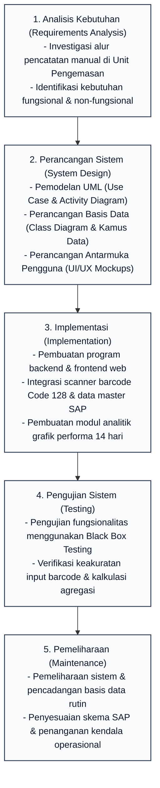
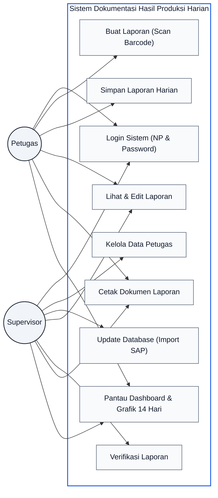
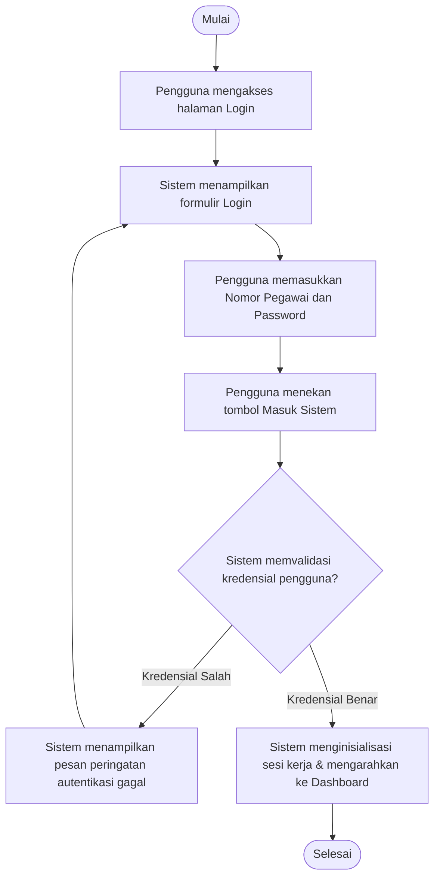
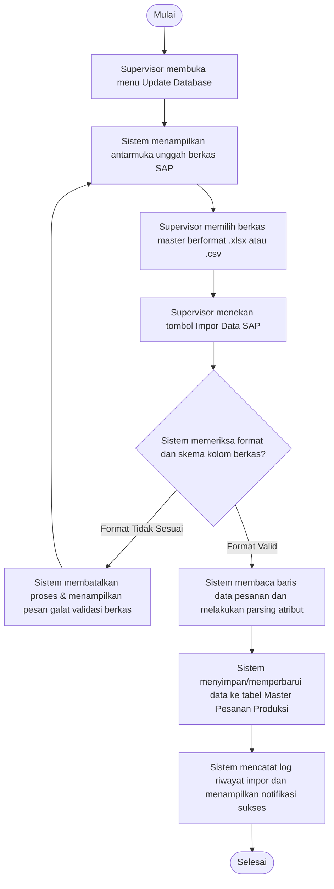
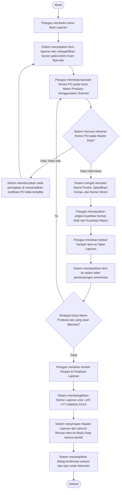
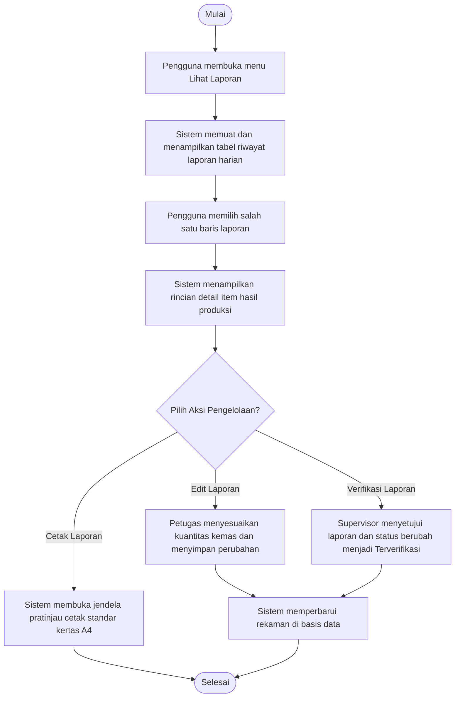
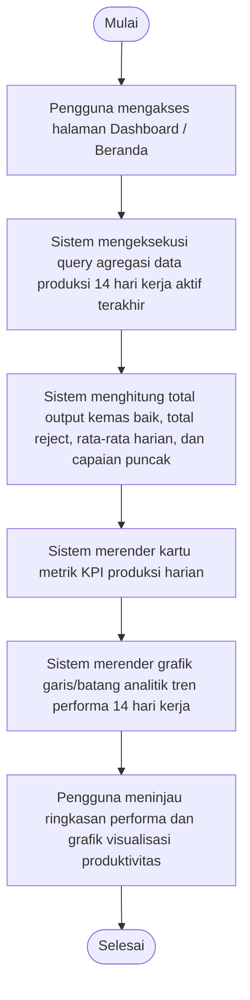
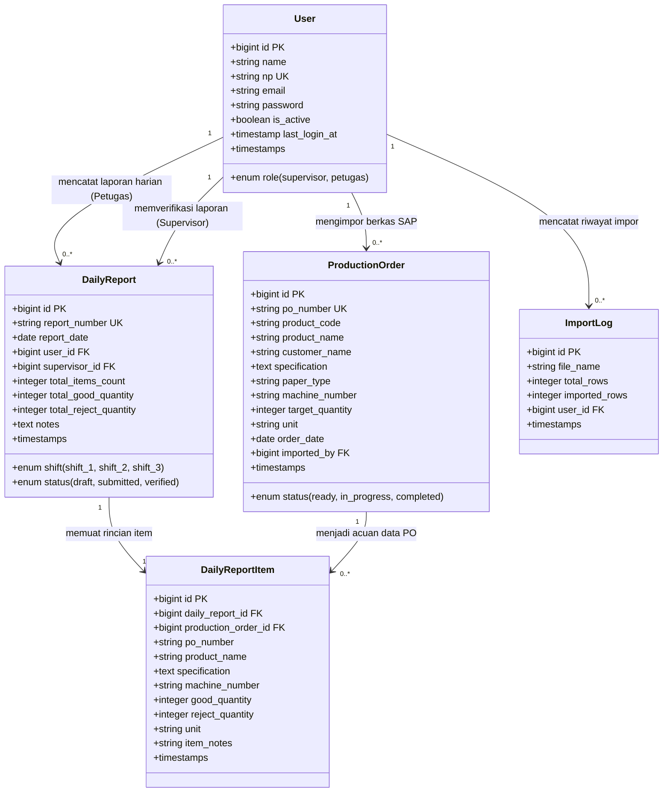

# BAB III
# PENGEMBANGAN PERANGKAT LUNAK

Bab ini menguraikan secara komprehensif metodologi, alur kerja, serta tahapan rekayasa perangkat lunak yang diterapkan dalam membangun Sistem Dokumentasi Hasil Produksi Harian Berbasis Web dengan Scan Barcode dan Grafik Performa 14 Hari Kerja. Objek penelitian ini berpusat pada Unit Pengemasan di PT Percetakan Dokumen Sekuriti, Ciampel, Karawang, yang bertanggung jawab atas proses akhir verifikasi kuantitas, pengemasan dokumen berpengaman tinggi, dan pelaporan hasil kerja harian kepada Kepala Unit/Supervisor. Seluruh tahapan pengembangan disusun secara terstruktur untuk menjawab permasalahan inefisiensi pencatatan manual, mengurangi potensi kesalahan manusia (*human error*), serta menghadirkan sistem pemantauan produktivitas harian yang transparan dan terukur.

---

## 3.1 Metode Pengembangan Perangkat Lunak

### 3.1.1 Nama dan Konsep Dasar Metode Pengembangan
Model pengembangan perangkat lunak yang diterapkan dalam penelitian ini adalah **Metode Waterfall** (*Classic Life Cycle*). Metode Waterfall merupakan pendekatan rekayasa perangkat lunak yang bersifat sekuensial dan sistematis, di mana kemajuan proses pengembangan diposisikan mengalir secara linier ke arah bawah melalui tahapan-tahapan yang terdefinisi secara baku. Dalam model ini, suatu fase pengembangan harus diselesaikan secara tuntas dan menghasilkan dokumen spesifikasi serta hasil kerja yang valid sebelum fase berikutnya dapat dimulai.

Prinsip dasar metode Waterfall menekankan pentingnya investigasi kebutuhan yang mendalam dan perancangan arsitektur yang matang sebelum tahap pembuatan aplikasi (coding) dilaksanakan. Pendekatan ini membantu menjaga kualitas aplikasi, memperjelas batasan ruang lingkup pekerjaan, serta memudahkan pemantauan kemajuan pengembangan sistem.

### 3.1.2 Alasan Pemilihan Metode Waterfall
Pemilihan metode Waterfall dalam pengembangan sistem dokumentasi hasil produksi harian ini didasarkan pada karakteristik operasional pabrik dan spesifikasi teknis sistem yang dikembangkan. Beberapa pertimbangan mendasar yang melandasi pemilihan metode ini antara lain:

Pertama, karakteristik kebutuhan fungsional sistem telah teridentifikasi secara jelas dan terperinci sejak tahap awal observasi lapangan di Unit Pengemasan PT Percetakan Dokumen Sekuriti. Format data pesanan dari sistem SAP, struktur Nomor PO yang tertuang dalam bentuk barcode tipe Code 128 pada Kartu Mesin Produksi, serta kebutuhan formulir pelaporan hasil kemas memiliki format dan aturan bisnis yang sudah baku. Kondisi kebutuhan yang pasti ini sangat selaras dengan sifat metode Waterfall yang tidak membutuhkan perubahan arsitektur secara berulang-ulang di tengah proses konstruksi.

Kedua, prosedur operasional standar (SOP) di area kerja pengemasan memiliki alur kerja yang stabil dan terikat pada hierarki pertanggungjawaban produksi. Hubungan kerja antara Petugas Pengemasan sebagai pelaksana pencatatan dan Kepala Unit/Supervisor sebagai pemeriksa dan penanggung jawab laporan harian menuntut kejelasan peran serta keabsahan data yang akurat dan dapat dipertanggungjawabkan. Dengan metode Waterfall, pembagian hak akses pengguna dan alur verifikasi laporan dapat dirancang dengan jelas sejak awal.

Ketiga, keterbatasan waktu pengerjaan dan sumber daya penelitian memerlukan manajemen proyek yang teratur dengan batas pencapaian (*milestones*) yang terukur. Dengan membagi pengembangan ke dalam tahapan sekuensial yang berurutan, evaluasi terhadap keberhasilan setiap fase, mulai dari analisis alur data, pemodelan basis data, hingga pengujian scanner, dapat dilakukan secara terstruktur tanpa menimbulkan tumpang tindih aktivitas.

Keempat, skala sistem yang terfokus pada digitalisasi pencatatan dokumen kemas dan pemantauan analitik 14 hari kerja memungkinkan seluruh spesifikasi dirancang secara komprehensif di awal. Pendekatan terstruktur ini meminimalkan risiko terjadinya pembengkakan ruang lingkup (*scope creep*) dan memastikan konsentrasi rekayasa tertuju pada stabilitas pembacaan scanner dan keakuratan kalkulasi data grafik.

### 3.1.3 Deskripsi Singkat Tahapan Metode Waterfall
Secara umum, metode Waterfall yang diterapkan dalam penelitian ini terdiri atas lima tahapan utama yang dilaksanakan secara berurutan:

1. **Analisis Kebutuhan (*Requirement Analysis*)**
   <br>
   Tahap pengumpulan data komprehensif melalui observasi langsung di area kerja pengemasan, wawancara mendalam bersama operator kemas dan supervisor, serta penelaahan dokumen fisik Kartu Mesin Produksi dan format laporan harian. Tahap ini menghasilkan spesifikasi kebutuhan fungsional dan non-fungsional sistem yang menjadi acuan utama perancangan.

2. **Perancangan Sistem (*System Design*)**
   <br>
   Tahap perancangan arsitektur perangkat lunak yang menerjemahkan kebutuhan sistem ke dalam representasi logis dan fisik. Aktivitas ini mencakup pemodelan perilaku sistem menggunakan diagram UML (*Use Case Diagram* dan *Activity Diagram*), perancangan relasi data menggunakan *Class Diagram* / ERD, serta perancangan antarmuka visual pengguna (*UI/UX Mockups*).

3. **Implementasi (*Implementation*)**
   <br>
   Tahap penerjemahan seluruh dokumen perancangan ke dalam pembuatan aplikasi. Pada tahap ini, basis data dibangun, logika bisnis backend diimplementasikan menggunakan Laravel dengan pola *Service Layer*, antarmuka reaktif dibangun dengan teknologi berbasis web, fungsi penangkap data barcode scanner diintegrasikan, dan kalkulasi data grafik performa 14 hari kerja dikonfigurasikan.

4. **Pengujian Sistem (*Testing*)**
   <br>
   Tahap pengujian fungsionalitas aplikasi yang telah selesai dibangun guna memastikan bahwa setiap modul bekerja sesuai rancangan dan terbebas dari kesalahan logika maupun kegagalan sistem. Pengujian dilakukan dengan teknik *Black Box Testing* yang menguji keakuratan masukan dan keluaran sistem pada skenario operasional nyata.

5. **Pemeliharaan (*Maintenance*)**
   <br>
   Tahap pemeliharaan dan penjaminan keberlanjutan operasional sistem setelah aplikasi diimplementasikan di lingkungan kerja. Kegiatan ini mencakup pencadangan basis data berkala, penanganan kendala yang tidak terdeteksi saat pengujian, serta penyesuaian konfigurasi jika terjadi pembaruan format data ekspor dari sistem SAP.

### 3.1.4 Kesesuaian Metode dengan Penelitian
Penerapan metode Waterfall memberikan kepastian alur kerja yang mendukung tujuan penelitian. Dengan menetapkan analisis dan desain arsitektur secara matang sebelum pembuatan aplikasi dimulai, pengembang dapat mengantisipasi kendala integrasi antara data hasil scanner dan basis data master SAP. Setiap fungsi yang dikembangkan, mulai dari pembacaan barcode cepat hingga penyajian grafik performa 14 hari kerja, memiliki acuan pengujian yang jelas, sehingga aplikasi yang dihasilkan dapat berfungsi dengan stabil, akurat, dan mudah digunakan oleh petugas di Unit Pengemasan.

### 3.1.5 Ilustrasi Alur Metode Waterfall
Alur tahapan pengembangan perangkat lunak menggunakan model Waterfall diilustrasikan secara runtut pada Gambar 3.1 berikut:


*Gambar 3.1: Alur Tahapan Metode Waterfall pada Pengembangan Sistem Dokumentasi Produksi Harian*

---

## 3.2 Tahap Pengembangan Perangkat Lunak

### A. Analisis Kebutuhan

Tahap analisis kebutuhan merupakan langkah awal dalam siklus pengembangan perangkat lunak. Pada tahap ini, pengembang melakukan investigasi menyeluruh mengenai mekanisme operasional yang sedang berjalan pada Unit Pengemasan PT Percetakan Dokumen Sekuriti untuk mengidentifikasi akar permasalahan, memetakan kendala operasional, dan merumuskan batasan solusi teknologi yang tepat sasaran.

#### 1. Analisis Permasalahan dan Kebutuhan Pengguna
Unit Pengemasan pada PT Percetakan Dokumen Sekuriti merupakan bagian akhir dalam proses produksi percetakan sekuriti sebelum produk dikirimkan kepada pelanggan (kementerian, perbankan, dan lembaga negara). Pada unit kerja ini, lembaran produk cetak yang telah melewati proses pencetakan dan pemeriksaan mutu akan dihitung, diverifikasi identitas pesanannya, dan dikemas rapi sesuai spesifikasi pemesanan.

Berdasarkan hasil observasi dan penelaahan alur kerja lapangan, proses dokumentasi hasil produksi harian saat ini masih mengandalkan pencatatan manual berbasis kertas (tulis tangan pada lembar formulir folio). Setiap lembar Kartu Mesin Produksi yang menyertai tumpukan produk kemas memuat data identitas order, seperti Nomor Order/PO, nama produk, spesifikasi bahan kertas berpengaman, nomor mesin cetak asal, dan jumlah cetak siap kirim. Petugas pengemasan harus menyalin ulang seluruh atribut informasi tersebut satu per satu menggunakan pulpen ke dalam lembar laporan rekapitulasi harian.

Kondisi pencatatan manual ini menimbulkan serangkaian permasalahan operasional:
Pertama, terjadi inefisiensi waktu kerja. Petugas membutuhkan waktu rata-rata 2 hingga 3 menit untuk menyalin rincian spesifikasi satu kartu mesin secara manual. Apabila dalam satu giliran kerja (*shift*) terdapat puluhan hingga ratusan pesanan kemas, akumulasi waktu yang terbuang hanya untuk kegiatan administrasi tulis tangan cukup besar, sehingga mengurangi efisiensi kerja operator pada kegiatan fisik pengemasan.
Kedua, risiko kesalahan pencatatan (*human error*). Penulisan angka jumlah kemas baik maupun reject yang tidak terbaca jelas atau salah tulis mengakibatkan ketidaksinkronan data antara lembar laporan harian dengan stok fisik barang yang siap dikirim.
Ketiga, potensi dokumen terselip. Penumpukan fisik berkas Kartu Mesin Produksi di meja kerja pengemasan rawan tercecer atau terselip di tumpukan lain, yang berakibat pada terhambatnya penelusuran riwayat produksi suatu pesanan sekuriti.
Keempat, keterlambatan pelaporan kepada Kepala Unit/Supervisor. Karena proses rekapitulasi dan penghitungan total output harian baru dapat dilakukan secara manual setelah jam kerja berakhir, laporan produksi harian sering kali terlambat diserahkan untuk proses evaluasi dan perencanaan produksi hari berikutnya.
Kelima, ketiadaan sarana pemantauan tren produktivitas. Supervisor tidak memiliki alat bantu visual untuk meninjau dinamika pencapaian volume produksi harian, perbandingan hasil antar-shift, maupun tren performa dalam rentang 14 hari kerja terakhir guna mendeteksi penurunan output secara cepat.

Padahal, pada Kartu Mesin Produksi telah tercetak kode barcode tipe Code 128 yang merepresentasikan Nomor PO, dan di ruang kerja unit pengemasan telah tersedia fasilitas komputer serta perangkat *barcode scanner* yang selama ini belum dimanfaatkan secara optimal untuk pencatatan internal. Oleh karena itu, dibangun sebuah Sistem Dokumentasi Hasil Produksi Harian berbasis web yang mengintegrasikan pembacaan barcode dari kartu mesin, terhubung dengan master data SAP, dan dilengkapi dasbor visualisasi grafik performa 14 hari kerja terakhir.

#### 2. Kebutuhan Fungsional (*Functional Requirements*)
Kebutuhan fungsional mendefinisikan kapabilitas, proses kerja, dan layanan interaktif yang wajib disediakan oleh sistem aplikasi untuk memenuhi kebutuhan pengguna:

1. **Modul Autentikasi Pengguna**
   <br>
   Sistem menyediakan antarmuka otentikasi berbasis formulir login yang memvalidasi kombinasi Nomor Pegawai (NP) dan kata sandi (*password*) terenkripsi. Sistem membedakan hak akses secara ketat berdasarkan dua peran pengguna, yaitu **Petugas** (operator pengemasan yang berwenang melakukan scan barcode, mencatat hasil kemas, dan mencetak laporan) serta **Supervisor** (Kepala Unit/Admin yang memiliki wewenang tambahan mengelola master akun petugas, mengimpor master data SAP, memverifikasi laporan, dan menganalisis grafik performa). Sistem juga menyediakan mekanisme keluar sistem (*logout*) yang aman.

2. **Modul Manajemen Data Petugas**
   <br>
   Sistem menyediakan antarmuka khusus bagi Supervisor untuk mengelola data akun operator pengemasan. Fungsionalitas ini mencakup penambahan akun baru, peninjauan daftar seluruh petugas beserta status aktif/nonaktif, pembaruan profil pengguna, pengubahan status akses, dan pengaturan ulang (*reset*) kata sandi akun secara terpusat berdasarkan Nomor Pegawai (NP).

3. **Modul Update Database (Master Data SAP)**
   <br>
   Sistem menyediakan antarmuka pengunggahan berkas master pesanan produksi hasil ekspor dari sistem ERP SAP dalam format spreadsheet (`.xlsx` atau `.csv`). Sistem menjalankan proses pembacaan dan validasi data secara otomatis untuk mengekstrak kolom Nomor PO, Kode Produk, Nama Barang, Spesifikasi Sekuriti, Nomor Mesin Asal, dan Target Kuantitas Siap Kemas, kemudian menyimpannya ke dalam basis data master sebagai referensi utama saat pemindaian barcode berlangsung.

4. **Modul Buat Laporan (Scan Barcode & Entri Data Kemas)**
   <br>
   Sistem menyediakan halaman kerja utama bagi Petugas yang mengarahkan fokus kursor secara otomatis ke kolom pembacaan barcode. Saat petugas memindai kode barcode Code 128 pada Kartu Mesin Produksi menggunakan scanner, sistem secara instan mencari rekaman Nomor PO pada basis data master dan menampilkan spesifikasi produk (Nama Produk, Spesifikasi Kertas/Hologram, Nomor Mesin, dan Target Order) secara otomatis tanpa pengetikan manual. Petugas selanjutnya memasukkan jumlah hasil kemas baik (siap kirim) dan kuantitas *reject* (rusak/tidak sempurna). Data item tersebut ditambahkan ke tabel penampungan sementara (*staging table*) multi-item sebelum difinalisasi. Sistem menghasilkan Nomor Laporan unik terstandarisasi (`LAP-YYYYMMDD-XXXX`) dan mencatat seluruh transaksi ke basis data secara aman.

5. **Modul Manajemen dan Cetak Laporan (Lihat Laporan)**
   <br>
   Sistem menyediakan tabel daftar riwayat laporan hasil produksi harian yang dilengkapi fitur pencarian dinamis, penyaringan (*filtering*) berdasarkan rentang tanggal atau status verifikasi, serta peninjauan rincian item per laporan. Petugas dapat melakukan pengeditan korektif terhadap draf laporan selama belum diverifikasi oleh Supervisor. Supervisor memiliki wewenang untuk meninjau dan menyetujui (*verify*) laporan harian. Selain itu, sistem menyediakan fitur cetak dokumen fisik standar ukuran kertas A4 lengkap dengan kolom pengesahan tanda tangan antara Petugas Pelaksana dan Kepala Unit.

6. **Modul Dashboard dan Visualisasi Grafik Performa 14 Hari Kerja**
   <br>
   Sistem menyajikan halaman beranda terpadu yang menampilkan kartu ringkasan metrik kinerja operasional harian (Total Kemas Baik Hari Ini, Total Reject, Total PO Terscan, dan Status Laporan Harian). Sistem secara otomatis menghitung akumulasi output kerja harian dan merender visualisasi **Grafik Analitik Hasil Produksi 14 Hari Kerja Terakhir** yang membandingkan tren volume kemas baik terhadap kuantitas reject, serta menyajikan indikator rata-rata output harian dan capaian hari produksi tertinggi.

#### 3. Kebutuhan Non-Fungsional (*Non-Functional Requirements*)
Kebutuhan non-fungsional menetapkan batasan kualitas teknis, performa, dan lingkungan operasional perangkat lunak:

1. **Performa dan Kecepatan Respon**
   <br>
   Sistem dirancang untuk memberikan respon pencarian data produk pada saat barcode Nomor PO dipindai dalam waktu kurang dari 1 detik. Proses kalkulasi akumulasi data dan penampilan grafik analitik 14 hari kerja pada halaman dashboard diselesaikan dalam waktu di bawah 2 detik pada kondisi jaringan lokal.

2. **Keandalan dan Integritas Transaksi Data**
   <br>
   Sistem menerapkan mekanisme pencegahan duplikasi entri data barcode Nomor PO dalam satu sesi pembuatan laporan harian guna mencegah penggandaan pencatatan. Seluruh proses penyimpanan laporan multi-item dibungkus dalam mekanisme transaksi basis data (*database transaction*) untuk menjamin konsistensi data.

3. **Kompatibilitas Perangkat Keras dan Perangkat Lunak**
   <br>
   Sistem kompatibel secara langsung (*Plug-and-Play*) dengan perangkat *barcode scanner* genggam berbasis USB yang membaca format standar Code 128. Sistem dapat diakses melalui peramban web modern (*Google Chrome, Mozilla Firefox, Microsoft Edge*) dan format keluaran cetak disesuaikan untuk printer standar kantor pada kertas A4.

4. **Kemudahan Penggunaan (*Usability*)**
   <br>
   Tata letak antarmuka dirancang bersih, intuitif, dan kontras, sehingga mempermudah pembacaan data oleh operator di area kerja pengemasan. Sistem dilengkapi dengan notifikasi umpan balik saat proses simpan berhasil atau terjadi kesalahan pengisian data.

5. **Keamanan Sistem dan Data**
   <br>
   Seluruh kata sandi pengguna disimpan menggunakan algoritma hashing (*Bcrypt*). Sistem menerapkan pengamanan terhadap ancaman aplikasi web seperti *Cross-Site Request Forgery* (CSRF), *SQL Injection*, serta pembatasan akses halaman berdasarkan peran pengguna (*role-based middleware*).

---

### B. Perancangan Sistem

Tahap perancangan sistem bertujuan untuk memetakan kebutuhan fungsional ke dalam model arsitektur logis, struktur basis data yang terelasi secara utuh, diagram aliran proses bisnis, serta tata letak antarmuka pengguna sebelum proses pembuatan aplikasi dilakukan.

#### 1. Pemodelan Sistem (UML - Unified Modeling Language)

##### a. Use Case Diagram
Use Case Diagram mendeskripsikan interaksi antara aktor (pengguna sistem) dengan fungsionalitas sistem yang tersedia. Sistem ini melibatkan dua aktor utama, yaitu **Petugas (Operator Pengemasan)** dan **Supervisor (Kepala Unit/Admin)**. Hubungan antara aktor dan fungsi-fungsi sistem dimodelkan pada Gambar 3.2:


*Gambar 3.2: Use Case Diagram Sistem Dokumentasi Hasil Produksi Harian*

Rincian peran aktor dan deskripsi fungsional masing-masing use case dijabarkan pada Tabel 3.1 dan Tabel 3.2:

*Tabel 3.1: Definisi Peran Aktor Sistem*
| No | Aktor | Deskripsi Peran dan Hak Akses |
|---|---|---|
| 1 | **Petugas** | Operator pada Unit Pengemasan yang bertugas melakukan login ke sistem menggunakan Nomor Pegawai (NP), memindai barcode Nomor PO pada Kartu Mesin Produksi, menginputkan kuantitas hasil kemas harian, menyimpan draf dan finalisasi laporan, mencetak lembar laporan fisik, serta memantau ringkasan performa pada dashboard. |
| 2 | **Supervisor** | Kepala Unit yang bertugas mengelola akun pengguna petugas, mengunggah data master pesanan produksi dari berkas ekspor SAP, meninjau dan memverifikasi laporan produksi harian, mencetak laporan terverifikasi, serta menganalisis visualisasi tren performa pada grafik 14 hari kerja. |

*Tabel 3.2: Deskripsi Fungsional Use Case Sistem*
| No | Use Case | Aktor Terlibat | Deskripsi Fungsional |
|---|---|---|---|
| 1 | Login Sistem | Petugas, Supervisor | Memvalidasi identitas pengguna melalui pencocokan Nomor Pegawai (NP) dan password terenkripsi sebelum memberikan akses ke halaman utama. |
| 2 | Kelola Data Petugas | Supervisor | Mengelola data akun pengguna sistem, mencakup penambahan akun baru, penonaktifan akun, pembaruan data, dan pengaturan ulang kata sandi berdasarkan Nomor Pegawai (NP). |
| 3 | Update Database (Import SAP) | Supervisor | Mengunggah dan memvalidasi berkas master data pesanan produksi dari SAP ke dalam tabel master sistem. |
| 4 | Buat Laporan (Scan Barcode) | Petugas | Menerima data hasil scanner barcode Code 128 dan mengambil spesifikasi produk secara otomatis dari basis data. |
| 5 | Simpan Laporan Harian | Petugas | Membentuk Nomor Laporan unik otomatis (`LAP-YYYYMMDD-XXXX`) dan menyimpan seluruh rincian transaksi hasil kemas ke basis data. |
| 6 | Lihat & Edit Laporan | Petugas, Supervisor | Menampilkan daftar riwayat laporan harian, menampilkan detail item barang, dan mengakomodasi koreksi data sebelum verifikasi. |
| 7 | Verifikasi Laporan | Supervisor | Memberikan status persetujuan resmi (*verified*) terhadap laporan produksi harian yang telah ditinjau keabsahannya. |
| 8 | Cetak Dokumen Laporan | Petugas, Supervisor | Menerbitkan keluaran cetak lembaran laporan fisik standar ukuran kertas A4 lengkap dengan kolom pengesahan tanda tangan. |
| 9 | Pantau Dashboard & Grafik 14 Hari | Petugas, Supervisor | Menyajikan kartu metrik ringkasan harian dan visualisasi grafik batang/garis performa produksi selama 14 hari kerja terakhir. |

---

##### b. Activity Diagram
Activity Diagram menggambarkan aliran aktivitas operasional dan logika transisi sistem pada masing-masing fitur utama:

**1. Activity Diagram Login Sistem**
Diagram ini menggambarkan alur kerja saat pengguna melakukan autentikasi ke dalam sistem, dimulai dari pengisian form hingga inisialisasi sesi kerja yang valid:


*Gambar 3.3: Activity Diagram Login Sistem*

**2. Activity Diagram Update Database (Import Master SAP)**
Diagram ini menggambarkan proses pengunggahan berkas data pesanan produksi SAP oleh Supervisor, validasi format berkas, serta penyimpanan data ke dalam tabel master:


*Gambar 3.4: Activity Diagram Update Database (Import SAP)*

**3. Activity Diagram Buat Laporan (Scan Barcode & Entri Kemas)**
Diagram ini memodelkan aktivitas operasional di area pengemasan saat petugas memindai barcode kartu mesin, memverifikasi data produk, dan menyimpan laporan:


*Gambar 3.5: Activity Diagram Buat Laporan dengan Scan Barcode*

**4. Activity Diagram Manajemen dan Cetak Laporan**
Diagram ini menggambarkan alur peninjauan daftar laporan harian, proses pengeditan data korektif, verifikasi persetujuan oleh Supervisor, dan pencetakan dokumen fisik:


*Gambar 3.6: Activity Diagram Manajemen dan Cetak Laporan*

**5. Activity Diagram Dashboard dan Visualisasi Grafik Performa 14 Hari Kerja**
Diagram ini menjelaskan alur pemrosesan data riwayat produksi untuk menghasilkan kartu metrik dan grafik analitik pada halaman beranda sistem:


*Gambar 3.7: Activity Diagram Dashboard dan Visualisasi Grafik Performa 14 Hari Kerja*

---

#### 2. Perancangan Basis Data (*Database Design*)

##### a. Entity Relationship Diagram (ERD) / Class Diagram
Perancangan struktur data sistem dibangun menggunakan model relasional yang dinormalisasi untuk mencegah redundansi dan menjamin keutuhan data (*referential integrity*). Hubungan antar-entitas data dimodelkan melalui Class Diagram pada Gambar 3.8:


*Gambar 3.8: Class Diagram Struktur Basis Data Sistem Dokumentasi Produksi Harian*

##### b. Kamus Data dan Struktur Tabel Basis Data
Struktur detail kamus data yang memuat atribut, tipe data, serta batasan (*constraints*) untuk masing-masing tabel basis data dijabarkan pada Tabel 3.3 hingga Tabel 3.6:

*Tabel 3.3: Struktur Tabel `users` (Data Akun Pengguna & Petugas)*
| Nama Field | Tipe Data | Kunci | Keterangan |
|---|---|---|---|
| `id` | BIGINT UNSIGNED | PK, Auto Increment | Identifikator unik akun pengguna |
| `name` | VARCHAR(100) | - | Nama lengkap petugas atau supervisor |
| `np` | VARCHAR(50) | Unique Index | Nomor Pegawai (NP) untuk autentikasi login |
| `email` | VARCHAR(100) | Unique Index | Alamat surat elektronik pengguna |
| `password` | VARCHAR(255) | - | Nilai hash kata sandi terenkripsi (Bcrypt) |
| `role` | ENUM('supervisor', 'petugas') | - | Hak akses dan peran operasional pengguna |
| `is_active` | BOOLEAN | Default: true | Status keaktifan akun dalam sistem |
| `last_login_at` | TIMESTAMP | Nullable | Rekam waktu terakhir kali pengguna berhasil login |
| `created_at` / `updated_at` | TIMESTAMP | - | Jejak waktu pembuatan dan pembaruan rekaman data |

*Tabel 3.4: Struktur Tabel `production_orders` (Master Data Pesanan SAP)*
| Nama Field | Tipe Data | Kunci | Keterangan |
|---|---|---|---|
| `id` | BIGINT UNSIGNED | PK, Auto Increment | Identifikator unik rekaman pesanan produksi |
| `po_number` | VARCHAR(50) | Unique Index | Nomor PO / barcode pada Kartu Mesin Produksi |
| `product_code` | VARCHAR(50) | Index | Kode identitas material barang |
| `product_name` | VARCHAR(150) | - | Nama produk cetak sekuriti (misal: Sertifikat A4) |
| `customer_name` | VARCHAR(150) | - | Nama instansi atau lembaga pemesan |
| `specification` | TEXT | - | Deskripsi spesifikasi bahan kertas dan pengaman |
| `paper_type` | VARCHAR(100) | Nullable | Jenis bahan baku kertas berpengaman |
| `machine_number` | VARCHAR(50) | Nullable | Nomor identitas mesin cetak asal |
| `target_quantity` | INT UNSIGNED | - | Target kuantitas cetak siap kemas |
| `unit` | VARCHAR(20) | Default: 'lembar' | Satuan hitung produk (lembar, rim, buku) |
| `order_date` | DATE | - | Tanggal pesanan produksi diterbitkan di SAP |
| `status` | ENUM('ready', 'in_progress', 'completed') | - | Status pengerjaan pesanan pada unit produksi |
| `imported_by` | BIGINT UNSIGNED | FK ke `users.id` | Identitas pengguna yang melakukan impor berkas SAP |
| `created_at` / `updated_at` | TIMESTAMP | - | Jejak waktu pembuatan dan pembaruan rekaman data |

*Tabel 3.5: Struktur Tabel `daily_reports` (Header Laporan Produksi Harian)*
| Nama Field | Tipe Data | Kunci | Keterangan |
|---|---|---|---|
| `id` | BIGINT UNSIGNED | PK, Auto Increment | Identifikator unik laporan produksi harian |
| `report_number` | VARCHAR(30) | Unique Index | Nomor dokumen laporan (`LAP-YYYYMMDD-XXXX`) |
| `report_date` | DATE | Index | Tanggal pelaksanaan proses pengemasan |
| `shift` | ENUM('shift_1', 'shift_2', 'shift_3') | - | Giliran kerja operasional pengemasan |
| `user_id` | BIGINT UNSIGNED | FK ke `users.id` | Identitas Petugas yang menyusun dan mencatat laporan |
| `supervisor_id` | BIGINT UNSIGNED | FK ke `users.id`, Nullable | Identitas Supervisor yang memverifikasi laporan |
| `total_items_count` | INT UNSIGNED | - | Akumulasi jumlah jenis PO yang dikemas pada shift |
| `total_good_quantity` | INT UNSIGNED | - | Akumulasi total kuantitas kemas baik siap kirim |
| `total_reject_quantity` | INT UNSIGNED | - | Akumulasi total kuantitas reject/cacat harian |
| `notes` | TEXT | Nullable | Catatan khusus kendala operasional selama shift |
| `status` | ENUM('draft', 'submitted', 'verified') | Index | Status tahapan verifikasi laporan harian |
| `created_at` / `updated_at` | TIMESTAMP | - | Jejak waktu pembuatan dan pembaruan rekaman data |

*Tabel 3.6: Struktur Tabel `daily_report_items` (Rincian Item Hasil Kemas)*
| Nama Field | Tipe Data | Kunci | Keterangan |
|---|---|---|---|
| `id` | BIGINT UNSIGNED | PK, Auto Increment | Identifikator unik baris rincian item kemas |
| `daily_report_id` | BIGINT UNSIGNED | FK ke `daily_reports.id` | Kunci relasi ke header laporan (Cascade on Delete) |
| `production_order_id` | BIGINT UNSIGNED | FK ke `production_orders.id` | Kunci relasi ke master data pesanan SAP |
| `po_number` | VARCHAR(50) | Index | Salinan (*snapshot*) Nomor PO saat laporan dicatat |
| `product_name` | VARCHAR(150) | - | Salinan nama produk cetak sekuriti |
| `specification` | TEXT | - | Salinan spesifikasi teknis barang |
| `machine_number` | VARCHAR(50) | Nullable | Salinan nomor mesin cetak asal |
| `good_quantity` | INT UNSIGNED | - | Kuantitas hasil kemas baik (siap didistribusikan) |
| `reject_quantity` | INT UNSIGNED | Default: 0 | Kuantitas hasil cetak rusak / reject |
| `unit` | VARCHAR(20) | Default: 'lembar' | Satuan hitung kuantitas produk |
| `item_notes` | VARCHAR(255) | Nullable | Catatan khusus pada item kemas terkait |
| `created_at` / `updated_at` | TIMESTAMP | - | Jejak waktu pembuatan dan pembaruan rekaman data |

---

#### 3. Perancangan Antarmuka Pengguna (*User Interface Mockups*)
Perancangan antarmuka visual dirancang dengan mengedepankan prinsip kejelasan informasi, keterbacaan tinggi di lingkungan area kerja pabrik, serta alur navigasi yang efisien bagi operator:

##### a. Rancangan Halaman Login
Halaman login dirancang dengan tata letak minimalis dan terpusat yang memfasilitasi proses autentikasi cepat bagi pengguna:

```
+-----------------------------------------------------------------------+
|                                                                       |
|                     PT PERCETAKAN DOKUMEN SEKURITI                    |
|             Sistem Dokumentasi Hasil Produksi Harian (Unit Kemas)     |
|                                                                       |
|                     +---------------------------+                     |
|                     |       FORM LOGIN USER     |                     |
|                     |                           |                     |
|                     |  Nomor Pegawai (NP):      |                     |
|                     |  [______________________] |                     |
|                     |                           |                     |
|                     |  Password:                |                     |
|                     |  [______________________] |                     |
|                     |                           |                     |
|                     |  [x] Ingat Saya           |                     |
|                     |                           |                     |
|                     |     [   MASUK SISTEM   ]  |                     |
|                     |                           |                     |
|                     +---------------------------+                     |
|                                                                       |
+-----------------------------------------------------------------------+
```
[visualisasi_mockup_halaman_login]  
*Gambar 3.9: Rancangan Antarmuka Halaman Login Sistem*

##### b. Rancangan Halaman Dashboard (Grafik Performa 14 Hari Kerja)
Halaman dashboard menampilkan ringkasan kartu metrik capaian harian, navigasi cepat modul sistem, serta visualisasi grafik analitik performa produksi 14 hari kerja terakhir yang menyajikan perbandingan output baik dan kuantitas reject:

```
+-----------------------------------------------------------------------+
| [PT PDS LOGO]  Unit Pengemasan  | Shift: Shift 1 | WIB: 08:30 | [User] v |
+-------------+---------------------------------------------------------+
| NAVIGATION  | DASHBOARD UTAMA & ANALITIK PRODUKSI                     |
| - Dashboard |                                                         |
| - Up Database| +-------------+ +-------------+ +-------------+ +-------+ |
| - Data Petugs| | TOTAL KEMAS | | TOTAL REJECT| | PO TERSCAN  | |STATUS | |
| - Buat Lapor | | 48.500 lbr  | | 320 lbr     | | 12 Order    | |Draft:2| |
| - Lihat Lapor| +-------------+ +-------------+ +-------------+ +-------+ |
|             |                                                         |
|             | GRAFIK ANALITIK HASIL PRODUKSI 14 HARI KERJA TERAKHIR   |
|             | +-----------------------------------------------------+ |
|             | | (Kuantitas)                                         | |
|             | |  60k |       _/\_        /\_                        | |
|             | |  40k |  _/\_/    \__/\__/   \__/\_   -- Kemas Baik  | |
|             | |  20k | /                          \  -- Reject      | |
|             | |    0 +---------------------------------             | |
|             | |       H-14 H-13 ... H-3  H-2  H-1 Hari Ini          | |
|             | +-----------------------------------------------------+ |
|             | * Rata-rata 14 Hari: 45.200 Lembar | Puncak: 56.000 lbr |
+-------------+---------------------------------------------------------+
```
[visualisasi_mockup_halaman_dashboard_grafik_14_hari]  
*Gambar 3.10: Rancangan Antarmuka Halaman Dashboard dan Grafik Performa 14 Hari Kerja*

##### c. Rancangan Halaman Update Database (Import SAP)
Halaman ini dirancang khusus bagi Supervisor untuk mengunggah berkas data master pesanan produksi yang diekspor dari sistem SAP, lengkap dengan tabel riwayat berkas impor terakhir:

```
+-----------------------------------------------------------------------+
| [PT PDS LOGO]  Unit Pengemasan  | Supervisor Admin             [User] v |
+-------------+---------------------------------------------------------+
| NAVIGATION  | UPDATE DATABASE MASTER PRODUKSI DARI SAP                |
| - Dashboard |                                                         |
| - Up Database| +-----------------------------------------------------+ |
| - Data Petugs| |  PILIH BERKAS EKSPOR SAP (.XLSX / .CSV)             | |
| - Buat Lapor | |  [ [Pilih File] sap_production_order_august.xlsx ]  | |
| - Lihat Lapor| |                                                     | |
|             | |  [   PROSES & IMPOR KE MASTER DATA   ]               | |
|             | +-----------------------------------------------------+ |
|             |                                                         |
|             | RIWAYAT UNGGAHAN MASTER SAP TERAKHIR                    |
|             | +----+-------------------------+----------+-----------+ |
|             | | No | Nama Berkas             | Jml Data | Tanggal   | |
|             | +----+-------------------------+----------+-----------+ |
|             | | 1  | sap_po_2026_08_25.xlsx  | 145 PO   | 25/08/2026| |
|             | | 2  | sap_po_2026_08_18.xlsx  | 120 PO   | 18/08/2026| |
|             | +----+-------------------------+----------+-----------+ |
+-------------+---------------------------------------------------------+
```
[visualisasi_mockup_halaman_update_database_sap]  
*Gambar 3.11: Rancangan Antarmuka Halaman Update Database SAP*

##### d. Rancangan Halaman Buat Laporan (Scan Barcode & Entri Kemas)
Halaman ini merupakan antarmuka operasional utama Petugas di meja kerja pengemasan. Formulir dilengkapi area masukan scan barcode otomatis, penampil rincian spesifikasi barang seketika, kolom input jumlah kemas, dan tabel penampungan draf hasil kemas multi-item:

```
+-----------------------------------------------------------------------+
| [PT PDS LOGO]  Unit Pengemasan  | Petugas: Umar I.Z.           [User] v |
+-------------+---------------------------------------------------------+
| NAVIGATION  | BUAT LAPORAN PRODUKSI HARIAN (SCAN BARCODE)             |
| - Dashboard | Tanggal: 25/08/2026 | Shift: [Shift 1 v] | Petugas: Umar|
| - Up Database+-------------------------------------------------------+ |
| - Data Petugs| [|||||||||||||||||] SCAN BARCODE NO PO (KARTU MESIN)   | |
| - Buat Lapor | [ PO-2026-8891                                    ]   | |
| - Lihat Lapor|                                                       | |
|             | Nama Produk: Sertifikat Sekuriti Hologram A4            | |
|             | Spesifikasi: Kertas Watermark 120gsm, 2 Spot UV         | |
|             | Mesin Asal : MESIN-02  | Target: 5.000 Lembar           | |
|             |                                                         | |
|             | Jml Kemas Baik: [ 5.000 ]  Jml Reject: [ 25 ]           | |
|             | [ + TAMBAH KE DAFTAR LAPORAN ]                          | |
|             +---------------------------------------------------------+ |
|             | TABEL RINCIAN HASIL KEMAS HARIAN (DRAFT)                |
|             | +----+--------------+-------------------+------+-------+| |
|             | | No | No PO        | Nama Produk       | Baik | Reject|| |
|             | +----+--------------+-------------------+------+-------+| |
|             | | 1  | PO-2026-8891 | Sertifikat A4     | 5.000| 25    || |
|             | | 2  | PO-2026-8892 | Ijazah Sekuriti   | 2.500| 10    || |
|             | +----+--------------+-------------------+------+-------+| |
|             | Total: 2 PO | Total Kemas: 7.500 | Total Reject: 35     | |
|             |                                                         | |
|             | [ SIMPAN SEBAGAI DRAFT ]     [ FINALISASI & SIMPAN ]    | |
+-------------+---------------------------------------------------------+
```
[visualisasi_mockup_halaman_buat_laporan_scan_barcode]  
*Gambar 3.12: Rancangan Antarmuka Halaman Buat Laporan dengan Scan Barcode*

##### e. Rancangan Halaman Lihat Laporan & Format Lembar Cetak Standar A4
Rancangan antarmuka peninjauan laporan menampilkan riwayat dokumen hasil kemas yang tersimpan, sedangkan format lembar cetak menyajikan dokumen laporan resmi standar kertas A4 lengkap dengan pengesahan tanda tangan:

```
+-----------------------------------------------------------------------+
| [PT PDS LOGO]  Unit Pengemasan  | Supervisor / Petugas         [User] v |
+-------------+---------------------------------------------------------+
| NAVIGATION  | DAFTAR LAPORAN HASIL PRODUKSI HARIAN                    |
| - Dashboard | Filter Tanggal: [ 2026-08-01 ] s/d [ 2026-08-25 ]       |
| - Up Database+----+-------------------+------------+-------+---------+| |
| - Data Petugs| No | Nomor Laporan     | Tanggal    | Shift | Aksi    || |
| - Buat Lapor +----+-------------------+------------+-------+---------+| |
| - Lihat Lapor| 1  | LAP-20260825-0001 | 25/08/2026 | 1     |[Lihat]  || |
|             | 2  | LAP-20260824-0002 | 24/08/2026 | 2     |[Lihat]  || |
|             | +----+-------------------+------------+-------+---------+| |
+-------------+---------------------------------------------------------+
```
[visualisasi_mockup_halaman_lihat_laporan]  
*Gambar 3.13: Rancangan Antarmuka Halaman Lihat Laporan*

```
+-----------------------------------------------------------------------+
|                     PT PERCETAKAN DOKUMEN SEKURITI                    |
|                LAPORAN HASIL PRODUKSI HARIAN PENGEMASAN               |
|                                                                       |
| No. Laporan : LAP-20260825-0001           Tanggal : 25 Agustus 2026   |
| Petugas     : Umar Ibnu Zainal M.         Shift   : Shift 1 (Pagi)    |
| Status      : TERVERIFIKASI                                           |
|-----------------------------------------------------------------------|
| No | Nomor PO      | Nama Produk / Spesifikasi | Mesin | Baik | Reject|
|----+---------------+---------------------------+-------+------+-------|
| 1  | PO-2026-8891  | Sertifikat Hologram A4    | M-02  | 5.000| 25    |
| 2  | PO-2026-8892  | Ijazah Sekuriti B5        | M-01  | 2.500| 10    |
|----+---------------+---------------------------+-------+------+-------|
| TOTAL HASIL PENGEMASAN                         |       | 7.500| 35    |
|-----------------------------------------------------------------------|
| Mengetahui,                                 Petugas Pelaksana,        |
| Kepala Unit / Supervisor                                              |
|                                                                       |
| ( Agus Soelistyo )                          ( Umar Ibnu Zainal M. )   |
+-----------------------------------------------------------------------+
```
[visualisasi_mockup_format_cetak_laporan_a4]  
*Gambar 3.14: Rancangan Format Lembar Cetak Laporan Produksi Harian (Standar A4)*

---

### C. Implementasi

Tahap implementasi merupakan fase eksekusi rekayasa di mana seluruh spesifikasi kebutuhan, diagram pemodelan UML, skema basis data, dan rancangan antarmuka diterjemahkan ke dalam pembuatan aplikasi yang dapat dieksekusi secara fungsional.

#### 1. Lingkungan Pengembangan Perangkat Lunak
Pelaksanaan implementasi dan pengoperasian perangkat lunak didukung oleh konfigurasi lingkungan perangkat keras dan perangkat lunak yang disajikan dalam bentuk tabel berikut:

*Tabel 3.7: Spesifikasi Lingkungan Perangkat Keras (Hardware Environment)*
| No | Komponen Perangkat Keras | Spesifikasi Teknis Lingkungan Kerja | Peruntukan / Fungsi |
|---|---|---|---|
| 1 | **Komputer Pengembang** | Prosesor AMD Ryzen 5 / Intel Core i5, RAM 16 GB DDR4, Penyimpanan SSD 512 GB NVMe | Pembuatan program, pengujian unit, kompilasi aset frontend, dan simulasi server |
| 2 | **Komputer Klien (Unit Pengemasan)** | PC Desktop dengan prosesor Intel Celeron / Core i3, RAM 4 GB DDR3/DDR4, Monitor Display resolusi minimal 1366x768 piksel, antarmuka jaringan LAN / Wi-Fi | Perangkat operasional utama bagi Petugas dan Supervisor di area kerja pengemasan |
| 3 | **Barcode Scanner** | Scanner genggam (*Handheld Barcode Reader*) koneksi USB Plug-and-Play (antarmuka HID), mendukung simbologi linear **Code 128** | Membaca barcode Nomor PO pada Kartu Mesin Produksi secara cepat dan akurat |
| 4 | **Printer Dokumen** | Printer Inkjet / Laser standar kantor dengan ukuran media kertas A4 | Mencetak lembaran fisik laporan hasil produksi harian untuk pengesahan tanda tangan |

*Tabel 3.8: Spesifikasi Lingkungan Perangkat Lunak (Software Environment)*
| No | Komponen Perangkat Lunak | Nama Paket / Versi Teknologi | Keterangan dan Peranan dalam Aplikasi |
|---|---|---|---|
| 1 | **Sistem Operasi** | Windows 11 (64-bit) | Sistem operasi utama pada komputer pengembang dan klien operasional |
| 2 | **Server Lingkungan Lokal** | Laragon (Local Development Environment) | Mengelola stack server lokal yang terintegrasi (Web Server, PHP runtime, dan database) |
| 3 | **Basis Data (DBMS)** | MySQL Server | Menyimpan master data SAP, data transaksi laporan harian, akun pengguna, dan riwayat audit |
| 4 | **Bahasa Pemrograman Backend** | PHP (versi 8.3+) | Bahasa pemrograman server-side utama untuk mengeksekusi logika bisnis aplikasi |
| 5 | **Backend Framework** | Laravel Framework (versi 13.x) | Kerangka kerja web utama dengan arsitektur MVC dan *Service Layer Pattern* |
| 6 | **Autentikasi & Keamanan** | Laravel Fortify (versi 1.37+) | Menyediakan backend autentikasi aman berbasis Nomor Pegawai (NP), password hashing, dan rate limiting |
| 7 | **Arsitektur Frontend Reaktif** | Livewire (versi 4.x) | Membangun komponen antarmuka web dinamis dan reaktif tanpa perpindahan halaman |
| 8 | **Komponen UI & Optimasi** | Livewire Flux UI (versi 2.13+) & Livewire Blaze (versi 1.0) | Pustaka komponen antarmuka modern dan mesin optimasi perenderan Blade View |
| 9 | **CSS Framework & Bundler** | Tailwind CSS (versi 4.x) dengan `@tailwindcss/vite` & Vite (versi 8.x) | Desain antarmuka responsif dan alat kompilasi aset frontend cepat |
| 10 | **Pengelola Paket Dependensi** | Composer (PHP) & pnpm (Node.js) | Manajemen instalasi dan pembaruan dependensi backend PHP dan frontend JavaScript |
| 11 | **Visualisasi Grafik Analitik** | Chart.js terintegrasi Alpine.js | Merender grafik analitik tren performa hasil kemas 14 hari kerja pada halaman Dashboard |
| 12 | **Pengujian & Kualitas Kode** | Pest PHP (versi 5.x), Larastan (versi 3.x), Laravel Pint (versi 1.27) | Pengujian otomatis (*automated testing*), analisis statis tipe data, dan standarisasi format kode |

---

#### 2. Implementasi Modul Program
Implementasi aplikasi dikelompokkan ke dalam enam modul fungsional utama yang saling terintegrasi sebagaimana dirangkum pada Tabel 3.9:

*Tabel 3.9: Pemetaan dan Implementasi Modul Program*
| No | Modul Program | Komponen / Berkas Utama | Penjelasan Implementasi Fungsional |
|---|---|---|---|
| 1 | **Skema Basis Data & Model Eloquent** | `database/migrations/`, Model: `User`, `ProductionOrder`, `DailyReport`, `DailyReportItem`, `ImportLog` | Membangun struktur tabel terelasi, foreign key constraints, tipe data kolom, seeder inisialisasi, dan pemodelan relasi Eloquent ORM untuk menjamin integritas transaksi data. |
| 2 | **Autentikasi & Kontrol Akses Peran** | `app/Livewire/Auth/Login.php`, `FortifyServiceProvider`, Middleware `EnsureUserRole` | Menerapkan login menggunakan identitas Nomor Pegawai (NP) dan password terenkripsi, manajemen sesi, rate limiting 5 percobaan per menit, serta proteksi halaman berbasis peran Petugas dan Supervisor. |
| 3 | **Update Database (Master Data SAP)** | `app/Livewire/MasterData/UpdateDatabase.php`, `app/Services/SapImportService.php` | Mengakomodasi pengunggahan berkas ekspor SAP (.xlsx/.csv), validasi struktur kolom, parsing baris pesanan, dan pembaruan massal (*bulk upsert*) data Nomor PO, spesifikasi bahan, dan target kemas. |
| 4 | **Buat Laporan (Scan Barcode & Kemas)** | `app/Livewire/Reports/CreateDailyReport.php`, Alpine.js Scanner Listener | Menangkap pembacaan scanner barcode Code 128 pada Nomor PO, melakukan pencarian instan (*instant lookup*) data produk, menyediakan input kuantitas baik/reject, dan menampung item pada tabel sementara (*staging table*). |
| 5 | **Manajemen & Cetak Laporan** | `app/Livewire/Reports/ReportIndex.php`, `ReportDetail.php`, `ReportNumberGenerator`, `@media print` | Menampilkan riwayat laporan harian, membangkitkan Nomor Laporan unik otomatis (`LAP-YYYYMMDD-XXXX`), memfasilitasi verifikasi persetujuan oleh Supervisor, serta mencetak dokumen fisik rapi standar kertas A4. |
| 6 | **Dashboard & Grafik Performa 14 Hari** | `app/Livewire/Dashboard/DashboardIndex.php`, `DashboardAnalyticsService.php`, Komponen Chart.js | Mengeksekusi query agregasi SQL untuk menghitung akumulasi kemas baik dan reject 14 hari kerja aktif terakhir (WIB), merender kartu metrik KPI harian, dan menampilkan visualisasi grafik interaktif. |

---

### D. Pengujian Sistem

Tahap pengujian sistem bertujuan untuk menguji, memverifikasi, dan memvalidasi bahwa seluruh fungsi pada perangkat lunak telah beroperasi secara presisi sesuai dengan rancangan spesifikasi kebutuhan serta bebas dari galat yang dapat mengganggu operasional di lapangan.

#### 1. Metode Pengujian
Metode pengujian yang diterapkan dalam penelitian ini adalah **Black Box Testing** (pengujian kotak hitam). Metode ini menitikberatkan pengujian pada aspek fungsionalitas eksternal perangkat lunak, yaitu dengan memberikan kombinasi masukan (*input*) data tertentu pada antarmuka pengguna dan memverifikasi apakah keluaran (*output*) serta perilaku sistem yang dihasilkan telah sesuai dengan hasil yang diharapkan, tanpa perlu memeriksa struktur internal kode program.

#### 2. Rencana dan Skenario Pengujian
Pengujian fungsionalitas dijalankan secara menyeluruh terhadap sepuluh skenario operasional utama sistem sebagaimana dirangkum pada Tabel 3.10:

*Tabel 3.10: Rekapitulasi Hasil Pengujian Fungsionalitas Sistem (Black Box Testing)*
| No | Modul / Fitur | Skenario Pengujian | Masukan (*Input*) Data | Hasil yang Diharapkan | Status Pengujian |
|---|---|---|---|---|---|
| 1 | Autentikasi Pengguna | Pengujian login dengan kredensial yang valid | Memasukkan Nomor Pegawai (NP) dan password yang benar dan terdaftar | Sistem menerima kredensial, membuka sesi kerja, dan mengarahkan pengguna ke halaman Dashboard | Berhasil (Sesuai) |
| 2 | Autentikasi Pengguna | Pengujian login dengan kata sandi yang salah | Memasukkan Nomor Pegawai (NP) terdaftar dengan password salah | Sistem menolak proses login dan menampilkan pesan peringatan bahwa kredensial tidak cocok | Berhasil (Sesuai) |
| 3 | Update Database SAP | Pengunggahan berkas master SAP format valid | Memilih berkas spreadsheet `.xlsx` atau `.csv` dengan format kolom sesuai | Sistem mengekstrak seluruh baris pesanan dan memperbarui tabel master produksi | Berhasil (Sesuai) |
| 4 | Update Database SAP | Pengunggahan berkas dengan format ekstensi tidak valid | Memilih berkas berformat `.pdf` atau `.txt` | Sistem menolak berkas dan menampilkan pesan galat validasi tipe berkas | Berhasil (Sesuai) |
| 5 | Buat Laporan | Pemindaian barcode Nomor PO yang terdaftar pada master | Memindai barcode Code 128 pada Kartu Mesin Produksi menggunakan scanner | Kolom Nama Produk, Spesifikasi Bahan, dan Nomor Mesin terisi otomatis secara seketika (< 1 detik) | Berhasil (Sesuai) |
| 6 | Buat Laporan | Pemindaian barcode Nomor PO yang tidak terdaftar | Memindai barcode yang belum diimpor ke master data | Sistem membunyikan peringatan dan menampilkan notifikasi bahwa Nomor PO belum terdaftar | Berhasil (Sesuai) |
| 7 | Buat Laporan | Penyimpanan laporan hasil kemas harian | Memasukkan jumlah kemas baik dan reject, lalu menekan tombol Simpan | Sistem membangkitkan Nomor Laporan unik otomatis (`LAP-YYYYMMDD-XXXX`) dan menyimpan seluruh data item | Berhasil (Sesuai) |
| 8 | Manajemen Laporan | Peninjauan rincian detail laporan | Menekan tombol Lihat pada salah satu nomor laporan | Sistem memuat dan menampilkan seluruh daftar item barang hasil kemas pada laporan tersebut | Berhasil (Sesuai) |
| 9 | Cetak Laporan | Pencetakan fisik lembar laporan harian | Menekan tombol Cetak pada dokumen laporan | Sistem membuka jendela pratinjau cetak standar kertas A4 rapi lengkap dengan kolom tanda tangan | Berhasil (Sesuai) |
| 10 | Dashboard & Grafik | Perenderan visualisasi grafik performa 14 hari | Membuka halaman Dashboard saat data transaksi harian tersedia | Sistem menampilkan grafik garis/batang yang mencerminkan akumulasi hasil kemas baik dan reject 14 hari terakhir | Berhasil (Sesuai) |

Berdasarkan hasil eksekusi seluruh butir pengujian *Black Box Testing*, seluruh fungsi sistem terbukti beroperasi sesuai dengan spesifikasi rancangan dan siap diimplementasikan untuk mendukung operasional pencatatan harian di Unit Pengemasan PT Percetakan Dokumen Sekuriti.

---

### E. Pemeliharaan

Tahap pemeliharaan (*maintenance*) merupakan tahapan pamungkas dalam daur hidup pengembangan perangkat lunak metode Waterfall. Tahap ini bertujuan untuk memastikan sistem perangkat lunak tetap beroperasi secara optimal, andal, aman, dan adaptif terhadap dinamika kebutuhan operasional setelah diterapkan secara penuh di lingkungan kerja Unit Pengemasan.

Aktivitas pemeliharaan perangkat lunak mencakup tiga kategori penanganan utama:

1. **Pemeliharaan Basis Data dan Pencadangan (*Database Maintenance & Backup*)**
   <br>
   Kegiatan pemeliharaan basis data dilaksanakan melalui penjadwalan pencadangan (*backup*) data secara berkala guna mencegah risiko kehilangan arsip riwayat laporan produksi harian akibat kegagalan perangkat keras komputer klien. Selain itu, dilakukan optimasi indeks tabel secara periodik pada entitas `daily_reports`, `daily_report_items`, dan `production_orders` untuk menjaga kecepatan respon proses pemindaian barcode dan query analitik grafik performa 14 hari kerja seiring bertambahnya volume data transaksi tahunan.

2. **Pemeliharaan Adaptif Format Master SAP (*Adaptive Maintenance*)**
   <br>
   Kegiatan pemeliharaan adaptif difokuskan pada penyesuaian logika pembacaan kolom pada modul *Update Database* apabila di masa mendatang pihak IT PT Percetakan Dokumen Sekuriti melakukan pembaruan struktur kolom pada berkas ekspor sistem SAP.

3. **Pemeliharaan Korektif dan Penjaminan Keamanan (*Corrective & Perfective Maintenance*)**
   <br>
   Kegiatan pemeliharaan korektif mencakup penanganan cepat terhadap kendala teknis atau anomali masukan yang berpotensi ditemukan selama penggunaan rutin di area kerja pengemasan. Sementara itu, pemeliharaan perfektif dilakukan melalui pembaruan versi dependensi aplikasi secara berkala guna memastikan sistem terlindung dari kerentanan celah keamanan web terbaru.
