# BAB III
# PENGEMBANGAN PERANGKAT LUNAK

Bab ini menguraikan secara komprehensif metodologi, alur kerja, serta tahapan rekayasa perangkat lunak yang diterapkan dalam membangun Sistem Dokumentasi Hasil Produksi Harian Berbasis Web dengan Scan Barcode dan Grafik Performa 14 Hari Kerja. Objek penelitian ini berpusat pada Unit Pengemasan di PT Percetakan Dokumen Sekuriti, Karawang, yang bertanggung jawab atas proses akhir verifikasi kuantitas, pengemasan dokumen berpengaman tinggi, dan pelaporan hasil kerja harian kepada Kepala Unit / Supervisor. Seluruh tahapan pengembangan disusun secara terstruktur untuk menjawab permasalahan inefisiensi pencatatan manual, mengurangi potensi kesalahan manusia (*human error*), serta menghadirkan sistem pemantauan produktivitas harian yang transparan dan terukur.

---

## 3.1. Metode Pengembangan Perangkat Lunak

### 3.1.1 Nama dan Konsep Dasar Metode Pengembangan
Model pengembangan perangkat lunak yang diterapkan dalam penelitian ini adalah **Metode Waterfall** (*Classic Life Cycle*). Metode Waterfall merupakan pendekatan rekayasa perangkat lunak yang bersifat sekuensial dan sistematis, di mana kemajuan proses pengembangan diposisikan mengalir secara linier ke arah bawah melalui tahapan-tahapan yang terdefinisi secara baku. Dalam model ini, suatu fase pengembangan harus diselesaikan secara tuntas dan menghasilkan dokumen spesifikasi serta hasil kerja yang valid sebelum fase berikutnya dapat dimulai.

Prinsip dasar metode Waterfall menekankan pentingnya investigasi kebutuhan yang mendalam dan perancangan arsitektur yang matang sebelum tahap pembuatan aplikasi (coding) dilaksanakan. Pendekatan ini membantu menjaga kualitas aplikasi, memperjelas batasan ruang lingkup pekerjaan, serta memudahkan pemantauan kemajuan pengembangan sistem.

### 3.1.2 Alasan Pemilihan Metode Waterfall
Pemilihan metode Waterfall dalam pengembangan sistem dokumentasi hasil produksi harian ini didasarkan pada karakteristik operasional pabrik dan spesifikasi teknis sistem yang dikembangkan. Beberapa pertimbangan mendasar yang melandasi pemilihan metode ini antara lain:

Pertama, karakteristik kebutuhan fungsional sistem telah teridentifikasi secara jelas dan terperinci sejak tahap awal observasi lapangan di Unit Pengemasan PT Percetakan Dokumen Sekuriti. Format data pesanan dari sistem SAP, struktur Nomor PO yang tertuang dalam bentuk barcode tipe Code 128 pada Kartu Mesin Produksi, serta kebutuhan formulir pelaporan hasil kemas memiliki format dan aturan bisnis yang sudah baku. Kondisi kebutuhan yang pasti ini sangat selaras dengan sifat metode Waterfall yang tidak membutuhkan perubahan arsitektur secara berulang-ulang di tengah proses konstruksi.

Kedua, prosedur operasional standar (SOP) di area kerja pengemasan memiliki alur kerja yang stabil dan terikat pada hierarki pertanggungjawaban produksi. Hubungan kerja antara Petugas Pengemasan sebagai pelaksana pencatatan dan Kepala Unit / Supervisor sebagai pemeriksa dan penanggung jawab laporan harian menuntut kejelasan peran serta keabsahan data yang valid dan akurat. Dengan metode Waterfall, pembagian hak akses pengguna dan alur verifikasi laporan dapat dirancang dengan jelas sejak awal.

Ketiga, keterbatasan waktu pengerjaan dan sumber daya penelitian memerlukan manajemen proyek yang teratur dengan batas pencapaian (*milestones*) yang terukur. Dengan membagi pengembangan ke dalam tahapan sekuensial yang berurutan, evaluasi terhadap keberhasilan setiap fase, mulai dari analisis alur data, pemodelan basis data, hingga pengujian scanner, dapat dilakukan secara terstruktur tanpa menimbulkan tumpang tindih aktivitas.

Keempat, skala sistem yang terfokus pada digitalisasi pencatatan dokumen kemas dan pemantauan analitik 14 hari kerja memungkinkan seluruh spesifikasi dirancang secara komprehensif di awal. Pendekatan terstruktur ini meminimalkan risiko terjadinya pembengkakan ruang lingkup (*scope creep*) dan memastikan konsentrasi rekayasa tertuju pada stabilitas pembacaan scanner dan keakuratan kalkulasi data grafik.

### 3.1.3 Deskripsi Singkat Tahapan Metode Waterfall
Secara umum, metode Waterfall yang diterapkan dalam penelitian ini terdiri atas lima tahapan utama yang dilaksanakan secara berurutan:

1. **Analisis Kebutuhan (*Requirement Analysis*)**
   <br>
   Tahap pengumpulan data komprehensif melalui wawancara, observasi langsung di area kerja pengemasan, serta studi pustaka. Tahap ini menghasilkan dokumen spesifikasi kebutuhan sistem pengguna yang mencakup kebutuhan fungsional dan non-fungsional sebagai acuan utama perancangan.

2. **Perancangan Sistem (*System Design*)**
   <br>
   Tahap perancangan arsitektur perangkat lunak yang menerjemahkan kebutuhan sistem ke dalam representasi logis dan fisik. Aktivitas ini mencakup pemodelan use case diagram terpisah per aktor beserta tabel deskripsi skenarionya, activity diagram seluruh modul, perancangan Entity Relationship Diagram (ERD) notasi Chen, transformasi Logical Record Structure (LRS), spesifikasi tabel basis data, dan perancangan antarmuka pengguna.

3. **Implementasi (*Implementation*)**
   <br>
   Tahap penerjemahan seluruh dokumen perancangan ke dalam pembuatan aplikasi fungsional. Pada tahap ini, basis data dikonfigurasikan, logika backend dibangun menggunakan Laravel dengan arsitektur MVC, antarmuka reaktif diwujudkan melalui Livewire dan Flux UI, integrasi pembacaan barcode Code 128 dikonfigurasikan, dan modul kalkulasi analitik grafik 14 hari kerja diaktifkan.

4. **Pengujian Sistem (*Testing*)**
   <br>
   Tahap verifikasi dan validasi aplikasi untuk memastikan setiap fungsi bekerja sesuai dengan rancangan spesifikasi kebutuhan. Pengujian dilakukan menggunakan metode *Black Box Testing* yang menguji keakuratan masukan dan keluaran sistem pada skenario operasional nyata.

5. **Pemeliharaan (*Maintenance*)**
   <br>
   Tahap pemeliharaan sistem setelah aplikasi diterapkan di lingkungan kerja. Kegiatan ini mencakup pencadangan basis data berkala, penanganan kendala teknis yang timbul, pembaruan keamanan, serta penyesuaian logika sistem terhadap perubahan format data ekspor SAP.

### 3.1.4 Kesesuaian Metode dengan Penelitian
Penerapan metode Waterfall memberikan kepastian alur kerja yang mendukung tujuan penelitian. Dengan menetapkan analisis dan desain arsitektur secara matang sebelum pembuatan aplikasi dimulai, pengembang dapat mengantisipasi kendala integrasi antara data hasil scanner dan basis data master SAP. Setiap fungsi yang dikembangkan, mulai dari pembacaan barcode cepat hingga penyajian grafik performa 14 hari kerja, memiliki acuan pengujian yang jelas, sehingga aplikasi yang dihasilkan dapat berfungsi dengan stabil, akurat, dan mudah digunakan oleh petugas di Unit Pengemasan.

### 3.1.5 Ilustrasi Alur Metode Waterfall
Alur tahapan pengembangan perangkat lunak menggunakan model Waterfall diilustrasikan secara runtut pada Gambar 3.1 berikut:

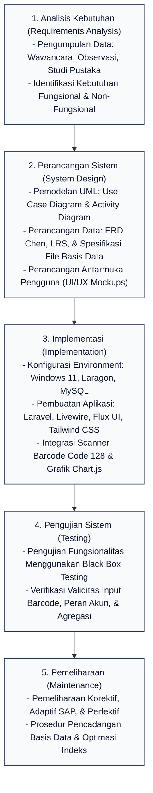
*(Sumber: Hasil Penelitian, 2026)*  
*Gambar 3.1: Alur Tahapan Metode Waterfall pada Pengembangan Sistem Dokumentasi Produksi Harian*

---

## 3.2 Tahap Pengembangan Perangkat Lunak

### A. Tahapan Perencanaan Kebutuhan

Tahap perencanaan kebutuhan merupakan langkah fondasional dalam siklus rekayasa perangkat lunak. Pada tahap ini, pengembang melakukan investigasi menyeluruh mengenai mekanisme operasional yang sedang berjalan pada Unit Pengemasan PT Percetakan Dokumen Sekuriti untuk mengidentifikasi akar permasalahan, memetakan kendala operasional, dan merumuskan batasan solusi teknologi yang tepat sasaran.

#### 1. Tahap Pengumpulan Data
Untuk memperoleh data yang akurat, komprehensif, dan relevan dengan kebutuhan sistem, proses pengumpulan data dilakukan melalui tiga teknik utama:

##### a. Wawancara
Wawancara mendalam (*in-depth interview*) dilakukan secara langsung dengan para pemangku kepentingan (*stakeholders*) di lingkungan Unit Pengemasan PT Percetakan Dokumen Sekuriti, antara lain:
1. **Kepala Unit / Supervisor Pengemasan (Bpk. Agus Soelistyo)**
   <br>
   Wawancara difokuskan pada prosedur operasional standar (SOP) pemeriksaan hasil produksi, mekanisme verifikasi laporan harian, kendala lambatnya penerimaan rekapitulasi kerja dari giliran kerja (*shift*) sebelumnya, serta kebutuhan terhadap instrumen pemantauan visual berupa grafik performa 14 hari kerja terakhir untuk mengevaluasi stabilitas produktivitas dan fluktuasi angka *reject*.
2. **Petugas Operator Pengemasan (Bpk. Umar Ibnu Zainal M. dan Operator Shift)**
   <br>
   Wawancara difokuskan pada alur teknis pencatatan fisik yang selama ini dilakukan di meja kerja pengemasan, kendala penyalinan manual dari Kartu Mesin Produksi ke lembar kertas folio, durasi waktu yang dihabiskan untuk mencatat data satu kartu mesin (mencapai 2 hingga 3 menit per pesanan), serta kesulitan dalam menelusuri riwayat pesanan yang terselip.

Dari hasil wawancara, disimpulkan bahwa pengguna sangat membutuhkan sistem berbasis web yang dapat mengisi data spesifikasi pesanan secara otomatis hanya dengan memindai barcode Nomor PO, sehingga petugas dapat berfokus pada aktivitas fisik pengemasan tanpa terbebani administrasi tulis tangan.

##### b. Observasi
Observasi lapangan dilakukan dengan mengamati secara langsung alur kerja fisik di ruang Unit Pengemasan PT Percetakan Dokumen Sekuriti di Karawang selama jam kerja aktif (meliputi Shift 1 Pagi, Shift 2 Siang, dan Shift 3 Malam).

Fokus pengamatan meliputi:
1. **Pemeriksaan Fisik Kartu Mesin Produksi:** Mengamati struktur atribut data yang tertera pada lembaran kartu mesin, termasuk keberadaan kode barcode linier tipe **Code 128** yang merepresentasikan Nomor PO (*Production Order*), nomor mesin cetak asal, jenis bahan kertas berpengaman, dan target kuantitas.
2. **Peralatan Kerja Tersedia:** Memeriksa ketersediaan fasilitas komputer PC dan perangkat *barcode scanner* genggam berbasis USB yang berada di meja kontrol pengemasan, yang selama ini belum terintegrasi ke dalam sistem pencatatan terpusat.
3. **Penanganan Dokumen Fisik:** Mengamati bagaimana lembaran formulir laporan harian ditumpuk, disalin ulang pada akhir shift, ditandatangani secara manual, dan disimpan dalam ordner arsip fisik yang rentan mengalami kerusakan fisik atau kehilangan data historis.

##### c. Studi Pustaka
Studi pustaka dilakukan dengan mengkaji berbagai referensi ilmiah, jurnal rekayasa perangkat lunak, buku teks, dan dokumentasi teknis yang relevan dengan topik penelitian.

Kajian pustaka mencakup:
1. Teori rekayasa perangkat lunak model Waterfall dan pemodelan visual menggunakan Unified Modeling Language (UML) dari literatur standar akademik.
2. Prinsip kerja simbologi barcode linier **Code 128** serta teknik penangkapan data masukan scanner melalui antarmuka *Human Interface Device* (HID) pada aplikasi web.
3. Arsitektur pengembangan web modern menggunakan kerangka kerja Laravel, Livewire untuk reaktivitas antarmuka, dan integrasi pustaka Chart.js untuk perenderan grafik analitik deret waktu (*time-series*).
4. Dokumentasi teknis mengenai standar keamanan dokumen sekuriti dan regulasi pengelolaan produksi dokumen sekuriti negara.

---

#### 2. Analisa Kebutuhan Sistem Pengguna

Kebutuhan fungsional mendefinisikan kapabilitas dan layanan yang wajib disediakan oleh sistem untuk memenuhi kebutuhan pengguna. Sistem informasi hasil produksi harian ini memiliki dua hak akses pengguna, yaitu Operator dan Kepala Unit (Supervisor), dengan rincian sebagai berikut:

**a. Kebutuhan Sistem Operator**
1) Operator dapat melakukan *login* ke dalam sistem.
2) Operator dapat mengakses halaman *Dashboard*.
3) Operator dapat membuka sesi laporan harian melalui menu **Buat Laporan** (PCHT, MMEA, atau HPTL).
4) Operator dapat memindai barcode Nomor PO dan menginputkan kuantitas hasil kemas pada konsol pemindaian.
5) Operator dapat melihat riwayat laporan melalui menu **Lihat Laporan**, mengekspor rekapitulasi ke Excel, dan mencetak lembar fisik laporan.
6) Operator dapat melakukan *logout* dari sistem.

**b. Kebutuhan Sistem Kepala Unit (Supervisor)**
1) Kepala Unit dapat melakukan *login* ke dalam sistem.
2) Kepala Unit dapat mengakses halaman *Dashboard*.
3) Kepala Unit dapat mengimpor berkas master data pesanan SAP dan mengelola data order melalui menu **Update Database**.
4) Kepala Unit dapat membuka sesi laporan dan melakukan pemindaian barcode melalui menu **Buat Laporan**.
5) Kepala Unit dapat melihat, memverifikasi, mengekspor Excel, dan mencetak seluruh riwayat laporan melalui menu **Lihat Laporan**.
6) Kepala Unit dapat mengelola data akun petugas melalui menu **Data Petugas**.
7) Kepala Unit dapat melakukan *logout* dari sistem.

##### Kebutuhan Non-Fungsional (*Non-Functional Requirements*)
Kebutuhan non-fungsional menetapkan batasan kualitas teknis dan performa sistem:
1. **Performa dan Kecepatan Respon:** Sistem memberikan respon pencarian data produk pada saat barcode Nomor PO dipindai dalam waktu kurang dari 1 detik, serta merender kalkulasi grafik analitik 14 hari kerja dalam waktu di bawah 2 detik pada jaringan lokal.
2. **Keandalan dan Integritas Transaksi Data:** Sistem menerapkan validasi pencegahan duplikasi entri barcode Nomor PO dalam satu sesi laporan harian dan membungkus proses penyimpanan dalam mekanisme transaksi basis data (*database transaction*).
3. **Kompatibilitas Perangkat Keras dan Perangkat Lunak:** Sistem kompatibel secara langsung (*Plug-and-Play*) dengan perangkat *barcode scanner* USB yang membaca format Code 128, dapat diakses melalui peramban web modern (*Google Chrome, Mozilla Firefox, Microsoft Edge*), dan format cetak disesuaikan untuk kertas standar A4.
4. **Kemudahan Penggunaan (*Usability*):** Tata letak antarmuka dirancang bersih, intuitif, dan kontras tinggi untuk mempermudah operasional di meja kerja pengemasan.
5. **Keamanan Sistem dan Data:** Seluruh kata sandi pengguna dienkripsi dengan algoritma *Bcrypt*, dilengkapi proteksi terhadap serangan CSRF, SQL Injection, XSS, serta pembatasan hak akses berbasis peran pengguna (*role-based middleware*).

---

### B. Tahap Analisis Pemodelan

Tahap analisis pemodelan bertujuan untuk memvisualisasikan struktur fungsional sistem melalui Use Case Diagram terpisah per peran pengguna, aliran aktivitas proses (Activity Diagram), skema hubungan entitas berbasis notasi Chen (ERD), representasi struktur record logis (LRS), serta spesifikasi detail berkas tabel data sebelum pembuatan aplikasi dilaksanakan.

#### 1. Use Case Diagram
Use Case Diagram mendeskripsikan interaksi fungsional antara aktor (pengguna sistem) dengan fungsi-fungsi yang disediakan oleh sistem. Pemodelan use case disusun berdasarkan menu navigasi utama aplikasi web yang benar-benar tersedia di antarmuka sistem, yaitu **Dashboard**, **Buat Laporan**, **Lihat Laporan**, **Update Database** (khusus Supervisor), dan **Data Petugas** (khusus Supervisor). Diagram use case dipisahkan menjadi dua diagram utama berdasarkan hak akses masing-masing aktor. Relasi `<<include>>` digunakan untuk use case Login sebagai prasyarat akses menu utama pada peran Operator, sedangkan relasi `<<extend>>` digunakan untuk fitur opsional seperti pilihan seri laporan (PCHT, MMEA, HPTL), ekspor Excel, cetak lembar fisik, serta verifikasi laporan (khusus Supervisor).

##### a. Use Case Diagram Hak Akses Petugas (Operator)
Diagram use case untuk peran Petugas (Operator Pengemasan) dimodelkan pada Gambar 3.2:

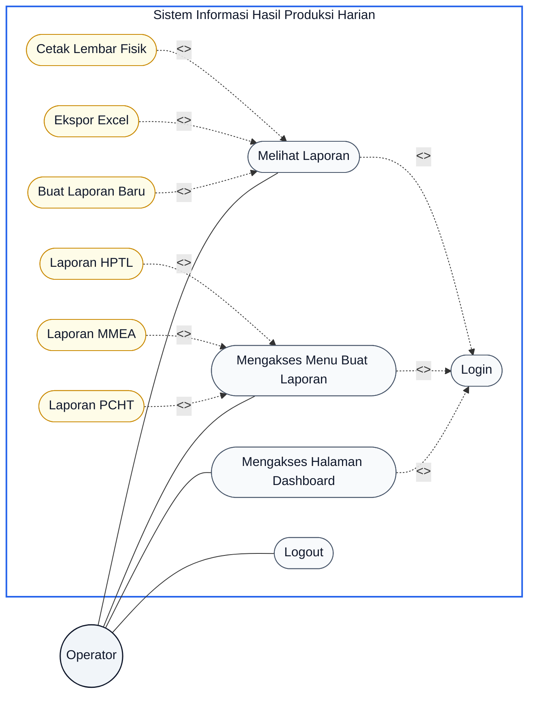
*(Sumber: Hasil Penelitian, 2026)*  
*Gambar 3.2: Use Case Diagram Hak Akses Petugas (Operator)*

##### b. Use Case Diagram Hak Akses Kepala Unit (Supervisor)
Diagram use case untuk peran Kepala Unit (Supervisor) dimodelkan pada Gambar 3.3:

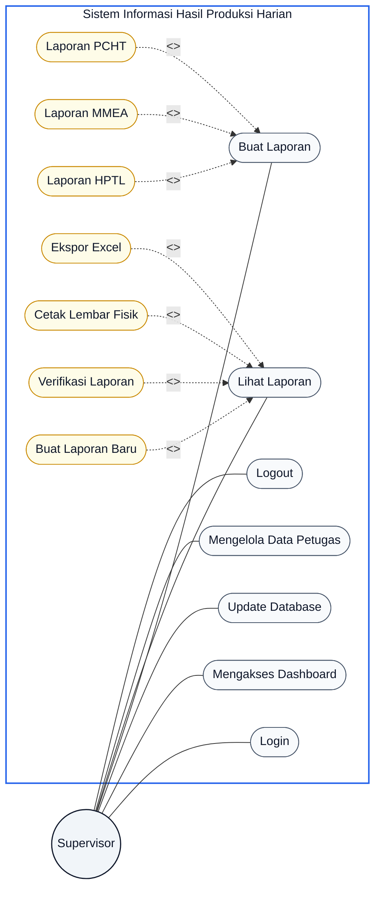
*(Sumber: Hasil Penelitian, 2026)*  
*Gambar 3.3: Use Case Diagram Hak Akses Kepala Unit (Supervisor)*

---

##### c. Tabel Deskripsi Skenario Use Case Sistem
Guna mendefinisikan secara terperinci mekanisme operasional setiap *use case*, berikut disajikan tabel deskripsi skenario yang selaras dengan antarmuka dan fungsionalitas sistem yang telah diimplementasikan (Tabel 3.1 s.d. Tabel 3.9):

*Tabel 3.1: Deskripsi Use Case Login*
| Elemen Use Case | Deskripsi Skenario |
|---|---|
| **Use Case Name** | Login |
| **Requirements** | Sistem harus dapat memvalidasi identitas pengguna berdasarkan kredensial Nomor Pegawai (NP), Username, atau Email beserta kata sandi untuk mengamankan hak akses fitur. |
| **Goal** | Pengguna (Operator atau Supervisor) berhasil masuk ke dalam sistem dengan hak akses menu yang sesuai perannya. |
| **Pre-Conditions** | Pengguna membuka peramban web dan berada pada halaman form login Sistem Informasi Hasil Produksi Harian. |
| **Post-Conditions** | Sistem mengalihkan pengguna ke halaman Dashboard utama sesuai dengan hak akses masing-masing aktor. |
| **Failed end Condition** | Sistem menolak akses pengguna, tetap berada di halaman login, dan menampilkan notifikasi kesalahan autentikasi. |
| **Actors** | Operator, Kepala Unit (Supervisor) |
| **Main Flow / Basic Path** | 1. User memasukkan Nomor Pegawai (NP) / Username / Email dan kata sandi pada kolom yang disediakan.<br>2. User menekan tombol "Masuk ke Sistem".<br>3. Sistem memvalidasi kecocokan data kredensial dengan database `users`.<br>4. Sistem berhasil mengautentikasi dan mengarahkan user ke halaman Dashboard utama. |
| **Alternate Flow / Invariant A** | A1. User mencentang opsi "Ingat Saya" sebelum menekan tombol login.<br>A2. Sistem memperpanjang durasi sesi autentikasi pengguna pada perangkat browser. |
| **Invariant B** | B1. User memasukkan NP/Username/Email yang tidak terdaftar atau kata sandi yang salah.<br>B2. Sistem mendeteksi kegagalan autentikasi.<br>B3. Sistem menampilkan pesan error "Nomor Pegawai/Username atau Kata Sandi yang dimasukkan salah."<br>B4. User memasukkan kredensial milik akun yang dinonaktifkan.<br>B5. Sistem menampilkan pesan "Akun Anda sedang dinonaktifkan. Silakan hubungi Supervisor." |
*(Sumber: Hasil Penelitian, 2026)*

*Tabel 3.2: Deskripsi Use Case Logout*
| Elemen Use Case | Deskripsi Skenario |
|---|---|
| **Use Case Name** | Logout |
| **Requirements** | Sistem harus dapat mengakhiri sesi autentikasi pengguna secara aman dan membersihkan token sesi dari perangkat browser. |
| **Goal** | Pengguna mengakhiri sesi kerja operasional dan mencegah akses tidak sah ke sistem. |
| **Pre-Conditions** | Pengguna telah berhasil login dan berada di halaman manapun dalam sistem. |
| **Post-Conditions** | Sesi autentikasi pengguna dihapus dan sistem mengarahkan kembali ke halaman login. |
| **Failed end Condition** | Sesi tetap aktif akibat kegagalan penghapusan cookie sesi di perangkat browser. |
| **Actors** | Operator, Kepala Unit (Supervisor) |
| **Main Flow / Basic Path** | 1. Pengguna mengklik menu profil akun di pojok kanan atas antarmuka.<br>2. Pengguna memilih opsi "Keluar" atau "Logout".<br>3. Sistem menginvalidasi token sesi autentikasi.<br>4. Sistem mengalihkan pengguna kembali ke halaman login. |
| **Alternate Flow / Invariant A** | A1. Pengguna menutup tab browser tanpa melakukan logout eksplisit.<br>A2. Sesi autentikasi berakhir otomatis setelah durasi timeout sistem. |
| **Invariant B** | B1. Terjadi gangguan jaringan saat proses logout.<br>B2. Sistem menampilkan halaman error sementara, namun sesi tetap diakhiri di sisi server. |
*(Sumber: Hasil Penelitian, 2026)*

*Tabel 3.3: Deskripsi Use Case Mengakses Halaman Dashboard*
| Elemen Use Case | Deskripsi Skenario |
|---|---|
| **Use Case Name** | Mengakses Halaman Dashboard |
| **Requirements** | Sistem harus menyajikan ringkasan metrik produksi harian, grafik tren produksi dengan opsi rentang 7, 14, atau 30 hari, serta pintasan menu cepat setelah pengguna berhasil login. |
| **Goal** | Pengguna memperoleh gambaran umum capaian produksi harian dan dapat beralih ke menu operasional lainnya. |
| **Pre-Conditions** | Pengguna telah berhasil login (`<<include>>` Login). |
| **Post-Conditions** | Halaman Dashboard tampil lengkap dengan kartu KPI harian, grafik tren produksi, widget distribusi shift, top 5 mesin, dan daftar laporan terbaru. |
| **Failed end Condition** | Dashboard gagal dimuat akibat kegagalan query agregasi data produksi di server. |
| **Actors** | Operator, Kepala Unit (Supervisor) |
| **Main Flow / Basic Path** | 1. Pengguna login dan sistem mengalihkan ke halaman Dashboard.<br>2. Sistem menghitung metrik produksi hari berjalan: total kemas baik, reject, order diproses, dan jumlah berkas laporan.<br>3. Sistem menampilkan 5 kartu KPI harian: **Kemas Baik Hari Ini**, **Reject / Rusak**, **Order Diproses**, **Berkas Laporan**, dan **Petugas Shift**.<br>4. Sistem merender grafik tren produksi (Chart.js) untuk rentang waktu default (14 Hari) dengan opsi toggle **7 Hari**, **14 Hari**, atau **30 Hari**, serta pilihan jenis grafik **Area**, **Garis**, atau **Batang**.<br>5. Sistem menampilkan widget distribusi volume per shift, ranking top 5 mesin cetak, dan tabel 5 laporan produksi terkini beserta tombol **"Buat Laporan Baru"**. |
| **Alternate Flow / Invariant A** | A1. Pengguna mengubah rentang waktu grafik dengan menekan tombol 7 Hari / 14 Hari / 30 Hari, atau mengganti jenis grafik.<br>A2. Sistem memuat ulang data grafik sesuai rentang terpilih.<br>A3. (Khusus Supervisor) Supervisor mengklik pintasan **"Update Database SAP"** atau **"Kelola Data Petugas"** dari kartu aksi cepat di Dashboard.<br>A4. Sistem mengalihkan pengguna ke halaman menu terkait. |
| **Invariant B** | B1. Belum ada rekaman data transaksi pada rentang waktu yang dipilih.<br>B2. Sistem menampilkan grafik dengan nilai nol dan keterangan data kosong pada widget terkait. |
*(Sumber: Hasil Penelitian, 2026)*

*Tabel 3.4: Deskripsi Use Case Mengakses Menu Buat Laporan*
| Elemen Use Case | Deskripsi Skenario |
|---|---|
| **Use Case Name** | Mengakses Menu Buat Laporan |
| **Requirements** | Sistem harus menyediakan halaman inisiasi sesi laporan harian dengan pilihan tanggal, seri produk, dan shift kerja sebelum operator masuk ke halaman entri pemindaian barcode. |
| **Goal** | Operator dapat memulai atau melanjutkan sesi laporan produksi harian sesuai kategori seri produk dan giliran kerja. |
| **Pre-Conditions** | Operator telah berhasil login (`<<include>>` Login). |
| **Post-Conditions** | Sesi laporan harian terbuka dan sistem mengalihkan operator ke halaman entri pemindaian barcode. |
| **Failed end Condition** | Sesi laporan gagal dibuat akibat kegagalan penyimpanan ke basis data. |
| **Actors** | Operator, Kepala Unit (Supervisor) |
| **Main Flow / Basic Path** | 1. Operator mengklik menu "Buat Laporan" pada navigasi utama.<br>2. Sistem menampilkan halaman **"Inisiasi Sesi Laporan Produksi"** dengan form pilihan tanggal, kategori seri produk (PCHT / MMEA / HPTL), shift kerja, dan catatan sesi opsional. Sistem secara otomatis mendeteksi dan pra-mengisi shift kerja yang sedang aktif berdasarkan waktu saat ini (WIB).<br>3. Sistem menampilkan pratinjau kode laporan sesi secara otomatis (contoh: `PCHT-2026-08-26-S1`).<br>4. Operator menekan tombol **"Buka Sesi Pemindaian PO"** (atau **"Lanjutkan Sesi Pemindaian PO"** jika sesi sudah ada).<br>5. Sistem membuat record laporan baru berstatus `Draft` atau membuka sesi yang sudah ada, lalu mengalihkan ke halaman konsol pemindaian barcode. |
| **Alternate Flow / Invariant A** | A1. Sesi laporan untuk kombinasi tanggal, seri produk, dan shift yang sama sudah pernah dibuat.<br>A2. Sistem mendeteksi sesi aktif dan langsung membuka halaman konsol pemindaian tanpa membuat duplikat, dengan notifikasi "Sesi laporan {kode} ditemukan. Membuka sesi aktif...". |
| **Invariant B** | B1. Operator tidak memilih seri produk atau shift kerja.<br>B2. Sistem menolak inisiasi sesi.<br>B3. Sistem menampilkan pesan validasi "Kategori seri produk wajib dipilih" atau "Shift kerja wajib dipilih". |
*(Sumber: Hasil Penelitian, 2026)*

*Tabel 3.5: Deskripsi Use Case Pemindaian Barcode & Entri Kemas (PCHT / MMEA / HPTL)*
| Elemen Use Case | Deskripsi Skenario |
|---|---|
| **Use Case Name** | Pemindaian Barcode & Entri Kemas (PCHT / MMEA / HPTL) |
| **Requirements** | Sistem harus mampu menerima data hasil scanner barcode Code 128, melakukan lookup instan ke master data SAP, menyimpan item langsung ke basis data, dan mengubah status laporan dari Draft menjadi Terkirim setelah selesai. |
| **Goal** | Operator menyelesaikan pencatatan hasil pengemasan harian untuk seri produk tertentu melalui konsol pemindaian barcode berkecepatan tinggi. |
| **Pre-Conditions** | Operator telah membuka sesi laporan melalui menu Buat Laporan (`<<extend>>` dari Mengakses Menu Buat Laporan) dan berada di halaman konsol pemindaian (`/reports/{kode}/entry`). |
| **Post-Conditions** | Item PO tersimpan di tabel `daily_report_items` dan laporan berstatus `submitted` (Terkirim / Selesai Scan) setelah operator menekan "Selesaikan Laporan". |
| **Failed end Condition** | Data pesanan gagal dimuat karena Nomor PO belum diimpor ke master data SAP. |
| **Actors** | Operator, Kepala Unit (Supervisor) |
| **Main Flow / Basic Path** | 1. Operator memindai barcode Code 128 pada Kartu Mesin Produksi ke kolom input **"1. Scan / Masukkan No PO Barcode"**.<br>2. Sistem mencari data pada tabel `production_orders` dan menampilkan Nama Produk, Spesifikasi, Nomor Mesin, dan Target Kuantitas SAP.<br>3. Operator menginputkan jumlah kemas pada kolom **"2. Jumlah Kemas (Lembar)"** dan menekan **"Simpan Item (Enter)"**.<br>4. Sistem menyimpan baris item ke basis data, menampilkan notifikasi sukses, dan mengembalikan fokus ke input barcode untuk PO berikutnya.<br>5. Operator dapat mengoreksi kuantitas secara langsung pada tabel (inline edit) atau menghapus baris item selama status laporan masih `Draft`.<br>6. Setelah seluruh Kartu Mesin shift tercatat, operator menekan **"Selesaikan Laporan"**.<br>7. Sistem mengubah status laporan dari `Draft` menjadi `Terkirim (Selesai Scan)` dan mengunci sesi dari penambahan item baru oleh operator. |
| **Alternate Flow / Invariant A** | A1. (Khusus Supervisor) Supervisor dapat menekan **"Buka Kembali Sesi"** pada laporan berstatus Terkirim untuk mengembalikan status ke `Draft`.<br>A2. Supervisor dapat menambah atau mengubah item kemas meskipun laporan sudah berstatus Terkirim. |
| **Invariant B** | B1. Operator memindai Nomor PO yang belum terdaftar di master SAP.<br>B2. Sistem membunyikan nada peringatan dan menampilkan notifikasi "No PO '{po_number}' tidak ditemukan pada Master Data SAP. Pastikan file SAP sudah diimpor."<br>B3. Operator mencoba menambah item saat laporan sudah bukan status `Draft`.<br>B4. Sistem menolak dan menampilkan "Laporan sudah diselesaikan dan terkunci dari penambahan item baru." |
*(Sumber: Hasil Penelitian, 2026)*

*Tabel 3.6: Deskripsi Use Case Melihat Laporan*
| Elemen Use Case | Deskripsi Skenario |
|---|---|
| **Use Case Name** | Melihat Laporan |
| **Requirements** | Sistem harus menyajikan arsip laporan produksi harian dengan filter multi-kriteria, rincian item per laporan, dan aksi verifikasi (khusus Supervisor). |
| **Goal** | Pengguna dapat meninjau riwayat laporan harian, melihat rincian item kemas, dan melakukan tindakan lanjutan seperti verifikasi atau cetak dokumen. |
| **Pre-Conditions** | Pengguna telah berhasil login ke dalam sistem. |
| **Post-Conditions** | Sistem menampilkan tabel arsip laporan atau rincian detail laporan yang dipilih. |
| **Failed end Condition** | Data laporan gagal dimuat akibat parameter filter yang tidak valid. |
| **Actors** | Operator, Kepala Unit (Supervisor) |
| **Main Flow / Basic Path** | 1. Pengguna mengklik menu "Lihat Laporan" pada navigasi utama.<br>2. Sistem menampilkan halaman arsip **"Laporan Produksi"** dengan 3 kartu statistik ringkasan (Total Berkas Laporan, Total Lembar Kemas Baik, Total Lembar Reject) dan tabel daftar laporan.<br>3. Pengguna memfilter berdasarkan kata kunci, tanggal, seri produk, shift, status (Draft / Terkirim / Terverifikasi), atau nama petugas.<br>4. Pengguna menekan tombol aksi **"Lihat Rincian"** pada baris laporan untuk membuka halaman detail.<br>5. Sistem menampilkan kartu metadata laporan, metrik realisasi, tabel rincian item PO, dan tombol aksi sesuai peran pengguna. |
| **Alternate Flow / Invariant A** | A1. Pengguna menekan **"Buat Laporan Baru"** dari halaman arsip untuk membuka sesi laporan baru.<br>A2. Pengguna menekan **"Ekspor Excel"** untuk mengunduh rekapitulasi data (lihat Tabel 3.7).<br>A3. Pengguna menekan **"Cetak Lembar Fisik"** untuk membuka tampilan cetak A4 (`/reports/{kode}/print`).<br>A4. (Khusus Operator) Operator menekan **"Koreksi Laporan"** untuk membuka halaman edit jika laporan milik sendiri, belum diverifikasi, dan masih dalam batas 24 jam.<br>A5. (Khusus Supervisor) Supervisor menekan **"Verifikasi Laporan"** pada halaman rincian untuk mengubah status laporan menjadi `Terverifikasi (Disetujui Ka. Unit)`.<br>A6. (Khusus Supervisor) Supervisor dapat menghapus laporan melalui modal konfirmasi **"Hapus Permanen"**.<br>A7. (Khusus Supervisor) Supervisor dapat menekan **"Buka Kembali Sesi"** pada konsol pemindaian laporan berstatus Terkirim untuk mengembalikan status ke `Draft`.<br>A8. (Khusus Supervisor) Supervisor dapat membuka halaman **"Koreksi Laporan"** tanpa batasan waktu dan tanpa syarat kepemilikan. |
| **Invariant B** | B1. Operator mencoba mengoreksi laporan milik operator lain atau laporan yang sudah lewat 24 jam.<br>B2. Sistem menolak akses edit dan tombol "Koreksi Laporan" tidak ditampilkan.<br>B3. Operator mencoba mengubah laporan berstatus `verified`.<br>B4. Sistem menampilkan peringatan bahwa laporan telah diverifikasi dan terkunci. |
*(Sumber: Hasil Penelitian, 2026)*

*Tabel 3.7: Deskripsi Use Case Ekspor Excel*
| Elemen Use Case | Deskripsi Skenario |
|---|---|
| **Use Case Name** | Ekspor Excel |
| **Requirements** | Sistem harus dapat mengekspor rekapitulasi data laporan produksi harian ke berkas spreadsheet Microsoft Excel (`.xlsx`) berdasarkan filter rentang tanggal, seri produk, shift, dan status. |
| **Goal** | Pengguna memperoleh salinan digital data laporan dalam format Excel untuk keperluan arsip, analisis lanjutan, atau pelaporan administratif. |
| **Pre-Conditions** | Pengguna berada di halaman "Lihat Laporan" (`<<extend>>` dari Melihat Laporan). |
| **Post-Conditions** | Berkas Excel (`.xlsx`) berhasil diunduh ke perangkat komputer lokal pengguna. |
| **Failed end Condition** | Ekspor gagal karena tidak ada data laporan yang sesuai dengan filter yang dipilih. |
| **Actors** | Operator, Kepala Unit (Supervisor) |
| **Main Flow / Basic Path** | 1. Pengguna menekan tombol "Ekspor Excel" pada halaman Lihat Laporan.<br>2. Sistem menampilkan modal "Ekspor Rekapitulasi Produksi (Excel)" dengan filter rentang tanggal, seri produk, shift, dan status.<br>3. Pengguna menentukan parameter filter dan menekan "Unduh File Excel (.xlsx)".<br>4. Sistem memproses query agregasi data laporan sesuai filter melalui endpoint `/reports/export`.<br>5. Sistem menghasilkan berkas `.xlsx` dan memicu unduhan otomatis ke perangkat lokal. |
| **Alternate Flow / Invariant A** | A1. Pengguna memfilter hanya seri produk PCHT dan shift Shift 1.<br>A2. Sistem mengekspor data terbatas sesuai kriteria filter yang dipilih. |
| **Invariant B** | B1. Rentang tanggal filter tidak valid (tanggal akhir lebih awal dari tanggal awal).<br>B2. Sistem menolak proses ekspor.<br>B3. Sistem menampilkan pesan validasi "Rentang tanggal tidak valid". |
*(Sumber: Hasil Penelitian, 2026)*

*Tabel 3.8: Deskripsi Use Case Update Database*
| Elemen Use Case | Deskripsi Skenario |
|---|---|
| **Use Case Name** | Update Database |
| **Requirements** | Sistem harus menyediakan antarmuka impor berkas SAP (`.xlsx`, `.xls`, `.csv`), penjelajah dan pengelolaan data order produksi (CRUD manual), riwayat impor, serta unduh template SAP. |
| **Goal** | Master data pesanan produksi SAP terbarui di basis data aplikasi sebagai referensi instan pemindaian barcode kartu mesin. |
| **Pre-Conditions** | Kepala Unit (Supervisor) telah login dan memiliki akses menu "Update Database". |
| **Post-Conditions** | Data pesanan tersimpan di tabel `production_orders` dan riwayat impor tercatat di tabel `sap_import_logs`. |
| **Failed end Condition** | Berkas ditolak karena format ekstensi tidak didukung atau struktur kolom wajib tidak sesuai standar. |
| **Actors** | Kepala Unit (Supervisor) |
| **Main Flow / Basic Path** | 1. Supervisor mengklik menu "Update Database" pada navigasi utama.<br>2. Sistem menampilkan halaman "Update Database SAP" dengan dua tab: **Impor SAP** dan **Data Order Produksi**.<br>3. (Tab Impor) Supervisor mengunggah berkas ekspor SAP, sistem menampilkan pratinjau validasi baris, lalu Supervisor menekan konfirmasi impor.<br>4. Sistem melakukan *bulk upsert* ke tabel `production_orders` dan mencatat riwayat impor.<br>5. (Tab Data Order) Supervisor dapat menambah order manual, mengubah spesifikasi order, menghapus order, memfilter data, dan mengekspor master data ke Excel. |
| **Alternate Flow / Invariant A** | A1. Berkas berisi Nomor PO yang sudah ada di basis data dengan revisi target kuantitas.<br>A2. Sistem secara cerdas memperbarui data yang ada (*update*) tanpa menduplikasi rekaman data. |
| **Invariant B** | B1. Supervisor mengunggah berkas dengan tipe file yang tidak valid (misal: `.pdf` atau `.docx`).<br>B2. Sistem membatalkan proses unggah.<br>B3. Sistem menampilkan pesan error "Format berkas tidak valid! Hanya berkas .xlsx dan .csv yang diizinkan". |
*(Sumber: Hasil Penelitian, 2026)*

*Tabel 3.9: Deskripsi Use Case Mengelola Data Petugas*
| Elemen Use Case | Deskripsi Skenario |
|---|---|
| **Use Case Name** | Mengelola Data Petugas |
| **Requirements** | Sistem harus menyediakan fasilitas bagi Supervisor untuk menambah, melihat, mengubah profil, menonaktifkan, menghapus, dan mereset kata sandi akun operator pengemasan. |
| **Goal** | Data akun pengguna sistem terkelola secara terpusat, aman, dan tertib berdasarkan identitas Nomor Pegawai (NP/NIP). |
| **Pre-Conditions** | Kepala Unit (Supervisor) telah berhasil login ke dalam sistem. |
| **Post-Conditions** | Data akun petugas baru tersimpan, terbarui, dinonaktifkan, atau dihapus dari basis data `users`. |
| **Failed end Condition** | Pendaftaran atau pembaruan akun gagal akibat duplikasi Nomor Pegawai (NP/NIP) atau email di basis data. |
| **Actors** | Kepala Unit (Supervisor) |
| **Main Flow / Basic Path** | 1. Supervisor mengklik menu "Data Petugas" pada navigasi utama.<br>2. Sistem menampilkan tabel daftar akun petugas dengan filter pencarian nama/NIP, peran, dan status aktif.<br>3. Supervisor menekan "Tambah Petugas Baru" atau ikon edit pada baris akun petugas tertentu.<br>4. Sistem menampilkan modal form isian: Nama Lengkap, NIP/NP, Username, Email, Peran (Petugas / Supervisor), Kata Sandi, dan Status Aktif.<br>5. Supervisor menyimpan data dan sistem memvalidasi serta menyimpan ke tabel `users`. |
| **Alternate Flow / Invariant A** | A1. Supervisor menonaktifkan akun petugas melalui opsi toggle status aktif/nonaktif pada baris tabel.<br>A2. Supervisor menghapus akun petugas melalui modal konfirmasi hapus (ditolak jika akun sudah tercatat pada laporan produksi, atau jika akun adalah akun milik sendiri). |
| **Invariant B** | B1. Supervisor mendaftarkan Nomor Pegawai (NP) atau Email yang sudah terdaftar sebelumnya.<br>B2. Sistem menolak proses penyimpanan.<br>B3. Sistem menampilkan notifikasi validasi duplikasi data. |
*(Sumber: Hasil Penelitian, 2026)*

---

#### 2. Activity Diagram
Activity Diagram memodelkan aliran aktivitas operasional dan logika transisi sistem pada masing-masing fitur utama dengan membagi peran ke dalam partisi jalur aktivitas (*swimlanes*). Setiap diagram disusun berdasarkan alur halaman dan aksi yang benar-benar diimplementasikan pada aplikasi web (menu navigasi, tombol aksi, status laporan, dan validasi sistem).

##### a. Activity Diagram Login Sistem
Diagram ini menggambarkan alur kerja saat pengguna (Operator atau Supervisor) melakukan autentikasi ke dalam sistem melalui halaman login Fortify/Livewire:

```mermaid
%%{init: {'theme': 'base', 'themeVariables': { 'primaryColor': '#ffffff', 'primaryBorderColor': '#000000', 'primaryTextColor': '#000000', 'lineColor': '#000000', 'textColor': '#000000', 'clusterBkg': '#ffffff', 'clusterBorder': '#000000', 'edgeLabelBackground':'#ffffff' }}}%%
flowchart TD
    subgraph Pengguna ["Pengguna (Operator / Supervisor)"]
        P_Start(( ))
        P_Buka(Buka Halaman<br/>Login)
        P_Input(Input NP / Username /<br/>Email dan Password)
        P_Kirim(Klik Tombol<br/>Masuk ke Sistem)
        P_Dash(Tampil Halaman<br/>Dashboard)
        P_End((( )))
    end

    subgraph Sistem ["Sistem"]
        S_Form(Tampilkan Form<br/>Login)
        S_Val{Kredensial<br/>Valid?}
        S_Aktif{Akun<br/>Aktif?}
        S_Err(Tampilkan Pesan<br/>Kredensial Salah)
        S_RateCheck{Percobaan<br/>Gagal >= 5?}
        S_Lockout(Tampilkan Pesan<br/>Terlalu Banyak Percobaan<br/>& Kunci Sementara)
        S_NonAktif(Tampilkan Pesan<br/>Akun Dinonaktifkan)
        S_Auth(Inisialisasi Sesi &<br/>Regenerasi Token)
    end

    P_Start --> P_Buka
    P_Buka --> S_Form
    S_Form --> P_Input
    P_Input --> P_Kirim
    P_Kirim --> S_Val
    S_Val -- Tidak Valid --> S_RateCheck
    S_RateCheck -- Ya --> S_Lockout
    S_Lockout --> S_Form
    S_RateCheck -- Belum --> S_Err
    S_Err --> S_Form
    S_Val -- Valid --> S_Aktif
    S_Aktif -- Tidak --> S_NonAktif
    S_NonAktif --> S_Form
    S_Aktif -- Ya --> S_Auth
    S_Auth --> P_Dash
    P_Dash --> P_End

    style P_Start fill:#000000,stroke:#000000,stroke-width:2px;
    style P_End fill:#ffffff,stroke:#000000,stroke-width:2px;
```
*(Sumber: Hasil Penelitian, 2026)*  
*Gambar 3.4: Activity Diagram Login Sistem*

##### b. Activity Diagram Mengelola Data Petugas
Diagram ini memodelkan aktivitas pengelolaan data akun petugas oleh Supervisor melalui menu Data Petugas, termasuk tambah, edit, nonaktifkan, dan hapus akun:

```mermaid
%%{init: {'theme': 'base', 'themeVariables': { 'primaryColor': '#ffffff', 'primaryBorderColor': '#000000', 'primaryTextColor': '#000000', 'lineColor': '#000000', 'textColor': '#000000', 'clusterBkg': '#ffffff', 'clusterBorder': '#000000', 'edgeLabelBackground':'#ffffff' }}}%%
flowchart TD
    subgraph Supervisor ["Supervisor (Kepala Unit)"]
        SP_Start(( ))
        SP_Buka(Buka Menu<br/>Data Petugas)
        SP_Pilih{Pilih Aksi<br/>Pengelolaan?}
        SP_Input(Isi Form Modal<br/>Tambah / Edit Petugas)
        SP_Simpan(Klik Simpan Data)
        SP_Toggle(Toggle Status<br/>Aktif / Nonaktif)
        SP_Hapus(Konfirmasi<br/>Hapus Akun)
        SP_End((( )))
    end

    subgraph Sistem ["Sistem"]
        SS_Tampil(Tampilkan Tabel Petugas<br/>dengan Filter)
        SS_Modal(Tampilkan Modal<br/>Form Petugas)
        SS_Val{Validasi<br/>NP / Email Unik?}
        SS_Err(Tampilkan Notifikasi<br/>Galat Validasi)
        SS_Save(Simpan / Update<br/>ke Tabel users)
        SS_Status(Update Flag<br/>is_active)
        SS_SelfCheck{Akun<br/>Milik Sendiri?}
        SS_SelfErr(Tolak Hapus<br/>Akun Sendiri)
        SS_Del{Akun Sudah<br/>Tercatat di Laporan?}
        SS_DelErr(Tolak Hapus &<br/>Sarankan Nonaktifkan)
        SS_DelOk(Hapus Rekaman<br/>Akun Petugas)
        SS_Notif(Kirim Notifikasi<br/>Sukses)
    end

    SP_Start --> SP_Buka
    SP_Buka --> SS_Tampil
    SS_Tampil --> SP_Pilih
    SP_Pilih -- Tambah / Edit --> SS_Modal
    SS_Modal --> SP_Input
    SP_Input --> SP_Simpan
    SP_Simpan --> SS_Val
    SS_Val -- Tidak Valid --> SS_Err
    SS_Err --> SS_Modal
    SS_Val -- Valid --> SS_Save
    SS_Save --> SS_Notif
    SP_Pilih -- Nonaktifkan --> SP_Toggle
    SP_Toggle --> SS_Status
    SS_Status --> SS_Notif
    SP_Pilih -- Hapus --> SP_Hapus
    SP_Hapus --> SS_SelfCheck
    SS_SelfCheck -- Ya --> SS_SelfErr
    SS_SelfErr --> SS_Tampil
    SS_SelfCheck -- Tidak --> SS_Del
    SS_Del -- Ya --> SS_DelErr
    SS_DelErr --> SS_Tampil
    SS_Del -- Tidak --> SS_DelOk
    SS_DelOk --> SS_Notif
    SS_Notif --> SP_End

    style SP_Start fill:#000000,stroke:#000000,stroke-width:2px;
    style SP_End fill:#ffffff,stroke:#000000,stroke-width:2px;
```
*(Sumber: Hasil Penelitian, 2026)*  
*Gambar 3.5: Activity Diagram Mengelola Data Petugas*

##### c. Activity Diagram Update Database
Diagram ini menggambarkan alur kerja Supervisor pada halaman Update Database SAP, yang terdiri atas dua tab: Impor Berkas SAP dan Master Data Order Produksi:

```mermaid
%%{init: {'theme': 'base', 'themeVariables': { 'primaryColor': '#ffffff', 'primaryBorderColor': '#000000', 'primaryTextColor': '#000000', 'lineColor': '#000000', 'textColor': '#000000', 'clusterBkg': '#ffffff', 'clusterBorder': '#000000', 'edgeLabelBackground':'#ffffff' }}}%%
flowchart TD
    subgraph Supervisor ["Supervisor (Kepala Unit)"]
        S_Start(( ))
        S_Buka(Buka Menu<br/>Update Database)
        S_Tab{Pilih Tab<br/>Menu?}
        S_Upload(Pilih & Unggah<br/>Berkas SAP)
        S_Konfirm(Konfirmasi Impor<br/>di Modal Pratinjau)
        S_Order(Kelola Order:<br/>Tambah / Edit / Hapus)
        S_End((( )))
    end

    subgraph Sistem ["Sistem"]
        SIS_Tampil(Tampilkan Halaman<br/>Update Database SAP)
        SIS_Preview(Parsing Berkas &<br/>Tampilkan Modal Pratinjau)
        SIS_Val{Validasi Format<br/>& Baris Data?}
        SIS_Err(Tampilkan Pesan<br/>Format Tidak Sesuai)
        SIS_Upsert(Bulk Upsert ke<br/>production_orders)
        SIS_Log(Catat sap_import_logs<br/>& Notifikasi Sukses)
        SIS_CRUD(Simpan / Update /<br/>Hapus Order Manual)
        SIS_Export(Ekspor Master Data<br/>ke Excel)
        S_AksiOrder{Pilih Aksi<br/>Order?}
    end

    S_Start --> S_Buka
    S_Buka --> SIS_Tampil
    SIS_Tampil --> S_Tab
    S_Tab -- Impor SAP --> S_Upload
    S_Upload --> SIS_Preview
    SIS_Preview --> SIS_Val
    SIS_Val -- Tidak Valid --> SIS_Err
    SIS_Err --> SIS_Tampil
    SIS_Val -- Valid --> S_Konfirm
    S_Konfirm --> SIS_Upsert
    SIS_Upsert --> SIS_Log
    SIS_Log --> S_End
    S_Tab -- Data Order --> S_Order
    S_Order --> S_AksiOrder
    S_AksiOrder -- Tambah / Edit / Hapus --> SIS_CRUD
    SIS_CRUD --> S_End
    S_AksiOrder -- Ekspor Excel --> SIS_Export
    SIS_Export --> S_End

    style S_Start fill:#000000,stroke:#000000,stroke-width:2px;
    style S_End fill:#ffffff,stroke:#000000,stroke-width:2px;
```
*(Sumber: Hasil Penelitian, 2026)*  
*Gambar 3.6: Activity Diagram Update Database*

##### d. Activity Diagram Buat Laporan (Inisiasi Sesi & Pemindaian Barcode)
Diagram ini memodelkan alur dua tahap pembuatan laporan: (1) inisiasi sesi laporan di menu Buat Laporan, dan (2) konsol pemindaian barcode serta penyelesaian laporan:

```mermaid
%%{init: {'theme': 'base', 'themeVariables': { 'primaryColor': '#ffffff', 'primaryBorderColor': '#000000', 'primaryTextColor': '#000000', 'lineColor': '#000000', 'textColor': '#000000', 'clusterBkg': '#ffffff', 'clusterBorder': '#000000', 'edgeLabelBackground':'#ffffff' }}}%%
flowchart TD
    subgraph Operator ["Operator / Supervisor"]
        P_Start(( ))
        P_Buka(Buka Menu<br/>Buat Laporan)
        P_Pilih(Pilih Tanggal, Seri<br/>PCHT/MMEA/HPTL, & Shift)
        P_Launch(Klik Buka / Lanjutkan<br/>Sesi Pemindaian PO)
        P_Scan(Scan / Input<br/>No PO Barcode)
        P_Qty(Input Jumlah Kemas<br/>Lembar)
        P_SimpanItem(Klik Simpan Item)
        P_Cek{Masih Ada<br/>Kartu Mesin?}
        P_Selesai(Klik Selesaikan<br/>Laporan)
        P_End((( )))
    end

    subgraph Sistem ["Sistem"]
        S_Form(Tampilkan Form<br/>Inisiasi Sesi)
        S_AutoShift(Deteksi &<br/>Pra-isi Shift Aktif Saat Ini)
        S_BuatSesi{Buat Sesi Baru<br/>atau Lanjutkan?}
        S_Record(Buat / Buka Record<br/>daily_reports status Draft)
        S_Konsol(Tampilkan Konsol<br/>Pemindaian Barcode)
        S_Cari{Cari No PO di<br/>Master SAP?}
        S_Err(Peringatan PO<br/>Tidak Ditemukan)
        S_Info(Tampilkan Spesifikasi<br/>Produk Otomatis)
        S_Item(Simpan Item Langsung<br/>ke daily_report_items)
        S_Final(Ubah Status<br/>Draft ke Submitted)
        S_Notif(Notifikasi Laporan<br/>Berhasil Diselesaikan)
    end

    P_Start --> P_Buka
    P_Buka --> S_Form
    S_Form --> S_AutoShift
    S_AutoShift --> P_Pilih
    P_Pilih --> P_Launch
    P_Launch --> S_BuatSesi
    S_BuatSesi --> S_Record
    S_Record --> S_Konsol
    S_Konsol --> P_Scan
    P_Scan --> S_Cari
    S_Cari -- Tidak Ditemukan --> S_Err
    S_Err --> S_Konsol
    S_Cari -- Ditemukan --> S_Info
    S_Info --> P_Qty
    P_Qty --> P_SimpanItem
    P_SimpanItem --> S_Item
    S_Item --> P_Cek
    P_Cek -- Ya --> P_Scan
    P_Cek -- Tidak --> P_Selesai
    P_Selesai --> S_Final
    S_Final --> S_Notif
    S_Notif --> P_End

    style P_Start fill:#000000,stroke:#000000,stroke-width:2px;
    style P_End fill:#ffffff,stroke:#000000,stroke-width:2px;
```
*(Sumber: Hasil Penelitian, 2026)*  
*Gambar 3.7: Activity Diagram Buat Laporan (Inisiasi Sesi & Pemindaian Barcode)*

##### e. Activity Diagram Melihat Laporan (Arsip, Verifikasi, Hapus & Cetak)
Diagram ini menggambarkan alur peninjauan arsip laporan, ekspor Excel, koreksi laporan, verifikasi Supervisor, hapus laporan, buka kembali sesi, dan cetak lembar fisik A4:

```mermaid
%%{init: {'theme': 'base', 'themeVariables': { 'primaryColor': '#ffffff', 'primaryBorderColor': '#000000', 'primaryTextColor': '#000000', 'lineColor': '#000000', 'textColor': '#000000', 'clusterBkg': '#ffffff', 'clusterBorder': '#000000', 'edgeLabelBackground':'#ffffff' }}}%%
flowchart TD
    subgraph Pengguna ["Operator / Supervisor"]
        U_Start(( ))
        U_Buka(Buka Menu<br/>Lihat Laporan)
        U_Aksi{Pilih Aksi<br/>di Halaman Arsip?}
        U_Filter(Set Filter Tanggal /<br/>Seri / Shift / Status)
        U_Detail(Buka Rincian<br/>Laporan)
        U_Aksi2{Pilih Aksi<br/>di Halaman Detail?}
        U_Excel(Set Filter & Unduh<br/>Excel)
        U_Edit(Buka Halaman<br/>Koreksi Laporan)
        U_Verif(Konfirmasi<br/>Verifikasi Laporan)
        U_Cetak(Buka Cetak<br/>Lembar Fisik A4)
        U_Hapus(Konfirmasi<br/>Hapus Laporan)
        U_Reopen(Konfirmasi<br/>Buka Kembali Sesi)
        U_End((( )))
    end

    subgraph Sistem ["Sistem"]
        S_Arsip(Tampilkan Arsip Laporan<br/>& Statistik Ringkasan)
        S_Filter(Terapkan Filter<br/>Multi-Kriteria)
        S_Modal(Tampilkan Modal<br/>Ekspor Excel)
        S_Export(Generate & Unduh<br/>Berkas .xlsx)
        S_Rincian(Tampilkan Detail Item<br/>& Metrik Realisasi)
        S_IzinEdit{Pengguna Berhak<br/>Edit Laporan?}
        S_FormEdit(Tampilkan Form<br/>Koreksi Laporan)
        S_SaveEdit(Simpan Perubahan<br/>Item & Catatan)
        S_SetVerif(Ubah Status ke<br/>Verified & Catat Supervisor)
        S_Print(Render Tampilan Cetak<br/>Standar A4)
        S_DeleteReport(Hapus Rekaman<br/>Laporan dari Basis Data)
        S_ReopenReport(Ubah Status<br/>Submitted ke Draft)
    end

    U_Start --> U_Buka
    U_Buka --> S_Arsip
    S_Arsip --> U_Aksi
    U_Aksi -- Filter --> U_Filter
    U_Filter --> S_Filter
    S_Filter --> S_Arsip
    U_Aksi -- Ekspor Excel --> U_Excel
    U_Excel --> S_Modal
    S_Modal --> S_Export
    S_Export --> U_End
    U_Aksi -- Lihat Detail --> U_Detail
    U_Detail --> S_Rincian
    S_Rincian --> U_Aksi2
    U_Aksi2 -- Koreksi --> S_IzinEdit
    S_IzinEdit -- Tidak --> S_Rincian
    S_IzinEdit -- Ya --> U_Edit
    U_Edit --> S_FormEdit
    S_FormEdit --> S_SaveEdit
    S_SaveEdit --> S_Rincian
    U_Aksi2 -- Verifikasi --> U_Verif
    U_Verif --> S_SetVerif
    S_SetVerif --> S_Rincian
    U_Aksi2 -- Cetak --> U_Cetak
    U_Cetak --> S_Print
    S_Print --> U_End
    U_Aksi2 -- "Hapus (Supervisor)" --> U_Hapus
    U_Hapus --> S_DeleteReport
    S_DeleteReport --> U_End
    U_Aksi2 -- "Buka Kembali (Supervisor)" --> U_Reopen
    U_Reopen --> S_ReopenReport
    S_ReopenReport --> S_Rincian

    style U_Start fill:#000000,stroke:#000000,stroke-width:2px;
    style U_End fill:#ffffff,stroke:#000000,stroke-width:2px;
```
*(Sumber: Hasil Penelitian, 2026)*  
*Gambar 3.8: Activity Diagram Melihat Laporan (Arsip, Verifikasi, Hapus & Cetak)*

##### f. Activity Diagram Dashboard dan Visualisasi Grafik Performa
Diagram ini menjelaskan alur pemrosesan data saat pengguna mengakses halaman Dashboard, termasuk metrik harian, grafik tren produksi, distribusi shift, ranking top 5 mesin cetak, dan daftar 5 laporan terbaru:

```mermaid
%%{init: {'theme': 'base', 'themeVariables': { 'primaryColor': '#ffffff', 'primaryBorderColor': '#000000', 'primaryTextColor': '#000000', 'lineColor': '#000000', 'textColor': '#000000', 'clusterBkg': '#ffffff', 'clusterBorder': '#000000', 'edgeLabelBackground':'#ffffff' }}}%%
flowchart TD
    subgraph Pengguna ["Operator / Supervisor"]
        U_Start(( ))
        U_Buka(Mengakses Menu<br/>Dashboard)
        U_Opsi{Ubah Rentang<br/>Grafik?}
        U_Pilih(Pilih 7 / 14 / 30 Hari<br/>atau Tipe Grafik)
        U_Lihat(Meninjau KPI Harian,<br/>Grafik, & Laporan Terbaru)
        U_End((( )))
    end

    subgraph Sistem ["Sistem"]
        S_Metrik(Hitung Metrik<br/>Produksi Hari Ini)
        S_Rentang(Set Rentang Waktu<br/>Filter Grafik)
        S_Query(Query Agregasi Tren<br/>Kemas Baik & Reject)
        S_Shift(Hitung Distribusi<br/>Output per Shift)
        S_Mesin(Ranking Top 5<br/>Mesin Cetak)
        S_Recent(Ambil 5 Laporan<br/>Terbaru)
        S_Render(Render Kartu KPI,<br/>Grafik Chart.js, Laporan Terbaru & Tabel)
    end

    U_Start --> U_Buka
    U_Buka --> S_Metrik
    S_Metrik --> S_Rentang
    S_Rentang --> S_Query
    S_Query --> S_Shift
    S_Shift --> S_Mesin
    S_Mesin --> S_Recent
    S_Recent --> S_Render
    S_Render --> U_Lihat
    U_Lihat --> U_Opsi
    U_Opsi -- Ya --> U_Pilih
    U_Pilih --> S_Rentang
    U_Opsi -- Tidak --> U_End

    style U_Start fill:#000000,stroke:#000000,stroke-width:2px;
    style U_End fill:#ffffff,stroke:#000000,stroke-width:2px;
```
*(Sumber: Hasil Penelitian, 2026)*  
*Gambar 3.9: Activity Diagram Dashboard dan Visualisasi Grafik Performa*

---

#### 3. Entity Relationship Diagram (ERD)
Entity Relationship Diagram (ERD) memodelkan keterhubungan konseptual antar-entitas data dalam sistem dokumentasi hasil produksi harian. Pemodelan ERD dirancang menggunakan **Notasi Chen** yang merepresentasikan entitas dalam bentuk persegi panjang (*rectangles*), relasi antar-entitas dalam bentuk belah ketupat (*diamonds*), serta atribut data dalam bentuk elips (*ovals*) dengan garis bawah penanda kunci utama (*Primary Key*).

Diagram ERD notasi Chen disajikan pada Gambar 3.10:

```mermaid
flowchart TD
    subgraph USR_GRP ["Entitas User"]
        E_USER["User"]
        A_U1(["<u>id (PK)</u>"])
        A_U2(["np (UK)"])
        A_U3(["name"])
        A_U4(["email (UK)"])
        A_U5(["password"])
        A_U6(["role"])
        A_U7(["is_active"])
        A_U8(["last_login_at"])
        E_USER --- A_U1
        E_USER --- A_U2
        E_USER --- A_U3
        E_USER --- A_U4
        E_USER --- A_U5
        E_USER --- A_U6
        E_USER --- A_U7
        E_USER --- A_U8
    end

    subgraph PO_GRP ["Entitas Production Order"]
        E_PO["Production_Order"]
        A_P1(["<u>id (PK)</u>"])
        A_P2(["po_number (UK)"])
        A_P3(["product_code"])
        A_P4(["product_name"])
        A_P5(["customer_name"])
        A_P6(["specification"])
        A_P7(["paper_type"])
        A_P8(["machine_number"])
        A_P9(["target_quantity"])
        A_P10(["unit"])
        A_P11(["order_date"])
        A_P12(["status"])
        E_PO --- A_P1
        E_PO --- A_P2
        E_PO --- A_P3
        E_PO --- A_P4
        E_PO --- A_P5
        E_PO --- A_P6
        E_PO --- A_P7
        E_PO --- A_P8
        E_PO --- A_P9
        E_PO --- A_P10
        E_PO --- A_P11
        E_PO --- A_P12
    end

    subgraph DR_GRP ["Entitas Daily Report"]
        E_DR["Daily_Report"]
        A_D1(["<u>id (PK)</u>"])
        A_D2(["report_code (UK)"])
        A_D3(["report_date"])
        A_D4(["shift"])
        A_D5(["total_items_count"])
        A_D6(["total_good_quantity"])
        A_D7(["total_reject_quantity"])
        A_D8(["notes"])
        A_D9(["status"])
        E_DR --- A_D1
        E_DR --- A_D2
        E_DR --- A_D3
        E_DR --- A_D4
        E_DR --- A_D5
        E_DR --- A_D6
        E_DR --- A_D7
        E_DR --- A_D8
        E_DR --- A_D9
    end

    subgraph DRI_GRP ["Entitas Daily Report Item"]
        E_DRI["Daily_Report_Item"]
        A_I1(["<u>id (PK)</u>"])
        A_I2(["po_number"])
        A_I3(["product_name"])
        A_I4(["specification"])
        A_I5(["machine_number"])
        A_I6(["good_quantity"])
        A_I7(["reject_quantity"])
        A_I8(["unit"])
        A_I9(["item_notes"])
        E_DRI --- A_I1
        E_DRI --- A_I2
        E_DRI --- A_I3
        E_DRI --- A_I4
        E_DRI --- A_I5
        E_DRI --- A_I6
        E_DRI --- A_I7
        E_DRI --- A_I8
        E_DRI --- A_I9
    end

    subgraph LOG_GRP ["Entitas Import Log"]
        E_LOG["Import_Log"]
        A_L1(["<u>id (PK)</u>"])
        A_L2(["file_name"])
        A_L3(["total_rows"])
        A_L4(["imported_rows"])
        E_LOG --- A_L1
        E_LOG --- A_L2
        E_LOG --- A_L3
        E_LOG --- A_L4
    end

    R_IMP{"mengimpor"}
    R_CATAT{"mencatat"}
    R_VERIF{"memverifikasi"}
    R_MUAT{"memuat"}
    R_ACUAN{"menjadi acuan"}
    R_LOG{"merekam log"}

    E_USER ---|1| R_IMP ---|M| E_PO
    E_USER ---|1| R_CATAT ---|M| E_DR
    E_USER ---|1| R_VERIF ---|M| E_DR
    E_USER ---|1| R_LOG ---|M| E_LOG
    E_DR ---|1| R_MUAT ---|M| E_DRI
    E_PO ---|1| R_ACUAN ---|M| E_DRI
```
*(Sumber: Hasil Penelitian, 2026)*  
*Gambar 3.10: Entity Relationship Diagram (ERD) Notasi Chen Sistem Dokumentasi Produksi Harian*

Kardinalitas dan hubungan relasional dalam ERD dijelaskan sebagai berikut:
1. **Relasi `User` ke `Production_Order` (mengimpor):** Memiliki kardinalitas *One-to-Many* (1:M), di mana satu pengguna Supervisor dapat mengimpor banyak berkas rekaman pesanan produksi SAP.
2. **Relasi `User` ke `Daily_Report` (mencatat):** Memiliki kardinalitas *One-to-Many* (1:M), di mana satu pengguna Petugas dapat mencatat banyak laporan hasil kemas harian.
3. **Relasi `User` ke `Daily_Report` (memverifikasi):** Memiliki kardinalitas *One-to-Many* (1:M), di mana satu pengguna Supervisor dapat memverifikasi banyak dokumen laporan harian.
4. **Relasi `User` ke `Import_Log` (merekam log):** Memiliki kardinalitas *One-to-Many* (1:M), di mana satu pengguna Supervisor dapat memiliki banyak catatan log riwayat unggahan berkas SAP.
5. **Relasi `Daily_Report` ke `Daily_Report_Item` (memuat):** Memiliki kardinalitas *One-to-Many* (1:M), di mana satu dokumen laporan harian memuat satu atau banyak rincian item hasil kemas.
6. **Relasi `Production_Order` ke `Daily_Report_Item` (menjadi acuan):** Memiliki kardinalitas *One-to-Many* (1:M), di mana satu rekaman pesanan produksi SAP menjadi acuan data bagi satu atau banyak rincian item laporan harian.

---

#### 4. Logical Record Structure (LRS)
Logical Record Structure (LRS) dibentuk dari hasil transformasi diagram relasi entitas (ERD) ke dalam bentuk struktur rekaman tabel relasional yang telah melalui proses penentuan kunci utama (*Primary Key*) dan penempatan kunci tamu (*Foreign Key*).

Aturan transformasi ERD ke LRS yang diterapkan meliputi:
1. Hubungan kardinalitas *One-to-Many* (1:M) ditransformasikan dengan menempatkan atribut *Primary Key* dari entitas di sisi "1" (One) menjadi atribut *Foreign Key* pada entitas di sisi "M" (Many).
2. Seluruh atribut dari entitas diubah menjadi elemen data (*fields*) yang memiliki tipe data dan panjang presisi pada tingkat basis data fisik.

Struktur LRS Sistem Dokumentasi Hasil Produksi Harian disajikan pada Gambar 3.11:

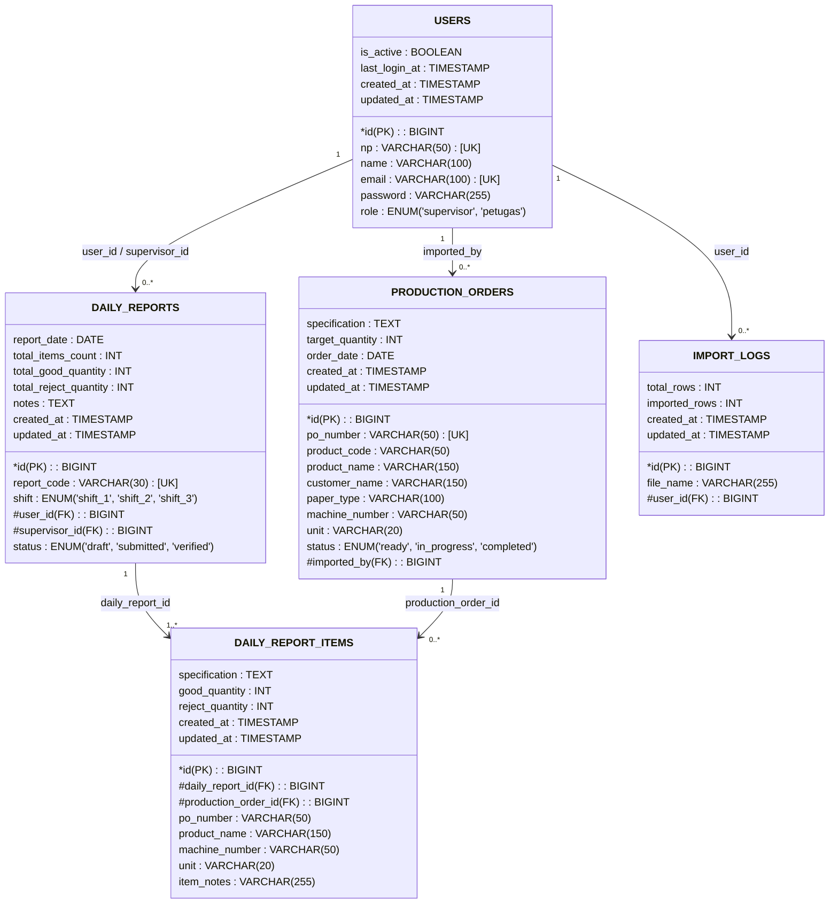
*(Sumber: Hasil Penelitian, 2026)*  
*Gambar 3.11: Logical Record Structure (LRS) Sistem Dokumentasi Produksi Harian*

---

#### 5. Spesifikasi File
Spesifikasi file menjelaskan rincian teknis dari setiap tabel basis data yang digunakan dalam sistem, mencakup nama field, tipe data, panjang ukuran data, dan keterangan batasannya:

##### a. Spesifikasi File `users`
- **Nama File / Tabel:** `users`
- **Akronim File:** USR
- **Fungsi File:** Menyimpan data akun pengguna, peran hak akses, dan kredensial login
- **Tipe File:** File Master
- **Media Penyimpanan:** Harddisk / SSD (MySQL Server)
- **Kunci Utama (*Primary Key*):** `id`
- **Kunci Unik (*Unique Key*):** `np`, `email`
- **Struktur Tabel:** Disajikan pada Tabel 3.10

*Tabel 3.10: Spesifikasi File Tabel `users`*
| No | Elemen Data | Nama Field | Tipe Data | Panjang / Ukuran | Keterangan / Constraint |
|---|---|---|---|---|---|
| 1 | ID Pengguna | `id` | BIGINT UNSIGNED | 20 | Primary Key, Auto Increment |
| 2 | Nama Lengkap | `name` | VARCHAR | 100 | Not Null |
| 3 | Nomor Pegawai | `np` | VARCHAR | 50 | Unique, Not Null (Kredensial Login) |
| 4 | Alamat Email | `email` | VARCHAR | 100 | Unique, Not Null |
| 5 | Kata Sandi | `password` | VARCHAR | 255 | Not Null (Terenkripsi Bcrypt) |
| 6 | Peran Akun | `role` | ENUM | - | Value: 'supervisor', 'petugas' |
| 7 | Status Keaktifan | `is_active` | BOOLEAN | 1 | Default: true (1) |
| 8 | Login Terakhir | `last_login_at` | TIMESTAMP | - | Nullable |
| 9 | Waktu Dibuat | `created_at` | TIMESTAMP | - | Nullable |
| 10 | Waktu Diperbarui | `updated_at` | TIMESTAMP | - | Nullable |
*(Sumber: Hasil Penelitian, 2026)*

##### b. Spesifikasi File `production_orders`
- **Nama File / Tabel:** `production_orders`
- **Akronim File:** PO
- **Fungsi File:** Menyimpan data master pesanan produksi hasil ekspor dari sistem SAP
- **Tipe File:** File Master
- **Media Penyimpanan:** Harddisk / SSD (MySQL Server)
- **Kunci Utama (*Primary Key*):** `id`
- **Kunci Unik (*Unique Key*):** `po_number`
- **Kunci Tamu (*Foreign Key*):** `imported_by` (Relasi ke `users.id`)
- **Struktur Tabel:** Disajikan pada Tabel 3.11

*Tabel 3.11: Spesifikasi File Tabel `production_orders`*
| No | Elemen Data | Nama Field | Tipe Data | Panjang / Ukuran | Keterangan / Constraint |
|---|---|---|---|---|---|
| 1 | ID Pesanan | `id` | BIGINT UNSIGNED | 20 | Primary Key, Auto Increment |
| 2 | Nomor PO / Barcode | `po_number` | VARCHAR | 50 | Unique, Not Null (Simbologi Code 128) |
| 3 | Kode Produk | `product_code` | VARCHAR | 50 | Index, Not Null |
| 4 | Nama Produk | `product_name` | VARCHAR | 150 | Not Null |
| 5 | Nama Instansi Pemesan | `customer_name` | VARCHAR | 150 | Not Null |
| 6 | Spesifikasi Teknis | `specification` | TEXT | - | Not Null (Bahan Kertas, Pengaman) |
| 7 | Jenis Kertas | `paper_type` | VARCHAR | 100 | Nullable |
| 8 | Nomor Mesin Asal | `machine_number` | VARCHAR | 50 | Nullable (Identitas Mesin Cetak) |
| 9 | Target Kuantitas | `target_quantity` | INT UNSIGNED | 10 | Not Null |
| 10 | Satuan Hitung | `unit` | VARCHAR | 20 | Default: 'lembar' |
| 11 | Tanggal Pesanan | `order_date` | DATE | - | Not Null |
| 12 | Status Pengerjaan | `status` | ENUM | - | Value: 'ready', 'in_progress', 'completed' |
| 13 | ID Pengimpor | `imported_by` | BIGINT UNSIGNED | 20 | Foreign Key ke `users.id` |
| 14 | Waktu Dibuat | `created_at` | TIMESTAMP | - | Nullable |
| 15 | Waktu Diperbarui | `updated_at` | TIMESTAMP | - | Nullable |
*(Sumber: Hasil Penelitian, 2026)*

##### c. Spesifikasi File `daily_reports`
- **Nama File / Tabel:** `daily_reports`
- **Akronim File:** DREP
- **Fungsi File:** Menyimpan data header laporan hasil pengemasan produksi harian
- **Tipe File:** File Transaksi
- **Media Penyimpanan:** Harddisk / SSD (MySQL Server)
- **Kunci Utama (*Primary Key*):** `id`
- **Kunci Unik (*Unique Key*):** `report_code`
- **Kunci Tamu (*Foreign Key*):** `user_id`, `supervisor_id` (Relasi ke `users.id`)
- **Struktur Tabel:** Disajikan pada Tabel 3.12

*Tabel 3.12: Spesifikasi File Tabel `daily_reports`*
| No | Elemen Data | Nama Field | Tipe Data | Panjang / Ukuran | Keterangan / Constraint |
|---|---|---|---|---|---|
| 1 | ID Laporan | `id` | BIGINT UNSIGNED | 20 | Primary Key, Auto Increment |
| 2 | Kode Laporan Sesi | `report_code` | VARCHAR | 30 | Unique, Not Null (Format: `{SERIES}-{YYYY-MM-DD}-S{N}`, contoh: `PCHT-2026-08-26-S1`) |
| 3 | Tanggal Pengemasan | `report_date` | DATE | - | Index, Not Null |
| 4 | Giliran Kerja | `shift` | ENUM | - | Value: 'shift_1', 'shift_2', 'shift_3' |
| 5 | ID Petugas Pelaksana | `user_id` | BIGINT UNSIGNED | 20 | Foreign Key ke `users.id` |
| 6 | ID Supervisor Pemeriksa | `supervisor_id` | BIGINT UNSIGNED | 20 | Foreign Key ke `users.id`, Nullable |
| 7 | Total Jenis Order | `total_items_count` | INT UNSIGNED | 5 | Default: 0 |
| 8 | Total Hasil Kemas Baik | `total_good_quantity` | INT UNSIGNED | 10 | Default: 0 |
| 9 | Total Kuantitas Reject | `total_reject_quantity` | INT UNSIGNED | 10 | Default: 0 |
| 10 | Catatan Operasional | `notes` | TEXT | - | Nullable |
| 11 | Status Verifikasi | `status` | ENUM | - | Value: 'draft', 'submitted', 'verified' |
| 12 | Waktu Dibuat | `created_at` | TIMESTAMP | - | Nullable |
| 13 | Waktu Diperbarui | `updated_at` | TIMESTAMP | - | Nullable |
*(Sumber: Hasil Penelitian, 2026)*

##### d. Spesifikasi File `daily_report_items`
- **Nama File / Tabel:** `daily_report_items`
- **Akronim File:** DRIT
- **Fungsi File:** Menyimpan baris rincian item hasil kemas per pesanan produksi
- **Tipe File:** File Transaksi (Detail)
- **Media Penyimpanan:** Harddisk / SSD (MySQL Server)
- **Kunci Utama (*Primary Key*):** `id`
- **Kunci Tamu (*Foreign Key*):** `daily_report_id` (ke `daily_reports.id`), `production_order_id` (ke `production_orders.id`)
- **Struktur Tabel:** Disajikan pada Tabel 3.13

*Tabel 3.13: Spesifikasi File Tabel `daily_report_items`*
| No | Elemen Data | Nama Field | Tipe Data | Panjang / Ukuran | Keterangan / Constraint |
|---|---|---|---|---|---|
| 1 | ID Rincian Item | `id` | BIGINT UNSIGNED | 20 | Primary Key, Auto Increment |
| 2 | ID Header Laporan | `daily_report_id` | BIGINT UNSIGNED | 20 | Foreign Key ke `daily_reports.id` (Cascade) |
| 3 | ID Pesanan SAP | `production_order_id` | BIGINT UNSIGNED | 20 | Foreign Key ke `production_orders.id` |
| 4 | Nomor PO Snapshot | `po_number` | VARCHAR | 50 | Index, Not Null |
| 5 | Nama Produk Snapshot | `product_name` | VARCHAR | 150 | Not Null |
| 6 | Spesifikasi Snapshot | `specification` | TEXT | - | Not Null |
| 7 | Nomor Mesin Snapshot | `machine_number` | VARCHAR | 50 | Nullable |
| 8 | Jumlah Kemas Baik | `good_quantity` | INT UNSIGNED | 10 | Not Null |
| 9 | Jumlah Kemas Reject | `reject_quantity` | INT UNSIGNED | 10 | Default: 0 |
| 10 | Satuan Hitung | `unit` | VARCHAR | 20 | Default: 'lembar' |
| 11 | Catatan Khusus Item | `item_notes` | VARCHAR | 255 | Nullable |
| 12 | Waktu Dibuat | `created_at` | TIMESTAMP | - | Nullable |
| 13 | Waktu Diperbarui | `updated_at` | TIMESTAMP | - | Nullable |
*(Sumber: Hasil Penelitian, 2026)*

##### e. Spesifikasi File `import_logs`
- **Nama File / Tabel:** `import_logs`
- **Akronim File:** IMPL
- **Fungsi File:** Menyimpan catatan riwayat aktivitas pengunggahan berkas ekspor master SAP
- **Tipe File:** File Log Riwayat
- **Media Penyimpanan:** Harddisk / SSD (MySQL Server)
- **Kunci Utama (*Primary Key*):** `id`
- **Kunci Tamu (*Foreign Key*):** `user_id` (Relasi ke `users.id`)
- **Struktur Tabel:** Disajikan pada Tabel 3.14

*Tabel 3.14: Spesifikasi File Tabel `import_logs`*
| No | Elemen Data | Nama Field | Tipe Data | Panjang / Ukuran | Keterangan / Constraint |
|---|---|---|---|---|---|
| 1 | ID Riwayat Impor | `id` | BIGINT UNSIGNED | 20 | Primary Key, Auto Increment |
| 2 | Nama Berkas Unggahan | `file_name` | VARCHAR | 255 | Not Null |
| 3 | Total Baris Berkas | `total_rows` | INT UNSIGNED | 8 | Not Null |
| 4 | Jumlah Baris Berhasil | `imported_rows` | INT UNSIGNED | 8 | Not Null |
| 5 | ID Pengunggah | `user_id` | BIGINT UNSIGNED | 20 | Foreign Key ke `users.id` |
| 6 | Waktu Dibuat | `created_at` | TIMESTAMP | - | Nullable |
| 7 | Waktu Diperbarui | `updated_at` | TIMESTAMP | - | Nullable |
*(Sumber: Hasil Penelitian, 2026)*

---

### C. Implementasi

Tahap implementasi merupakan fase eksekusi rekayasa di mana seluruh spesifikasi kebutuhan, diagram pemodelan UML, skema basis data, dan rancangan antarmuka diterjemahkan ke dalam pembuatan aplikasi fungsional yang dapat dijalankan secara nyata pada lingkungan kerja operasional.

#### 1. Lingkungan Pengembangan Perangkat Lunak
Pelaksanaan implementasi didukung oleh konfigurasi lingkungan perangkat keras dan perangkat lunak yang disajikan pada Tabel 3.15 dan Tabel 3.16:

*Tabel 3.15: Spesifikasi Lingkungan Perangkat Keras (Hardware Environment)*
| No | Komponen Perangkat Keras | Spesifikasi Teknis Lingkungan Kerja | Peruntukan / Fungsi |
|---|---|---|---|
| 1 | **Komputer Pengembang** | Prosesor AMD Ryzen 5 / Intel Core i5, RAM 16 GB DDR4, Penyimpanan SSD 512 GB NVMe | Pembuatan program, pengujian unit, kompilasi aset frontend, dan simulasi server |
| 2 | **Komputer Klien (Unit Pengemasan)** | PC Desktop dengan prosesor Intel Celeron / Core i3, RAM 4 GB DDR3/DDR4, Monitor Display resolusi minimal 1366x768 piksel, antarmuka jaringan LAN / Wi-Fi | Perangkat operasional utama bagi Petugas dan Supervisor di area kerja pengemasan |
| 3 | **Barcode Scanner** | Scanner genggam (*Handheld Barcode Reader*) koneksi USB Plug-and-Play (antarmuka HID), mendukung simbologi linear **Code 128** | Membaca barcode Nomor PO pada Kartu Mesin Produksi secara cepat dan akurat |
| 4 | **Printer Dokumen** | Printer Inkjet / Laser standar kantor dengan ukuran media kertas A4 | Mencetak lembaran fisik laporan hasil produksi harian untuk pengesahan tanda tangan |
*(Sumber: Hasil Penelitian, 2026)*

*Tabel 3.16: Spesifikasi Lingkungan Perangkat Lunak (Software Environment)*
| No | Komponen Perangkat Lunak | Nama Paket / Versi Teknologi | Keterangan dan Peranan dalam Aplikasi |
|---|---|---|---|
| 1 | **Sistem Operasi** | Windows 11 (64-bit) | Sistem operasi utama pada komputer pengembang dan klien operasional |
| 2 | **Server Lingkungan Lokal** | Laragon (Local Development Environment) | Mengelola stack server lokal yang terintegrasi (Web Server, PHP runtime, dan database) |
| 3 | **Basis Data (DBMS)** | MySQL Server | Menyimpan master data SAP, data transaksi laporan harian, akun pengguna, dan riwayat audit |
| 4 | **Bahasa Pemrograman Backend** | PHP (versi 8.3+) | Bahasa pemrograman server-side utama untuk mengeksekusi logika bisnis aplikasi |
| 5 | **Backend Framework** | Laravel Framework (versi 13.x) | Kerangka kerja web utama dengan arsitektur MVC dan *Service Layer Pattern* |
| 6 | **Autentikasi & Keamanan** | Laravel Fortify (versi 1.37+) | Menyediakan backend autentikasi aman berbasis Nomor Pegawai (NP), password hashing, dan rate limiting |
| 7 | **Arsitektur Frontend Reaktif** | Livewire (versi 4.x) | Membangun komponen antarmuka web dinamis dan reaktif tanpa perpindahan halaman |
| 8 | **Komponen UI & Optimasi** | Livewire Flux UI (versi 2.13+) & Livewire Blaze (versi 1.0) | Pustaka komponen antarmuka modern dan mesin optimasi perenderan Blade View |
| 9 | **CSS Framework & Bundler** | Tailwind CSS (versi 4.x) dengan `@tailwindcss/vite` & Vite (versi 8.x) | Desain antarmuka responsif dan alat kompilasi aset frontend cepat |
| 10 | **Pengelola Paket Dependensi** | Composer (PHP) & pnpm (Node.js) | Manajemen instalasi dan pembaruan dependensi backend PHP dan frontend JavaScript |
| 11 | **Visualisasi Grafik Analitik** | Chart.js terintegrasi Alpine.js | Merender grafik analitik tren performa hasil kemas 14 hari kerja pada halaman Dashboard |
| 12 | **Pengujian & Kualitas Kode** | Pest PHP (versi 5.x), Larastan (versi 3.x), Laravel Pint (versi 1.27) | Pengujian otomatis (*automated testing*), analisis statis tipe data, dan standarisasi format kode |
*(Sumber: Hasil Penelitian, 2026)*

---

#### 2. Implementasi Antarmuka Sistem
Berikut disajikan rancangan dan implementasi antarmuka visual keseluruhan halaman sistem dari proses awal login hingga penerbitan cetak laporan:

##### a. Tampilan Antarmuka Halaman Login
Halaman login dirancang dengan tata letak minimalis dan terpusat yang memfasilitasi proses autentikasi cepat bagi pengguna menggunakan Nomor Pegawai (NP) dan password:

```
+-----------------------------------------------------------------------+
|                                                                       |
|                     PT PERCETAKAN DOKUMEN SEKURITI                    |
|             Sistem Dokumentasi Hasil Produksi Harian (Unit Kemas)     |
|                                                                       |
|                     +---------------------------+                     |
|                     |       FORM LOGIN USER     |                     |
|                     |                           |                     |
|                     |  Nomor Pegawai (NP):      |                     |
|                     |  [______________________] |                     |
|                     |                           |                     |
|                     |  Password:                |                     |
|                     |  [______________________] |                     |
|                     |                           |                     |
|                     |  [x] Ingat Saya           |                     |
|                     |                           |                     |
|                     |     [   MASUK SISTEM   ]  |                     |
|                     |                           |                     |
|                     +---------------------------+                     |
|                                                                       |
+-----------------------------------------------------------------------+
```
*(Sumber: Hasil Penelitian, 2026)*  
*Gambar 3.12: Tampilan Antarmuka Halaman Login Sistem*

##### b. Tampilan Antarmuka Halaman Dashboard Utama dan Grafik Performa 14 Hari Kerja
Halaman dashboard menampilkan ringkasan kartu metrik capaian harian, navigasi cepat modul sistem, serta visualisasi grafik analitik performa produksi 14 hari kerja terakhir yang menyajikan perbandingan output baik dan kuantitas reject:

```
+-----------------------------------------------------------------------+
| [PT PDS LOGO]  Unit Pengemasan  | Shift: Shift 1 | WIB: 08:30 | [User] v |
+-------------+---------------------------------------------------------+
| NAVIGATION  | DASHBOARD UTAMA & ANALITIK PRODUKSI                     |
| - Dashboard |                                                         |
| - Up Database| +-------------+ +-------------+ +-------------+ +-------+ |
| - Data Petugs| | TOTAL KEMAS | | TOTAL REJECT| | PO TERSCAN  | |STATUS | |
| - Buat Lapor | | 48.500 lbr  | | 320 lbr     | | 12 Order    | |Draft:2| |
| - Lihat Lapor| +-------------+ +-------------+ +-------------+ +-------+ |
|             |                                                         |
|             | GRAFIK ANALITIK HASIL PRODUKSI 14 HARI KERJA TERAKHIR   |
|             | +-----------------------------------------------------+ |
|             | | (Kuantitas)                                         | |
|             | |  60k |       _/\_        /\_                        | |
|             | |  40k |  _/\_/    \__/\__/   \__/\_   -- Kemas Baik  | |
|             | |  20k | /                          \  -- Reject      | |
|             | |    0 +---------------------------------             | |
|             | |       H-14 H-13 ... H-3  H-2  H-1 Hari Ini          | |
|             | +-----------------------------------------------------+ |
|             | * Rata-rata 14 Hari: 45.200 Lembar | Puncak: 56.000 lbr |
+-------------+---------------------------------------------------------+
```
*(Sumber: Hasil Penelitian, 2026)*  
*Gambar 3.13: Tampilan Antarmuka Halaman Dashboard dan Grafik Performa 14 Hari Kerja*

##### c. Tampilan Antarmuka Halaman Manajemen Data Petugas
Halaman ini memfasilitasi Supervisor untuk mengelola akun operator pengemasan melalui tabel data terstruktur dan form modal penambahan/pengubahan akun:

```
+-----------------------------------------------------------------------+
| [PT PDS LOGO]  Unit Pengemasan  | Supervisor Admin             [User] v |
+-------------+---------------------------------------------------------+
| NAVIGATION  | MANAJEMEN DATA PETUGAS OPERATOR                         |
| - Dashboard |                                                         |
| - Up Database| [ + TAMBAH PETUGAS BARU ]       Cari Petugas: [_______] |
| - Data Petugs+----+---------+---------------------+-----------+-------+ |
| - Buat Lapor | No | NP      | Nama Petugas        | Peran     | Status| |
| - Lihat Lapor+----+---------+---------------------+-----------+-------+ |
|             | 1  | 202401  | Umar Ibnu Zainal M. | Petugas   | Aktif | |
|             | 2  | 202402  | Hendra Setiawan     | Petugas   | Aktif | |
|             | 3  | 202001  | Agus Soelistyo      | Supervisor| Aktif | |
|             | +----+---------+---------------------+-----------+-------+ |
+-------------+---------------------------------------------------------+
```
*(Sumber: Hasil Penelitian, 2026)*  
*Gambar 3.14: Tampilan Antarmuka Halaman Manajemen Data Petugas*

##### d. Tampilan Antarmuka Halaman Update Database (Import SAP)
Halaman ini dirancang khusus bagi Supervisor untuk mengunggah berkas data master pesanan produksi yang diekspor dari sistem SAP, lengkap dengan tabel riwayat berkas impor terakhir:

```
+-----------------------------------------------------------------------+
| [PT PDS LOGO]  Unit Pengemasan  | Supervisor Admin             [User] v |
+-------------+---------------------------------------------------------+
| NAVIGATION  | UPDATE DATABASE MASTER PRODUKSI DARI SAP                |
| - Dashboard |                                                         |
| - Up Database| +-----------------------------------------------------+ |
| - Data Petugs| |  PILIH BERKAS EKSPOR SAP (.XLSX / .CSV)             | |
| - Buat Lapor | |  [ [Pilih File] sap_production_order_august.xlsx ]  | |
| - Lihat Lapor| |                                                     | |
|             | |  [   PROSES & IMPOR KE MASTER DATA   ]               | |
|             | +-----------------------------------------------------+ |
|             |                                                         |
|             | RIWAYAT UNGGAHAN MASTER SAP TERAKHIR                    |
|             | +----+-------------------------+----------+-----------+ |
|             | | No | Nama Berkas             | Jml Data | Tanggal   | |
|             | +----+-------------------------+----------+-----------+ |
|             | | 1  | sap_po_2026_08_25.xlsx  | 145 PO   | 25/08/2026| |
|             | | 2  | sap_po_2026_08_18.xlsx  | 120 PO   | 18/08/2026| |
|             | +----+-------------------------+----------+-----------+ |
+-------------+---------------------------------------------------------+
```
*(Sumber: Hasil Penelitian, 2026)*  
*Gambar 3.15: Tampilan Antarmuka Halaman Update Database Master SAP*

##### e. Tampilan Antarmuka Halaman Buat Laporan (Scan Barcode & Entri Kemas)
Halaman ini merupakan antarmuka operasional utama Petugas di meja kerja pengemasan. Formulir dilengkapi area masukan scan barcode otomatis, penampil rincian spesifikasi barang seketika, kolom input jumlah kemas, dan tabel penampungan draf hasil kemas multi-item:

```
+-----------------------------------------------------------------------+
| [PT PDS LOGO]  Unit Pengemasan  | Petugas: Umar I.Z.           [User] v |
+-------------+---------------------------------------------------------+
| NAVIGATION  | BUAT LAPORAN PRODUKSI HARIAN (SCAN BARCODE)             |
| - Dashboard | Tanggal: 25/08/2026 | Shift: [Shift 1 v] | Petugas: Umar|
| - Up Database+-------------------------------------------------------+ |
| - Data Petugs| [|||||||||||||||||] SCAN BARCODE NO PO (KARTU MESIN)   | |
| - Buat Lapor | [ PO-2026-8891                                    ]   | |
| - Lihat Lapor|                                                       | |
|             | Nama Produk: Sertifikat Sekuriti Hologram A4            | |
|             | Spesifikasi: Kertas Watermark 120gsm, 2 Spot UV         | |
|             | Mesin Asal : MESIN-02  | Target: 5.000 Lembar           | |
|             |                                                         | |
|             | Jml Kemas Baik: [ 5.000 ]  Jml Reject: [ 25 ]           | |
|             | [ + TAMBAH KE DAFTAR LAPORAN ]                          | |
|             +---------------------------------------------------------+ |
|             | TABEL RINCIAN HASIL KEMAS HARIAN (DRAFT)                |
|             | +----+--------------+-------------------+------+-------+| |
|             | | No | No PO        | Nama Produk       | Baik | Reject|| |
|             | +----+--------------+-------------------+------+-------+| |
|             | | 1  | PO-2026-8891 | Sertifikat A4     | 5.000| 25    || |
|             | | 2  | PO-2026-8892 | Ijazah Sekuriti   | 2.500| 10    || |
|             | +----+--------------+-------------------+------+-------+| |
|             | Total: 2 PO | Total Kemas: 7.500 | Total Reject: 35     | |
|             |                                                         | |
|             | [ SIMPAN SEBAGAI DRAFT ]     [ FINALISASI & SIMPAN ]    | |
+-------------+---------------------------------------------------------+
```
*(Sumber: Hasil Penelitian, 2026)*  
*Gambar 3.16: Tampilan Antarmuka Halaman Buat Laporan dengan Scan Barcode*

##### f. Tampilan Antarmuka Halaman Lihat Laporan
Halaman ini menyajikan tabel riwayat seluruh dokumen laporan hasil kemas yang tersimpan, dilengkapi fitur pencarian, filter rentang tanggal, status verifikasi, dan tombol aksi:

```
+-----------------------------------------------------------------------+
| [PT PDS LOGO]  Unit Pengemasan  | Supervisor / Petugas         [User] v |
+-------------+---------------------------------------------------------+
| NAVIGATION  | DAFTAR LAPORAN HASIL PRODUKSI HARIAN                    |
| - Dashboard | Filter Tanggal: [ 2026-08-01 ] s/d [ 2026-08-25 ]       |
| - Up Database+----+-------------------+------------+-------+---------+| |
| - Data Petugs| No | Nomor Laporan     | Tanggal    | Shift | Aksi    || |
| - Buat Lapor +----+-------------------+------------+-------+---------+| |
| - Lihat Lapor| 1  | LAP-20260825-0001 | 25/08/2026 | 1     |[Lihat]  || |
|             | 2  | LAP-20260824-0002 | 24/08/2026 | 2     |[Lihat]  || |
|             | +----+-------------------+------------+-------+---------+| |
+-------------+---------------------------------------------------------+
```
*(Sumber: Hasil Penelitian, 2026)*  
*Gambar 3.17: Tampilan Antarmuka Halaman Lihat Laporan Produksi Harian*

##### g. Tampilan Antarmuka Halaman Detail dan Verifikasi Laporan
Halaman ini menampilkan rincian lengkap item kemas pada suatu dokumen laporan, memfasilitasi pengeditan korektif oleh Petugas (jika masih draf), serta menyediakan tombol aksi persetujuan (*verifikasi*) bagi Supervisor:

```
+-----------------------------------------------------------------------+
| [PT PDS LOGO]  Unit Pengemasan  | Supervisor: Agus S.          [User] v |
+-------------+---------------------------------------------------------+
| NAVIGATION  | RINCIAN LAPORAN: LAP-20260825-0001                      |
| - Dashboard | Tanggal: 25/08/2026 | Shift: Shift 1 | Petugas: Umar    |
| - Up Database| Status : [ BELUM VERIFIKASI / SUBMITTED ]              |
| - Data Petugs+----+--------------+-------------------+------+-------+ |
| - Buat Lapor | No | No PO        | Nama Produk       | Baik | Reject| |
| - Lihat Lapor+----+--------------+-------------------+------+-------+ |
|             | 1  | PO-2026-8891 | Sertifikat A4     | 5.000| 25    | |
|             | 2  | PO-2026-8892 | Ijazah B5         | 2.500| 10    | |
|             | +----+--------------+-------------------+------+-------+ |
|             | Total Kemas Baik: 7.500 Lembar | Total Reject: 35 Lembar| |
|             |                                                         |
|             | [ CETAK LAPORAN ]         [ VERIFIKASI & SETUJUI LAPORAN]|
+-------------+---------------------------------------------------------+
```
*(Sumber: Hasil Penelitian, 2026)*  
*Gambar 3.18: Tampilan Antarmuka Detail dan Verifikasi Laporan Produksi Harian*

##### h. Tampilan Format Lembar Cetak Laporan Standar Kertas A4
Format cetak lembar dokumen resmi standar A4 yang dihasilkan sistem lengkap dengan kop perusahaan, rincian item, total hasil kemas, dan kolom tanda tangan pengesahan:

```
+-----------------------------------------------------------------------+
|                     PT PERCETAKAN DOKUMEN SEKURITI                    |
|                LAPORAN HASIL PRODUKSI HARIAN PENGEMASAN               |
|                                                                       |
| No. Laporan : LAP-20260825-0001           Tanggal : 25 Agustus 2026   |
| Petugas     : Umar Ibnu Zainal M.         Shift   : Shift 1 (Pagi)    |
| Status      : TERVERIFIKASI                                           |
|-----------------------------------------------------------------------|
| No | Nomor PO      | Nama Produk / Spesifikasi | Mesin | Baik | Reject|
|----+---------------+---------------------------+-------+------+-------|
| 1  | PO-2026-8891  | Sertifikat Hologram A4    | M-02  | 5.000| 25    |
| 2  | PO-2026-8892  | Ijazah Sekuriti B5        | M-01  | 2.500| 10    |
|----+---------------+---------------------------+-------+------+-------|
| TOTAL HASIL PENGEMASAN                         |       | 7.500| 35    |
|-----------------------------------------------------------------------|
| Mengetahui,                                 Petugas Pelaksana,        |
| Kepala Unit / Supervisor                                              |
|                                                                       |
| ( Agus Soelistyo )                          ( Umar Ibnu Zainal M. )   |
+-----------------------------------------------------------------------+
```
*(Sumber: Hasil Penelitian, 2026)*  
*Gambar 3.19: Tampilan Format Lembar Cetak Laporan Produksi Harian (Standar A4)*

---

#### 3. Implementasi Modul Program
Implementasi aplikasi dikelompokkan ke dalam enam modul fungsional utama yang saling terintegrasi sebagaimana dirangkum pada Tabel 3.17:

*Tabel 3.17: Pemetaan dan Implementasi Modul Program*
| No | Modul Program | Komponen / Berkas Utama | Penjelasan Implementasi Fungsional |
|---|---|---|---|
| 1 | **Skema Basis Data & Model Eloquent** | `database/migrations/`, Model: `User`, `ProductionOrder`, `DailyReport`, `DailyReportItem`, `ImportLog` | Membangun struktur tabel terelasi, foreign key constraints, tipe data kolom, seeder inisialisasi, dan pemodelan relasi Eloquent ORM untuk menjamin integritas transaksi data. |
| 2 | **Autentikasi & Kontrol Akses Peran** | `app/Livewire/Auth/Login.php`, `FortifyServiceProvider`, Middleware `EnsureUserRole` | Menerapkan login menggunakan identitas Nomor Pegawai (NP) dan password terenkripsi, manajemen sesi, rate limiting 5 percobaan per menit, serta proteksi halaman berbasis peran Petugas dan Supervisor. |
| 3 | **Update Database (Master Data SAP)** | `app/Livewire/MasterData/UpdateDatabase.php`, `app/Services/SapImportService.php` | Mengakomodasi pengunggahan berkas ekspor SAP (.xlsx/.csv), validasi struktur kolom, parsing baris pesanan, dan pembaruan massal (*bulk upsert*) data Nomor PO, spesifikasi bahan, dan target kemas. |
| 4 | **Buat Laporan (Scan Barcode & Kemas)** | `app/Livewire/Reports/CreateDailyReport.php`, Alpine.js Scanner Listener | Menangkap pembacaan scanner barcode Code 128 pada Nomor PO, melakukan pencarian instan (*instant lookup*) data produk, menyediakan input kuantitas baik/reject, dan menampung item pada tabel sementara (*staging table*). |
| 5 | **Manajemen & Cetak Laporan** | `app/Livewire/Reports/ReportIndex.php`, `ReportDetail.php`, `app/Services/ReportCodeGenerator.php`, `@media print` | Menampilkan riwayat laporan harian, membangkitkan kode laporan unik otomatis dengan format `{SERIES}-{YYYY-MM-DD}-S{N}` (contoh: `PCHT-2026-08-26-S1`), memfasilitasi verifikasi persetujuan oleh Supervisor, serta mencetak dokumen fisik rapi standar kertas A4. |
| 6 | **Dashboard & Grafik Tren Produksi** | `app/Livewire/Dashboard/DashboardIndex.php`, `DashboardAnalyticsService.php`, Komponen Chart.js | Mengeksekusi query agregasi SQL untuk menghitung akumulasi kemas baik dan reject pada rentang 7, 14, atau 30 hari aktif terakhir (WIB), merender 5 kartu metrik KPI harian, grafik interaktif tipe Area/Garis/Batang, widget distribusi shift, dan ranking top 5 mesin cetak. |
*(Sumber: Hasil Penelitian, 2026)*

---

### D. Pengujian Sistem

Tahap pengujian sistem bertujuan untuk menguji, memverifikasi, dan memvalidasi bahwa seluruh fungsi pada perangkat lunak telah beroperasi secara presisi sesuai dengan rancangan spesifikasi kebutuhan serta bebas dari galat yang dapat mengganggu operasional di lapangan.

#### 1. Metode Pengujian
Metode pengujian yang diterapkan dalam penelitian ini adalah **Black Box Testing** (pengujian kotak hitam). Metode ini menitikberatkan pengujian pada aspek fungsionalitas eksternal perangkat lunak, yaitu dengan memberikan kombinasi masukan (*input*) data tertentu pada antarmuka pengguna dan memverifikasi apakah keluaran (*output*) serta perilaku sistem yang dihasilkan telah sesuai dengan hasil yang diharapkan, tanpa perlu memeriksa struktur internal kode program.

#### 2. Rencana dan Skenario Pengujian
Pengujian fungsionalitas dijalankan secara menyeluruh terhadap seluruh skenario operasional utama sistem sebagaimana dirangkum pada Tabel 3.18:

*Tabel 3.18: Rekapitulasi Hasil Pengujian Fungsionalitas Sistem (Black Box Testing)*
| No. | Skenario Pengujian | Test Case / Masukan Data | Hasil yang Diharapkan | Hasil Pengujian | Kesimpulan |
|---|---|---|---|---|---|
| 1. | Pengguna mengosongkan kolom NP/Username/Email dan password, kemudian menekan tombol "Masuk ke Sistem". | Login: (kosong)<br>Password: (kosong) | Login gagal dan sistem menampilkan pesan validasi "Nomor Pegawai, Username, atau Email wajib diisi." | Sistem menolak proses login dan memunculkan notifikasi validasi form. | Valid |
| 2. | Pengguna memasukkan Nomor Pegawai (NP) yang tidak terdaftar pada basis data. | NP: 999999<br>Password: rahasia123 | Login gagal dan sistem menampilkan pesan "Nomor Pegawai/Username atau Kata Sandi yang dimasukkan salah." | Sistem menolak akses dan memunculkan notifikasi akun tidak terdaftar. | Valid |
| 3. | Pengguna memasukkan Nomor Pegawai (NP) terdaftar namun kata sandi yang dimasukkan salah. | NP: 202401<br>Password: salahpass | Login gagal dan sistem menampilkan pesan "Nomor Pegawai/Username atau Kata Sandi yang dimasukkan salah." | Sistem menolak akses dan memunculkan notifikasi kata sandi salah. | Valid |
| 4. | Pengguna memasukkan Nomor Pegawai (NP) dan kata sandi yang benar dan terdaftar. | NP: 202401<br>Password: Password123! | Login berhasil dan sistem menginisialisasi sesi kerja serta mengarahkan ke halaman Dashboard. | Sistem membuka sesi dan mengarahkan pengguna ke halaman Dashboard. | Valid |
| 5. | Supervisor menambahkan akun petugas baru dengan data yang valid. | NP: 202405<br>Nama: Budi Santoso<br>Email: budi@pds.co.id<br>Role: Petugas | Data akun baru tersimpan ke tabel `users` dan muncul di tabel daftar petugas. | Data berhasil tersimpan dan daftar tabel petugas memuat akun baru. | Valid |
| 6. | Supervisor mengunggah berkas ekspor SAP format spreadsheet valid (.xlsx). | File: `sap_po_august.xlsx`<br>(Kolom No PO, Nama, Qty lengkap) | Sistem mengekstrak seluruh baris pesanan dan memperbarui tabel master `production_orders`. | Sistem melakukan *bulk upsert* dan menampilkan jumlah data terproses. | Valid |
| 7. | Supervisor mengunggah berkas dengan ekstensi yang tidak diizinkan (.pdf). | File: `dokumen_sap.pdf` | Sistem menolak berkas dan memunculkan pesan "Format berkas tidak valid". | Berkas ditolak sistem dan menampilkan peringatan tipe berkas. | Valid |
| 8. | Petugas memindai barcode Nomor PO yang terdaftar pada master SAP menggunakan scanner. | Barcode Scanner input:<br>`PO-2026-8891` | Kolom Nama Produk, Spesifikasi Kertas, dan Nomor Mesin terisi otomatis secara seketika (< 1 detik). | Seluruh kolom spesifikasi produk terisi otomatis dari basis data. | Valid |
| 9. | Petugas memindai barcode Nomor PO yang belum diimpor ke dalam sistem. | Barcode Scanner input:<br>`PO-9999-0000` | Sistem membunyikan peringatan dan menampilkan notifikasi "Nomor PO belum terdaftar". | Sistem membunyikan alarm dan memunculkan alert PO tidak ditemukan. | Valid |
| 10. | Petugas memasukkan jumlah hasil kemas baik lalu menekan tombol "Selesaikan Laporan" untuk menyelesaikan sesi. | Kemas Baik: 5.000<br>Klik "Selesaikan Laporan" | Sistem mengubah status laporan menjadi `Terkirim (Selesai Scan)` dan membangkitkan kode laporan unik otomatis (contoh: `PCHT-2026-08-26-S1`). | Laporan tersimpan di basis data dengan kode unik dan status Terkirim. | Valid |
| 11. | Petugas mengedit angka kemas pada laporan yang masih berstatus draf. | Kemas Baik diubah dari 5.000 menjadi 5.200 | Sistem memperbarui rekaman jumlah kemas pada tabel rincian laporan. | Angka kuantitas kemas berhasil diperbarui di database. | Valid |
| 12. | Supervisor meninjau dan menyetujui laporan harian yang diserahkan petugas. | Klik tombol "Verifikasi Laporan" → konfirmasi "Ya, Verifikasi Laporan" | Status laporan berubah menjadi `Terverifikasi (Disetujui Ka. Unit)` dan data terkunci dari perubahan. | Status laporan terverifikasi dan identitas Supervisor tercatat di basis data. | Valid |
| 13. | Pengguna menekan tombol Cetak Lembar Fisik pada dokumen laporan. | Klik tombol "Cetak Lembar Fisik" | Sistem merender tampilan cetak standar kertas A4 rapi lengkap dengan kolom tanda tangan. | Lembar cetak berformat standar A4 muncul pada jendela pratinjau cetak. | Valid |
| 14. | Pengguna mengakses halaman Dashboard saat terdapat transaksi 14 hari terakhir. | Buka halaman Dashboard | Sistem menampilkan kartu KPI harian dan visualisasi grafik tren performa 14 hari kerja. | Kartu metrik KPI dan grafik Chart.js 14 hari kerja ter-render interaktif. | Valid |
*(Sumber: Hasil Penelitian, 2026)*

#### 3. Kesimpulan Hasil Pengujian
Berdasarkan hasil eksekusi seluruh butir pengujian *Black Box Testing*, seluruh fungsi sistem terbukti beroperasi secara presisi sesuai dengan rancangan spesifikasi kebutuhan dan siap diimplementasikan untuk mendukung operasional pencatatan harian di Unit Pengemasan PT Percetakan Dokumen Sekuriti.

---

### E. Pemeliharaan

Tahap pemeliharaan (*maintenance*) merupakan tahapan pamungkas dalam daur hidup pengembangan perangkat lunak metode Waterfall. Tahap ini bertujuan untuk memastikan sistem perangkat lunak tetap beroperasi secara optimal, andal, aman, dan adaptif terhadap dinamika kebutuhan operasional setelah diterapkan secara penuh di lingkungan kerja Unit Pengemasan PT Percetakan Dokumen Sekuriti.

Aktivitas pemeliharaan perangkat lunak mencakup empat kategori penanganan utama:

1. **Pemeliharaan Korektif (*Corrective Maintenance*)**
   <br>
   Kegiatan pemeliharaan korektif mencakup penanganan cepat terhadap kendala teknis, galat masukan data, atau anomali pembacaan scanner yang berpotensi ditemukan selama penggunaan rutin di area kerja pengemasan. Prosedur penanganan dilakukan dengan meninjau log error aplikasi dan melakukan perbaikan logika program secara terukur tanpa mengganggu integritas data yang telah tersimpan.

2. **Pemeliharaan Adaptif Format Master SAP (*Adaptive Maintenance*)**
   <br>
   Kegiatan pemeliharaan adaptif difokuskan pada penyesuaian logika pembacaan kolom pada modul *Update Database* apabila di masa mendatang pihak IT PT Percetakan Dokumen Sekuriti melakukan modifikasi atau pembaruan struktur kolom pada berkas ekspor sistem SAP.

3. **Pemeliharaan Perfektif dan Penjaminan Keamanan (*Perfective & Security Maintenance*)**
   <br>
   Kegiatan pemeliharaan perfektif dilakukan melalui pembaruan versi dependensi aplikasi secara berkala guna memastikan sistem terlindung dari celah keamanan web terbaru, serta melakukan optimalisasi perenderan antarmuka untuk meningkatkan kenyamanan kerja operator.

4. **Pemeliharaan Basis Data dan Pencadangan (*Database Backup & Routine Maintenance*)**
   <br>
   Kegiatan pemeliharaan basis data dilaksanakan melalui penjadwalan pencadangan (*backup*) data secara berkala guna mencegah risiko kehilangan arsip riwayat laporan produksi harian akibat kegagalan perangkat keras komputer klien. Selain itu, dilakukan optimasi indeks tabel secara periodik pada entitas `daily_reports`, `daily_report_items`, dan `production_orders` untuk menjaga kecepatan respon proses pemindaian barcode dan query analitik grafik performa 14 hari kerja seiring bertambahnya volume data transaksi tahunan.
