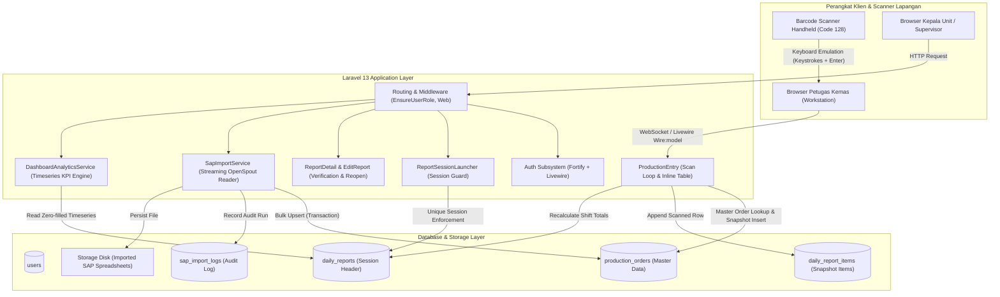
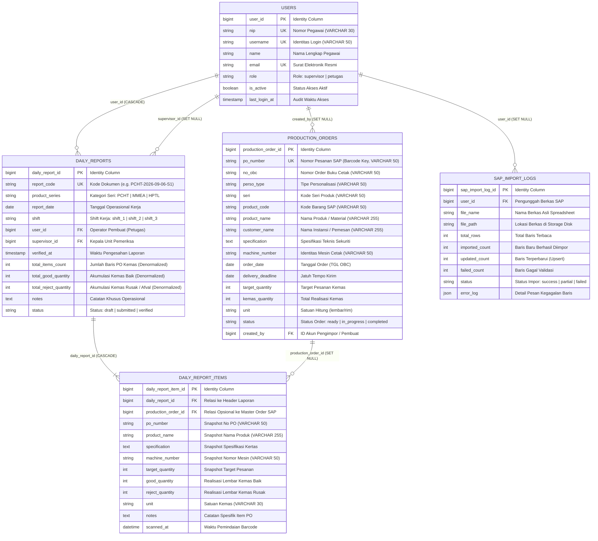
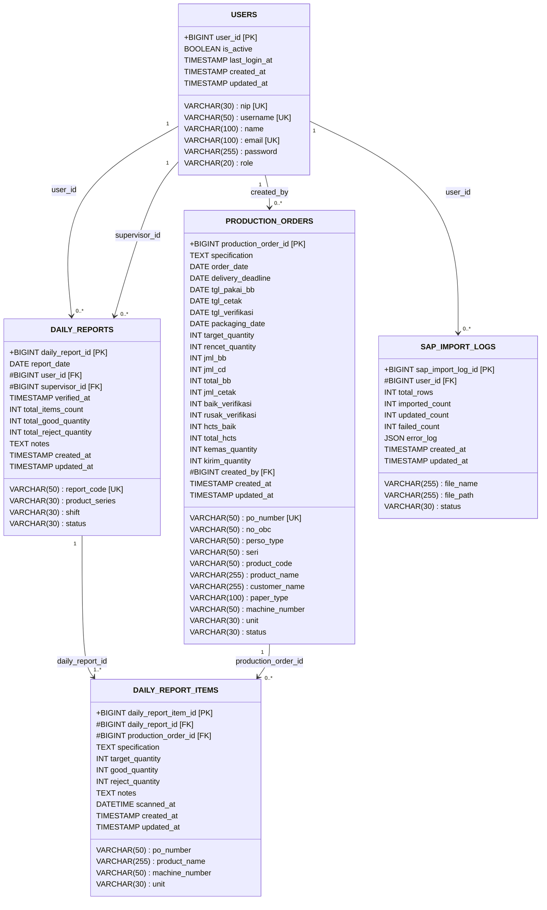
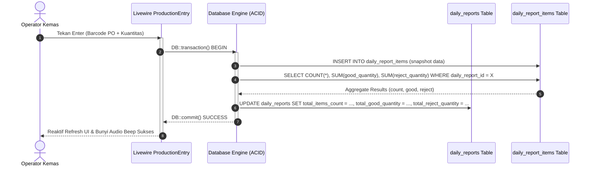

# System & Database Architecture Document — scan-produksi

**Project Name:** Sistem Dokumentasi Hasil Produksi Harian Berbasis Web dengan Pemindaian Barcode  
**Target Organization:** PT Percetakan Dokumen Sekuriti (Unit Pengemasan / Packaging Unit)  
**Architect:** Senior Database / Data Architect  
**Technical Lead:** Zulfikar Hidayatullah  
**Runtime Environment:** PHP 8.5, Laravel 13, Livewire 4, Flux UI, Tailwind CSS v4  
**Primary Databases:** SQLite (Local Development) → MySQL 8.0+ / PostgreSQL 16+ (Staging & Production)  
**Standardized Timezone:** `Asia/Jakarta` (WIB)  
**Currency Standard:** Rupiah (`IDR` / `Rp`)  

---

## 1. Executive Summary & Business Context

### 1.1 Operational Problem Statement
Unit Pengemasan pada PT Percetakan Dokumen Sekuriti (PDS) bertanggung jawab atas pemeriksaan akhir, penghitungan presisi, pembungkusan, dan verifikasi fisik produk sekuriti negara—khususnya seri pita cukai:
- **PCHT** (Pita Cukai Hasil Tembakau)
- **MMEA** (Minuman Mengandung Etil Alkohol)
- **HPTL** (Hasil Pengolahan Tembakau Lainnya)

Sebelum sistem ini diterapkan, dokumentasi dilakukan secara manual melalui pencatatan tulisan tangan dari **Kartu Mesin Produksi** ke buku register fisik. Permasalahan utama yang terjadi:
1. **Pencatatan Berulang & Human Error:** Nomor Order (No PO) 10–12 digit sering salah tulis, menyebabkan selisih rekonsiliasi antara hasil cetak mesin dan hasil kemas.
2. **Keterlambatan Pelaporan Shift:** Rekapitulasi shift harian (Shift 1, 2, dan 3) memakan waktu 30–60 menit setelah jam kerja usai karena penghitungan manual.
3. **Risiko Audit & Integritas Dokumen:** Berkas kertas rentan tercecer, kotor terkena tinta/oli mesin, dan sulit ditelusuri riwayat verifikasi supervisornya.

### 1.2 System Solution Architecture
Sistem **scan-produksi** mengotomatisasi aliran data produksi pengemasan dengan:
- **Pemindai Barcode Fisik (Code 128):** Pembacaan instan No PO dari Kartu Mesin Produksi dengan latensi baca master data < 50 ms.
- **Integrasi Master Data SAP:** Sinkronisasi berkas pesanan pabrik melalui parser spreadsheet massal (*streaming bulk upsert*).
- **Session-Driven Daily Reporting:** Kontainer laporan otomatis per seri produk, tanggal kerja, dan shift dengan generator kode unik deterministik (misal `PCHT-2026-09-06-S1`).
- **Verifikasi Bertingkat & Audit Trail:** Penatausahaan status draf, submit, dan verifikasi supervisor dengan jendela koreksi 24 jam dan ekspor spreadsheet memory-safe.

---

## 2. High-Level System Architecture



---

## 3. Database Architecture & Relational Schema

### 3.1 Conceptual Entity Relationship Diagram (ERD)



---

### 3.2 Logical Record Structure (LRS)

Transformasi ERD konseptual ke dalam bentuk struktur rekaman logis relasional menghasilkan skema ternormalisasi berikut:



---

## 4. Deep-Dive Architectural Evaluations & Decisions

### 4.1 The Primary Key Dilemma: `tablename_id` vs `id`

#### The Conflict
- **Academic Thesis Standard (Dosen / ISO/IEC 11179):** Penguji akademis mewajibkan setiap kolom Primary Key bersifat *globally qualified* (misalnya `user_id`, `production_order_id`, `daily_report_id`, `daily_report_item_id`). Dalam teori relasional klasik (Chen & Codd), penamaan ini memungkinkan operasi aljabar relasional seperti `NATURAL JOIN` tanpa ambigu dan mempermudah pelacakan keterhubungan antar-entitas pada diagram ERD/LRS.
- **Enterprise Framework Convention (Laravel Eloquent):** Secara default mengasumsikan nama Primary Key adalah `id`. Pengubahan nama kolom PK di fisik database memaksa penambahan deklarasi `protected $primaryKey = '...';` pada seluruh model, konfigurasi eksplisit nama kolom kunci tamu (`foreignKey`, `ownerKey`), serta penyesuaian dependensi internal framework (seperti Laravel Fortify dan session driver).

#### Architectural Assessment & Strategy
Sebagai Data Architect, dilema penamaan Primary Key diselesaikan dengan **Pathway 2 — Full Physical Database Refactoring** (diaktifkan pada US-6.1):

1. **Basis Data Fisik & Model Eloquent:** Kolom Primary Key domain diganti menjadi `user_id`, `production_order_id`, `daily_report_id`, `daily_report_item_id`, dan `sap_import_log_id`. Setiap Model menetapkan `protected $primaryKey`, mendefinisikan relasi dengan `foreignKey`/`ownerKey` eksplisit, serta menyediakan accessor `$model->id` yang mengembalikan `getKey()` agar call site Livewire/Blade dan `Auth::id()` tetap kompatibel.
2. **Naskah Akademis (Bab III):** ERD Chen, LRS, dan spesifikasi file mendokumentasikan PK fisik yang sama sehingga demonstrasi sidang (phpMyAdmin/DBeaver) selaras dengan diagram skripsi.
3. **Pathway 1 (Dual-Representation / Academic Bridge):** Tetap tercatat sebagai alternatif historis berisiko lebih rendah (fisik `id`, dokumentasi akademis `tablename_id`), namun digantikan Pathway 2 agar tidak ada kesenjangan kognitif antara naskah dan skema live.

---

### 4.2 Cleaning the ERP Dump Sprawl in `production_orders`

#### Problem
Tabel `production_orders` saat ini menampung lebih dari 30 kolom dengan pencampuran istilah:
- Istilah Bahasa Inggris: `order_date`, `delivery_deadline`, `packaging_date`, `target_quantity`
- Singkatan teknis lembar kerja pabrik: `tgl_pakai_bb`, `tgl_cetak`, `tgl_verifikasi`, `jml_bb`, `jml_cd`, `total_bb`, `jml_cetak`, `baik_verifikasi`, `rusak_verifikasi`, `hcts_baik`, `total_hcts`
- Pelanggaran 3NF: Kolom `total_bb` disimpan secara fisik, padahal nilainya adalah derivasi murni dari `jml_bb + jml_cd`.

#### Architectural Rationale
- **Mengapa Tidak Dipecah Menjadi Banyak Tabel?** Di tingkat teoritis, tabel ini dapat didekomposisi menjadi `production_orders`, `production_sheet_preparations`, `production_print_stages`, dan `production_verifications`. Namun, secara praktis dalam sistem manufaktur, data ini berasal dari satu tarikan lembar kerja ekspor sistem SAP. Memecahnya ke dalam 4 tabel terpisah akan memaksa `SapImportService` melakukan 4 kali *insert/upsert* terpisah per baris, memperlambat proses impor data dari 3 detik menjadi 45 detik, serta memperbesar kompleksitas penanganan rollback transaksi.
- **Tindakan Perapian (Hardening):**
  1. Klasifikasikan kolom ke dalam dua kelompok fungsional: **Kolom Operasional Pengemasan** (yang dibaca oleh scanner barcode) dan **Kolom Arsip Siklus Cetak SAP** (*passthrough metadata*).
  2. Batasi ukuran alokasi memori `VARCHAR` (dari default `VARCHAR(255)` ke panjang terukur seperti `VARCHAR(50)` untuk `po_number`, `machine_number`, dan `product_code`).
  3. Dokumentasikan relasi derivasi `total_bb` di level application model melalui accessor Eloquent untuk memastikan konsistensi matematis.

---

### 4.3 Snapshot Pattern in `daily_report_items` (Deliberate Denormalization)

#### Problem
Tabel `daily_report_items` menyalin langsung nilai `po_number`, `product_name`, `specification`, `machine_number`, `target_quantity`, dan `unit` dari tabel `production_orders`, meskipun telah memiliki foreign key `production_order_id`. Dari sudut pandang normalisasi basis data murni (3NF), ini adalah redundansi data.

#### Architectural Justification
**Pola denormalisasi snapshot ini mutlak dan wajib dipertahankan.**
Di industri percetakan dokumen sekuriti berpresisi tinggi:
1. **Kekekalan Arsip Hukum (*Audit Immutability*):** Dokumen Laporan Pengemasan Harian adalah bukti serah terima legal hasil cetak pita cukai ke pihak Bea Cukai. Jika di masa mendatang data master pada SAP diimpor ulang dengan spesifikasi baru, atau jika pesanan produksi lama dibersihkan/dihapus (*purged*), berkas laporan fisik yang dicetak 6 bulan lalu **tidak boleh berubah nilainya sedikit pun**.
2. **Resiliensi Foreign Key:** Relasi `production_order_id` dikonfigurasi dengan aturan `nullOnDelete()`. Apabila suatu rekaman master order pada `production_orders` dihapus, baris rincian pada `daily_report_items` tetap utuh beserta seluruh data snapshot-nya.

---

### 4.4 Resolving Redundant Indexes & Data Type Mismatches

Pemeriksaan baris kode migrasi menemukan inefisiensi yang **telah dirapikan pada US-6.2**:

1. **Redundant Index pada `daily_reports.report_code` (selesai):**
   ```php
   // ✅ database/migrations/2026_08_26_000004_create_daily_reports_and_items_tables.php
   $table->string('report_code', 50)->unique();
   ```
   Deklarasi `->unique()` secara otomatis membuat indeks pohon B-Tree unik. Rantai `->index()` tambahan dihapus agar tidak menciptakan indeks kedua yang memperlambat *write* dan memboroskan *index buffer cache*.

2. **Ketidaksesuaian Tipe Kolom Catatan (`notes`) (selesai):**
   - `daily_reports.notes` dan `daily_report_items.notes` sama-sama bertipe `text()->nullable()`.
   - Catatan operator yang panjang tidak lagi terpotong pada batas 255 karakter.

3. **Restriksi Ukuran Kolom String (selesai):**
   Pada MySQL dengan set karakter `utf8mb4`, panjang terukur diterapkan antara lain: `po_number` (50), `no_obc` (50), `machine_number` (50), `product_code` (50), `unit` (30), serta kolom status/shift/seri terkait. `SapImportService::boundString()` memotong sel impor yang melebihi batas sebelum upsert.

Dokumentasi fitur: [Schema Decluttering & Data Dictionary](dev-docs/features/schema-decluttering-and-data-dictionary.md).

## 5. Concurrency Control & Transaction Boundaries

### 5.1 Barcode Scanning & Totals Synchronization

Pada komponen Livewire `ProductionEntry`, proses penambahan item hasil pemindaian barcode melibatkan dua aksi berurutan:
1. `DailyReportItem::create([...])`
2. `this->refreshTotals()` yang memperbarui `total_items_count` dan `total_good_quantity` pada tabel `daily_reports`.

#### Celah Teridentifikasi
Operasi ini sebelumnya dijalankan tanpa pembungkus transaksi (`DB::transaction`). Jika terjadi kegagalan jaringan atau crash basis data di antara langkah 1 dan 2, akan terjadi **denormalization drift** di mana jumlah fisik baris item tidak sesuai dengan angka agregat di header laporan. Selain itu, `refreshTotals()` lama mengabaikan penghitungan `total_reject_quantity`.

#### Arsitektur Transaksi yang Tepat



Implementasi standar pada service/component:
```php
DB::transaction(function () use ($qty) {
    DailyReportItem::create([
        'daily_report_id' => $this->report->id,
        'production_order_id' => $this->scannedOrder->id,
        'po_number' => $this->scannedOrder->po_number,
        'product_name' => $this->scannedOrder->product_name,
        'specification' => $this->scannedOrder->specification,
        'machine_number' => $this->scannedOrder->machine_number,
        'target_quantity' => $this->scannedOrder->target_quantity,
        'good_quantity' => $qty,
        'reject_quantity' => 0,
        'unit' => $this->scannedOrder->unit ?? 'lembar',
        'notes' => $this->itemNotes ?: null,
        'scanned_at' => now(),
    ]);

    // Sinkronisasi seluruh kolom akumulasi secara atomik
    $totals = DailyReportItem::where('daily_report_id', $this->report->id)
        ->selectRaw('COUNT(*) as total_items, COALESCE(SUM(good_quantity), 0) as total_good, COALESCE(SUM(reject_quantity), 0) as total_reject')
        ->first();

    $this->report->update([
        'total_items_count' => (int) $totals->total_items,
        'total_good_quantity' => (int) $totals->total_good,
        'total_reject_quantity' => (int) $totals->total_reject,
    ]);
});
```

---

### 5.2 Session Launcher Concurrency (TOCTOU Race Condition)

Pada `ReportSessionLauncher`, inisiasi sesi laporan harian menerapkan logika *Check-Then-Act*:
```php
$existing = DailyReport::where('product_series', $series)
    ->whereDate('report_date', $date)
    ->where('shift', $shift)
    ->first();

if (! $existing) {
    $report = DailyReport::create([...]);
}
```

Jika dua operator di workstation berbeda membuka shift yang sama pada detik yang persis sama, kedua proses lolos pengecekan pertama. Proses kedua akan gagal dengan fatal exception `QueryException: Duplicate entry for key 'daily_reports_product_series_report_date_shift_unique'`.

**Solusi Arsitektur:**
Gunakan operasi atomik `DailyReport::firstOrCreate()` atau tangani `QueryException` secara anggun dengan mengalihkan operator kedua ke sesi yang berhasil dibuat oleh operator pertama.

---

## 6. Database Engine Portability (SQLite → MySQL / PostgreSQL)

Sistem **scan-produksi** dirancang untuk beroperasi secara portabel melintasi tiga mesin basis data relasional utama: **SQLite 3** untuk pengembangan lokal dan pengujian otomatis cepat (*in-memory*), **MySQL 8.0+** sebagai basis data target implementasi *on-premise* di lingkungan operasional pabrik, serta **PostgreSQL 16+** sebagai opsi infrastruktur korporat masa depan berdaya tahan tinggi.

### 6.1 Matriks Kompatibilitas Lintas Driver Basis Data

| Aspek / Fitur Relasional | SQLite 3 (Pengembangan Lokal / Test) | MySQL 8.0+ (Target Produksi Pabrik) | PostgreSQL 16+ (Alternatif Enterprise) | Ketetapan Arsitektur & Portabilitas |
|---|---|---|---|---|
| **Foreign Key Constraints** | Diaktifkan via konfigurasi `'foreign_key_constraints' => true` (`PRAGMA foreign_keys = ON`) | Selalu aktif pada engine default InnoDB | Selalu aktif secara natif | Diuji otomatis pada `DatabasePortabilityTest` untuk menjamin integritas referensial. |
| **Klausa Posisi `->after()`** | Diabaikan secara anggun (*silent ignore*) oleh SQLite SchemaGrammar | Didukung penuh untuk memposisikan kolom fisik tabel | Diabaikan secara anggun (*silent ignore*) oleh PostgresGrammar | Dilarang keras menulis kueri atau pemetaan numerik berbasis urutan posisi kolom fisik (`SELECT *` offset). Seluruh model Eloquent dan query builder wajib menyebutkan nama kolom secara eksplisit. |
| **Penyimpanan Kolom JSON** | Disimpan secara fisik sebagai `TEXT` | Disimpan sebagai tipe biner `JSON` natif dengan validasi sintaks otomatis | Disimpan sebagai `JSON` / `JSONB` natif | Model Eloquent (`SapImportLog`) menggunakan casting `'error_log' => 'array'` sehingga serialisasi dan deserialisasi bekerja transparan dan identik di ketiga mesin. |
| **Batas Panjang Kunci Indeks** | Tidak dibatasi secara praktis | Dibatasi hingga 3.072 byte pada format `DYNAMIC` / `utf8mb4` | Dibatasi hingga 1/3 ukuran halaman memori (± 2.700 byte untuk tuple B-Tree) | Seluruh kolom string pembentuk indeks majemuk dibatasi dengan panjang terukur (`VARCHAR(30)` hingga `VARCHAR(50)`), menjaga konsumsi memori indeks di bawah 500 byte. |
| **Fungsi Agregasi Waktu Nyata** | `COUNT(*)`, `SUM()`, `COALESCE()` standar ANSI | `COUNT(*)`, `SUM()`, `COALESCE()` standar ANSI | `COUNT(*)`, `SUM()`, `COALESCE()` standar ANSI | Tidak menggunakan fungsi spesifik vendor (seperti `IFNULL` MySQL atau ekstensi non-ANSI). Kueri `selectRaw` pada modul pemindaian dan penyuntingan bersifat portabel murni. |
| **Tipe Data Kuantitas & Flag** | Integer dinamis, integer 0/1 untuk boolean | `INT UNSIGNED`, `TINYINT(1)` untuk boolean | `INTEGER` (signed), `BOOLEAN` natif | Definisi migrasi Laravel menggunakan `$table->unsignedInteger(...)` dan `$table->boolean(...)` yang ditransformasikan secara akurat oleh masing-masing grammar driver. |

---

### 6.2 Independensi Urutan Kolom Fisik (`->after()`)

Pada migrasi penambahan kolom:
1. `2026_08_26_000001_add_role_nip_username_status_to_users_table.php`:
   ```php
   $table->string('nip', 30)->nullable()->unique()->after('name');
   $table->string('username', 50)->nullable()->unique()->after('nip');
   $table->string('role', 20)->default('petugas')->after('password');
   $table->boolean('is_active')->default(true)->after('role');
   $table->timestamp('last_login_at')->nullable()->after('is_active');
   ```
2. `2026_08_26_000005_add_verified_at_and_reject_to_daily_reports_tables.php`:
   ```php
   $table->unsignedInteger('total_reject_quantity')->default(0)->after('total_good_quantity');
   $table->timestamp('verified_at')->nullable()->after('supervisor_id');
   $table->unsignedInteger('reject_quantity')->default(0)->after('good_quantity');
   ```

**Aturan Penjaminan Portabilitas:**
- Mesin MySQL menempatkan kolom baru tepat di sebelah kolom acuan `->after()`, menjaga kerapian susunan kolom ketika diinspeksi melalui perkakas basis data administratif (*phpMyAdmin* atau *MySQL Workbench*).
- Mesin PostgreSQL dan SQLite tidak mendukung klausa posisi `AFTER` pada operasi `ALTER TABLE ADD COLUMN`. Laravel SchemaGrammar untuk SQLite dan PostgreSQL mengabaikan pemanggilan `->after()` tanpa memicu galat sintaksis (*graceful fallback*), menambahkan kolom tersebut di posisi akhir tabel.
- Kode aplikasi dalam repositori ini sepenuhnya terisolasi dari perbedaan urutan fisik tersebut karena interaksi basis data dieksekusi melalui Eloquent Model dan pemanggilan kolom berbasis nama (*named projection*), bukan indeks numerik array (*positional fetch*).

---

### 6.3 Audit Anggaran Ukuran Indeks Majemuk MySQL utf8mb4 (3.072 Byte)

Pada MySQL 8.0+ dengan set karakter bawaan `utf8mb4` (yang mengalokasikan hingga 4 byte per karakter untuk mendukung set karakter multibyte dan simbol sekuriti), panjang gabungan seluruh kolom dalam satu indeks pohon B-Tree dibatasi maksimal **3.072 byte**. Apabila tabel memiliki indeks komposit pada beberapa kolom `VARCHAR(255)` tanpa pembatasan panjang, migrasi akan gagal dengan pengecualian fatal:
`SQLSTATE[42000]: Syntax error or access violation: 1071 Specified key was too long; max key length is 3072 bytes`.

Arsitektur skema `scan-produksi` mengaudit seluruh indeks komposit pada domain tabel dengan alokasi ketat:

| Tabel Basis Data | Nama / Kolom Indeks Majemuk | Komposisi Tipe Data & Ukuran Byte (utf8mb4) | Total Ukuran Byte | Status Portabilitas |
|---|---|---|---|---|
| `production_orders` | `['status', 'order_date']` | `VARCHAR(30)` (120 B) + `DATE` (3 B) | **123 Byte** | Aman (< 3.072 B) |
| `production_orders` | `['machine_number', 'status']` | `VARCHAR(50)` (200 B) + `VARCHAR(30)` (120 B) | **320 Byte** | Aman (< 3.072 B) |
| `production_orders` | `['no_obc', 'status']` | `VARCHAR(50)` (200 B) + `VARCHAR(30)` (120 B) | **320 Byte** | Aman (< 3.072 B) |
| `sap_import_logs` | `['created_at', 'status']` | `TIMESTAMP` (4 B) + `VARCHAR(30)` (120 B) | **124 Byte** | Aman (< 3.072 B) |
| `daily_reports` | `['product_series', 'report_date', 'shift']` (UK) | `VARCHAR(30)` (120 B) + `DATE` (3 B) + `VARCHAR(30)` (120 B) | **243 Byte** | Aman (< 3.072 B) |
| `daily_reports` | `['status', 'report_date']` | `VARCHAR(30)` (120 B) + `DATE` (3 B) | **123 Byte** | Aman (< 3.072 B) |
| `daily_report_items` | `['daily_report_id', 'po_number']` | `BIGINT` (8 B) + `VARCHAR(50)` (200 B) | **208 Byte** | Aman (< 3.072 B) |

Setiap indeks komposit dalam aplikasi mengonsumsi **kurang dari 350 byte**, hanya menghabiskan ±11% dari batas aman MySQL, sehingga mencegah risiko pemborosan memori *buffer pool* dan menjamin kompatibilitas penuh.

---

### 6.4 Struktur Kolom JSON & Model Casting (`sap_import_logs.error_log`)

Tabel `sap_import_logs` mencatat riwayat pemrosesan impor master order SAP termasuk rincian baris yang gagal divalidasi pada kolom `error_log`:
- **Definisi Migrasi:** `$table->json('error_log')->nullable();`
- **Tingkat Fisik MySQL 8.0+:** Disimpan dalam format biner teroptimasi `JSON` natif dengan verifikasi sintaks otomatis saat *write*.
- **Tingkat Fisik PostgreSQL 16+:** Diterjemahkan sebagai tipe `JSON` standar.
- **Tingkat Fisik SQLite 3:** Diterjemahkan sebagai kolom teks `TEXT`.
- **Penanganan Aplikasi Eloquent:**
  Model `SapImportLog` menetapkan deklarasi casting eksplisit:
  ```php
  protected function casts(): array
  {
      return [
          'total_rows' => 'integer',
          'imported_count' => 'integer',
          'updated_count' => 'integer',
          'failed_count' => 'integer',
          'error_log' => 'array',
      ];
  }
  ```
  Dengan konfigurasi ini, Eloquent secara otomatis melakukan `json_encode()` saat menyimpan array error dan `json_decode(..., true)` saat membaca rekaman dari basis data. Fungsionalitas aplikasi tidak bergantung pada fitur mesin spesifik, dan data log audit tetap utuh saat basis data dimigrasikan antar-platform.

---

### 6.5 Integritas Referensial Kunci Tamu (*Foreign Key Lifecycle*)

Integritas relasional antar-tabel dijaga secara konsisten melalui dua aksi penghapusan kunci tamu:

1. **`cascadeOnDelete()` — Penghapusan Berjenjang Dependen Induk:**
   - Menghapus akun Petugas (`users.user_id`) akan menghapus seluruh rekaman header sesi laporan (`daily_reports`) yang dibuat oleh petugas tersebut.
   - Menghapus dokumen laporan harian (`daily_reports.daily_report_id`) secara otomatis menghapus seluruh baris rincian item (`daily_report_items`) di bawahnya, mencegah keberadaan data yatim (*orphaned records*).
2. **`nullOnDelete()` — Perlindungan Arsip & Nilai Snapshot:**
   - Menghapus data master pesanan SAP (`production_orders.production_order_id`) **tidak menghapus** baris rincian pada `daily_report_items`. Foreign key disetel ke `NULL`, sementara seluruh data snapshot operasional (`po_number`, `product_name`, `specification`, `machine_number`, `target_quantity`, `good_quantity`, `reject_quantity`, `unit`, `notes`, `scanned_at`) tetap utuh untuk kebutuhan pembuktian audit hukum.
   - Menghapus akun supervisor pengesah (`daily_reports.supervisor_id`) atau pengunggah berkas SAP (`sap_import_logs.user_id`) menyetel kolom kunci tamu menjadi `NULL` tanpa membatalkan keabsahan rekaman laporan atau berkas log.

---

### 6.6 Kepatuhan Sintaks ANSI SQL pada Kueri Agregasi

Seluruh kalkulasi akumulasi data (seperti pada `ProductionEntry::saveEntry()` dan `EditReport::refreshTotals()`) menggunakan ekspresi SQL murni yang mematuhi standar ANSI:
```php
$totals = DailyReportItem::where('daily_report_id', $this->report->id)
    ->selectRaw('COUNT(*) as total_items, COALESCE(SUM(good_quantity), 0) as total_good, COALESCE(SUM(reject_quantity), 0) as total_reject')
    ->first();
```
- Fungsi `COUNT(*)` dan `SUM(...)` didukung universal oleh SQLite, MySQL, dan PostgreSQL.
- Fungsi pembungkus nilai kosong `COALESCE(..., 0)` memastikan kalkulasi menghasilkan nilai integer 0 saat tabel masih kosong (menghindari galat nilai `NULL` pada PostgreSQL atau MySQL *strict mode*).
- Layanan analitik `DashboardAnalyticsService` mengelompokkan data deret waktu menggunakan koleksi PHP (`Collection::groupBy()`) berbasis tanggal terurai, menghindari ketergantungan pada fungsi pemformatan tanggal spesifik vendor seperti `DATE_FORMAT()` (MySQL), `strftime()` (SQLite), atau `TO_CHAR()` (PostgreSQL).

---

### 6.7 Panduan Konfigurasi Basis Data Produksi & Variabel Lingkungan (`.env`)

#### Lingkungan 1: Pengembangan Lokal & Pengujian Cepat (SQLite)
Cocok untuk lingkungan kerja lokal pengembang, CI/CD pipeline, dan eksekusi pengujian Pest:
```ini
DB_CONNECTION=sqlite
DB_DATABASE=/absolute/path/to/database/database.sqlite
DB_FOREIGN_KEYS=true
```

#### Lingkungan 2: Target Produksi Pabrik (MySQL 8.0+)
Konfigurasi standar untuk server operasional *on-premise* unit pengemasan:
```ini
DB_CONNECTION=mysql
DB_HOST=127.0.0.1
DB_PORT=3306
DB_DATABASE=scan_produksi_prod
DB_USERNAME=pds_app_user
DB_PASSWORD=SecureProductionPasswordGenerated2026!
DB_CHARSET=utf8mb4
DB_COLLATION=utf8mb4_unicode_ci
MYSQL_ATTR_SSL_CA=
```

**Rekomendasi Parameter `my.cnf` Mesin MySQL Produksi:**
- `default_storage_engine = InnoDB`
- `innodb_file_per_table = 1`
- `innodb_buffer_pool_size = 2G` (sesuaikan dengan 60-70% RAM server)
- `innodb_flush_log_at_trx_commit = 1` (menjamin durabilitas penuh ACID)
- `character-set-server = utf8mb4`
- `collation-server = utf8mb4_unicode_ci`
- `sql_mode = "STRICT_TRANS_TABLES,NO_ZERO_IN_DATE,NO_ZERO_DATE,ERROR_FOR_DIVISION_BY_ZERO,NO_ENGINE_SUBSTITUTION"`

#### Lingkungan 3: Alternatif Enterprise (PostgreSQL 16+)
Konfigurasi untuk infrastruktur korporat dengan replikasi tingkat lanjut:
```ini
DB_CONNECTION=pgsql
DB_HOST=127.0.0.1
DB_PORT=5432
DB_DATABASE=scan_produksi_enterprise
DB_USERNAME=pds_app_user
DB_PASSWORD=SecureProductionPasswordGenerated2026!
DB_CHARSET=utf8
DB_SSLMODE=prefer
```

---

### 6.8 Prosedur Verifikasi Migrasi & *Cutover* Produksi

Sebelum melakukan *cutover* produksi ke basis data MySQL/PostgreSQL, administrator wajib menjalankan serangkaian perintah verifikasi:

1. **Pengujian Status Migrasi Bersih:**
   ```bash
   php artisan migrate:status
   ```
2. **Uji Coba Migrasi Penuh (*Dry-Run / Migration Cycle*):**
   ```bash
   php artisan migrate:fresh --seed
   ```
3. **Eksekusi Pengujian Otomatis Integritas Relasional:**
   ```bash
   php artisan test --compact --filter=DatabasePortabilityTest
   php artisan test --compact --filter=PrimaryKeyArchitectureTest
   ```
4. **Verifikasi Encoding Tabel & Buffer Indeks (MySQL Shell):**
   ```sql
   SELECT table_name, table_collation, data_length, index_length 
   FROM information_schema.tables 
   WHERE table_schema = 'scan_produksi_prod';
   ```

---

## 7. Referensi & Dokumen Terkait

- [docs/Readme.md](Readme.md) — Master indeks dokumentasi proyek
- [docs/dev-docs/decisions/003-production-order-indexing-and-schema-architecture.md](dev-docs/decisions/003-production-order-indexing-and-schema-architecture.md) — Keputusan indeks barcode master data
- [docs/dev-docs/decisions/006-daily-production-report-schema-and-session-launcher.md](dev-docs/decisions/006-daily-production-report-schema-and-session-launcher.md) — Skema sesi laporan harian
- [docs/dev-docs/decisions/010-database-schema-refinement-and-academic-pk-conventions.md](dev-docs/decisions/010-database-schema-refinement-and-academic-pk-conventions.md) — ADR penyelarasan penamaan Primary Key dan hardening transaksi
- [docs/dev-docs/decisions/011-cross-database-portability-and-migration-standards.md](dev-docs/decisions/011-cross-database-portability-and-migration-standards.md) — ADR standarisasi portabilitas basis data lintas engine
- [docs/dev-docs/features/dual-path-primary-key-and-model-alignment.md](dev-docs/features/dual-path-primary-key-and-model-alignment.md) — Dokumentasi teknis Pathway 2 PK fisik `tablename_id`
- [docs/dev-docs/features/schema-decluttering-and-data-dictionary.md](dev-docs/features/schema-decluttering-and-data-dictionary.md) — Dokumentasi perapian skema dan restriksi panjang VARCHAR
- [docs/dev-docs/features/transactional-hardening-and-concurrency-protection.md](dev-docs/features/transactional-hardening-and-concurrency-protection.md) — Dokumentasi batas transaksi atomik pemindaian barcode
- [docs/dev-docs/features/production-portability-and-multi-database-verification.md](dev-docs/features/production-portability-and-multi-database-verification.md) — Dokumentasi verifikasi portabilitas SQLite ke MySQL dan PostgreSQL
- [docs/scrum-planning/phase-06-database-architecture-refinement-and-academic-alignment.md](scrum-planning/phase-06-database-architecture-refinement-and-academic-alignment.md) — Rencana backlog sprint implementasi refactoring basis data
- [docs/BAB_III_Draft.md](BAB_III_Draft.md) — Naskah Bab III Skripsi (ERD Chen, LRS, dan Spesifikasi File Basis Data)
