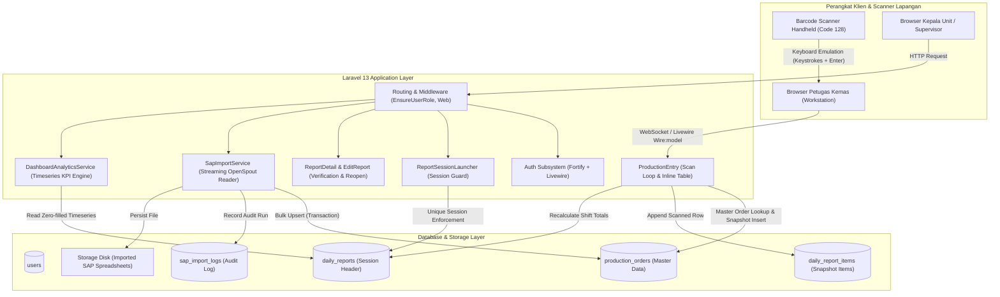
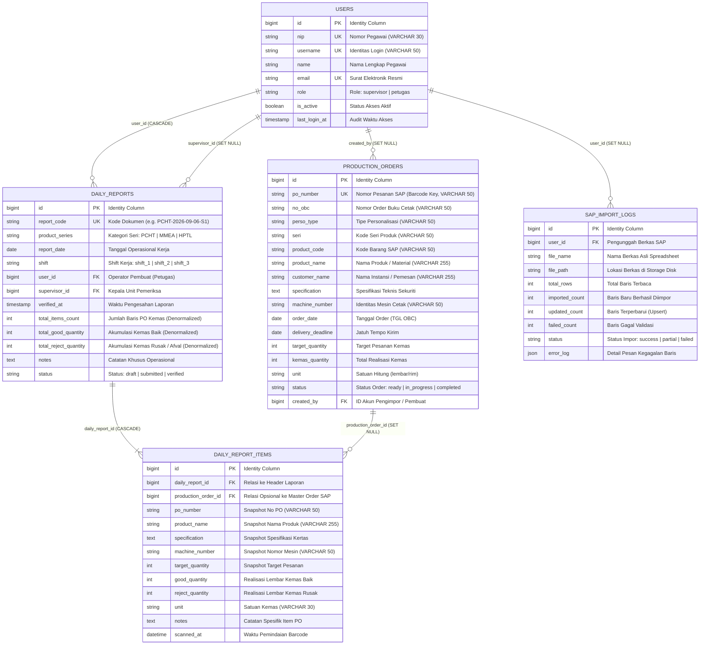
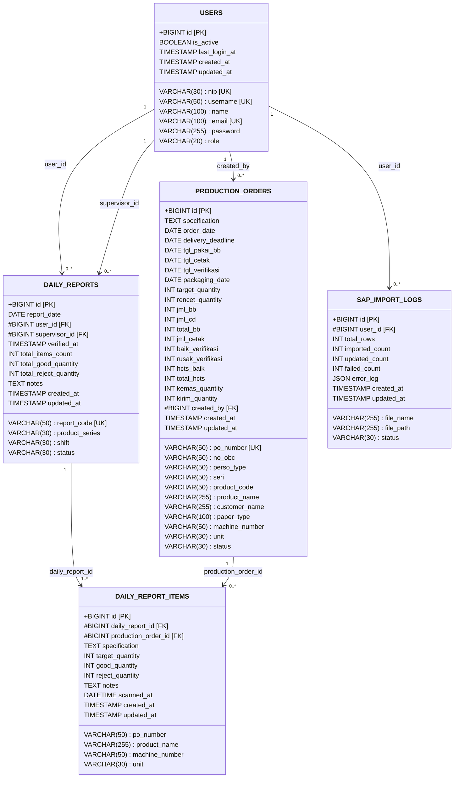
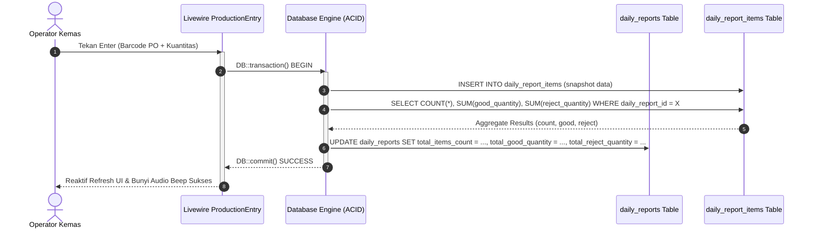

# System & Database Architecture Document — scan-produksi

**Project Name:** Sistem Dokumentasi Hasil Produksi Harian Berbasis Web dengan Pemindaian Barcode  
**Target Organization:** PT Percetakan Dokumen Sekuriti (Unit Pengemasan / Packaging Unit)  
**Architect:** Senior Database / Data Architect  
**Technical Lead:** Zulfikar Hidayatullah  
**Runtime Environment:** PHP 8.5, Laravel 13, Livewire 4, Flux UI, Tailwind CSS v4  
**Primary Databases:** SQLite (Local Development) → MySQL 8.0+ / PostgreSQL 16+ (Staging & Production)  
**Standardized Timezone:** `Asia/Jakarta` (WIB)  
**Currency Standard:** Rupiah (`IDR` / `Rp`)  

---

## 1. Executive Summary & Business Context

### 1.1 Operational Problem Statement
Unit Pengemasan pada PT Percetakan Dokumen Sekuriti (PDS) bertanggung jawab atas pemeriksaan akhir, penghitungan presisi, pembungkusan, dan verifikasi fisik produk sekuriti negara—khususnya seri pita cukai:
- **PCHT** (Pita Cukai Hasil Tembakau)
- **MMEA** (Minuman Mengandung Etil Alkohol)
- **HPTL** (Hasil Pengolahan Tembakau Lainnya)

Sebelum sistem ini diterapkan, dokumentasi dilakukan secara manual melalui pencatatan tulisan tangan dari **Kartu Mesin Produksi** ke buku register fisik. Permasalahan utama yang terjadi:
1. **Pencatatan Berulang & Human Error:** Nomor Order (No PO) 10–12 digit sering salah tulis, menyebabkan selisih rekonsiliasi antara hasil cetak mesin dan hasil kemas.
2. **Keterlambatan Pelaporan Shift:** Rekapitulasi shift harian (Shift 1, 2, dan 3) memakan waktu 30–60 menit setelah jam kerja usai karena penghitungan manual.
3. **Risiko Audit & Integritas Dokumen:** Berkas kertas rentan tercecer, kotor terkena tinta/oli mesin, dan sulit ditelusuri riwayat verifikasi supervisornya.

### 1.2 System Solution Architecture
Sistem **scan-produksi** mengotomatisasi aliran data produksi pengemasan dengan:
- **Pemindai Barcode Fisik (Code 128):** Pembacaan instan No PO dari Kartu Mesin Produksi dengan latensi baca master data < 50 ms.
- **Integrasi Master Data SAP:** Sinkronisasi berkas pesanan pabrik melalui parser spreadsheet massal (*streaming bulk upsert*).
- **Session-Driven Daily Reporting:** Kontainer laporan otomatis per seri produk, tanggal kerja, dan shift dengan generator kode unik deterministik (misal `PCHT-2026-09-06-S1`).
- **Verifikasi Bertingkat & Audit Trail:** Penatausahaan status draf, submit, dan verifikasi supervisor dengan jendela koreksi 24 jam dan ekspor spreadsheet memory-safe.

---

## 2. High-Level System Architecture



---

## 3. Database Architecture & Relational Schema

### 3.1 Conceptual Entity Relationship Diagram (ERD)



---

### 3.2 Logical Record Structure (LRS)

Transformasi ERD konseptual ke dalam bentuk struktur rekaman logis relasional menghasilkan skema ternormalisasi berikut:



---

## 4. Deep-Dive Architectural Evaluations & Decisions

### 4.1 The Primary Key Dilemma: `tablename_id` vs `id`

#### The Conflict
- **Academic Thesis Standard (Dosen / ISO/IEC 11179):** Penguji akademis mewajibkan setiap kolom Primary Key bersifat *globally qualified* (misalnya `user_id`, `production_order_id`, `daily_report_id`, `daily_report_item_id`). Dalam teori relasional klasik (Chen & Codd), penamaan ini memungkinkan operasi aljabar relasional seperti `NATURAL JOIN` tanpa ambigu dan mempermudah pelacakan keterhubungan antar-entitas pada diagram ERD/LRS.
- **Enterprise Framework Convention (Laravel Eloquent):** Secara default mengasumsikan nama Primary Key adalah `id`. Pengubahan nama kolom PK di fisik database memaksa penambahan deklarasi `protected $primaryKey = '...';` pada seluruh model, konfigurasi eksplisit nama kolom kunci tamu (`foreignKey`, `ownerKey`), serta penyesuaian dependensi internal framework (seperti Laravel Fortify dan session driver).

#### Architectural Assessment & Strategy
Sebagai Data Architect, kita menyelesaikan dilema ini dengan membedakan **Tingkat Representasi Logis (Naskah Skripsi)** dan **Tingkat Implementasi Fisik (Database Engine & Kode Aplikasi)**:

1. **Pathway 1 — Dual-Representation Strategy (Rekomendasi Utama):**
   - **Pada Naskah Akademis (Bab III):** Dokumentasikan Primary Key secara eksplisit sebagai atribut identitas entitas: `user_id (PK)`, `production_order_id (PK)`, `daily_report_id (PK)`, dll. Dalam ERD Chen dan tabel LRS, representasikan kolom PK dengan nama tersebut agar 100% memenuhi kaidah akademis dosen pembimbing.
   - **Pada Basis Data Fisik Laravel:** Kolom fisik tetap mempertahankan penamaan standar `id` (atau diselaraskan secara terkontrol). Keuntungannya adalah zero-risk regression: seluruh relasi bawaan framework (`$this->belongsTo(...)`, `$this->hasMany(...)`), session guard, dan route-model binding tetap berjalan 100% tanpa overhead maintenance.
2. **Pathway 2 — Full Physical Database Refactoring:**
   - Jika dosen penguji bersikukuh memeriksa skema database fisik secara langsung via phpMyAdmin/DBeaver saat demonstrasi sidang, migrasi fisik dapat dieksekusi dengan memperbarui seluruh file migrasi dan Model Eloquent (lihat rincian pada Sprint Planning Phase 06).

---

### 4.2 Cleaning the ERP Dump Sprawl in `production_orders`

#### Problem
Tabel `production_orders` saat ini menampung lebih dari 30 kolom dengan pencampuran istilah:
- Istilah Bahasa Inggris: `order_date`, `delivery_deadline`, `packaging_date`, `target_quantity`
- Singkatan teknis lembar kerja pabrik: `tgl_pakai_bb`, `tgl_cetak`, `tgl_verifikasi`, `jml_bb`, `jml_cd`, `total_bb`, `jml_cetak`, `baik_verifikasi`, `rusak_verifikasi`, `hcts_baik`, `total_hcts`
- Pelanggaran 3NF: Kolom `total_bb` disimpan secara fisik, padahal nilainya adalah derivasi murni dari `jml_bb + jml_cd`.

#### Architectural Rationale
- **Mengapa Tidak Dipecah Menjadi Banyak Tabel?** Di tingkat teoritis, tabel ini dapat didekomposisi menjadi `production_orders`, `production_sheet_preparations`, `production_print_stages`, dan `production_verifications`. Namun, secara praktis dalam sistem manufaktur, data ini berasal dari satu tarikan lembar kerja ekspor sistem SAP. Memecahnya ke dalam 4 tabel terpisah akan memaksa `SapImportService` melakukan 4 kali *insert/upsert* terpisah per baris, memperlambat proses impor data dari 3 detik menjadi 45 detik, serta memperbesar kompleksitas penanganan rollback transaksi.
- **Tindakan Perapian (Hardening):**
  1. Klasifikasikan kolom ke dalam dua kelompok fungsional: **Kolom Operasional Pengemasan** (yang dibaca oleh scanner barcode) dan **Kolom Arsip Siklus Cetak SAP** (*passthrough metadata*).
  2. Batasi ukuran alokasi memori `VARCHAR` (dari default `VARCHAR(255)` ke panjang terukur seperti `VARCHAR(50)` untuk `po_number`, `machine_number`, dan `product_code`).
  3. Dokumentasikan relasi derivasi `total_bb` di level application model melalui accessor Eloquent untuk memastikan konsistensi matematis.

---

### 4.3 Snapshot Pattern in `daily_report_items` (Deliberate Denormalization)

#### Problem
Tabel `daily_report_items` menyalin langsung nilai `po_number`, `product_name`, `specification`, `machine_number`, `target_quantity`, dan `unit` dari tabel `production_orders`, meskipun telah memiliki foreign key `production_order_id`. Dari sudut pandang normalisasi basis data murni (3NF), ini adalah redundansi data.

#### Architectural Justification
**Pola denormalisasi snapshot ini mutlak dan wajib dipertahankan.**
Di industri percetakan dokumen sekuriti berpresisi tinggi:
1. **Kekekalan Arsip Hukum (*Audit Immutability*):** Dokumen Laporan Pengemasan Harian adalah bukti serah terima legal hasil cetak pita cukai ke pihak Bea Cukai. Jika di masa mendatang data master pada SAP diimpor ulang dengan spesifikasi baru, atau jika pesanan produksi lama dibersihkan/dihapus (*purged*), berkas laporan fisik yang dicetak 6 bulan lalu **tidak boleh berubah nilainya sedikit pun**.
2. **Resiliensi Foreign Key:** Relasi `production_order_id` dikonfigurasi dengan aturan `nullOnDelete()`. Apabila suatu rekaman master order pada `production_orders` dihapus, baris rincian pada `daily_report_items` tetap utuh beserta seluruh data snapshot-nya.

---

### 4.4 Resolving Redundant Indexes & Data Type Mismatches

Pemeriksaan baris kode migrasi menemukan inefisiensi yang harus dirapikan:

1. **Redundant Index pada `daily_reports.report_code`:**
   ```php
   // ❌ Ditemukan pada database/migrations/2026_08_26_000004_create_daily_reports_and_items_tables.php:16
   $table->string('report_code')->unique()->index();
   ```
   Deklarasi `->unique()` pada MySQL, PostgreSQL, maupun SQLite secara otomatis membuat indeks pohon B-Tree unik. Penambahan `->index()` setelahnya menciptakan indeks kedua yang identik, memperlambat operasi *write* dan memboroskan kapasitas memori *index buffer cache*.
   - **Solusi:** Hapus `->index()` dan pertahankan `$table->string('report_code', 50)->unique();`.

2. **Ketidaksesuaian Tipe Kolom Catatan (`notes`):**
   - `daily_reports.notes` bertipe `text` (kapasitas 64 KB pada MySQL).
   - `daily_report_items.notes` bertipe `string` (kapasitas default 255 karakter).
   Jika operator kemas mencatat rincian teknis afval kertas atau kendala pisau potong yang panjang, penyimpanan akan terpotong (*truncate*) atau melempar fatal error pada MySQL mode strict.
   - **Solusi:** Samakan tipe data `daily_report_items.notes` menjadi `text()->nullable()`.

3. **Restriksi Ukuran Kolom String:**
   Pada MySQL dengan set karakter `utf8mb4`, setiap karakter memakan memori hingga 4 byte. Menggunakan `VARCHAR(255)` untuk seluruh kolom kode identitas membebani *composite index page*.
   - **Solusi:** Berikan panjang terukur: `po_number` (50), `no_obc` (50), `machine_number` (50), `unit` (30).

---

## 5. Concurrency Control & Transaction Boundaries

### 5.1 Barcode Scanning & Totals Synchronization

Pada komponen Livewire `ProductionEntry`, proses penambahan item hasil pemindaian barcode melibatkan dua aksi berurutan:
1. `DailyReportItem::create([...])`
2. `this->refreshTotals()` yang memperbarui `total_items_count` dan `total_good_quantity` pada tabel `daily_reports`.

#### Celah Teridentifikasi
Operasi ini sebelumnya dijalankan tanpa pembungkus transaksi (`DB::transaction`). Jika terjadi kegagalan jaringan atau crash basis data di antara langkah 1 dan 2, akan terjadi **denormalization drift** di mana jumlah fisik baris item tidak sesuai dengan angka agregat di header laporan. Selain itu, `refreshTotals()` lama mengabaikan penghitungan `total_reject_quantity`.

#### Arsitektur Transaksi yang Tepat



Implementasi standar pada service/component:
```php
DB::transaction(function () use ($qty) {
    DailyReportItem::create([
        'daily_report_id' => $this->report->id,
        'production_order_id' => $this->scannedOrder->id,
        'po_number' => $this->scannedOrder->po_number,
        'product_name' => $this->scannedOrder->product_name,
        'specification' => $this->scannedOrder->specification,
        'machine_number' => $this->scannedOrder->machine_number,
        'target_quantity' => $this->scannedOrder->target_quantity,
        'good_quantity' => $qty,
        'reject_quantity' => 0,
        'unit' => $this->scannedOrder->unit ?? 'lembar',
        'notes' => $this->itemNotes ?: null,
        'scanned_at' => now(),
    ]);

    // Sinkronisasi seluruh kolom akumulasi secara atomik
    $totals = DailyReportItem::where('daily_report_id', $this->report->id)
        ->selectRaw('COUNT(*) as total_items, COALESCE(SUM(good_quantity), 0) as total_good, COALESCE(SUM(reject_quantity), 0) as total_reject')
        ->first();

    $this->report->update([
        'total_items_count' => (int) $totals->total_items,
        'total_good_quantity' => (int) $totals->total_good,
        'total_reject_quantity' => (int) $totals->total_reject,
    ]);
});
```

---

### 5.2 Session Launcher Concurrency (TOCTOU Race Condition)

Pada `ReportSessionLauncher`, inisiasi sesi laporan harian menerapkan logika *Check-Then-Act*:
```php
$existing = DailyReport::where('product_series', $series)
    ->whereDate('report_date', $date)
    ->where('shift', $shift)
    ->first();

if (! $existing) {
    $report = DailyReport::create([...]);
}
```

Jika dua operator di workstation berbeda membuka shift yang sama pada detik yang persis sama, kedua proses lolos pengecekan pertama. Proses kedua akan gagal dengan fatal exception `QueryException: Duplicate entry for key 'daily_reports_product_series_report_date_shift_unique'`.

**Solusi Arsitektur:**
Gunakan operasi atomik `DailyReport::firstOrCreate()` atau tangani `QueryException` secara anggun dengan mengalihkan operator kedua ke sesi yang berhasil dibuat oleh operator pertama.

---

## 6. Database Engine Portability (SQLite → MySQL / PostgreSQL)

| Aspek / Fitur | SQLite (Pengembangan Lokal) | MySQL 8.0+ (Target Produksi) | PostgreSQL 16+ (Alternatif Enterprise) | Rekomendasi Portabilitas |
|---|---|---|---|---|
| **Foreign Key Enforcement** | Dinonaktifkan default (aktif via pragma) | Selalu aktif (InnoDB) | Selalu aktif | Pastikan seeder & test menghormati integritas FK |
| **Klausa `->after()`** | Diabaikan (*silent ignore*) | Didukung penuh | Diabaikan | Jangan bergantung pada urutan fisik kolom di query |
| **Kolom JSON (`error_log`)** | Disimpan sebagai `TEXT` | Native `JSON` (dengan validasi sintaks) | Disimpan sebagai `JSON` / `JSONB` | Gunakan casting array pada model Eloquent |
| **Tipe Data Waktu** | Disimpan sebagai string ISO 8601 | `DATETIME` / `TIMESTAMP` | `TIMESTAMP WITHOUT TIME ZONE` | Selalu gunakan accessor/mutator Carbon Laravel |
| **Panjang Indeks String** | Tidak dibatasi | Dibatasi hingga 3072 byte (utf8mb4) | Tidak dibatasi (hingga batas tuple) | Batasi panjang `VARCHAR` pada kolom berindeks |
| **Tipe Data Kuantitas** | Integer dinamis | `INT UNSIGNED` | `INTEGER` (signed) | Pertahankan `unsignedInteger` di migrasi Laravel |

---

## 7. Referensi & Dokumen Terkait

- [docs/Readme.md](Readme.md) — Master indeks dokumentasi proyek
- [docs/dev-docs/decisions/003-production-order-indexing-and-schema-architecture.md](dev-docs/decisions/003-production-order-indexing-and-schema-architecture.md) — Keputusan indeks barcode master data
- [docs/dev-docs/decisions/006-daily-production-report-schema-and-session-launcher.md](dev-docs/decisions/006-daily-production-report-schema-and-session-launcher.md) — Skema sesi laporan harian
- [docs/dev-docs/decisions/010-database-schema-refinement-and-academic-pk-conventions.md](dev-docs/decisions/010-database-schema-refinement-and-academic-pk-conventions.md) — ADR penyelarasan penamaan Primary Key dan hardening transaksi
- [docs/scrum-planning/phase-06-database-architecture-refinement-and-academic-alignment.md](scrum-planning/phase-06-database-architecture-refinement-and-academic-alignment.md) — Rencana backlog sprint implementasi refactoring basis data
- [docs/BAB_III_Draft.md](BAB_III_Draft.md) — Naskah Bab III Skripsi (ERD Chen, LRS, dan Spesifikasi File Basis Data)
