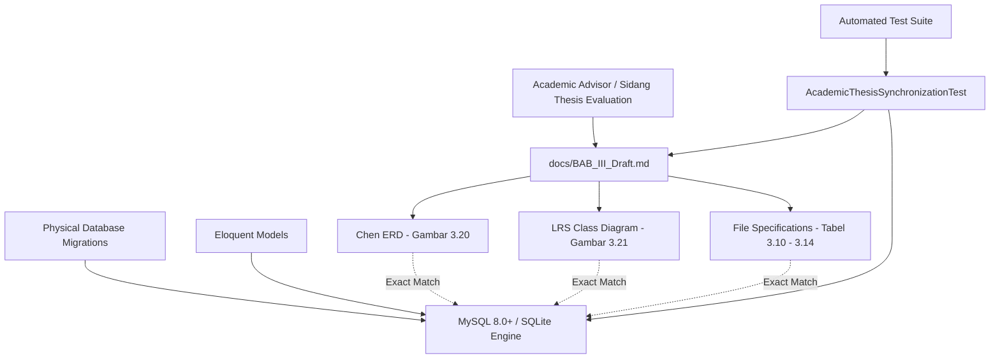
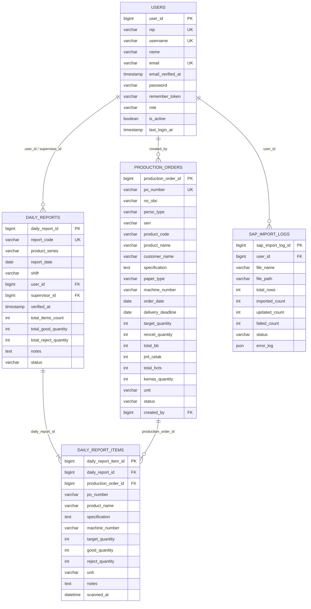

# Academic Thesis Database Synchronization

## Overview

This module formalizes the synchronization between the physical database architecture (MySQL/Laravel migrations and Eloquent models) and the academic thesis documentation in `docs/BAB_III_Draft.md` for **Phase 06 US-6.5**. It ensures that the Chen Entity Relationship Diagram (ERD), Logical Record Structure (LRS) class diagram, and File Specifications (Tabel 3.10 s.d. Tabel 3.14) depict qualified primary keys (`tablename_id`), bounded VARCHAR data types, deduplicated indexes, and operational versus passthrough SAP attributes without discrepancies during thesis defense evaluation and live system demonstrations.

## Architecture Diagram

## Data Model

## Key Files

| Layer | File | Purpose |
|-------|------|---------|
| Thesis Draft | `docs/BAB_III_Draft.md` | Academic manuscript containing Chen ERD, LRS, File Specifications, and implementation specs |
| Automated Test | `tests/Feature/MasterData/AcademicThesisSynchronizationTest.php` | Validates thesis documentation against physical database schema and language rules |
| Database Migration | `database/migrations/0001_01_01_000000_create_users_table.php` | Physical schema for `users` (`user_id` PK) |
| Database Migration | `database/migrations/2026_08_26_000001_add_role_nip_username_status_to_users_table.php` | Role, credentials, and active status fields on `users` |
| Database Migration | `database/migrations/2026_08_26_000002_create_production_orders_table.php` | Physical schema for `production_orders` (`production_order_id` PK and bounded columns) |
| Database Migration | `database/migrations/2026_08_26_000003_create_sap_import_logs_table.php` | Physical schema for `sap_import_logs` (`sap_import_log_id` PK and JSON log) |
| Database Migration | `database/migrations/2026_08_26_000004_create_daily_reports_and_items_tables.php` | Physical schema for `daily_reports` and `daily_report_items` |
| Database Migration | `database/migrations/2026_08_26_000005_add_verified_at_and_reject_to_daily_reports_tables.php` | Verified timestamp and reject quantity tracking columns |
| Eloquent Models | `app/Models/User.php`, `ProductionOrder.php`, `DailyReport.php`, `DailyReportItem.php`, `SapImportLog.php` | Domain models with `$primaryKey = 'tablename_id'` and relationship bindings |

## Flow Explanation

1. **Academic Requirement Analysis**:
   - The thesis guidelines require classical relational integrity where primary keys reflect entity names (`tablename_id`) rather than generic `id` surrogates.
   - The physical database underwent full physical refactoring under **Pathway 2 (US-6.1)**.

2. **Diagrammatic Synchronization**:
   - **Chen ERD (Gambar 3.20)**: Highlights all 5 primary keys with underlined notation (`<u>user_id (PK)</u>`, etc.) and documents relationships (`mengimpor`, `mencatat`, `memverifikasi`, `merekam log`, `memuat`, `menjadi acuan`).
   - **LRS Class Diagram (Gambar 3.21)**: Maps entity attributes into relational tables with strict bounded types (`VARCHAR(50)`, `VARCHAR(30)`), deduplicated indexes, and clean foreign keys.

3. **File Specification Tables (Tabel 3.10 s.d. 3.14)**:
   - **Tabel 3.10 (`users`)**: Documents 13 columns including `nip`, `username`, `email_verified_at`, `remember_token`, and `role`.
   - **Tabel 3.11 (`production_orders`)**: Clearly delineates the data dictionary between Operational Packaging Attributes (14 columns) and Passthrough SAP Metadata (17 columns).
   - **Tabel 3.12 (`daily_reports`)**: Details the single deduplicated B-Tree index on `report_code`, composite unique constraint `(product_series, report_date, shift)`, and three-aggregate synchronization.
   - **Tabel 3.13 (`daily_report_items`)**: Details snapshot fields, reject quantity, and the widening of `notes` to `TEXT`.
   - **Tabel 3.14 (`sap_import_logs`)**: Details import metrics, server file paths, and the `JSON` structure of `error_log`.

4. **Programmatic Verification**:
   - `AcademicThesisSynchronizationTest` executes during every CI/test cycle, reading `docs/BAB_III_Draft.md` to guarantee that all table definitions, column names, constraints, and operational vocabulary match the database engine.

## API Endpoints

*None — Internal Database Architecture and Academic Documentation Layer.*

## Decisions & Trade-offs

- **Why keep physical column names identical to thesis documentation?**  
  Eliminates cognitive dissonance and potential point deductions during the thesis defense (sidang skripsi), allowing the examiner to view phpMyAdmin/database tables and find the exact column names documented in Bab III.
- **Why automate documentation verification in Pest?**  
  Documentation easily drifts from code. By asserting that `docs/BAB_III_Draft.md` contains every physical column name and avoids banned AI-slop phrases, regressions are caught immediately.
- **Why split `production_orders` conceptually instead of physically?**  
  Splitting `production_orders` into two separate normalized tables would add join overhead to every barcode scan without operational benefit. Retaining a single flat table with a clear data dictionary categorization satisfies both performance and architectural clarity.

## Related

- [Dual-Path Primary Key & Model Architecture Alignment (US-6.1)](dual-path-primary-key-and-model-alignment.md)
- [Schema Decluttering, String Bounds & Data Dictionary (US-6.2)](schema-decluttering-and-data-dictionary.md)
- [Transactional Hardening & Concurrency Protection (US-6.3)](transactional-hardening-and-concurrency-protection.md)
- [ADR-010: Database Schema Refinement, Academic Primary Key Conventions, and Transactional Hardening](../decisions/010-database-schema-refinement-and-academic-pk-conventions.md)
