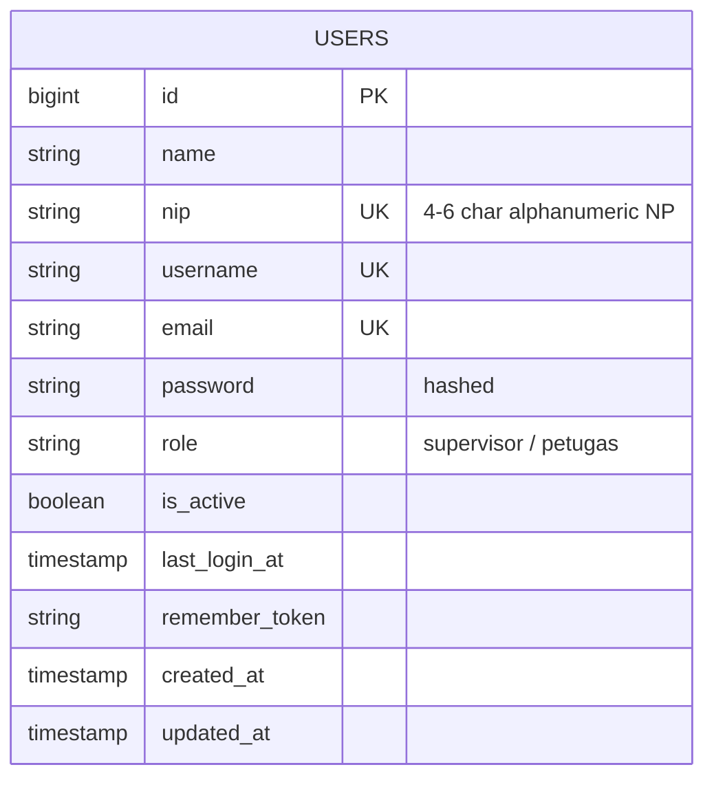

# Feature: Authentication & Application Shell Architecture

## Overview
This feature establishes the core foundational layout and authentication engine for the packaging unit application. It provides an intuitive Flux UI application shell (responsive sidebar, header with operational shift detection, timezone WIB clock, dark/light theme toggle, role-based navigation item visibility) and secure session login powered by Laravel Fortify and Livewire 4 supporting multi-identifier login (NP / Employee ID, Username, Email).

---

## Architecture Diagram

```mermaid
flowchart TD
    User([User / Operator Kemas / Supervisor]) -->|Visits /login| LoginView[Livewire Auth Component]
    LoginView -->|Input NP/Username/Email + Password| AuthProcess[Login::authenticate]
    AuthProcess -->|Check Rate Limit (5 attempts/min)| RateLimiter[RateLimiter]
    AuthProcess -->|Query User by NP / Username / Email| UserModel[(Users Table)]
    AuthProcess -->|Verify Hash & Active Status| ValidationCheck{Valid & Active?}
    ValidationCheck -->|No| ThrowError[Return Validation Error]
    ValidationCheck -->|Yes| SessionRegen[Auth::login & session()->regenerate]
    SessionRegen -->|Redirect| Dashboard[App Shell & Dashboard]
    Dashboard -->|Reads Session User & Role| LayoutApp[Flux Sidebar + Header + ShiftHelper]
```

---

## Data Model



---

## Key Files

| Layer | File | Purpose |
|-------|------|---------|
| Model | `app/Models/User.php` | Authenticatable user model with role checks & casts |
| Enum | `app/Enums/UserRole.php` | Enum definitions for `SUPERVISOR` and `PETUGAS` |
| Helper | `app/Helpers/ShiftHelper.php` | Computes Shift 1, 2, 3 and formatted WIB datetime |
| Provider | `app/Providers/FortifyServiceProvider.php` | Fortify configuration for login view and multi-identifier authentication |
| Provider | `app/Providers/AppServiceProvider.php` | Configures defaults and Livewire Blaze component optimization |
| Livewire Component | `app/Livewire/Auth/Login.php` | Reactive login logic, rate limiting, and session regeneration |
| Blade View | `resources/views/livewire/auth/login.blade.php` | Login form card template with Flux UI inputs & loading states |
| Blade Layout | `resources/views/layouts/app/sidebar.blade.php` | Main application shell with responsive Flux sidebar and header |
| Blade Layout | `resources/views/layouts/auth/card.blade.php` | Auth layout with PT PDS branding |
| Blade Component | `resources/views/components/desktop-user-menu.blade.php` | User avatar, role badge, settings link, and logout button |

---

## Flow Explanation

1. **User Action**: The operator opens `/login` on their workstation.
2. **Form Interaction**: The user enters their 4–6 character NP (e.g. `7426` or `T0087`), Username, or Email, and enters their password.
3. **Livewire Execution**: On submit, `Login::authenticate()` runs without full-page reloads. It validates input presence, checks rate-limiting, queries `User` across `nip`, `username`, and `email`, validates password hash, and confirms `is_active === true`.
4. **Session & Redirect**: Upon success, `last_login_at` is updated, session regenerated, and user redirected to `/dashboard`.
5. **App Shell Rendering**: The application shell displays the active shift banner (Shift 1, 2, or 3), real-time WIB clock, and filters menu options based on `isSupervisor()`.

---

## Decisions & Trade-offs

- **Multi-Identifier Authentication (NP / Username / Email)**: Field operators primarily recognize their 4–6 alphanumeric NP (Nomor Pegawai), while administrative supervisors might use usernames or corporate emails. Supporting all three seamlessly in one input reduces cognitive friction on the shop floor.
- **Flux UI Native Layout**: By consolidating navigation into Flux components (`<flux:sidebar>`, `<flux:header>`, `<flux:dropdown>`), client-side bundle weight is minimal and interactions are instant.
- **Blaze Optimization**: Enabled via `Blaze::optimize()->in(resource_path('views/components'))` for high-speed Blade component compilation.
