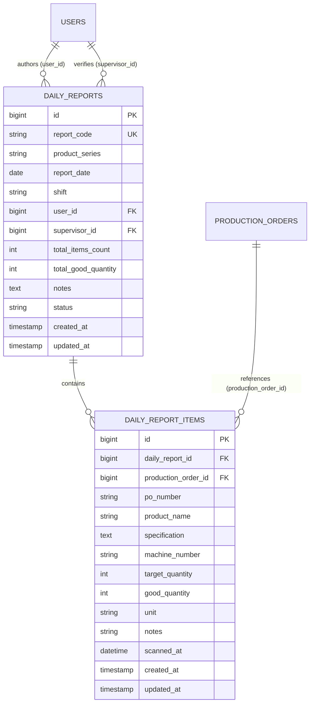

# High-Speed Continuous Barcode Scanning & Real-Time Inline Production Entry

## Overview
The High-Speed Continuous Barcode Scanning & Inline Production Entry module enables packaging operators to rapidly capture machine cards (*Kartu Mesin Produksi*) using handheld Code 128 barcode scanners and 100% keyboard navigation. The single-surface Livewire console handles instantaneous SAP order lookup, automated cursor autofocus transfer, dual-tone audio feedback, real-time snapshot recording into daily report items, modal-free inline table quantity adjustments, shift finalization, and standardized A4 physical print rendering.

## Architecture Diagram

```mermaid
flowchart TD
    A[Hardware Code 128 Scanner] -->|Scans Barcode + Sends Enter| B[Scan No PO Input #scan-po-input]
    B -->|wire:keydown.enter.prevent=lookupPo| C[ProductionEntry Component]
    C -->|Query po_number| D[(production_orders Table)]
    D -->|Order Found| E[Populate Spec Pill & Success Chime]
    D -->|Order Not Found| F[Error Toast & Buzzer Sound]
    E -->|Dispatch focus-qty-input| G[Jumlah Kemas Input #production-qty-input]
    G -->|Type Qty + Press Enter| H[ProductionEntry::saveEntry]
    H -->|Insert Record| I[(daily_report_items Table)]
    H -->|Recalculate Totals| J[(daily_reports Table)]
    H -->|Dispatch focus-scan-input| B
    
    K[Inline Table Row] -->|Edit Cell Value + Enter/Blur| L[ProductionEntry::updateItemQuantity]
    L -->|Update Record & Recount| I
    L -->|Recount Totals| J
    
    M[Header Finalize Button] -->|wire:click=finalizeReport| N[Update status to SUBMITTED]
    N -->|Lock Editing & Show Print CTA| O[Physical Print View /reports/{code}/print]
```

## Data Model



## Key Files

| Layer | File | Purpose |
|---|---|---|
| Livewire Component | `app/Livewire/Reports/ProductionEntry.php` | Handles continuous scan lookup, focus event dispatches, singular item persistence, inline quantity updates, deletion, finalization, and supervisor reopening |
| Blade Template | `resources/views/livewire/reports/production-entry.blade.php` | Single-surface scan console, Web Audio API sound synthesis, matched SAP spec pill, and 9-column inline editable table |
| Printable Template | `resources/views/reports/print.blade.php` | Standardized A4 portrait layout with company header, metadata table, items breakdown, and signature block for handover |
| Routing | `routes/web.php` | Named routes for `reports.entry` (`/reports/{report:report_code}/entry`) and `reports.print` (`/reports/{report:report_code}/print`) |
| Feature Tests | `tests/Feature/Reports/ProductionEntryTest.php`<br>`tests/Feature/Reports/InlineRowEditTest.php`<br>`tests/Feature/Reports/FinalizeReportTest.php`<br>`tests/Feature/Reports/ReportPrintTest.php` | Full Pest feature test suite verifying scanning loop, inline edits, total calculations, lock permissions, and print rendering |

## Flow Explanation

1. **Continuous Scan Loop (100% Keyboard Driven)**:
   - Upon page load, Alpine.js executes `$refs.scanInput.focus()`.
   - The operator aims the physical scanner at the barcode on the machine card. The scanner enters the PO number and sends `Enter`.
   - Livewire triggers `lookupPo()`. It queries `production_orders` for the matching `po_number`.
   - If not found, an error toast is displayed, buzzer audio is emitted, the input is cleared, and focus remains on `#scan-po-input`.
   - If found, product specifications are displayed in the matched pill, a pleasant chime plays, and `@focus-qty-input` transfers focus to `#production-qty-input` (auto-selecting the default target quantity).
   - The operator types the actual packed amount and presses `Enter`.
   - `saveEntry()` creates a snapshot row in `daily_report_items`, increments report aggregates, resets the form, dispatches `@focus-scan-input`, and prepares the console for the next card immediately.
2. **Real-Time Inline Table Editing (No Modals)**:
   - All scanned rows are listed in reverse chronological order in the table below the console.
   - To correct a typo, the operator clicks or tabs directly to the number input in the "Jumlah Kemas" column.
   - When the value is changed and `Enter` or `Tab` is pressed, `updateItemQuantity($itemId, $newQty)` executes immediately.
   - Quantity must be $\ge 1$. If invalid, an alert toast is shown and the previous value is restored.
   - The table footer recalculates total target quantity, total packed quantity, and percentage realization instantly.
3. **Session Finalization & Physical Print Handover**:
   - When the operator completes packaging for the shift, they click "Selesaikan Laporan".
   - If the report contains items, `finalizeReport()` transitions the report status from `draft` to `submitted`.
   - The scanning console and table inline inputs are locked for operators.
   - A direct link to "Cetak Dokumen Fisik" (`/reports/{report_code}/print`) opens an A4 print-ready sheet with official headers and two-column signature fields.
   - Packaging supervisors can reopen a submitted report if corrections are required.

## Routing & URL Structure

| Method | URI | Name | Access Role | Description |
|---|---|---|---|---|
| GET | `/reports/{report:report_code}/entry` | `reports.entry` | Petugas, Supervisor | High-speed continuous scanning console & inline table |
| GET | `/reports/{report:report_code}/print` | `reports.print` | Petugas, Supervisor | Standard A4 physical printable view |

## Decisions & Trade-offs

- **Single-Surface Zero-Modal Architecture**: Modals interrupt high-speed operator scanning rhythm. Integrating the scanner input, spec pill, and inline table into one reactive Livewire surface allows seamless processing of hundreds of cards per hour.
- **Web Audio API Synthesis**: Rather than relying on external MP3 audio asset files that may fail to buffer or trigger cross-origin blocking, audio chimes are synthesized directly in the browser using the Web Audio API oscillator.
- **Snapshot Immutability**: All item attributes (name, specification, machine number, target quantity) are snapshotted in `daily_report_items` upon save, ensuring historical report integrity regardless of future SAP master data imports.

## Related

- [ADR-007: High-Speed Continuous Barcode Scanning and Inline Table Editing](../decisions/007-high-speed-continuous-barcode-scanning-and-inline-table-editing.md)
- [Daily Production Report Session & Code Generator](./daily-production-report-session.md)
- [Panduan Pemindaian Barcode & Input Produksi](../../user-docs/guides/panduan-pemindaian-barcode-dan-input-produksi.md)
