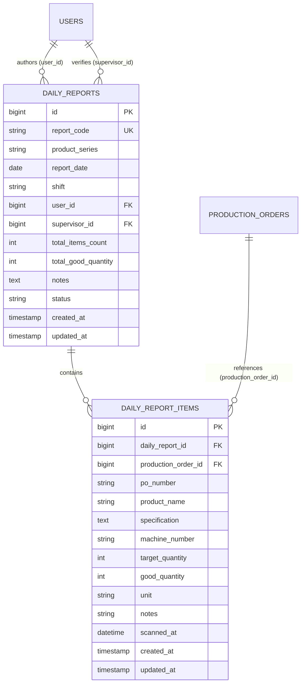

# Daily Production Report Session & Code Generator

## Overview
The Daily Production Report Session module handles the initialization, categorization, and tracking of daily security printing packaging reports. Each reporting session is isolated by product series category (`PCHT`, `MMEA`, `HPTL`), reporting date in Jakarta timezone (WIB), and operational shift (`Shift 1`, `Shift 2`, `Shift 3`). The module provides real-time collision detection, auto-detection of active work shifts, standardized code generation (e.g. `PCHT-2026-08-26-S1`), and immediate redirection to the high-speed barcode scanning entry console.

## Architecture Diagram

```mermaid
flowchart TD
    A[Petugas / Supervisor] -->|Access /reports/session| B[ReportSessionLauncher Livewire Component]
    B -->|Fetch Current Date & WIB Shift| C[ShiftHelper / WorkShift Enum]
    B -->|Check Existing Session| D[(daily_reports Table)]
    B -->|Generate Code Preview| E[ReportCodeGenerator Service]
    A -->|Submit Form / Enter| F{Report Exists?}
    F -->|Yes| G[Resume Existing Session]
    F -->|No| H[Create Draft DailyReport Record]
    G --> I[Redirect to /reports/{report_code}/entry]
    H --> I
    I --> J[ProductionEntry Livewire Component]
```

## Data Model



## Key Files

| Layer | File | Purpose |
|---|---|---|
| Migration | `database/migrations/2026_08_26_000004_create_daily_reports_and_items_tables.php` | Defines relational schemas, indexes, and unique composite constraint |
| Enums | `app/Enums/ProductSeries.php`<br>`app/Enums/WorkShift.php`<br>`app/Enums/ReportStatus.php` | Strict type definitions for categories, shifts, and lifecycle states |
| Service | `app/Services/ReportCodeGenerator.php` | Standardized report code generator (`[SERIES]-[YYYY-MM-DD]-S[SHIFT]`) |
| Eloquent Models | `app/Models/DailyReport.php`<br>`app/Models/DailyReportItem.php` | Relational models with casts and user relationship bindings |
| Livewire Component | `app/Livewire/Reports/ReportSessionLauncher.php` | State management, validation, collision check, and redirection |
| Blade View | `resources/views/livewire/reports/session-launcher.blade.php` | Flux UI responsive launcher card with radio cards and live preview |
| Entry Component | `app/Livewire/Reports/ProductionEntry.php` | High-speed entry console and inline editable table |
| Blade View | `resources/views/livewire/reports/production-entry.blade.php` | Dual-input scan console with audio feedback and table footer summaries |
| Routes | `routes/web.php` | Named routes for `/reports/session`, `/reports/create`, `/laporan/buat`, `/reports/{report}/entry` |

## Flow Explanation

1. **User Navigation**: The operator clicks the "Buat Laporan" menu item on the sidebar or visits `/reports/session`.
2. **Component Initialization (`mount`)**:
   - `report_date` defaults to current date in `Asia/Jakarta` (`Y-m-d`).
   - `shift` auto-detects current operational shift via `ShiftHelper::getCurrentShift()`.
   - `product_series` defaults to `pcht` (Pita Cukai Hasil Tembakau).
3. **Reactive Preview & Existing Session Detection**:
   - As the user toggles product series or shift radio cards, the live report code preview dynamically updates (e.g., `MMEA-2026-08-26-S2`).
   - The component checks if a report with `(product_series, report_date, shift)` already exists in the database.
   - If an existing report is found, an info banner displays author details, total scanned POs, and current status, switching the CTA button to *"Lanjutkan Sesi Pemindaian PO"*.
4. **Session Dispatch (`launchSession`)**:
   - Validates input parameters (`report_date`, `product_series`, `shift`).
   - If existing: flashes toast notification and redirects directly to `route('reports.entry', ['report' => $existingReport->report_code])`.
   - If new: generates code via `ReportCodeGenerator`, creates a new `DailyReport` record with status `draft`, and redirects to `reports.entry`.

## Routing & URL Structure

| Method | URI | Name | Access Role | Description |
|---|---|---|---|---|
| GET | `/reports/session` | `reports.session` | Petugas, Supervisor | Daily report session initiator |
| GET | `/reports/create` | `reports.create` | Petugas, Supervisor | Standard alias for session launcher |
| GET | `/laporan/buat` | `laporan.create` | Petugas, Supervisor | Indonesian alias for session launcher |
| GET | `/reports/{report:report_code}/entry` | `reports.entry` | Petugas, Supervisor | High-speed scanning console & inline table |

## Decisions & Trade-offs

- **Smart Session Resuming vs Re-creating**: Operators frequently reopen draft reports after breaks or shift handovers. Instead of throwing database duplicate key exceptions, the system transparently opens the active session.
- **Lean Models & Direct Livewire Eloquent Queries**: In accordance with project development guidelines, business logic and database queries are placed directly in the Livewire component without unnecessary service/repository abstractions.
- **Composite Unique Key**: Enforces database integrity ensuring that only one report exists per `(product_series, report_date, shift)` combination.

## Related

- [ADR-006: Daily Production Report Schema and Session Launcher](../decisions/006-daily-production-report-schema-and-session-launcher.md)
- [Master Data SAP Feature Documentation](./production-order-master-data.md)
- [Panduan Inisiasi Sesi Laporan Produksi](../../user-docs/guides/panduan-inisiasi-sesi-laporan-produksi.md)
