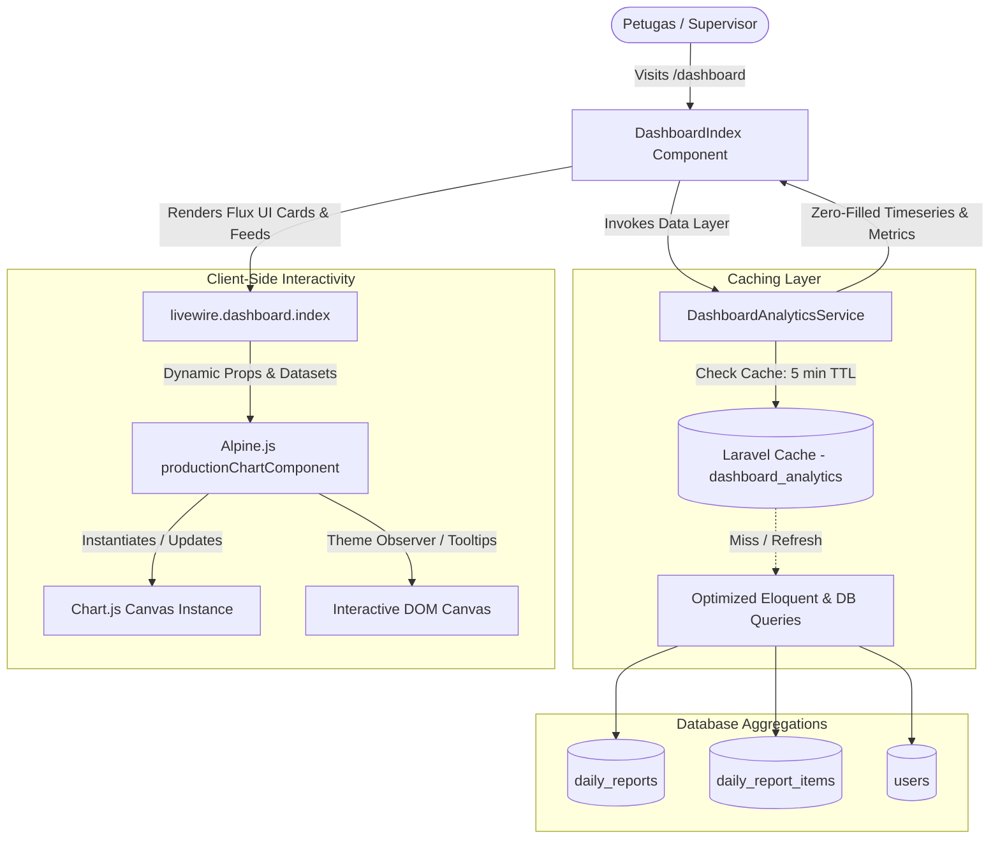
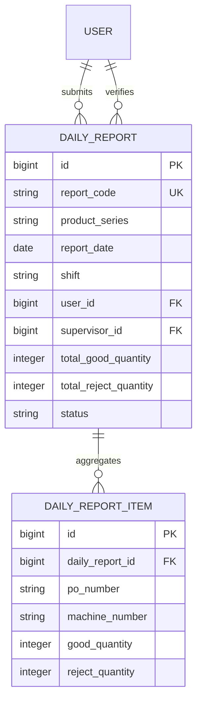

# Dashboard Analytics & 14-Day Production Visualization

## Overview
The Dashboard Analytics and 14-Day Production Visualization module acts as the unified Operational Command Center (`/dashboard`) for PT Percetakan Dokumen Sekuriti (PT PDS). It consolidates real-time daily production KPIs, an interactive 14-day production volume and defect timeseries graph powered by Chart.js and Alpine.js, work shift performance distribution, top machine rankings, role-based quick action shortcuts, and a live recent report feed into a single cohesive surface.

## Architecture Diagram

## Data Model

## Key Files

| Layer | File | Purpose |
|-------|------|---------|
| Service Layer | `app/Services/DashboardAnalyticsService.php` | Calculates daily KPIs, zero-filled time-series production data, shift distribution percentages, top machines, and manages caching. |
| Livewire Component | `app/Livewire/Dashboard/DashboardIndex.php` | Manages dashboard state, date ranges (`range=7, 14, 30`), chart types (`type=area, line, bar`), dynamic greetings, and cache refresh. |
| Blade View & Alpine | `resources/views/livewire/dashboard/index.blade.php` | Flux UI responsive view, Alpine.js Chart.js container, 5 KPI cards, Quick Action Hub, Shift & Machine distribution cards, and recent report activity table. |
| JS Integration | `resources/js/app.js` | Imports `chart.js/auto` and registers it on the `window.Chart` global object for Alpine.js component usage. |
| Routing | `routes/web.php` | Registers the single dashboard endpoint `GET /dashboard` mapped to `DashboardIndex::class`. |

## Flow Explanation

1. **User triggers / Navigation** — Authenticated user navigates to `/dashboard` or is redirected upon login.
2. **Component rendering (`DashboardIndex::render`)** — Requests KPI metrics and trend datasets from `DashboardAnalyticsService`.
3. **Data Aggregation & Caching** — `DashboardAnalyticsService` resolves cached metrics (5-minute TTL) or calculates them via aggregated queries:
   - `getTodayMetrics()`: Sums good/reject output for today, calculates reject rate %, compares against yesterday's volume (+/-%), counts unique POs, active operators, and status breakdowns.
   - `getProductionTrend($days)`: Builds a full `CarbonPeriod` sequence for 7, 14, or 30 days, joins `daily_reports` and `daily_report_items`, and zero-fills any days without reports to ensure continuous line curves.
   - `getShiftDistribution($days)`: Computes percentage volume for Shift 1 (Pagi), Shift 2 (Siang), and Shift 3 (Malam).
   - `getTopMachines($days, 5)`: Groups output by `machine_number` to rank the top 5 high-performing machines.
4. **Interactive Chart Initialization** — Blade template renders `x-data="productionChartComponent(...)"`, which binds datasets to Chart.js, styles the canvas with theme-adaptive colors and gradients (emerald for good, rose for reject), and attaches custom tooltip formatters in Indonesian locale (`id-ID`).
5. **Dynamic Filtering** — When users click 7/14/30 days or Area/Line/Bar toggles, Livewire updates URL query parameters without page reload and Alpine seamlessly redraws the canvas.

## Decisions & Trade-offs

- **Alpine.js + Global Chart.js over Heavy React/Vue Wrappers:** Chart.js `auto` is bundled via Vite and initialized inside an Alpine component. This eliminates the overhead of multi-framework bridges while delivering reactive canvas transitions.
- **PHP Zero-Filling for Time-Series:** Rather than relying on frontend logic to guess missing dates, `DashboardAnalyticsService` generates a continuous calendar collection using `CarbonPeriod`. Days with no production are initialized with 0 to prevent skewed graph intervals.
- **Smart Tagged / Fallback Cache Strategy:** Uses `Cache::tags(['dashboard_analytics'])` when supported by Redis/Memcached, with graceful fallback to standard `Cache::remember()` when using file/database cache drivers.

## Related

- [ADR-009: Dashboard Analytics Aggregation, Zero-Fill Timeseries, and Chart.js Integration](../decisions/009-dashboard-analytics-aggregation-and-chartjs-visualization.md)
- [Phase 05 Scrum Planning Document](../../scrum-planning/phase-05-dashboard-analytics-14-day-chart.md)
- [Phase 05 UX Plan](../../scrum-planning/phase-05-ux-plan.md)
