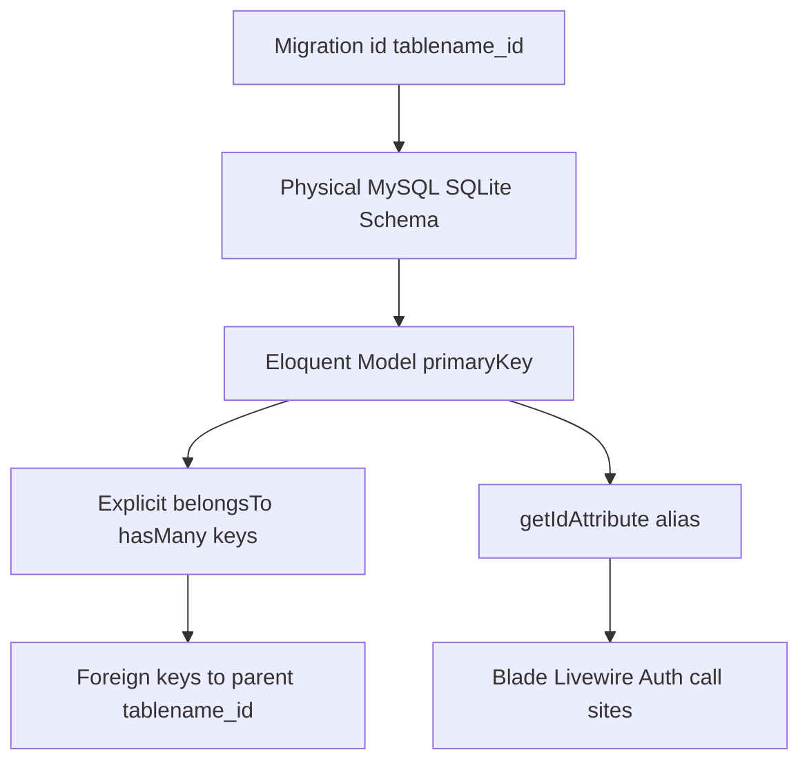
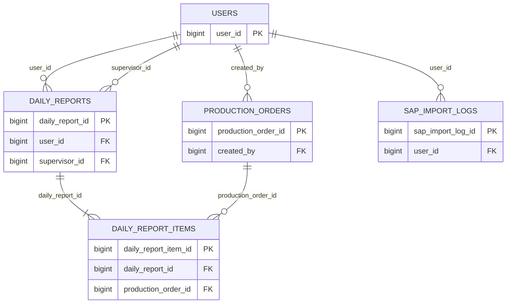

# Dual-Path Primary Key & Model Architecture Alignment

## Overview

Phase 06 US-6.1 activates **Pathway 2 (Full Physical Database Refactoring)**: every domain entity uses a qualified physical primary key (`tablename_id`) so academic ERD/LRS diagrams and live database inspection match. Eloquent models declare matching `$primaryKey` values, explicit relationship owner/foreign keys, and a backward-compatible `$model->id` accessor that aliases `getKey()` so Livewire views, `Auth::id()`, and existing call sites keep working.

## Architecture Diagram

## Data Model

| Table | Physical PK | Model `$primaryKey` | Alias accessor |
|-------|-------------|---------------------|----------------|
| `users` | `user_id` | `user_id` | `$user->id` |
| `production_orders` | `production_order_id` | `production_order_id` | `$order->id` |
| `daily_reports` | `daily_report_id` | `daily_report_id` | `$report->id` |
| `daily_report_items` | `daily_report_item_id` | `daily_report_item_id` | `$item->id` |
| `sap_import_logs` | `sap_import_log_id` | `sap_import_log_id` | `$log->id` |

## Key Files

| Layer | File | Purpose |
|-------|------|---------|
| Migrations | `database/migrations/0001_01_01_000000_create_users_table.php` | `id('user_id')` |
| Migrations | `database/migrations/2026_08_26_000002_create_production_orders_table.php` | `id('production_order_id')` + FK to `users.user_id` |
| Migrations | `database/migrations/2026_08_26_000003_create_sap_import_logs_table.php` | `id('sap_import_log_id')` |
| Migrations | `database/migrations/2026_08_26_000004_create_daily_reports_and_items_tables.php` | Report/item PKs and qualified FKs |
| Models | `app/Models/{User,ProductionOrder,DailyReport,DailyReportItem,SapImportLog}.php` | `$primaryKey`, relations, `getIdAttribute()` |
| Analytics | `app/Services/DashboardAnalyticsService.php` | Joins on `daily_reports.daily_report_id` |
| Validation | `app/Livewire/Petugas/PetugasIndex.php`, `UpdateDatabase.php`, `ProfileValidationRules.php` | `unique` ignore column = PK name |
| Tests | `tests/Feature/MasterData/PrimaryKeyArchitectureTest.php` | Schema, model, relation, FK assertions |

## Flow Explanation

1. **Schema create** — migrations define `$table->id('tablename_id')` and `constrained('parent', 'parent_pk')`.
2. **Model boot** — Eloquent reads/writes using `$primaryKey`; `find($id)` and route binding (still `report_code` for reports) keep working.
3. **UI / Auth** — Blade and Livewire still pass `$model->id`; the accessor returns the physical key so wire:click and Auth identifiers stay stable.
4. **Raw queries** — dashboard joins and `orderBy`/`latest`/`oldest` clauses use the physical PK column names.
5. **Validation** — `unique:table,column,ignoreId,idColumn` and `Rule::unique()->ignore($id, 'user_id')` target the renamed PK.

## API Endpoints (if applicable)

None found — this story is schema and ORM alignment only. Existing Livewire routes are unchanged (`reports/{report:report_code}`, `/petugas`, `/update-database`, `/dashboard`).

## Decisions & Trade-offs

- **Pathway 2 over Pathway 1** — examiners may inspect phpMyAdmin/DBeaver; physical `tablename_id` columns satisfy academic PK naming without relying only on thesis notation.
- **`$id` accessor retained** — avoids a mass rewrite of Blade `wire:click` and Livewire state that already store numeric IDs; physical column remains the source of truth.
- **Fresh migration strategy** — create migrations were edited in place because the project has not shipped a production schema freeze; local/test DBs use `migrate:fresh`.
- **Framework tables untouched** — `jobs.id`, `failed_jobs.id`, `sessions.id` stay Laravel defaults (out of academic domain entities).

## Related

- [ADR-010](../decisions/010-database-schema-refinement-and-academic-pk-conventions.md)
- [System Architecture](../../architecture.md)
- [Phase 06 Scrum Plan](../../scrum-planning/phase-06-database-architecture-refinement-and-academic-alignment.md)
- [Schema Decluttering (US-6.2)](schema-decluttering-and-data-dictionary.md)
- [Transactional Hardening (US-6.3)](transactional-hardening-and-concurrency-protection.md)
