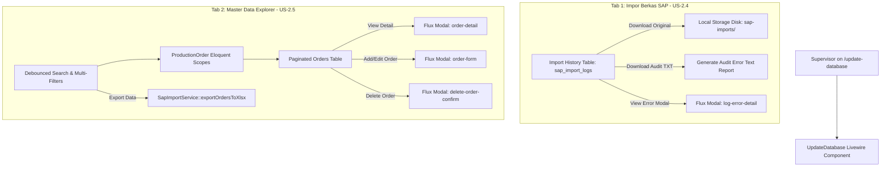
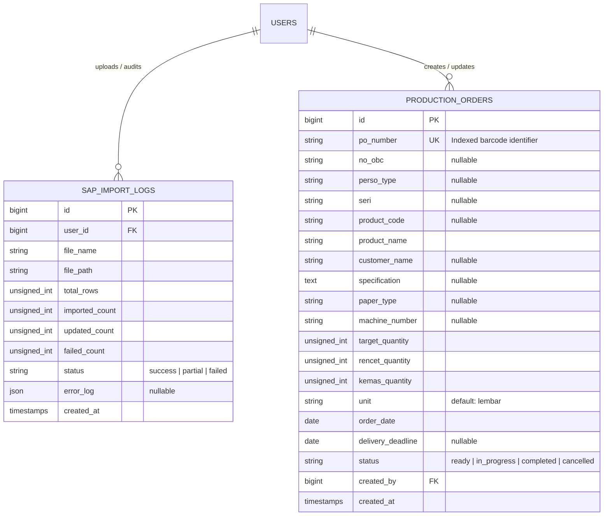

# Master Data Explorer & Manual Order Management (US-2.4 & US-2.5)

## Overview

The Master Data Explorer & Manual Order Management module (`/update-database` tab 2) provides supervisors and unit officers with interactive search, multi-faceted filtering, ad-hoc manual order registration, complete technical print specification drawers, and Excel export capabilities. It also completes the audit trail features (US-2.4) by enabling supervisors to download archived source spreadsheets and structured error audit logs.

---

## Architecture Diagram

---

## Data Model & Relationships

---

## Key Files

| Layer | File | Purpose |
|-------|------|---------|
| Model | `app/Models/ProductionOrder.php` | Eloquent model with casts, status enums, formatted numbers, fulfillment calculations, and query scopes (`search`, `byStatus`, `byMachine`, `byCustomer`, `byDateRange`) |
| Model | `app/Models/SapImportLog.php` | Import audit model with status helpers, error checks, and file storage links |
| Service | `app/Services/SapImportService.php` | Spreadsheet parsing, permanent audit archiving, sample template generation, and Excel dataset export (`exportOrdersToXlsx`) |
| Livewire Component | `app/Livewire/MasterData/UpdateDatabase.php` | Single-surface component orchestrating tabs, reactive filters, CRUD modal states, safety guardrails, and file downloads |
| Blade View | `resources/views/livewire/master-data/update-database.blade.php` | Responsive UI with tab navigation, filter toolbar, orders table, import history, and 4 modal dialogs (`import-preview`, `log-error-detail`, `order-form`, `order-detail`, `delete-order-confirm`) |
| Feature Test | `tests/Feature/MasterData/ImportLogTest.php` | Pest tests for audit logs, pagination, original file downloads, and error text reports (US-2.4) |
| Feature Test | `tests/Feature/MasterData/ProductionOrderCrudTest.php` | Pest tests for manual order creation, editing, detail view, deletion safety, filtering, and Excel export (US-2.5) |

---

## Flow Explanation

### 1. Master Data Searching & Multi-Attribute Filtering (US-2.5)
- Supervisor navigates to `/update-database` and switches to the **"Master Data Order Produksi"** tab.
- Livewire binds query state directly to URL parameters (`search`, `statusFilter`, `machineFilter`, `customerFilter`, `startDateFilter`, `endDateFilter`).
- Keyword search is debounced by 300ms across 5 fields (`po_number`, `no_obc`, `product_code`, `product_name`, `customer_name`).
- Machine dropdown dynamically retrieves distinct machine codes from `production_orders`.
- Resetting filters restores all properties to blank and resets pagination to page 1.

### 2. Manual Order Registration & Editing (Ad-Hoc / Emergency Jobs)
- Supervisor clicks **"+ Tambah Order Manual"**, opening `<flux:modal name="order-form">`.
- Form inputs are organized into 3 logical visual groups: *Identitas Order*, *Lini & Jadwal Produksi*, and *Target Kuantitas & Spesifikasi*.
- Real-time validation checks for unique `po_number`, required material name, positive integer target quantity, and valid dates.
- On save, `ProductionOrder::create()` or `$order->update()` executes, displaying a green Flux toast and refreshing the table.

### 3. Technical Specification Detail Drawer / Modal
- Clicking **"Lihat Detail"** on any order row opens `<flux:modal name="order-detail">`.
- Displays complete print specifications: full guilloche & security text, machine ID, packaging target vs real-time packed quantity, fulfillment progress percentage, and production cycle timestamps.

### 4. Order Deletion Guardrail
- Clicking **"Hapus Order"** opens `<flux:modal name="delete-order-confirm">`.
- If the order has status `in_progress` (currently active on the packaging shop floor), deletion is blocked with an alert toast to prevent session inconsistencies.
- For `ready` or completed orders, deletion safely removes the record and confirms via toast.

### 5. Filtered Data Export & Audit Log Downloads (US-2.4 & US-2.5)
- Clicking **"Ekspor Data (.xlsx)"** queries the currently filtered order set and streams an Excel file formatted with standard 24 SAP header columns.
- In the Import History table, supervisors can click **"Unduh Berkas Asli"** to retrieve the exact spreadsheet uploaded on previous shifts, or click **"Unduh Laporan Error (.txt)"** for audit analysis.

---

## Decisions & Trade-offs

- **Single Surface Architecture:** In strict compliance with the Phase 02 UX Plan, manual order creation, editing, detail viewing, deletion, and search are embedded in modal dialogs and tabs on `/update-database` rather than creating separate route endpoints.
- **Permanent Private Storage for Audit Files:** Uploaded files are copied to `storage/app/private/sap-imports/` upon import confirmation, ensuring long-term audit traceability for factory quality supervisors.
- **Safe In-Progress Deletion Blocking:** Deleting an order that is actively being packaged in Phase 03 could corrupt barcode scan sessions. The controller enforces status checks before executing delete operations.
