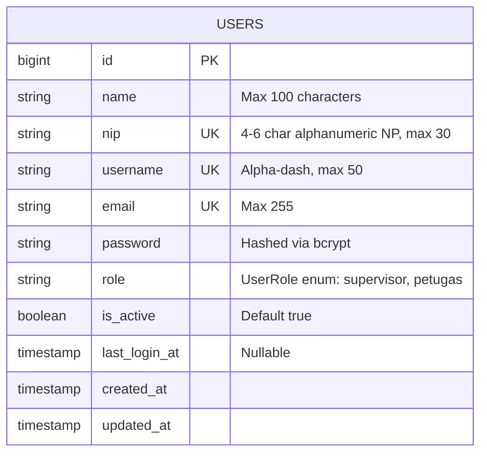

# Feature: Petugas Management & Role-Based Access Control (RBAC)

## Overview
This feature provides a unified administrative module for managing packaging operators and supervisors (*Data Petugas*) at PT Percetakan Dokumen Sekuriti. Built on Livewire 4 and Flux UI, it enables real-time search, filtering by role and active status, pagination, and full lifecycle management (create, update, status toggle, protected deletion) entirely within a single reactive interface (`/petugas`) using center modal dialogs. Role-based access control is enforced at both HTTP route and component levels via the `EnsureUserRole` middleware to restrict administrative operations exclusively to authorized Supervisor accounts.

---

## Architecture Diagram

```mermaid
flowchart TD
    Supervisor([Supervisor User]) -->|Navigates to /petugas| RouteWeb[Route /petugas]
    RouteWeb -->|Check Auth & Role:supervisor| Middleware[EnsureUserRole Middleware]
    Middleware -->|403 if Petugas / Redirect if Guest| DenyAccess[Access Denied / Login]
    Middleware -->|Authorized| PetugasIndex[App\\Livewire\\Petugas\\PetugasIndex]
    
    PetugasIndex -->|Live Search & Role/Status Filters| QueryUsers[Eloquent Query Users Table]
    QueryUsers --> TableView[Flux Data Table View]
    
    TableView -->|Click + Tambah Petugas| OpenCreateModal[openCreateModal -> Show petugas-form modal]
    TableView -->|Click Edit Data| OpenEditModal[openEditModal -> Populate state & Show modal]
    TableView -->|Click Toggle Status| ToggleStatus[toggleStatus -> Flip is_active & Toast]
    TableView -->|Click Hapus Akun| OpenDeleteModal[confirmDelete -> Show delete-confirm modal]
    
    OpenCreateModal -->|Submit Form| SaveAction[PetugasIndex::save]
    OpenEditModal -->|Submit Form| SaveAction
    SaveAction -->|Validation (NP, Username, Email, Password)| ValidateState{Valid?}
    ValidateState -->|No| InlineErrors[Render Inline Flux Errors]
    ValidateState -->|Yes| DatabaseWrite[(Database Users Table)]
    DatabaseWrite --> CloseModal[Close Modal & Dispatch Success Toast]
    
    OpenDeleteModal -->|Confirm Delete| DeleteAction[PetugasIndex::deleteUser]
    DeleteAction -->|Check Self-Delete & Historical Reports| IntegrityCheck{Allowed?}
    IntegrityCheck -->|No| ToastError[Dispatch Error Toast]
    IntegrityCheck -->|Yes| DeleteRecord[Delete User & Close Modal]
```

---

## Data Model



---

## Key Files

| Layer | File | Purpose |
|-------|------|---------|
| Middleware | `app/Http/Middleware/EnsureUserRole.php` | Enforces role-based route protection (`role:supervisor`) |
| Route Configuration | `bootstrap/app.php` | Registers the `role` middleware alias |
| Route Definitions | `routes/web.php` | Declares protected `/petugas` route |
| Livewire Component | `app/Livewire/Petugas/PetugasIndex.php` | State management, query filtering, form validation, and CRUD actions |
| Blade View | `resources/views/livewire/petugas/index.blade.php` | Flux data table, filters, create/edit modal, and delete confirmation dialog |
| Model | `app/Models/User.php` | Authenticatable user model with `UserRole` enum casting and role helper methods |
| Enum | `app/Enums/UserRole.php` | Defines `SUPERVISOR` and `PETUGAS` enum cases and display labels |
| Tests | `tests/Feature/Auth/RoleAuthorizationTest.php` | Pest tests for RBAC middleware and unauthorized access prevention |
| Tests | `tests/Feature/Petugas/PetugasIndexTest.php` | Pest tests for staff listing, live search, role/status filtering, and pagination |
| Tests | `tests/Feature/Petugas/PetugasCrudTest.php` | Pest tests for creation, edit, validation rules, status toggle, and self-delete protection |

---

## Flow Explanation

1. **Access Verification**: When a user attempts to access `/petugas`, `EnsureUserRole` middleware verifies whether the user is authenticated and holds the `supervisor` role. Unauthenticated requests are redirected to `/login`, while operators (`petugas` role) receive an HTTP 403 Forbidden response.
2. **Data Presentation & Reactive Filtering**: The `PetugasIndex` component queries the `users` table with optional real-time text matching against `name`, `nip`, `username`, and `email`, plus role and status dropdown filters. Updating search or filter criteria automatically resets pagination to the first page.
3. **Staff Creation & Modification**: Clicking "+ Tambah Petugas" or "Edit Data" triggers the centered Flux modal (`<flux:modal name="petugas-form">`). The component validates required unique constraints (ignoring the current user's ID during updates) and optional password updates. Passwords are encrypted using `Hash::make()` before persistence.
4. **Account Suspension & Deactivation**: Supervisors can toggle an operator's active status without deleting historical records. The system actively forbids self-deactivation of the currently authenticated supervisor account.
5. **Deletion & Integrity Protection**: Deleting an account requires explicit confirmation via `<flux:modal name="delete-confirm">`. The system prevents self-deletion and includes guardrails to protect accounts associated with historical production report documents.
6. **Instant User Feedback**: All successful operations trigger top-right Flux toast notifications (`Flux::toast()`) with humanized Indonesian feedback messages.

---

## Decisions & Trade-offs

- **Single-Surface Consolidation (Modal over Multi-Route)**: By avoiding separate routes like `/petugas/create` or `/petugas/{id}/edit`, supervisors can manage operators without losing their table search state or page position.
- **Direct Eloquent in Livewire**: In alignment with the project's pragmatic development rules, queries and model mutations are executed directly in `PetugasIndex` without redundant repository layers, optimizing maintainability and execution speed.
- **Role Middleware with Variadic Support**: `EnsureUserRole` supports variadic arguments (`role:supervisor,petugas`), allowing flexible reuse for future endpoints requiring multi-role permissions.

---

## Related

- [Authentication & Layout Shell](authentication-and-layout-shell.md)
- [ADR-002: Role-Based Access Control & Single-Surface Petugas Management](../decisions/002-role-based-access-control-and-single-surface-user-management.md)
- [Panduan Manajemen Data Petugas](../../user-docs/guides/panduan-manajemen-data-petugas.md)
- [Scrum Plan Phase 01: Foundation, Auth & User Management](../../scrum-planning/phase-01-foundation-auth-user-management.md)
- [Phase 01 UX Plan](../../scrum-planning/phase-01-ux-plan.md)
