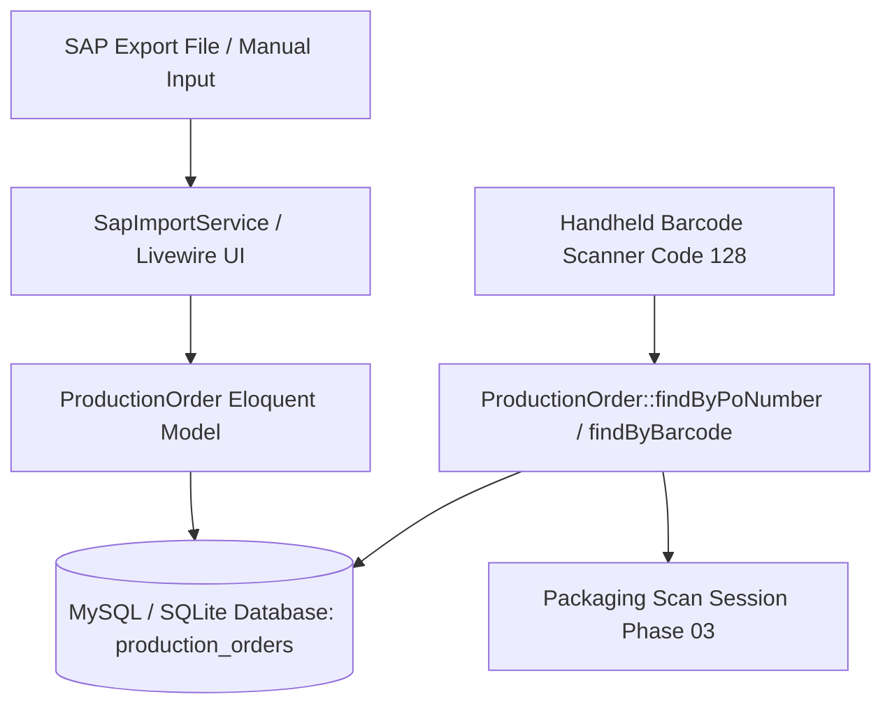
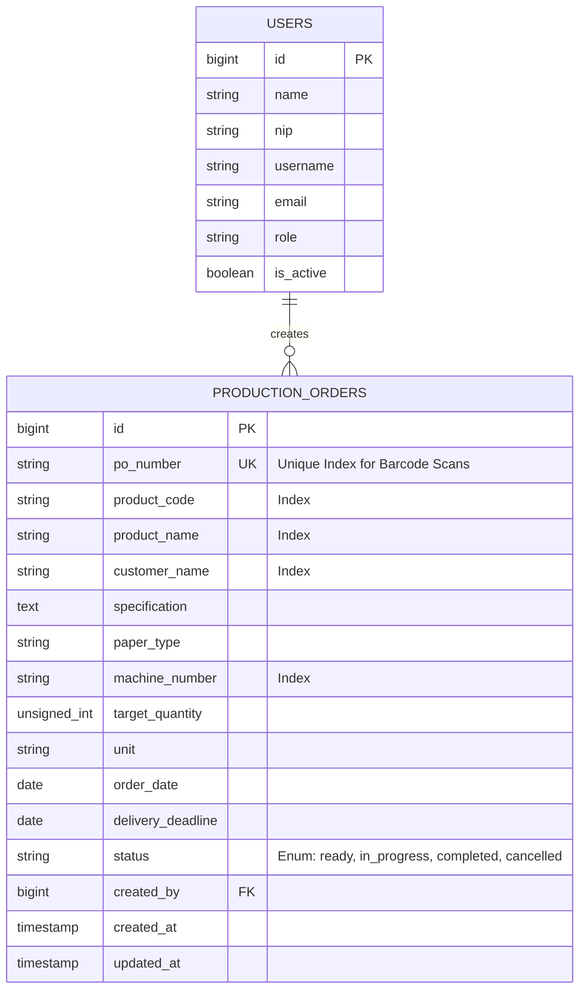

# Production Order Master Data Schema & Model

## Overview

The Production Order Master Data module (`production_orders`) forms the foundational data layer for Phase 02 (SAP Master Data Import) and Phase 03 (Barcode Scanning & Packaging Tracking). It persists production identity attributes—such as PO Number, product specifications, machine assignments, packaging target quantities, and delivery deadlines—while providing ultra-fast (<20ms) barcode lookups via indexed composite keys.

---

## Architecture Diagram

---

## Data Model

---

## Key Files

| Layer | File | Purpose |
|-------|------|---------|
| Migration | `database/migrations/2026_08_26_000002_create_production_orders_table.php` | Defines `production_orders` table schema, unique constraint on `po_number`, and composite indexes |
| Enum | `app/Enums/ProductionOrderStatus.php` | Backed string enum (`ready`, `in_progress`, `completed`, `cancelled`) with Indonesian labels and Flux UI badge colors |
| Model | `app/Models/ProductionOrder.php` | Eloquent model with casts, search scopes, creator relationships, and fast barcode lookup methods |
| Factory | `database/factories/ProductionOrderFactory.php` | Model factory with realistic security printing data and status states |
| Seeder | `database/seeders/ProductionOrderSeeder.php` | Seed initial realistic master orders for development and test scenarios |
| Unit Tests | `tests/Unit/Models/ProductionOrderTest.php` | Unit test suite covering casts, scopes, relationships, and edge cases |
| Unit Tests | `tests/Unit/Enums/ProductionOrderStatusTest.php` | Unit test suite covering status enum cases, labels, and badge colors |
| Feature Tests | `tests/Feature/MasterData/ProductionOrderSchemaTest.php` | Feature tests for table schema, <20ms lookup performance, and upsert handling |

---

## Flow Explanation

1. **Master Data Ingestion** — Data enters the system either through bulk SAP spreadsheet imports (`SapImportService`) or manual emergency entry via supervisor dialogs.
2. **Schema & Casting** — Eloquent casts date fields (`order_date`, `delivery_deadline`) to `CarbonInterface`, `target_quantity` to integer, and `status` to `ProductionOrderStatus` enum.
3. **High-Speed Barcode Lookup** — The packaging station scans physical job tickets. `ProductionOrder::findByPoNumber($barcode)` queries the unique indexed `po_number` column with sub-20ms latency.
4. **Lifecycle & Filtering** — Master data explorer and production dashboards query orders via scopes (`scopeSearch`, `scopeByStatus`, `scopeByMachine`, `scopeByDateRange`).

---

## Decisions & Trade-offs

- **Indexed `po_number` as Primary Barcode Lookup Key:** The shop-floor handheld scanner reads Code 128 barcodes containing PO numbers (e.g., `PO-2026-8891`). Placing a unique index on `po_number` ensures instant response times (<20ms) without full table scans.
- **Null-on-Delete Foreign Key (`created_by`):** Production orders represent permanent physical production batches. If a supervisor account is deactivated or deleted, master orders remain intact with `created_by = null`.
- **String Backed Status Enum:** Using `ProductionOrderStatus` enum with string backing (`ready`, `in_progress`, `completed`, `cancelled`) provides native database readability, simple Eloquent casting, and direct UI badge mapping.

---

## Related

- [ADR-003: Production Order Indexing and Schema Architecture](../decisions/003-production-order-indexing-and-schema-architecture.md)
- [Panduan Master Data Order Produksi](../../user-docs/guides/panduan-master-data-order-produksi.md)
- [Phase 02 Scrum Planning](../../scrum-planning/phase-02-sap-master-data-import.md)
