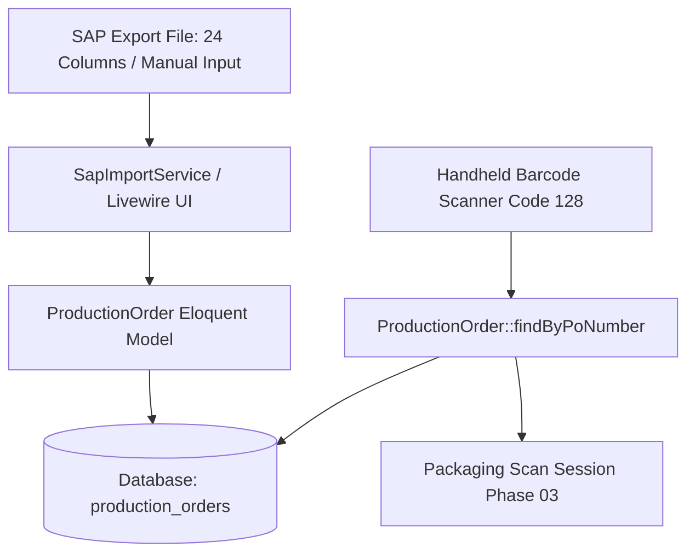

# Production Order Master Data Schema & Model

## Overview

The Production Order Master Data module (`production_orders`) forms the foundational data layer for Phase 02 (SAP Master Data Import) and Phase 03 (Barcode Scanning & Packaging Tracking). It persists 24 standard SAP ERP export attributes—including PO Number, OBC Number, Perso Type, Seri, 6 Production Cycle Dates, 12 Sheet/Quantity Metrics, Work Center, and Material Code—while providing ultra-fast (<20ms) barcode lookups via indexed unique keys.

---

## 24 SAP Header Column Mapping

| # | SAP Export Header | Database Column | Data Type | Description |
|---|---|---|---|---|
| 1 | `NO PO` | `po_number` | `string` (Unique Index) | **Primary Barcode Key (Code 128)** scanned at packaging stations |
| 2 | `No OBC` | `no_obc` | `string` (Index, Nullable) | Order Bukti Cetak number |
| 3 | `Perso / non Perso` | `perso_type` | `string` (Nullable) | Personalization category (`P` or `NP`) |
| 4 | `SERI` | `seri` | `string` (Nullable) | Product serial identifier |
| 5 | `TGL OBC` | `order_date` | `date` | Order issue date |
| 6 | `TGL JTempo` | `delivery_deadline` | `date` (Nullable) | Delivery due deadline |
| 7 | `TGL_PAKAI_BB` | `tgl_pakai_bb` | `date` (Nullable) | Raw material usage date |
| 8 | `TGL_CETAK` | `tgl_cetak` | `date` (Nullable) | Printing execution date |
| 9 | `TGL_VERIFIKASI` | `tgl_verifikasi` | `date` (Nullable) | Quality control verification date |
| 10 | `Tanggal Kemas` | `packaging_date` | `date` (Nullable) | Packaging target date |
| 11 | `QTY PESAN` | `target_quantity` | `unsignedInteger` | Clean customer order quantity |
| 12 | `RENCET` | `rencet_quantity` | `unsignedInteger` | Planned printing sheets including inschiet |
| 13 | `JML_BB (LK)` | `jml_bb` | `unsignedInteger` | Raw material base sheets |
| 14 | `JLM_CD (LK)` | `jml_cd` | `unsignedInteger` | Spare / inschiet buffer sheets |
| 15 | `TOTAL_BB (LK)` | `total_bb` | `unsignedInteger` | Total raw material sheets (`JML_BB + JLM_CD`) |
| 16 | `JML_CETAK` | `jml_cetak` | `unsignedInteger` | Physical printed sheets |
| 17 | `BAIK_VERIFIKASI` | `baik_verifikasi` | `unsignedInteger` | Good sheets verified |
| 18 | `RUSAK_VERIFIKASI` | `rusak_verifikasi` | `unsignedInteger` | Defect sheets (afval) verified |
| 19 | `HASIL BAIK DIJADIKAN HCTS` | `hcts_baik` | `unsignedInteger` | Good sheets converted to HCTS rework |
| 20 | `TOTAL_HCTS` | `total_hcts` | `unsignedInteger` | Accumulated HCTS sheets |
| 21 | `KEMAS` | `kemas_quantity` | `unsignedInteger` | Quantity packaged |
| 22 | `KIRIM` | `kirim_quantity` | `unsignedInteger` | Quantity shipped |
| 23 | `WORK CENTER` | `machine_number` | `string` (Index, Nullable) | Machine / Work Center ID (e.g. `HDR-1001`) |
| 24 | `Material` | `product_name` / `product_code` | `string` (Index) | Material description and SKU identifier |

---

## Architecture Diagram

---

## Key Files

| Layer | File | Purpose |
|-------|------|---------|
| Migration | `database/migrations/2026_08_26_000002_create_production_orders_table.php` | Defines `production_orders` table with 24 SAP columns, unique index on `po_number`, and composite indexes |
| Enum | `app/Enums/ProductionOrderStatus.php` | Backed string enum (`ready`, `in_progress`, `completed`, `cancelled`) with Indonesian labels and Flux UI badge colors |
| Model | `app/Models/ProductionOrder.php` | Eloquent model with casts for all 6 dates, numeric metrics, scopes, and barcode lookup |
| Factory | `database/factories/ProductionOrderFactory.php` | Factory generating realistic SAP production data (inschiet calculations, work centers, dates) |
| Seeder | `database/seeders/ProductionOrderSeeder.php` | Seed initial realistic master orders for development |
| Unit Tests | `tests/Unit/Models/ProductionOrderTest.php` | Unit test suite covering casts, scopes, relationships, and edge cases |
| Feature Tests | `tests/Feature/MasterData/ProductionOrderSchemaTest.php` | Feature tests for table schema, real SAP row parsing, lookup speed (<20ms), and upsert handling |

---

## Decisions & Trade-offs

- **Indexed `po_number` as Primary Barcode Lookup Key:** The shop-floor handheld scanner reads Code 128 barcodes containing PO numbers (e.g., `3000189509`). Placing a unique index on `po_number` ensures instant response times (<20ms) without full table scans.
- **Support for Dash (`-`) and Dot Thousand Separator in SAP:** Numerical metrics in SAP often contain dots (e.g. `2.068`) or dashes for zero (e.g. `-`). The model integer casts and schema guarantee clean integer storage.
- **Null-on-Delete Foreign Key (`created_by`):** Production orders represent permanent physical production batches. If a supervisor account is deactivated or deleted, master orders remain intact with `created_by = null`.
