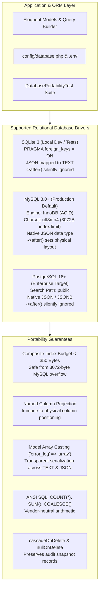
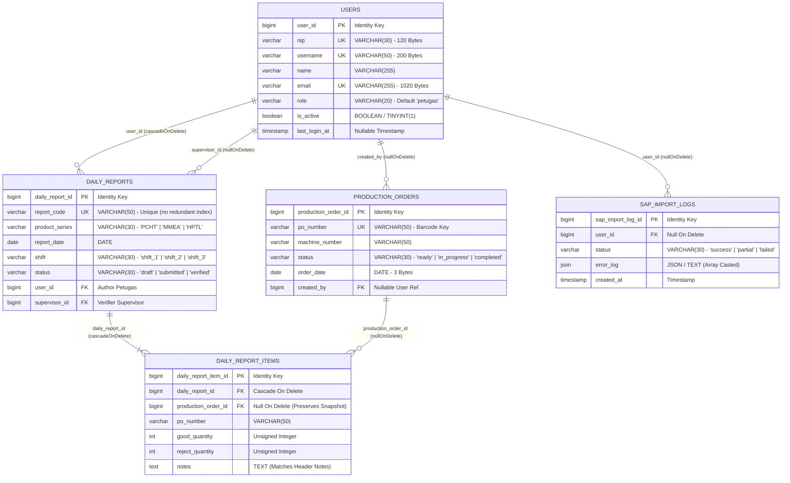

# Production Portability & Multi-Database Verification

## Overview

This module establishes and verifies cross-database portability for the **scan-produksi** application across SQLite 3 (local development and in-memory automated testing), MySQL 8.0+ (on-premise production target in the factory packaging plant), and PostgreSQL 16+ (enterprise high-availability alternative) for **Phase 06 US-6.4**. It validates that physical column order differences from migration `->after()` clauses cause zero runtime failure, guarantees all composite indexes adhere to the MySQL `utf8mb4` 3072-byte prefix length limit, ensures JSON serialization/deserialization for `sap_import_logs.error_log` functions consistently across drivers, and guarantees ANSI SQL compliance for all real-time aggregation queries.

## Architecture Diagram

## Data Model

## Key Files

| Layer | File | Purpose |
|-------|------|---------|
| Configuration | `config/database.php` | Connection profiles for SQLite, MySQL (strict, utf8mb4), PostgreSQL, and SQL Server |
| Migration | `database/migrations/0001_01_01_000000_create_users_table.php` | Users identity schema with `user_id` PK |
| Migration | `database/migrations/2026_08_26_000001_add_role_nip_username_status_to_users_table.php` | Portability-verified `->after()` column additions |
| Migration | `database/migrations/2026_08_26_000002_create_production_orders_table.php` | Master order schema with bounded composite indexes (<350 bytes) |
| Migration | `database/migrations/2026_08_26_000003_create_sap_import_logs_table.php` | Audit log schema with portable `json('error_log')` |
| Migration | `database/migrations/2026_08_26_000004_create_daily_reports_and_items_tables.php` | Session header and item schema with FK cascade/null rules |
| Migration | `database/migrations/2026_08_26_000005_add_verified_at_and_reject_to_daily_reports_tables.php` | Extended audit columns added with safe `->after()` positioning |
| Model | `app/Models/SapImportLog.php` | Eloquent model with `'error_log' => 'array'` casting |
| Test | `tests/Feature/MasterData/DatabasePortabilityTest.php` | Automated 6-test suite verifying multi-database portability contracts |
| Architecture Doc | `docs/architecture.md` | Section 6: Comprehensive driver compatibility matrix & `.env` configuration |

## Flow Explanation

Data and schema operations maintain full cross-database compatibility through the following pipeline:

1. **Environment Configuration** — The deployment environment sets `DB_CONNECTION` in `.env` (`sqlite` for local dev/testing, `mysql` for factory production, or `pgsql` for enterprise cloud).
2. **Schema Migration Execution** — Laravel SchemaGrammar translates Blueprint definitions:
   - On MySQL, `->after()` positions new columns physically; composite indexes are validated against InnoDB's 3072-byte ceiling; `json()` maps to native MySQL JSON.
   - On PostgreSQL and SQLite, `->after()` is safely ignored without errors; columns append to the end; `json()` maps to PostgreSQL JSON or SQLite TEXT.
3. **Application Query & Persistence** — All application queries use Eloquent named projections (`select(['daily_report_id', ...])`) or ANSI-standard SQL aggregations (`COUNT(*)`, `COALESCE(SUM(...), 0)`), completely isolating business logic from physical column offsets or vendor-specific SQL extensions.
4. **Audit Log Serialization** — When saving import errors in `SapImportService`, array structures are automatically serialized into JSON. On retrieval, Eloquent casts the database value into a native PHP associative array regardless of the underlying driver storage format.
5. **Referential Cleanup** — Foreign key cascades automatically clean up dependent daily report items on report deletion, while `nullOnDelete` protects audit snapshots on `production_orders` and `users`.

## API Endpoints (if applicable)

N/A (This is a core database architecture and schema persistence layer verification).

## Decisions & Trade-offs

- **Why Backed Enums as Bounded Strings instead of Native DB ENUMs?**
  MySQL native `ENUM` requires costly table locks during `ALTER TABLE` to append new values, PostgreSQL requires separate composite types (`CREATE TYPE ... AS ENUM`), and SQLite lacks enum support entirely. Storing enums as bounded `VARCHAR(20-30)` validated by PHP Backed Enums provides 100% portability, zero-downtime additions, and full type safety.
- **Why Explicit Lengths on All VARCHAR Columns?**
  Default `VARCHAR(255)` under MySQL `utf8mb4` consumes 1020 bytes per column in an index prefix. Three unconstrained columns in a composite index would consume 3060 bytes, dangerously close to the 3072-byte limit. Explicit bounding (`VARCHAR(30)` or `VARCHAR(50)`) keeps composite indexes under 350 bytes.
- **Why Model-Level JSON Casting instead of Raw DB JSON Functions?**
  SQLite does not natively parse MySQL-specific JSON functions like `JSON_EXTRACT` or `->>`. Using Eloquent's `'error_log' => 'array'` casting guarantees identical serialization, deserialization, and query behavior across all drivers.

## Related

- [docs/architecture.md](../../architecture.md) — System & Database Architecture Document (Section 6)
- [docs/dev-docs/decisions/011-cross-database-portability-and-migration-standards.md](../decisions/011-cross-database-portability-and-migration-standards.md) — ADR-011: Cross-Database Portability and Migration Standards
- [docs/dev-docs/features/dual-path-primary-key-and-model-alignment.md](dual-path-primary-key-and-model-alignment.md) — US-6.1 Primary Key Architecture
- [docs/dev-docs/features/schema-decluttering-and-data-dictionary.md](schema-decluttering-and-data-dictionary.md) — US-6.2 Schema Decluttering & String Bounds
- [docs/dev-docs/features/transactional-hardening-and-concurrency-protection.md](transactional-hardening-and-concurrency-protection.md) — US-6.3 ACID Transactions & Concurrency
- [docs/scrum-planning/phase-06-database-architecture-refinement-and-academic-alignment.md](../../scrum-planning/phase-06-database-architecture-refinement-and-academic-alignment.md) — Phase 06 Scrum Plan (US-6.4)
