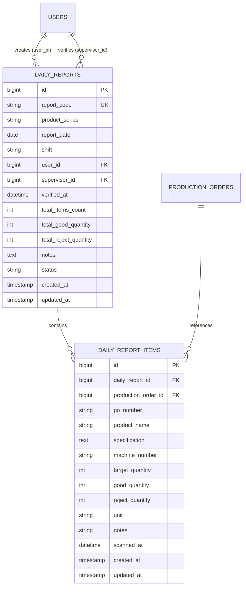

# Daily Production Report Management, Verification & Export Architecture

## Overview
The Report Management, Verification & Export module provides a comprehensive lifecycle management interface for daily production packaging records. It enables operators and supervisors to search and filter archived reports across product series, shifts, and date presets, inspect detailed order breakdowns with verification audit trails, perform authorized item corrections within a 24-hour window, verify and seal completed reports under supervisor authority, and export production batches into streamable Excel spreadsheets and print-ready PDF/A4 documents.

## Architecture Diagram

```mermaid
flowchart TD
    A[Supervisor / Petugas] -->|Navigates /reports| B[ReportIndex Livewire Component]
    B -->|Filter: Series, Shift, Date, Status| C[(daily_reports & items)]
    
    B -->|Click Row Detail| D[ReportDetail Component /reports/{code}]
    D -->|Supervisor Action: Verify| E[DailyReportPolicy::verify]
    E -->|Approved| F["Atomic UPDATE where status=SUBMITTED → VERIFIED"]
    F -->|0 rows affected| F2[Warning toast no change]
    
    D -->|Supervisor Action: Delete| G[DailyReportPolicy::delete]
    G -->|Approved| H[DB::transaction Cascade Delete Items & Restore Orders]
    
    B -->|Click Edit Button| I[EditReport Component /reports/{code}/edit]
    I -->|Policy Check: <24h & Own Report or Supervisor| J[DB::transaction Recalculate 3 Aggregates]
    J -->|Save Changes| K[Update daily_reports & daily_report_items]
    
    B -->|Trigger Export Modal / Export Route| L[ReportExportController::export]
    L -->|OpenSpout XLSX Streaming| M[Download .xlsx file]
    
    D -->|Click Cetak / PDF Download| N[ReportExportController::pdf / reports.print]
    N -->|A4 Print-Optimized Layout| O[Standard Physical Document]
```

## Data Model



## Key Files

| Layer | File | Purpose |
|---|---|---|
| Livewire Component | `app/Livewire/Reports/ReportIndex.php` | Handles multi-criteria report filtering, date range presets, live search, export trigger, and deletion dispatch |
| Livewire Component | `app/Livewire/Reports/ReportDetail.php` | Displays report summary metrics, audit trail banner, itemized order table, and supervisor action modals |
| Livewire Component | `app/Livewire/Reports/EditReport.php` | Form for editing item quantities (good & reject), supplemental PO scanning, and notes modification with policy checks |
| Controller | `app/Http/Controllers/ReportExportController.php` | Memory-safe OpenSpout XLSX streaming export and printable PDF document response generator |
| Policy | `app/Policies/DailyReportPolicy.php` | Enforces fine-grained role-based access control (RBAC), 24-hour edit windows, and supervisor authorization |
| Blade View | `resources/views/livewire/reports/index.blade.php` | Single-surface report archive table with responsive filters, KPI stat badges, and confirmation dialogs |
| Blade View | `resources/views/livewire/reports/show.blade.php` | Detailed report view with verification status ribbons, metadata grid, and order list |
| Blade View | `resources/views/livewire/reports/edit.blade.php` | Full-width editable form with recalculation cards, supplemental item lookup, and removal controls |
| Printable View | `resources/views/reports/print.blade.php` | Standardized A4 portrait physical document layout with official company header and two-party sign-off boxes |

## Flow Explanation

1. **Archive Exploration & Filtering**: Users access `/reports` and filter archives by product series, shift, report status, or quick date presets (`Hari Ini`, `Kemarin`, `7 Hari Terakhir`, `Bulan Ini`). Live search queries match both `report_code` and associated `po_number` via subqueries.
2. **Audit & Verification**: When viewing `/reports/{report_code}`, supervisors evaluate production output figures against target specs. Clicking "Verifikasi Laporan" prompts an official confirmation modal. Persistence uses an atomic `UPDATE ... WHERE status = submitted` so only submitted reports become `VERIFIED` (draft or already-verified rows yield a warning toast and no state change). Once verified, editing is strictly locked.
3. **Report Correction (24-Hour Window)**: Petugas can edit submitted reports they authored within 24 hours of creation; supervisors can edit any unverified report at any time. The edit form dynamically updates good and reject quantities, appends supplemental POs, removes mistaken entries, and recomputes all three summary aggregates inside `DB::transaction` on save.
4. **Memory-Efficient XLSX Streaming**: The export controller leverages `OpenSpout` to stream rows directly to client downloads without buffering thousands of records into server memory.

## Decisions & Trade-offs

- **OpenSpout over PhpSpreadsheet**: OpenSpout uses negligible memory buffers ($<10\text{MB}$) regardless of dataset size, preventing out-of-memory errors on large batch exports.
- **Single-Surface Routing**: Followed the UX Plan hard constraints by keeping report management under `/reports`, `/reports/{code}`, and `/reports/{code}/edit` without fragmented sub-pages.
- **Authorization via Dedicated Policy**: Implemented `DailyReportPolicy` adhering to Laravel standards while encapsulating time-sensitive business logic (24h edit window).

## Related
- [ADR-008: Daily Report Verification and Streaming Export Architecture](../decisions/008-daily-report-verification-and-streaming-export-architecture.md)
- [ADR-010: Database Schema Refinement and Transactional Hardening](../decisions/010-database-schema-refinement-and-academic-pk-conventions.md)
- [Transactional Hardening & Concurrency Protection](./transactional-hardening-and-concurrency-protection.md)
- [User Guide: Panduan Arsip Laporan, Verifikasi & Cetak](../../user-docs/guides/panduan-arsip-laporan-verifikasi-dan-cetak.md)
