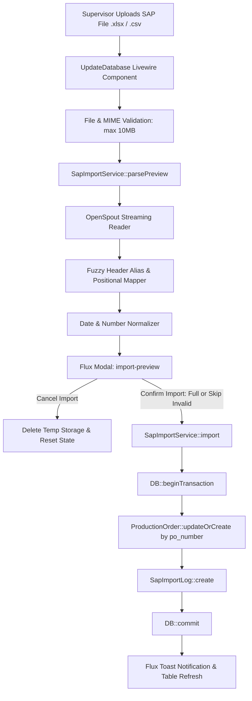
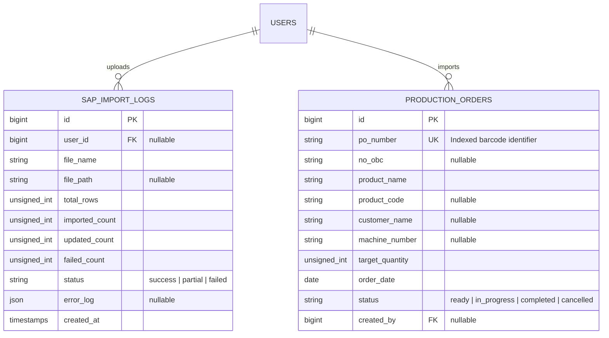

# SAP File Import & Modal Preview (Update Database)

## Overview

The SAP File Import & Modal Preview module (`/update-database`) enables unit supervisors to update the production master database in bulk using daily SAP ERP export files (`.xlsx`, `.xls`, `.csv`). Built with Livewire 4, Flux UI, and OpenSpout streaming readers, the module provides low-memory parsing, intelligent multi-alias header mapping, normalization of dates and numbers, interactive modal validation previews (US-2.3), atomic database transactions with upsert semantics, and audit history logs (`sap_import_logs`).

---

## Architecture Diagram

---

## Data Model

---

## Key Files

| Layer | File | Purpose |
|-------|------|---------|
| Migration | `database/migrations/2026_08_26_000003_create_sap_import_logs_table.php` | Creates `sap_import_logs` table for tracking audit history of SAP uploads |
| Model | `app/Models/SapImportLog.php` | Eloquent model representing import audit records with status badges and user relationship |
| Factory | `database/factories/SapImportLogFactory.php` | Testing factory with success, partial, and failed states |
| Service | `app/Services/SapImportService.php` | Streaming spreadsheet parser (OpenSpout), header alias mapping, preview builder, upsert executor, and template generator |
| Livewire Component | `app/Livewire/MasterData/UpdateDatabase.php` | Single-surface controller managing tabs, file uploads, preview state, and import triggers |
| Blade View | `resources/views/livewire/master-data/update-database.blade.php` | Responsive UI containing upload zone, summary badges, preview modal (`<flux:modal name="import-preview">`), and audit history table |
| Feature Test | `tests/Feature/MasterData/SapImportTest.php` | 17 comprehensive Pest feature tests covering XLSX/CSV parsing, preview verification, partial imports, upserts, role authorization, and downloads |

---

## Flow Explanation

1. **File Selection & Immediate Validation:**
   - Supervisor drags or selects an SAP export file on `/update-database`.
   - The Livewire lifecycle hook `updatedFile()` validates file type (`xlsx,xls,csv,txt`) and file size (max 10MB).
   - The file is saved to temporary private storage (`sap-temp/`).

2. **Parsing & Preview Generation (US-2.3):**
   - `SapImportService::parsePreview()` initializes an OpenSpout streaming reader.
   - Headers are mapped against canonical alias dictionaries (e.g. `No PO`, `NO PO`, `Order Number`, `po_number`).
   - Dates (`m/d/Y`, `d/m/Y`, `Y-m-d`, numeric serials) and numerical metrics (dots as thousand separators, `-` as 0) are normalized.
   - The first 20 sample rows are formatted into a preview table, invalid rows are flagged with Indonesian error descriptions, and `<flux:modal name="import-preview">` is opened.

3. **User Decision & Confirmation:**
   - If all rows are valid, the supervisor clicks **"Simpan Semua ke Database"**.
   - If some rows are missing required fields, the supervisor clicks **"Lewati Baris Error & Simpan Baris Valid"**, or clicks **"Batal Impor"** to abort.

4. **Transaction-Safe Upsert & Audit Trail (US-2.2):**
   - `SapImportService::import()` wraps execution in `DB::beginTransaction()`.
   - Each valid row is persisted via `ProductionOrder::updateOrCreate(['po_number' => $poNumber], [...])`.
   - `SapImportLog` is recorded with counters for total, new, updated, and skipped rows.
   - Temporary upload files are deleted, the modal is closed, and a Flux toast feedback message is dispatched.

---

## Decisions & Trade-offs

- **Server-Side Streaming via OpenSpout:** Rather than loading large Excel files into server RAM with DOM-based libraries (like PhpSpreadsheet), OpenSpout streams rows one at a time. This keeps memory usage near zero (<5MB) even when parsing 10,000+ row exports.
- **Single Page Consolidation (`/update-database`):** In strict accordance with the Phase 02 UX Plan, all upload functions, download template actions, preview modals, and master data explorer tabs reside on a single consolidated route without URL fragmentation.
- **Upsert Semantics (`updateOrCreate`):** SAP exports are frequently re-uploaded across shifts with updated quantities or corrected specs. Matching existing records by `po_number` prevents database duplication errors.
- **Indonesian User Experience:** All error messages (e.g. *"Nomor PO tidak boleh kosong"*) are formatted in polite, actionable Indonesian rather than leaking raw SQL or parser exceptions.
