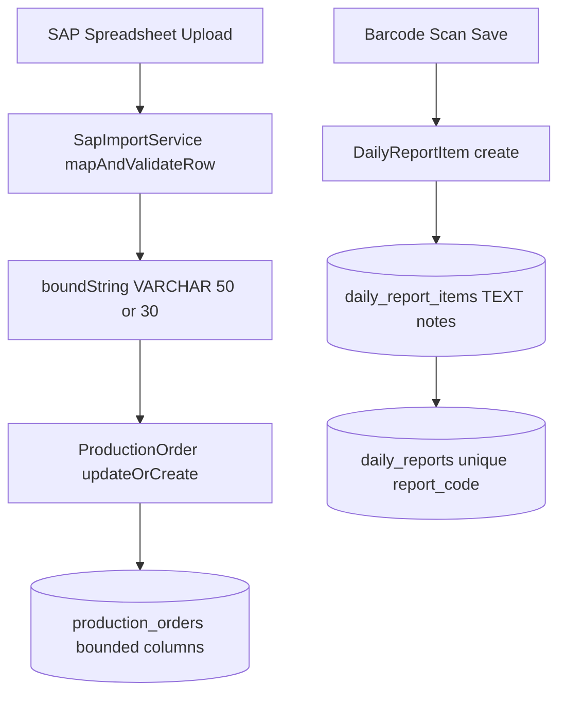
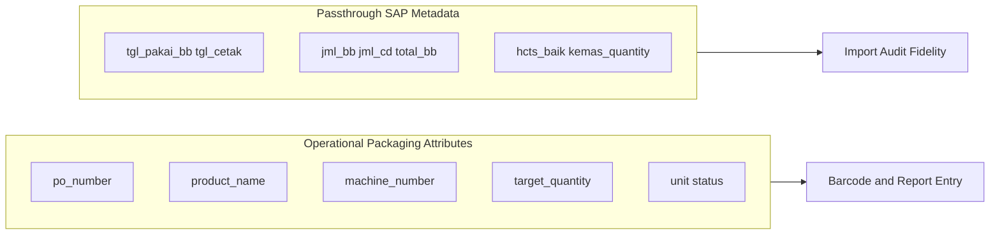
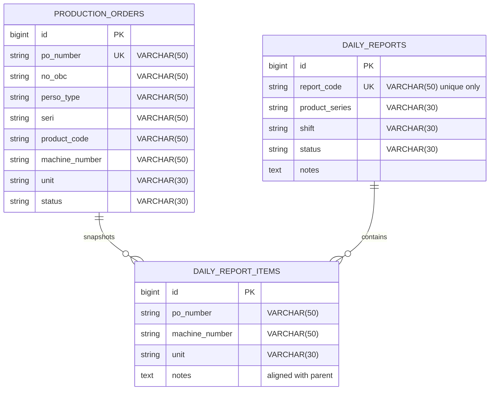

# Schema Decluttering, String Bounds & Data Dictionary

## Overview

This module cleans the physical database schema for Phase 06 US-6.2: remove the redundant B-Tree index on `daily_reports.report_code`, widen `daily_report_items.notes` from `VARCHAR(255)` to `TEXT` to match the parent report notes column, apply explicit bounded `VARCHAR` lengths on indexed lookup columns to reduce MySQL `utf8mb4` index memory pressure, document the `production_orders` data dictionary split between Operational Packaging Attributes and Passthrough SAP Metadata, and harden `SapImportService` so overlong spreadsheet cells are truncated before upsert.

## Architecture Diagram

## Data Model

## Key Files

| Layer | File | Purpose |
|-------|------|---------|
| Migration | `database/migrations/2026_08_26_000002_create_production_orders_table.php` | Bounded VARCHAR lengths + data dictionary comments |
| Migration | `database/migrations/2026_08_26_000004_create_daily_reports_and_items_tables.php` | Unique-only `report_code`, TEXT item notes, bounded item strings |
| Model | `app/Models/ProductionOrder.php` | PHPDoc data dictionary (Operational vs Passthrough) |
| Service | `app/Services/SapImportService.php` | `boundString()` sanitization before upsert |
| Feature Tests | `tests/Feature/MasterData/SchemaDeclutteringAndBoundsTest.php` | Index, TEXT notes, bounds, SAP import validation |

## Flow Explanation

1. **User triggers** — Supervisor imports a SAP spreadsheet, or an operator saves a scanned line with optional notes.
2. **Request handling** — `SapImportService::mapAndValidateRow()` trims and bounds string fields (`po_number`, `no_obc`, `perso_type`, `seri`, `product_code`, `machine_number`, `unit`) before persistence.
3. **Business logic** — Eloquent writes land in schema columns sized for MySQL `utf8mb4` index pages. Item notes use `TEXT` so long operator remarks are not truncated at 255 characters. `report_code` relies on a single unique index.
4. **Response** — Import preview / upsert succeeds without MySQL 1406 data-too-long errors for runaway cells; report entry stores full notes.

## API Endpoints (if applicable)

None found — schema and import/service hardening only; existing Livewire routes unchanged (`database.update`, `reports.entry`, `reports.session`).

## Decisions & Trade-offs

- **Why edit create migrations instead of additive alter migrations?** Phase 06 targets a pre-production academic schema; scrum US-6.2 explicitly adjusts the create migration files. Local/dev databases use `migrate:fresh`.
- **Why truncate in `SapImportService` rather than fail the row?** Real SAP exports occasionally contain padded cells; generous bounds (50/30) already exceed typical PO lengths (10–12 digits). Soft truncation preserves import throughput while protecting MySQL strict mode.
- **Why keep flat SAP columns?** Retaining Passthrough SAP Metadata preserves one-pass spreadsheet import performance and audit fidelity; categorization is documentary rather than a physical table split.

## Related

- [ADR-010: Database Schema Refinement, Academic Primary Key Conventions, and Transactional Hardening](../decisions/010-database-schema-refinement-and-academic-pk-conventions.md)
- [Production Order Master Data](./production-order-master-data.md)
- [SAP File Import & Modal Preview](./sap-file-import-and-preview.md)
- [Transactional Hardening & Concurrency Protection](./transactional-hardening-and-concurrency-protection.md)
- [System Architecture — Redundant Indexes & Data Types](../../architecture.md)
