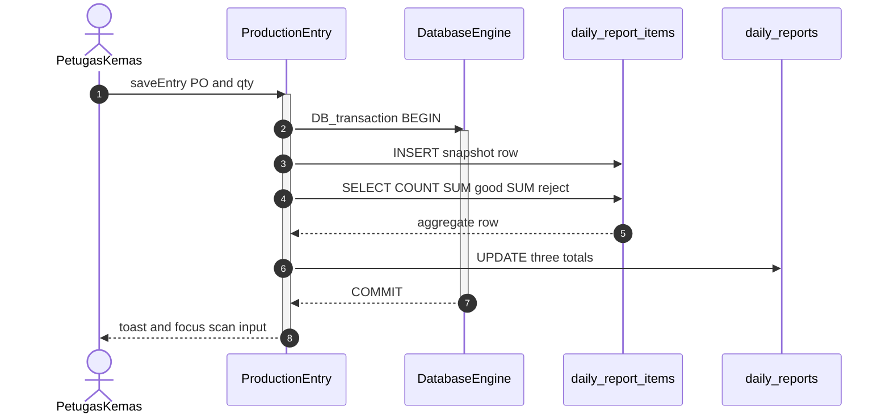
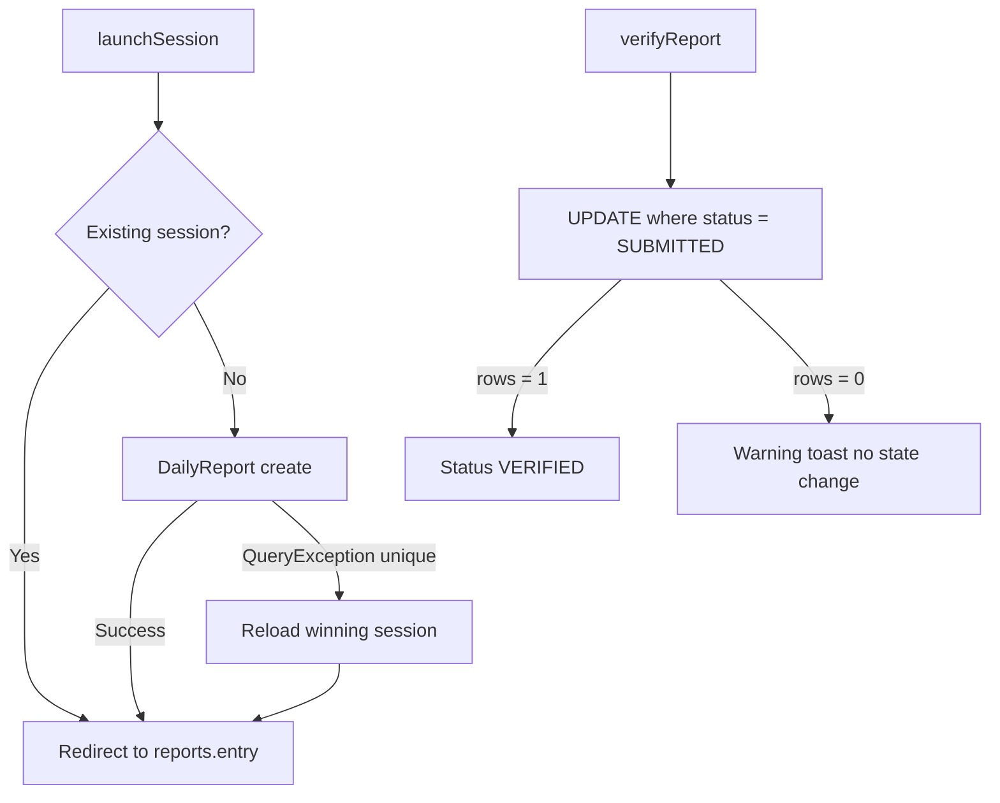
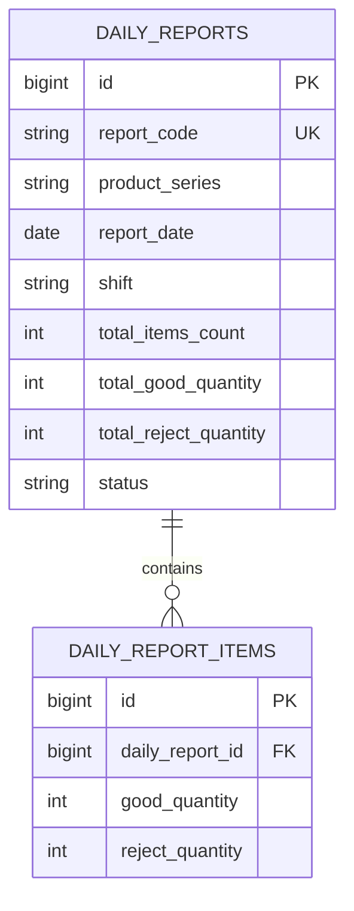

# Transactional Hardening & Concurrency Protection for Barcode Scanning

## Overview
This module hardens the daily production report write path so barcode scans, aggregate recalculation, concurrent session launches, and supervisor verification never leave the database in a drifted or invalid state. Item inserts and header totals run inside ACID transactions; session creation recovers from TOCTOU races on the composite unique key; verification uses an atomic status precondition update.

## Architecture Diagram

## Data Model

Composite unique constraint on `daily_reports (product_series, report_date, shift)` is the concurrency boundary for session creation.

## Key Files

| Layer | File | Purpose |
|-------|------|---------|
| Livewire Component | `app/Livewire/Reports/ProductionEntry.php` | `DB::transaction` around save/update/delete; atomic `refreshTotals()` with three aggregates |
| Livewire Component | `app/Livewire/Reports/EditReport.php` | Transactional batch correction + shared `refreshTotals()` |
| Livewire Component | `app/Livewire/Reports/ReportSessionLauncher.php` | `QueryException` catch for TOCTOU duplicate session |
| Livewire Component | `app/Livewire/Reports/ReportDetail.php` | Preconditioned verify update; transactional delete |
| Feature Tests | `tests/Feature/Reports/ReportConcurrencyAndTransactionTest.php` | Aggregate sync, rollback, race redirect, verify precondition |

## Flow Explanation

1. **User triggers** — Operator confirms quantity after a barcode scan (`saveEntry`), edits an inline qty, deletes a row, saves an edit form, launches a session, or verifies a report.
2. **Request handling** — Livewire validates auth/status guards before touching the database.
3. **Business logic** — Writes that mutate items and header totals run inside `DB::transaction()`. Totals come from one `selectRaw` computing `COUNT(*)`, `SUM(good_quantity)`, and `SUM(reject_quantity)`. Session create catches unique-key `QueryException` and redirects to the winning row. Verify only updates rows still in `submitted`.
4. **Response** — Success toast / redirect, or a warning toast when precondition fails; never an unhandled SQL error for duplicate sessions.

## API Endpoints (if applicable)

None found — this is Livewire server-action hardening on existing named routes (`reports.entry`, `reports.session`, `reports.show`, `reports.edit`).

## Decisions & Trade-offs

- **Why `DB::transaction` in the Livewire component?** Keeps the write boundary next to the scan loop without introducing a Service/Repository layer for a two-step insert+aggregate.
- **Why `try/catch QueryException` instead of only `firstOrCreate`?** Session creation also assigns a generated `report_code` and authorship metadata; catch-and-redirect preserves the early-check UX while surviving true concurrent inserts.
- **Why precondition `where status = submitted` on verify?** Prevents draft or already-verified reports from being sealed if two supervisors act at once.

## Related

- [ADR-010: Database Schema Refinement, Academic Primary Key Conventions, and Transactional Hardening](../decisions/010-database-schema-refinement-and-academic-pk-conventions.md)
- [High-Speed Continuous Barcode Scanning](./continuous-barcode-scan-and-inline-production-entry.md)
- [Daily Production Report Session](./daily-production-report-session.md)
- [Report Management, Verification & Export](./report-management-verification-and-export.md)
- [System Architecture — Concurrency Control](../../architecture.md)
